# Business Process & Use Case — F&B POS & Inventory
> **Versi:** 3.0 (Baseline final) | **Tanggal:** 2026-10-25 | **Status:** Disetujui
> **Referensi:** PRD v3.0 · SRS v3.0 · **Penanda:** `[R1.1]` rilis Januari 2027 · `[P2]` Phase 2
> **Cakupan:** 4 proses core + proses Purchase (BP-05), 40 use case Phase 1 (7 di antaranya `[R1.1]`) + 6 use case Midtrans `[P2]`.

---

## 1. Business Process (TO-BE)

### 1.1 Daftar Proses
| ID | Proses | Aktor | Fitur | BR |
|----|--------|-------|-------|----|
| BP-01 | Penjualan & Pembayaran | Cashier, Sistem, Kitchen | F-07, F-08, F-09, F-14 | BR-001, 005, 007, 008, 009, 011, 021, 036 |
| BP-02 | Refund | Manager/Owner, Sistem | F-10 | BR-012, 035 |
| BP-03 | Shift & Rekonsiliasi Kas | Cashier, Sistem | F-06 | BR-002, 003, 004, 026 |
| BP-04 | Siklus Stok | Inventory, Kitchen, Manager, Sistem | F-11, F-12, F-13 | BR-009, 016, 017 |

### 1.2 BP-01 Penjualan & Pembayaran
**Pemicu:** pelanggan memesan. **Hasil akhir:** order `COMPLETED`, stok terpotong, struk tercetak, antrian dapur `NEW`.

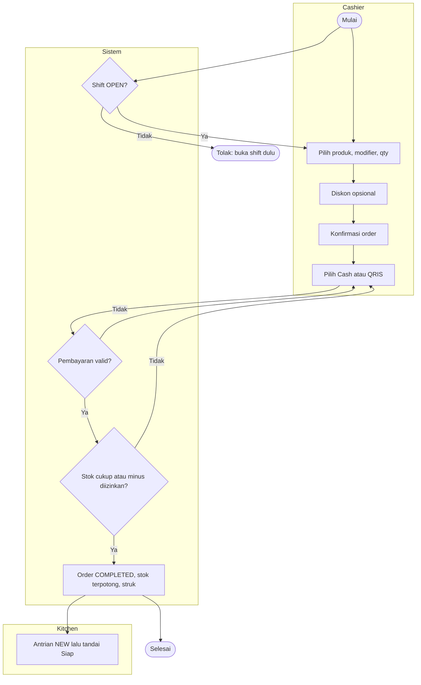
| Titik keputusan | Aturan | BR |
|-----------------|--------|----|
| Shift OPEN? | Kasir punya shift `OPEN` di outlet | BR-001 |
| Pembayaran valid? | Cash `tendered ≥ total`; QRIS nominal = total; `Idempotency-Key` baru | BR-007, BR-008 |
| Stok cukup? | Jika kurang dan `allow_negative_stock = false` → tolak dengan daftar bahan | BR-011 |

**Exception:** jaringan putus saat bayar → retry dengan key sama, hasil sama, stok tidak terpotong dua kali. Order dibatalkan sebelum bayar → `CANCELLED`, tanpa movement stok.

### 1.3 BP-02 Refund
**Pemicu:** pelanggan meminta pengembalian. **Hasil akhir:** order `REFUNDED`, kas keluar tercatat, stok kembali bila dipilih.

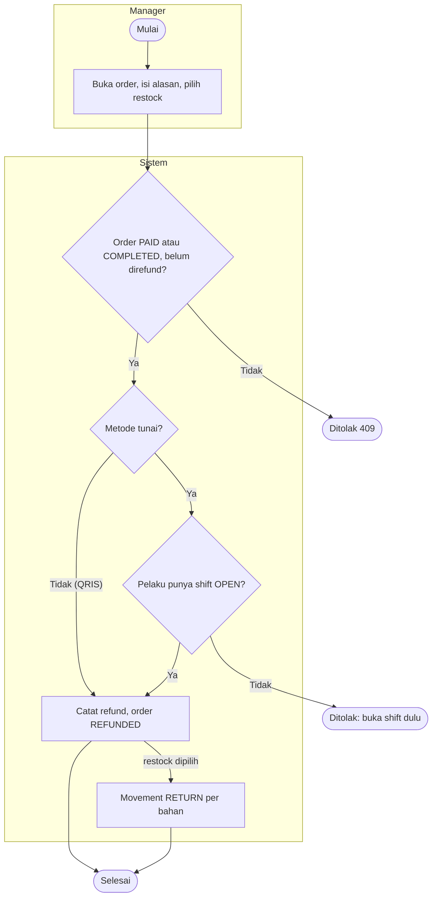
**Exception:** refund QRIS hanya dicatat di sistem; pengembalian dana dilakukan manual di luar sistem.

### 1.4 BP-03 Shift & Rekonsiliasi Kas
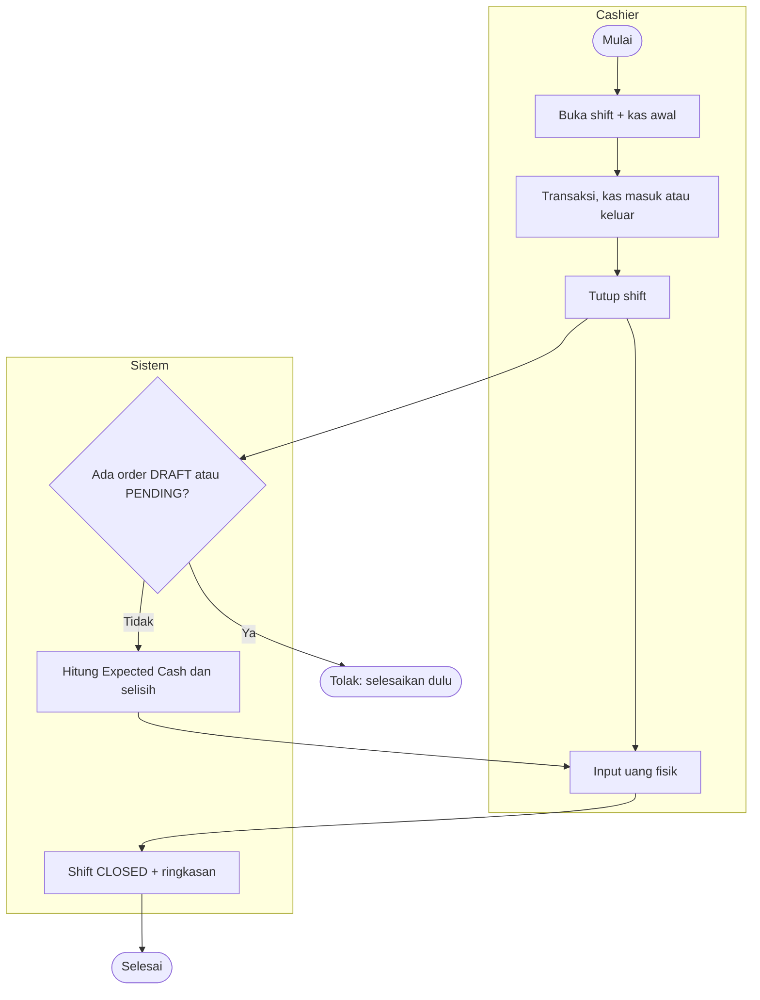
**Peringatan:** shift terbuka > 24 jam menampilkan peringatan saat dibaca; tidak ditutup otomatis (BR-026).

### 1.5 BP-04 Siklus Stok
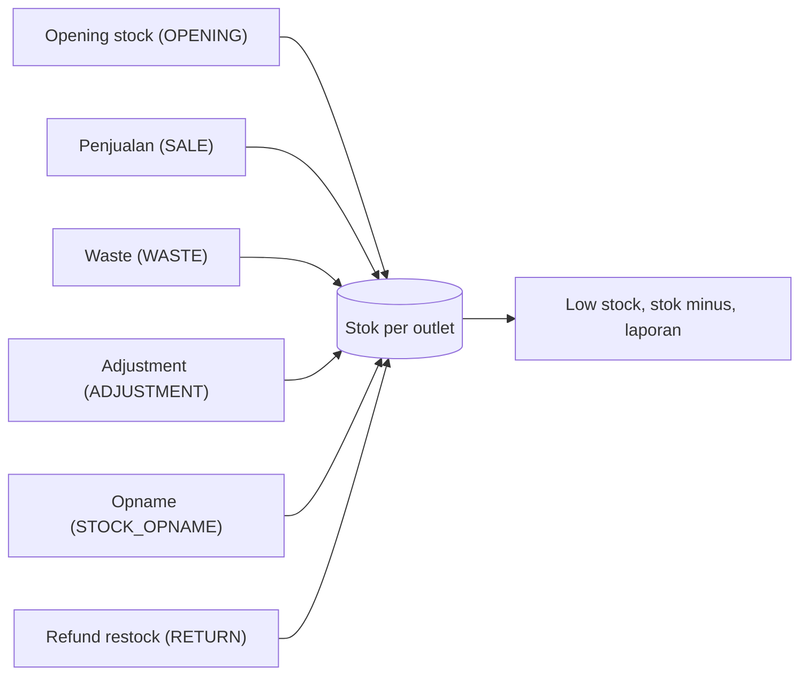
| Titik keputusan | Aturan | BR |
|-----------------|--------|----|
| Opname submit | Selisih = hitungan − snapshot, diterapkan ke stok live | BR-017 |
| Adjustment/waste | Alasan wajib, qty > 0 | BR-016 |

---

### 1.6 BP-05 Pembelian Bahan (Purchase)
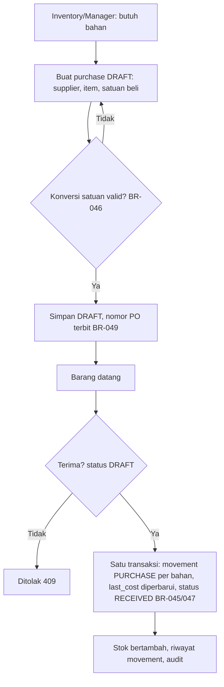

---

## 2. Use Case

### 2.1 Aktor
| Aktor | Tipe | Role di Sistem |
|-------|------|----------------|
| Owner | Primary | OWNER |
| Manager | Primary | MANAGER |
| Cashier | Primary | CASHIER |
| Inventory Staff | Primary | INVENTORY |
| Kitchen Staff | Primary | KITCHEN |
| Sistem | System | Pemicu otomatis di dalam transaksi (potong stok, restock) |

Catatan: aktor **Sistem Penjadwal** di PRD §3.6 tidak dipakai di Phase 1 (peringatan shift dihitung saat dibaca; rekonsiliasi stok masuk Phase 2). Calon Owner pada UC-AUTH-01 adalah aktor Owner sebelum akun dibuat.

### 2.2 Use Case Diagram
Diagram memakai Mermaid flowchart (render langsung di GitHub dan Notion); satu diagram per subsistem, ≤ 11 UC.

**A. Fondasi**
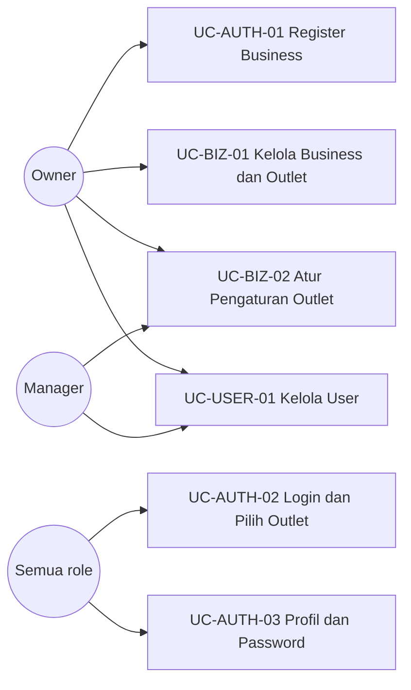

**B. Menu & Resep**
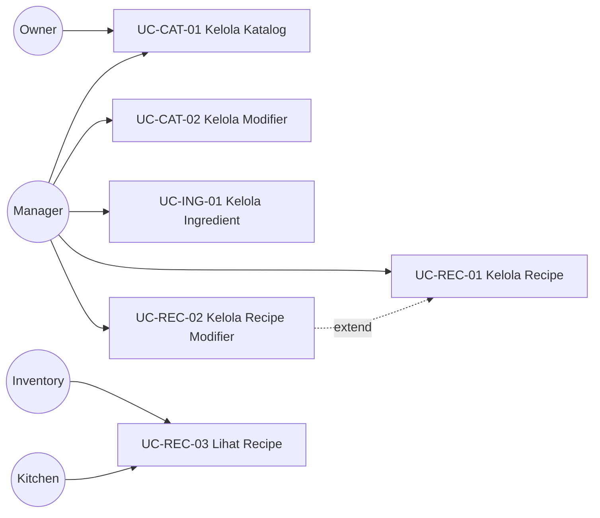

**C1. Shift & Order**
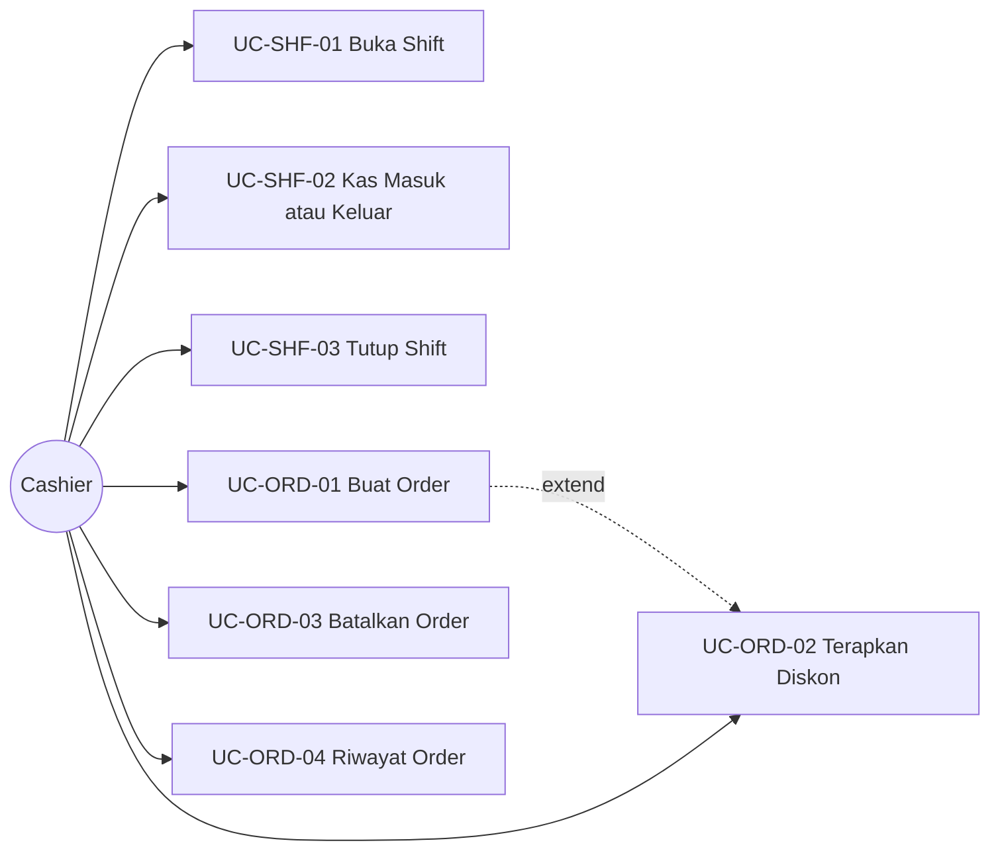

**C2. Pembayaran, Refund, Dapur**
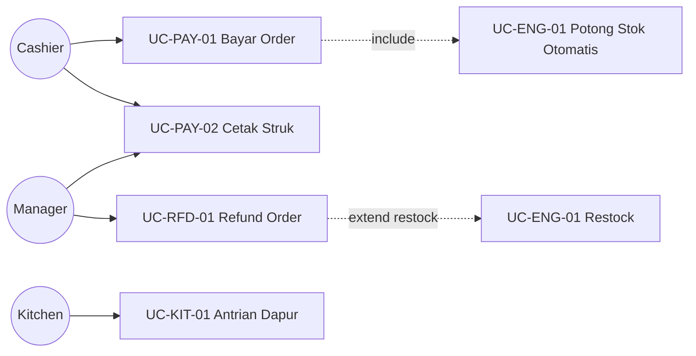

**D. Inventory, Laporan, Audit**
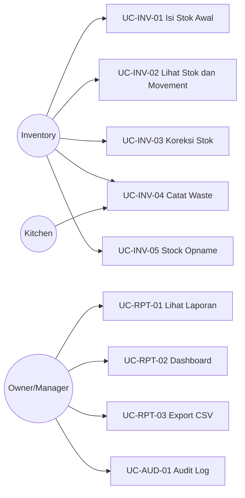

**D. Purchasing**
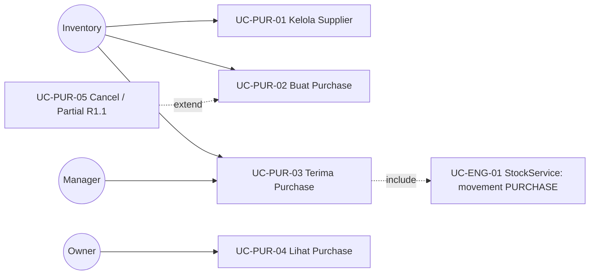

### 2.3 Daftar Use Case
| ID | Nama | Aktor | Prioritas | FR | Proses |
|----|------|-------|-----------|----|--------|
| UC-AUTH-01 | Register Business | Owner | Must | FR-AUTH-001 | |
| UC-AUTH-02 | Login & Pilih Outlet | Semua role | Must | FR-AUTH-002, 004 | |
| UC-AUTH-03 | Kelola Profil & Password | Semua role | Must | FR-AUTH-003 | |
| UC-BIZ-01 | Kelola Business & Outlet | Owner | Must | FR-BIZ-001, 002 | |
| UC-BIZ-02 | Atur Pengaturan Outlet | Owner, Manager | Must | FR-BIZ-003 | |
| UC-USER-01 | Kelola User | Owner, Manager | Must | FR-USER-001, 002 | |
| UC-CAT-01 | Kelola Katalog (category, product) | Owner, Manager | Must | FR-CAT-001, 002, 004 | |
| UC-CAT-02 | Kelola Modifier | Owner, Manager | Must | FR-CAT-003 | |
| UC-ING-01 | Kelola Ingredient | Owner, Manager | Must | FR-ING-001 | |
| UC-REC-01 | Kelola Recipe Produk | Owner, Manager | Must | FR-REC-001, 003 | |
| UC-REC-02 | Kelola Recipe Modifier `[R1.1]` | Owner, Manager | Should | FR-REC-002 | |
| UC-REC-03 | Lihat Recipe (read-only) `[R1.1]` | Inventory, Kitchen | Should | FR-REC-001 | |
| UC-SHF-01 | Buka Shift | Cashier | Must | FR-SHF-001, 004 | BP-03 |
| UC-SHF-02 | Kas Masuk / Keluar | Cashier | Must | FR-SHF-002 | BP-03 |
| UC-SHF-03 | Tutup Shift | Cashier | Must | FR-SHF-003 | BP-03 |
| UC-ORD-01 | Buat Order (draft, konfirmasi, edit ulang) | Cashier | Must | FR-ORD-001, 002, 004, 007 | BP-01 |
| UC-ORD-02 | Terapkan Diskon | Cashier, Manager, Owner | Must | FR-ORD-003 | BP-01 |
| UC-ORD-03 | Batalkan Order | Cashier, Manager, Owner | Must | FR-ORD-005 | BP-01 |
| UC-ORD-04 | Lihat Riwayat & Detail Order | Cashier, Manager, Owner | Must | FR-ORD-006 | |
| UC-PAY-01 | Bayar Order | Cashier | Must | FR-PAY-001 | BP-01 |
| UC-PAY-02 | Cetak Struk | Cashier, Manager | Must | FR-PAY-002 | BP-01 |
| UC-ENG-01 | Potong Stok Otomatis (dan restock) | Sistem | Must | FR-ENG-001, 002, 003 | BP-01, BP-02 |
| UC-RFD-01 | Refund Order | Manager, Owner | Must | FR-RFD-001 | BP-02 |
| UC-INV-01 | Isi Stok Awal | Inventory, Manager, Owner | Must | FR-INV-001 | BP-04 |
| UC-INV-02 | Lihat Stok & Movement | Inventory, Manager, Owner, Kitchen | Must | FR-INV-002, 005 | BP-04 |
| UC-INV-03 | Koreksi Stok (Adjustment) | Inventory, Manager, Owner | Must | FR-INV-003 | BP-04 |
| UC-INV-04 | Catat Waste | Inventory, Kitchen, Manager, Owner | Must | FR-INV-004 | BP-04 |
| UC-INV-05 | Stock Opname `[R1.1]` | Inventory, Manager, Owner | Should | FR-INV-006 | BP-04 |
| UC-PUR-01 | Kelola Supplier | Owner, Manager, Inventory | Should | FR-PUR-001 | BP-05 |
| UC-PUR-02 | Buat & Ubah Purchase (DRAFT) | Owner, Manager, Inventory | Should | FR-PUR-002 | BP-05 |
| UC-PUR-03 | Terima Purchase | Owner, Manager, Inventory | Should | FR-PUR-003 | BP-05, BP-04 |
| UC-PUR-04 | Lihat Purchase | Owner, Manager, Inventory | Should | FR-PUR-004 | BP-05 |
| UC-PUR-05 `[R1.1]` | Cancel Purchase & Partial Receive | Owner, Manager, Inventory | Could | FR-PUR-005 | BP-05 |
| UC-KIT-01 | Kelola Antrian Dapur `[R1.1]` | Kitchen, Manager, Owner | Should | FR-KIT-001 | BP-01 |
| UC-RPT-01 | Lihat Laporan (core: sales, payment, stok; FR-RPT-002/004 `[R1.1]`) | Owner, Manager, Inventory, Cashier (terbatas) | Must | FR-RPT-001…004 | |
| UC-RPT-02 | Lihat Dashboard `[R1.1]` | Owner, Manager, Cashier, Inventory | Must | FR-RPT-005 | |
| UC-RPT-03 | Export CSV `[R1.1]` | Owner, Manager | Should | FR-RPT-006 | |
| UC-AUD-01 | Lihat Audit Log `[R1.1]` | Owner, Manager | Should | FR-AUD-002 | |

FR-AUD-001 (pencatatan) dan FR-PWA-001 adalah perilaku sistem lintas fitur, bukan tujuan aktor, sehingga tidak punya UC sendiri. Pencatatan audit dirujuk di tiap UC lewat "Pascakondisi sukses".

---

### 2.4 Spesifikasi Use Case

#### 2.4.1 UC Inti (spesifikasi penuh)

##### UC-AUTH-02: Login & Pilih Outlet
| Elemen | Isi |
|--------|-----|
| Aktor utama | Semua role |
| Tujuan | Masuk dan bekerja di satu outlet |
| Prakondisi | Akun ACTIVE, tidak terkunci |
| Pascakondisi sukses | Sesi aktif; audit `LOGIN`; `X-Outlet-Id` terpilih dari outlet yang boleh diakses |
| Pascakondisi gagal | Tidak ada sesi; `failed_login_count` bertambah; audit `LOGIN_FAILED` |
| FR / BR | FR-AUTH-002, 004 / BR-023 |

**Alur utama:** (1) Aktor mengisi email dan password. (2) Sistem memvalidasi dan membuat sesi. (3) Sistem mengembalikan user, role, permission, daftar outlet. (4) Aktor memilih outlet aktif (otomatis bila hanya satu).

| Kode | Kondisi | Respon |
|------|---------|--------|
| 2a | Email atau password salah | "Email atau password salah." (hitungan gagal +1) |
| 2b | Gagal ke-5 | Akun terkunci 15 menit, `423` |
| 2c | Akun terkunci | "Akun terkunci sementara…" `423` |
| 2d | Akun INACTIVE | `403` |
| 4a | User tidak punya outlet | Tampil pesan "Hubungi pemilik", tidak bisa lanjut |

##### UC-SHF-03: Tutup Shift
| Elemen | Isi |
|--------|-----|
| Aktor utama | Cashier |
| Tujuan | Menutup shift dan mengetahui selisih kas |
| Prakondisi | Shift OPEN milik aktor |
| Pascakondisi sukses | Shift `CLOSED`; `expected_cash`, `actual_cash`, `difference` tersimpan; audit `SHIFT_CLOSED` |
| Pascakondisi gagal | Shift tetap OPEN |
| FR / BR | FR-SHF-003 / BR-003, BR-004 |

**Alur utama:** (1) Aktor menekan Tutup Shift. (2) Sistem memeriksa tidak ada order DRAFT/PENDING_PAYMENT. (3) Sistem menampilkan Expected Cash. (4) Aktor memasukkan uang fisik. (5) Sistem menghitung selisih dan menutup shift. (6) Ringkasan dapat dicetak.

| Kode | Kondisi | Respon |
|------|---------|--------|
| 2a | Ada order DRAFT/PENDING | `409` "Selesaikan atau batalkan {n} order…" |
| 5a | Shift sudah CLOSED (tab ganda) | `409` |
| 5b | Selisih ≠ 0 | Tetap boleh tutup; selisih dicatat |

##### UC-ORD-01: Buat Order
| Elemen | Isi |
|--------|-----|
| Aktor utama | Cashier |
| Tujuan | Menyusun order yang total-nya benar dan siap dibayar |
| Prakondisi | Login; shift OPEN milik aktor di outlet aktif |
| Pascakondisi sukses | Order `PENDING_PAYMENT`, item terkunci, total terhitung (termasuk pembulatan) |
| Pascakondisi gagal | Order tetap `DRAFT` atau tidak terbentuk |
| FR / BR | FR-ORD-001, 002, 004, 007 / BR-001, 005, 019, 028, 029, 030, 036 |

**Alur utama:** (1) Aktor memilih produk, modifier, qty. (2) Sistem menyimpan snapshot nama, harga, HPP, versi recipe dan menghitung ulang total. (3) Aktor memilih tipe order (dan nomor meja bila Dine In). (4) Aktor (opsional) menerapkan diskon (UC-ORD-02). (5) Aktor mengonfirmasi; sistem memvalidasi produk masih ACTIVE dan mengunci item.

| Kode | Kondisi | Respon |
|------|---------|--------|
| 1a | Produk INACTIVE | "Produk tidak tersedia." |
| 1b | Group modifier wajib belum dipilih | "Pilih opsi untuk {group}." |
| 3a | Nomor meja pada Takeaway | Ditolak |
| 5a | Order kosong | "Tambahkan minimal satu item." |
| 5b | Ada produk jadi INACTIVE sejak ditambahkan | Konfirmasi ditolak, item ditandai |
| 6a | Aktor ingin koreksi setelah konfirmasi | `PENDING_PAYMENT → DRAFT` (BR-028) |
| – | Tidak ada shift OPEN | `409` "Buka shift terlebih dahulu." |

##### UC-PAY-01: Bayar Order
| Elemen | Isi |
|--------|-----|
| Aktor utama | Cashier |
| Tujuan | Menerima pembayaran dan menyelesaikan order |
| Prakondisi | Order `PENDING_PAYMENT`; shift OPEN milik aktor |
| Pascakondisi sukses | Payment `SUCCESS`; order `COMPLETED` (via `PAID`); stok terpotong (UC-ENG-01); `kitchen_status = NEW`; audit `PAYMENT_CREATED`; struk siap |
| Pascakondisi gagal | **Tidak ada perubahan** (rollback penuh); order tetap `PENDING_PAYMENT` |
| FR / BR | FR-PAY-001 / BR-007, 008, 009, 011, 021 |
| Include | UC-ENG-01 |

**Alur utama:** (1) Aktor memilih Cash atau QRIS dan mengisi nominal/referensi. (2) FE membuat `Idempotency-Key`. (3) Sistem mengunci order, memvalidasi nominal. (4) Sistem membuat payment, menandai order dibayar, memotong stok dalam satu transaksi. (5) Sistem mengembalikan kembalian dan `stock_shortage` bila ada. (6) FE menampilkan struk.

| Kode | Kondisi | Respon |
|------|---------|--------|
| 1a | Metode CARD/GATEWAY | "Metode pembayaran belum tersedia." |
| 3a | Order bukan `PENDING_PAYMENT` | `409` |
| 3b | Cash `tendered` < total | `422` "Uang diterima kurang dari total." |
| 3c | QRIS nominal ≠ total | `422` |
| 3d | Key sudah dipakai (order sama) | `200` hasil sebelumnya |
| 3e | Key dipakai untuk order lain | `409` |
| 4a | Stok kurang dan `allow_negative_stock = false` | `422` + daftar bahan; rollback |
| 4b | Stok kurang dan minus diizinkan | Lanjut; `stock_shortage` di respons |
| 5a | Jaringan putus sebelum respons | Retry dengan key sama; tidak ada payment ganda |

##### UC-ENG-01: Potong Stok Otomatis (dan Restock)
| Elemen | Isi |
|--------|-----|
| Aktor utama | Sistem (dipicu UC-PAY-01 dan UC-RFD-01) |
| Tujuan | Stok berkurang sesuai recipe, atomik dan idempoten |
| Prakondisi | Order dibayar di dalam transaksi yang sama |
| Pascakondisi sukses | 1 movement `SALE` per ingredient; balance diperbarui; (refund + restock) movement `RETURN` |
| Pascakondisi gagal | Rollback bersama pembayaran |
| FR / BR | FR-ENG-001…003 / BR-009, 010, 011 |

**Alur utama:** (1) Hitung kebutuhan per item dari recipe di snapshot + recipe modifier terpilih. (2) Agregat per ingredient. (3) Urutkan by `ingredient_id`, kunci balance, buat movement dengan `unit_cost` snapshot, update balance.

| Kode | Kondisi | Respon |
|------|---------|--------|
| 1a | Produk tanpa recipe | Dilewati; muncul di laporan "no recipe" |
| 3a | Movement untuk order+ingredient sudah ada | Tidak diproses ulang (idempoten) |
| 3b | Stok menjadi minus dan dilarang | Gagal, rollback |

##### UC-RFD-01: Refund Order
| Elemen | Isi |
|--------|-----|
| Aktor utama | Manager, Owner |
| Tujuan | Mengembalikan pembayaran order dengan jejak jelas |
| Prakondisi | Order `PAID`/`COMPLETED`, belum pernah direfund; aktor punya `sales.refund` |
| Pascakondisi sukses | Refund tercatat; order `REFUNDED`; kas keluar di shift OPEN aktor (tunai); `RETURN` bila restock; audit `REFUND_CREATED` |
| Pascakondisi gagal | Tidak ada perubahan |
| FR / BR | FR-RFD-001 / BR-012, 035 |
| Extend | Restock (UC-ENG-01) |

**Alur utama:** (1) Aktor membuka order, mengisi alasan, memilih restock (default tidak). (2) Sistem memvalidasi status dan shift. (3) Sistem membuat refund sebesar `orders.total`, mengubah status, mencatat movement bila restock. (4) Sistem mengonfirmasi.

| Kode | Kondisi | Respon |
|------|---------|--------|
| 2a | Order bukan PAID/COMPLETED | `409` |
| 2b | Sudah direfund | `409` |
| 2c | Tunai dan aktor tanpa shift OPEN | `409` "Buka shift terlebih dahulu…" |
| 2d | Alasan kosong | `422` |
| 3a | Refund QRIS | Hanya dicatat; dana dikembalikan manual |

##### UC-INV-05: Stock Opname
| Elemen | Isi |
|--------|-----|
| Aktor utama | Inventory Staff |
| Tujuan | Menyamakan stok sistem dengan stok fisik |
| Prakondisi | Tidak ada opname `IN_PROGRESS` di outlet |
| Pascakondisi sukses | Opname `SUBMITTED`; movement `STOCK_OPNAME` untuk tiap selisih ≠ 0; audit |
| Pascakondisi gagal | Opname `CANCELLED` atau tetap `IN_PROGRESS`; stok tidak berubah |
| FR / BR | FR-INV-006 / BR-017 |

**Alur utama:** (1) Mulai: sistem mem-snapshot stok. (2) Aktor mengisi hitungan fisik. (3) Sistem menampilkan selisih. (4) Aktor submit; sistem menerapkan selisih ke stok live (urut `ingredient_id`).

| Kode | Kondisi | Respon |
|------|---------|--------|
| 1a | Opname lain berjalan | `409` |
| 2a | Hitungan negatif | `422` |
| 4a | Penjualan terjadi selama penghitungan | Tidak hilang: selisih terhadap snapshot diterapkan ke stok live |
| 4b | Opname sudah selesai/dibatalkan | `409` |

#### 2.4.2 UC CRUD & pendukung (ringkas)
| ID | Prakondisi | Alur utama | Pascakondisi sukses | Alternatif / gagal | FR / BR |
|----|-----------|------------|---------------------|--------------------|---------|
| UC-AUTH-01 | Belum punya akun | Isi data business, outlet, owner → validasi → sistem membuat business, outlet, Owner dalam 1 transaksi | Akun Owner aktif; audit `BUSINESS_REGISTERED` | Email ganda, password lemah → `422`; tidak ada data tersimpan | FR-AUTH-001 / BR-022 |
| UC-AUTH-03 | Login | Ubah nama atau password (lama + baru) | Tersimpan; sesi lain berakhir | Password lama salah → `422` | FR-AUTH-003 |
| UC-BIZ-01 | Owner | Ubah profil/license; tambah, ubah, nonaktifkan outlet | Tersimpan + audit | Kode outlet ganda atau diubah setelah ada order → `422`; outlet bertransaksi tidak dihapus | FR-BIZ-001, 002 / BR-018, 031 |
| UC-BIZ-02 | Owner/Manager | Ubah pajak, service, stok minus, batas diskon, pembulatan, struk | Tersimpan; berlaku order baru; audit `SETTING_CHANGED` | Tarif di luar 0–100 → `422`; Manager mengubah field di luar haknya → `403` | FR-BIZ-003 / BR-024 |
| UC-USER-01 | Owner/Manager | Tambah/ubah user: role, outlet, status | User tersimpan; audit; nonaktif → sesi berakhir | Manager memilih role/outlet di luar hak → `403`; Owner terakhir tidak bisa dinonaktifkan | FR-USER-001, 002 / BR-024 |
| UC-CAT-01 | Manager/Owner | Kelola category dan product (harga, SKU, gambar, status) | Tersimpan; cache katalog dibatalkan; harga berubah → audit | SKU ganda, gambar > 2 MB → `422`; produk bertransaksi hanya INACTIVE | FR-CAT-001, 002, 004 / BR-018, 029, 031 |
| UC-CAT-02 | Manager/Owner | Buat group dan option, pasang ke produk | Tersimpan; cache dibatalkan | `min_select > max_select` → `422` | FR-CAT-003 / BR-030 |
| UC-ING-01 | Manager/Owner | Kelola ingredient (base unit, `last_cost`, minimum) | Tersimpan | SKU ganda; ubah base unit setelah ada movement → `422` | FR-ING-001 / BR-015, 031 |
| UC-REC-01 | Manager/Owner | Isi bahan dan qty → simpan | Recipe versi baru aktif; versi lama nonaktif; audit `RECIPE_UPDATED`; HPP terhitung | Qty ≤ 0, bahan ganda, recipe kosong → `422`; role tanpa `recipes.manage` → `403` | FR-REC-001, 003 / BR-013, 032 |
| UC-REC-02 | Manager/Owner | Isi bahan tambahan per modifier option | Tersimpan; audit | Qty ≤ 0 → `422` | FR-REC-002 / BR-009 |
| UC-REC-03 | Inventory/Kitchen | Buka recipe produk | Recipe tampil **tanpa HPP** | Tanpa `recipes.view` → `403` | FR-REC-001 / BR-032 |
| UC-SHF-01 | Cashier; tidak ada shift OPEN | Isi kas awal → buka | Shift `OPEN`, `business_date` terisi; audit | Shift sudah OPEN → `409`; kas awal negatif → `422` | FR-SHF-001, 004 / BR-002, 026, 027 |
| UC-SHF-02 | Shift OPEN | Pilih masuk/keluar, nominal, alasan | Tercatat di shift | Alasan kosong → `422`; tanpa shift OPEN → `409` | FR-SHF-002 |
| UC-ORD-02 | Order `DRAFT`; punya `discounts.apply` | Pilih persen/nominal, isi nilai | Diskon tersimpan; total dihitung ulang; audit `DISCOUNT_APPLIED` | Melebihi subtotal → `422`; Cashier melebihi batas outlet → `403` | FR-ORD-003 / BR-006 |
| UC-ORD-03 | Order `DRAFT`/`PENDING_PAYMENT` | Isi alasan → batalkan | `CANCELLED`; tanpa movement stok; audit `ORDER_CANCELLED` | Order dibayar → `409` (harus refund); Cashier membatalkan order orang lain → `403` | FR-ORD-005 / BR-025 |
| UC-ORD-04 | Login | Filter tanggal, status, kasir, nomor → buka detail | Daftar dan detail tampil (Cashier: milik sendiri) | Order tenant lain → `404` | FR-ORD-006 |
| UC-PAY-02 | Order dibayar | Buka struk → cetak (browser print 58/80 mm), dapat dicetak ulang | Struk tampil/tercetak | — | FR-PAY-002 |
| UC-INV-01 | `inventory.adjust` | Isi qty awal per bahan | Batch opening + movement `OPENING` | Qty ≤ 0 → `422` | FR-INV-001 / BR-015 |
| UC-INV-02 | `inventory.view` | Buka stok / riwayat movement, filter | Stok, low stock, minus, riwayat tampil | — | FR-INV-002, 005 / BR-020 |
| UC-INV-03 | `inventory.adjust` | Pilih bahan, jenis tambah/kurangi, qty, alasan | Adjustment + movement `ADJUSTMENT`; audit | Alasan kosong, qty ≤ 0 → `422`; minus dilarang → `422` | FR-INV-003 / BR-016 |
| UC-INV-04 | `inventory.waste` | Pilih bahan, qty, alasan (enum), catatan | Waste + movement `WASTE`; biaya tersimpan (Kitchen tidak melihat nilai); audit | Alasan `OTHER` tanpa catatan → `422` | FR-INV-004 / BR-016, 034 |
| UC-PUR-01 | Aktor punya `suppliers.*` | Tambah, ubah, nonaktifkan supplier | Supplier tersimpan; INACTIVE tidak muncul di pilihan purchase baru | Nama ganda → `422` | FR-PUR-001 / BR-048 |
| UC-PUR-02 | Aktor punya `purchases.create`; ada supplier ACTIVE dan bahan | Pilih supplier → tambah item (bahan, satuan beli, qty, harga) → sistem tampilkan konversi dan total → simpan | Purchase `DRAFT` dengan nomor PO; total terhitung | Qty ≤ 0, satuan tak dapat dikonversi, bahan ganda → `422`; purchase bukan DRAFT → `409` | FR-PUR-002 / BR-046, 048, 049 |
| UC-PUR-03 | Purchase `DRAFT`; `purchases.receive` | Tekan Terima → sistem menambah stok per bahan, memperbarui `last_cost`, mengubah status | Purchase `RECEIVED`; movement `PURCHASE`; audit `PURCHASE_RECEIVED`; tidak bisa diubah | Bukan DRAFT → `409` (tanpa efek); gagal di tengah → rollback total | FR-PUR-003 / BR-045, 047, 050 |
| UC-PUR-04 | `purchases.view` | Filter status, supplier, tanggal → buka detail | Daftar dan detail tampil | Data tenant lain → `404` | FR-PUR-004 |
| UC-PUR-05 `[R1.1]` | Purchase DRAFT; `purchases.cancel` | Cancel dengan alasan, atau terima sebagian | CANCELLED tanpa movement / stok bertambah sesuai qty diterima | Alasan kosong → `422` | FR-PUR-005 |
| UC-KIT-01 | Order dibayar | Lihat antrian (tanpa harga) → tekan Siap | `kitchen_status = READY` | Tanpa `orders.kitchen_update` → `403` | FR-KIT-001 / BR-033 |
| UC-RPT-01 | `reports.view` | Pilih laporan dan filter | Laporan sesuai business date; Cashier hanya miliknya | Outlet di luar akses → `403` | FR-RPT-001…004 / BR-027 |
| UC-RPT-02 | `dashboard.view` | Buka dashboard | Widget sesuai permission | — | FR-RPT-005 |
| UC-RPT-03 | `reports.export` | Pilih laporan → Export CSV | File CSV, filter sama dengan layar | Tanpa permission → `403` | FR-RPT-006 / BR-022 |
| UC-AUD-01 | `audit.view` | Filter tanggal, user, aksi, resource | Daftar audit (Manager: outlet miliknya) | — | FR-AUD-002 / BR-020 |

#### 2.4.3 Use Case Gateway Midtrans `[P2]` (ringkas)
| ID | Aktor | Prakondisi | Alur utama | Pascakondisi sukses | Alternatif / gagal | FR / BR |
|----|-------|-----------|------------|---------------------|--------------------|---------|
| UC-BIZ-03 | Owner | Akun Midtrans milik business | Isi server key, client key, mode; simpan (write-only, terenkripsi) | Provider aktif; audit tanpa nilai kunci | Kunci tidak valid → `422` | FR-BIZ-004 / BR-037 |
| UC-PAY-03 | Cashier | Order `PENDING_PAYMENT`; shift OPEN; provider aktif | Pilih QRIS Midtrans → sistem buat transaksi + QR → layar polling 3 detik → settlement → order `PAID`→`COMPLETED` | Payment `GATEWAY` tercatat; stok terpotong; struk | Kedaluwarsa, gagal → transaksi `EXPIRED`/`FAILED`, order tetap `PENDING_PAYMENT` | FR-PAY-003 / BR-037…039, 041 |
| UC-PAY-04 | Cashier | Transaksi gateway `PENDING` | Batalkan transaksi atau ganti metode | Transaksi `CANCELLED` (dibatalkan juga di Midtrans) | Settlement sudah masuk → ditolak | FR-PAY-004 / BR-039 |
| UC-PAY-05 | Owner, Manager | Ada transaksi gateway | Buka laporan rekonsiliasi gateway | Selisih/anomali tampil | — | FR-RPT-007 / BR-044 |
| UC-SYS-01 | Sistem (Midtrans) | Webhook diterima | Verifikasi signature → simpan event (inbox) → balas `200` → worker proses settlement | Order selesai, stok dipotong, `GATEWAY_STOCK_OVERRIDE` bila stok minus | Signature salah → `401`; event ganda dibuang; order tidak valid → ditandai `ORDER_NOT_PAYABLE`/`AMOUNT_MISMATCH` | FR-PAY-005 / BR-040, 041 |
| UC-RFD-01 (ekstensi) | Manager, Owner | Order dibayar via gateway | Refund via API Midtrans; bila ditolak → fallback manual | Refund tercatat dengan `gateway_status` | API menolak → jalur manual (B6) | FR-RFD-002 / BR-043 |

> Detail SEQ-GW-01…04 ada di SDD v3.0 §3.2; spesifikasi UC penuh ditulis menjelang Phase 2.

---

## 3. Temuan G2 — status
Semua temuan G2 sebelumnya (U-01…U-04) sudah diserap di SRS v3.0 dan Task Breakdown v3.0. Celah yang ditutup saat menyusun v3.0: UC Purchase (UC-PUR-01…05), BP-05, dan UC gateway (UC-PAY-03…05, UC-SYS-01, UC-BIZ-03) yang sebelumnya hanya disebut di SRS.

## 4. Checklist Kelengkapan
- [x] Setiap fitur Must/Should di PRD punya ≥ 1 UC (F-20 → UC-PUR; F-21 → UC-PAY-03…05, UC-SYS-01)
- [x] Setiap UC punya aktor utama dan pascakondisi sukses dan gagal
- [x] Setiap decision point proses merujuk BR
- [x] Setiap aktor di diagram terdaftar di §2.1; aktor Midtrans dan Sistem Penjadwal hanya Phase 2
- [x] Kolom UC di traceability SRS §7 terisi

## 5. Changelog
| Versi | Tanggal | Perubahan | Author |
|-------|---------|-----------|--------|
| 3.0 | 2026-10-25 | Baseline final: BP-05 dan UC-PUR-01…05, UC gateway `[P2]`, penanda `[R1.1]` | Claude |
| 1.0 | 2026-10-07 | 4 proses swimlane, 33 use case, 7 spesifikasi penuh | Claude |
