# Software Design Document (SDD) — F&B POS & Inventory
## 0. Ringkasan
> **Versi:** 3.0 (Baseline final) | **Tanggal:** 2026-10-25 | **Status:** Disetujui | **Referensi:** PRD v3.0, SRS v3.0, ERD v3.0, Process & Use Case v3.0
> Dokumen ini berisi **arsitektur (§1), behavior (§3), dan API (§4)**. Data model lengkap ada di **ERD v3.0** (`docs/05_ERD_v3.0.md`) dan menjadi sumber kebenaran skema; nilai status di diagram harus sama dengan enum di ERD.
> Penanda: `[R1.1]` rilis Januari 2027 · `[P2]` Phase 2.
> **Pola:** monolith modular Laravel (API) + Vue PWA; satu database PostgreSQL (Supabase); atomik di satu transaksi untuk bayar, status, movement, dan saldo.

---

## 1. Arsitektur

### 1.1 Pola Arsitektur
**Pilihan:** Modular monolith Laravel (API-only) + Vue 3 SPA (PWA) terpisah, satu database PostgreSQL.
**Alasan:** produk sendiri yang akan punya klien Flutter (PRD §32), tim 3 fullstack, 12 minggu, skala 5 outlet dalam 12 bulan. API-first dibayar dari awal; satu deployable backend menekan biaya operasional.
**Ditolak:** (a) Inertia atau Blade+Livewire, karena API harus dibangun ulang saat Flutter masuk; (b) microservices dan DB-per-tenant, karena tidak ada alasan terukur di SRS (NFR-PERF-006 ≈ 1.500 order/hari).

### 1.2 Architecture Diagram

**Level 1 — System Context**
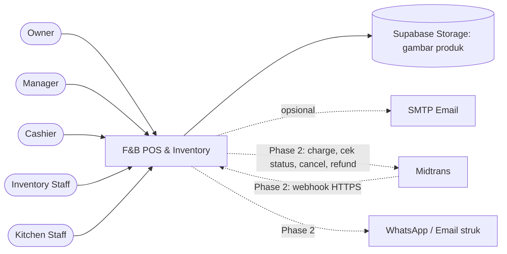

**Level 2 — Container**
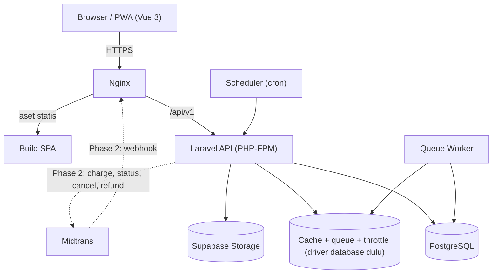
Worker dan scheduler tetap disiapkan walau Phase 1 hampir seluruhnya sinkron: audit log setelah commit, invalidasi cache, dan (opsional) email dikerjakan di queue.

**[P2] Midtrans:** webhook masuk lewat Nginx ke aplikasi yang sama (route publik), hanya **menyimpan event lalu mengantrekan job**; pemrosesan (verifikasi status, buat payment, potong stok) dikerjakan queue worker. Scheduler menjalankan penyapu transaksi kedaluwarsa tiap menit dan retry event gagal. Tidak ada layanan baru yang perlu di-deploy.

### 1.3 Stack Teknologi
| Layer | Teknologi | Versi | Alasan |
|-------|-----------|-------|--------|
| Backend | Laravel 13 (API-only, modul di `app/Modules`), PHP 8.4 | dikunci di SETUP-001 | Keahlian tim; Action/Service/Policy |
| Frontend | Vue 3 + TypeScript + Vite + Pinia + Tailwind | stabil terbaru | State POS berat (cart, modifier, dialog); PWA |
| Database | PostgreSQL di Supabase (direct/session pooler) | stabil terbaru | Partial unique index, `FOR UPDATE`, JSONB, CHECK |
| RBAC | Spatie Permission (teams = business) | stabil terbaru | Package matang; aturan Limited/Own di Policy |
| Cache / Queue | Driver database (core); Cache/Queue (driver database) menyusul saat Midtrans (Phase 2) | | Cache katalog/dashboard, queue, throttle |
| Storage | Supabase Storage | | Gambar produk; disk lokal saat dev |
| Auth | Sanctum SPA (cookie) | | Satu origin tepercaya; token terpisah untuk Flutter nanti |
| Payment gateway [P2] | Midtrans (Core API + HTTP notification) | ditetapkan 2026-10-12 | Provider keputusan Owner; diakses lewat interface `PaymentGateway` (adapter), sehingga provider lain dapat ditambah tanpa mengubah alur order |
| Test | PEST, Playwright | | Sandbox Midtrans untuk test gateway |
| Hosting | VPS + Docker Compose | | Technical Design §5 dan Deploy & Ops |

### 1.4 Keputusan Arsitektur (ADR)
| ID | Keputusan | Alternatif ditolak | Alasan | Konsekuensi |
|----|-----------|--------------------|--------|-------------|
| ADR-001 | Laravel API + **Vue 3 SPA** (Vite, Pinia, PWA via vite-plugin-pwa) — **Accepted** (kembali ke stack awal; Next.js sempat dipilih 24 Okt dan dibatalkan 25 Okt) | Next.js, Inertia, Blade+Livewire | POS interaktif; tanpa SSR sehingga SPA statis cukup; Flutter direncanakan | FE statis disajikan Nginx (tanpa proses Node di server); satu origin lewat Nginx path-based (dev: proxy Vite); dua build/CI; kontrak `/api/v1` harus stabil |
| ADR-002 | Ledger `stock_movements` + cache `stock_balances`, potong stok **sinkron** di transaksi pembayaran | Saldo saja; saldo = SUM; deduct via queue | Audit + cepat + tanpa stok setengah jadi | Pembayaran puluhan ms lebih lambat; wajib lock berurutan `ingredient_id`; job rekonsiliasi di Phase 2 |
| ADR-003 | Single DB, shared schema, `business_id` di **semua** tabel tenant + global scope | DB-per-tenant | MVP; biaya ops | Risiko query tanpa scope → `TEST-AUTH-001` dataset-driven, larangan `DB::table()` tanpa helper scope |
| ADR-004 | Uang `BIGINT` rupiah; qty `DECIMAL(18,4)`; waktu UTC; **pembulatan total ke increment outlet di level order (semua metode)**; ID `BIGINT` identity | ULID/UUID; DECIMAL untuk uang | Presisi; lihat ERD v3.0 §7.3 | Half-up per komponen (service, pajak) lalu pembulatan total |
| ADR-005 | RBAC memakai **Spatie Permission** (`teams` = `business_id`), 1 role per user, "Limited/Own" di Policy dan `config/rbac_scopes.php` — **Accepted** | Tabel RBAC sendiri | Keputusan tim; package matang dan ada cache permission | Wajib `setPermissionsTeamId()` di middleware sebelum cek izin; role custom per business = Phase 3 (didukung teams) |
| ADR-006 | PostgreSQL di **Supabase** — **Accepted** | MySQL; transaction pooler | Partial unique index (shift, opname, recipe aktif, payment sukses) dan `FOR UPDATE` | Aplikasi memakai **direct atau session pooler**; transaction pooler dilarang; migrasi lewat direct connection |
| ADR-007 | Append-only ditegakkan di **database** (trigger `BEFORE UPDATE OR DELETE` → exception) untuk `audit_logs`, `stock_movements`, `payments`, `cash_movements` | Hanya konvensi aplikasi | BR-020 harus tahan terhadap bug dan akses langsung | Migrasi koreksi data butuh jalur khusus (disable trigger oleh DBA) |
| ADR-008 | Sesi Sanctum SPA cookie; `X-Outlet-Id` per request | Token di localStorage | Hindari token di JS; outlet-context eksplisit | CORS + CSRF dikonfigurasi ketat |
| ADR-009 | Class Diagram **dilewati** | — | Logika domain terkonsentrasi di service (PriceCalculator, StockService, DeductStockForOrder, ShiftSummary, ReceivePurchase); ERD + state diagram menutup kebutuhan | Dikaji ulang jika partial receive (R1.1) atau Phase 2 menambah behavior |
| ADR-010 | [P2] Webhook memakai pola **inbox + queue**: simpan event dulu, balas `200`, proses di worker | Memproses penuh di dalam request webhook | Midtrans mengulang notifikasi bila respons lambat atau gagal; pemrosesan melibatkan lock order dan stok | Perlu worker aktif dan job retry; status proses terlihat di `payment_webhook_events` |
| ADR-011 | [P2] `payments` tetap **append-only** dan hanya berisi pembayaran berhasil. Siklus hidup gateway (pending, gagal, kedaluwarsa) disimpan di tabel terpisah `payment_gateway_transactions` | Menambah status PENDING di `payments` | Trigger append-only ADR-007 melarang UPDATE; status pending pasti berubah | `payment_webhook_events` **dikecualikan** dari trigger append-only karena `processing_status` di-update |
| ADR-012 | [P2] Settlement gateway **tidak pernah di-rollback karena stok** (BR-041): cek stok saat transaksi dimulai; saat settlement stok dipotong walau minus dan ditandai `GATEWAY_STOCK_OVERRIDE` | Menolak settlement bila stok kurang | Dana sudah diterima; menolak berarti uang masuk tanpa order selesai | `StockService::apply()` menerima parameter `forceNegative`; laporan stok minus dan audit menampilkan override |
| ADR-013 | [P2] Kredensial Midtrans per business (override outlet), `server_key` terenkripsi aplikasi (Laravel encrypted cast), write-only, hanya Owner | Satu akun platform; simpan plaintext | Business adalah merchant of record; server key rahasia | Rotasi `APP_KEY` perlu enkripsi ulang; keputusan akun per business dikunci (B2) |

| ADR-014 | Cache dan queue memakai **driver database** di core; Cache/Queue (driver database) saat Midtrans (Phase 2) — **Accepted** | Cache/Queue (driver database) sejak awal | Menghindari infrastruktur tambahan di 9 minggu; beban pilot kecil | Job audit dan invalidasi cache sedikit lebih lambat; worker `queue:work` tetap wajib; throttle memakai cache database |
| ADR-015 | Purchase diterima lewat service `ReceivePurchase` yang memanggil `StockService`; biaya = **Last Cost**, bukan rata-rata; nomor dokumen via `document_sequences` — **Accepted** | Weighted average cost; nomor dari `MAX(id)` | Sederhana dan konsisten dengan BR-047; nomor aman konkurensi | HPP berubah mengikuti pembelian terakhir; riwayat biaya ada di movement `PURCHASE` |

> Catatan ADR-007: pengecualian append-only untuk `payment_webhook_events` dijelaskan di ADR-011.

### 1.5 Keamanan & Otorisasi (Ringkas)
- Auth Sanctum SPA, lockout 5×/15 menit (BR-023), throttle login dan pembayaran.
- Rantai middleware: `auth:sanctum → outlet.context → permission:<kode> → [shift.open] → tenant scope`. Policy untuk aturan "Limited" (SRS §2.1).
- Tenant: trait `BelongsToBusiness` (global scope + auto-fill). Data business lain → `404`.
- Data sensitif: password hash; HPP dan nilai biaya tidak ikut respons POS dan dapur; log tanpa password/token; HTTPS wajib.
- **[P2] Midtrans:** webhook publik (tanpa sesi dan CSRF) diamankan dengan signature `SHA512(order_id + status_code + gross_amount + server_key)` memakai `gross_amount` persis seperti diterima; setelah valid, status diverifikasi ulang ke Midtrans sebelum mengubah data; event ganda dibuang lewat `event_key`; throttle per IP; server key terenkripsi, tidak masuk respons, log, maupun audit; data kartu tidak pernah melewati server.

---


## 2. Data Model
Dipindahkan ke **ERD v3.0** (`docs/05_ERD_v3.0.md`): diagram per domain, definisi 40 tabel Phase 1 + 3 tabel Midtrans, index, relasi BR → DB, dan pemetaan Eloquent. Class Diagram dilewati (ADR-009).

---

## 3. Behavior

### 3.1 Pemilihan Diagram
| Use Case / Entitas | Sequence | Activity | State | Alasan |
|--------------------|:--------:|:--------:|:-----:|--------|
| UC-ORD-01, 02 Buat order, diskon | ✅ | ✅ (hitung total) | — | Snapshot + kalkulasi bercabang (diskon, service, pajak, pembulatan) |
| UC-PAY-01 + UC-ENG-01 Bayar & potong stok | ✅ | — | — | Core engine: atomik, idempoten, lock, banyak partisipan |
| UC-RFD-01 Refund | ✅ | — | — | Shift + restock opsional |
| UC-INV-01, 03, 04 Opening, adjustment, waste | ✅ | ✅ (`StockService::apply`) | — | Satu jalur ledger dipakai bersama |
| UC-INV-05 Opname | ✅ | — | — | Tiga fase, delta vs snapshot |
| UC-REC-01 Recipe | ✅ | — | — | Versioning |
| Entitas `Order` | — | — | ✅ | 6 status, transisi bersyarat |
| Entitas `Shift` | — | — | ✅ | 2 status, guard close |
| Entitas `StockOpname` | — | — | ✅ | 3 status |
| UC-AUTH-01/02, UC-USER-01, UC-CAT-01, UC-SHF-01…03, UC-ORD-03, UC-KIT-01, UC-RPT-01/02 | ✅ (§3.2.7–3.2.13) | — | — | Lapisan keamanan, kas, dan cache; jalur gagal perlu eksplisit |
| UC lain (CRUD sederhana, audit) | — | — | — | Alur linear; cukup spesifikasi di SRS dan API |
| `Payment` | — | — | — | Hanya `SUCCESS` yang disimpan (gagal = tidak ada baris), jadi tidak butuh state diagram |
| Entitas `PaymentGatewayTransaction` [P2] | — | — | ✅ | 6 status, banyak sumber perubahan (webhook, cancel, penyapu) |
| Alur Midtrans: mulai bayar, webhook, cancel/kedaluwarsa, refund [P2] | ✅ (§3.2.14–3.2.17) | — | — | Sistem eksternal, asinkron, idempoten, jalur gagal banyak |
| Communication Diagram | — | — | — | **Dilewati: tercakup Sequence** |

### 3.2 Sequence Diagram
Semua diagram mengikuti SRS v3.0 dan nama permission kanonik (SRS §2.1). Peta ID final:

| ID | Topik | UC |
|----|-------|----|
| SEQ-ORD-01 | Buat, ubah, diskon, konfirmasi order | UC-ORD-01, 02 |
| SEQ-PAY-01 | Bayar order + potong stok (core engine) | UC-PAY-01, UC-ENG-01 |
| SEQ-RFD-01 | Refund penuh | UC-RFD-01 |
| SEQ-INV-01 | Opening stock, adjustment, waste | UC-INV-01, 03, 04 |
| SEQ-INV-02 | Stock opname | UC-INV-05 |
| SEQ-REC-01 | Simpan recipe versi baru | UC-REC-01 |
| SEQ-AUTH-01 | Register business & login | UC-AUTH-01, 02 |
| SEQ-USER-01 | Kelola user & cek permission | UC-USER-01 |
| SEQ-CAT-01 | Simpan product & katalog POS | UC-CAT-01 |
| SEQ-SHF-01 | Shift, kas, close shift | UC-SHF-01…03 |
| SEQ-ORD-02 | Cancel order | UC-ORD-03 |
| SEQ-KIT-01 | Antrian dapur | UC-KIT-01 |
| SEQ-RPT-01 | Dashboard & laporan | UC-RPT-01, 02 |
| SEQ-GW-01 [P2] | Mulai pembayaran Midtrans | UC-PAY-03 |
| SEQ-GW-02 [P2] | Webhook Midtrans + proses settlement | UC-SYS-01 |
| SEQ-GW-03 [P2] | Batalkan transaksi dan penyapu kedaluwarsa | UC-PAY-03 |
| SEQ-GW-04 [P2] | Refund pembayaran Midtrans | UC-RFD-01 |

#### 3.2.1 SEQ-ORD-01: Buat, Ubah, Diskon, Konfirmasi Order (UC-ORD-01, 02)
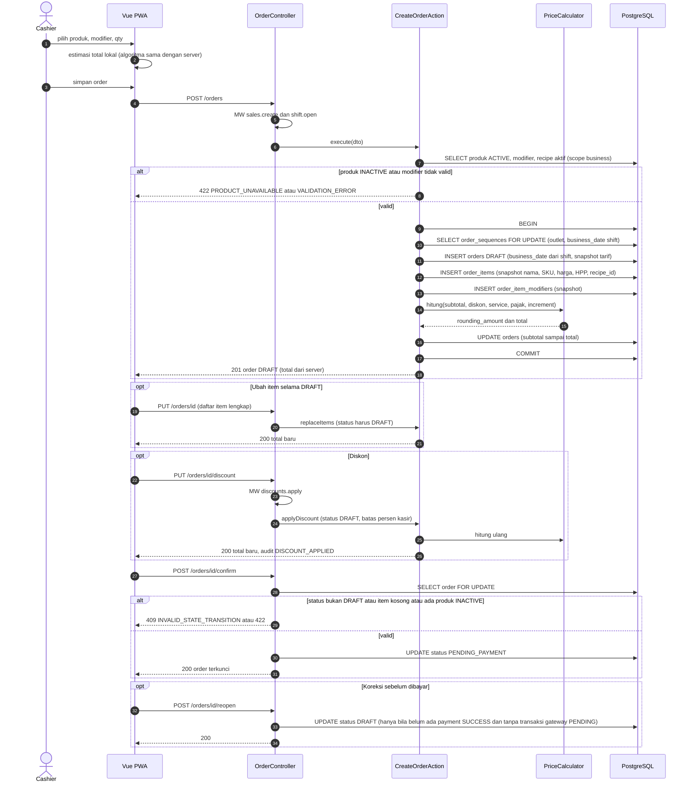
**Catatan:** `shift.open` dicek lewat middleware (BR-001). Penomoran order memakai lock `order_sequences` agar aman konkurensi (BR-019). Server selalu menjadi sumber angka akhir; FE hanya estimasi (selisih pembulatan diperbaiki saat respons tiba). Diskon hanya pada status DRAFT.

#### 3.2.2 SEQ-PAY-01: Bayar Order + Potong Stok (UC-PAY-01, UC-ENG-01)
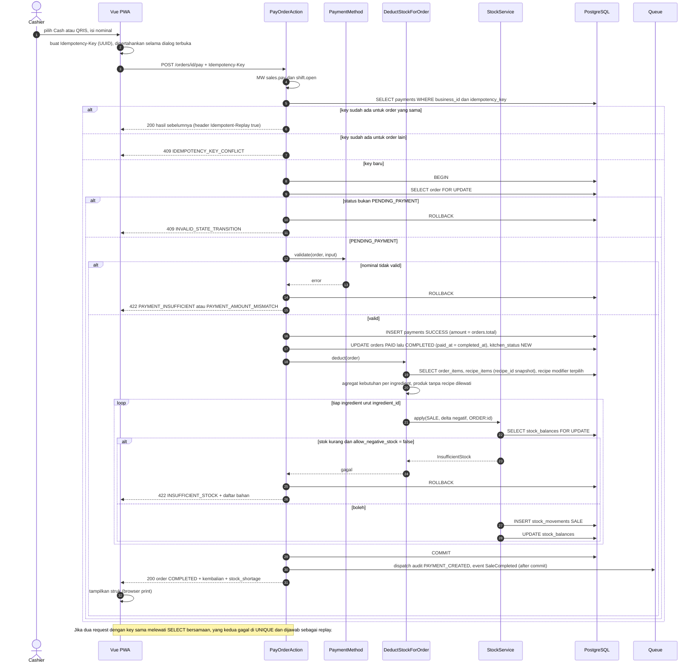
**Catatan:** seluruh langkah di dalam `BEGIN…COMMIT` atomik (ADR-002). Lock berurutan `ingredient_id` mencegah deadlock. `PAID` hanya state transien di dalam transaksi (BR-021). Jaringan putus: FE retry dengan key yang sama. Endpoint ini hanya untuk Cash dan QRIS manual; pembayaran Midtrans memakai SEQ-GW-01 dan SEQ-GW-02 [P2].

#### 3.2.3 SEQ-RFD-01: Refund Penuh (UC-RFD-01)
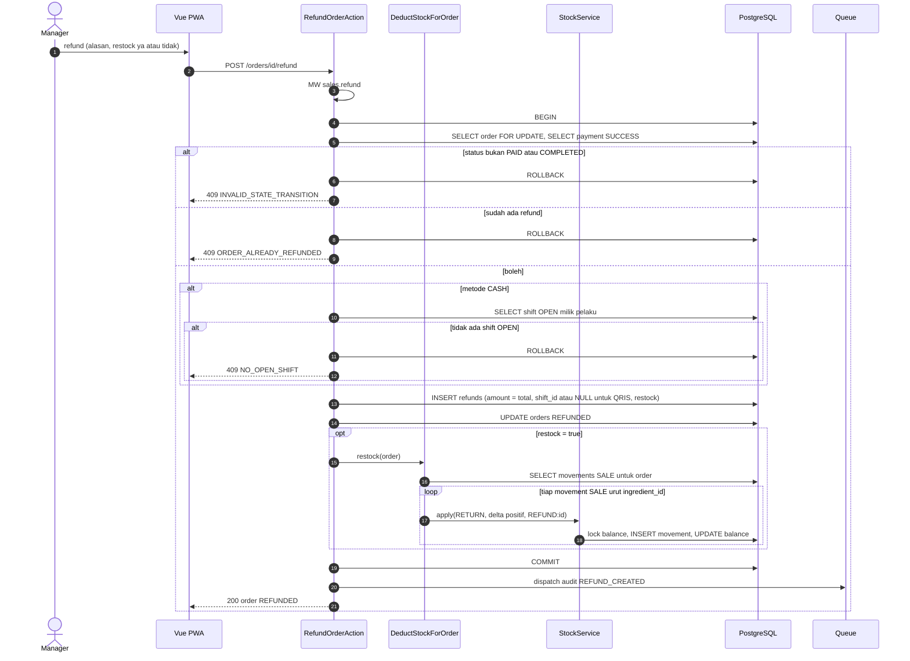
**Catatan:** refund tunai masuk ke shift OPEN **pelaku**, bukan shift asal (BR-012). Refund QRIS hanya tercatat (`shift_id` NULL); pengembalian dana manual. Order `REFUNDED` otomatis keluar dari antrian dapur (filter `COMPLETED`).

#### 3.2.4 SEQ-INV-01: Opening Stock, Adjustment, Waste (UC-INV-01, 03, 04)
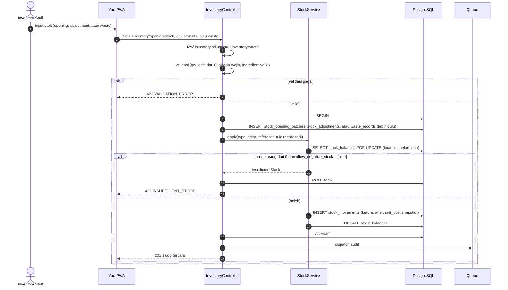
**Catatan:** record induk dibuat **sebelum** movement sehingga `reference_id` sudah ada (menutup T-01). Opening stock membuat satu `stock_opening_batches` untuk seluruh baris; tiap bahan memperoleh satu movement `OPENING` dengan `reference_id` = id batch.

#### 3.2.5 SEQ-INV-02: Stock Opname (UC-INV-05) `[R1.1]`
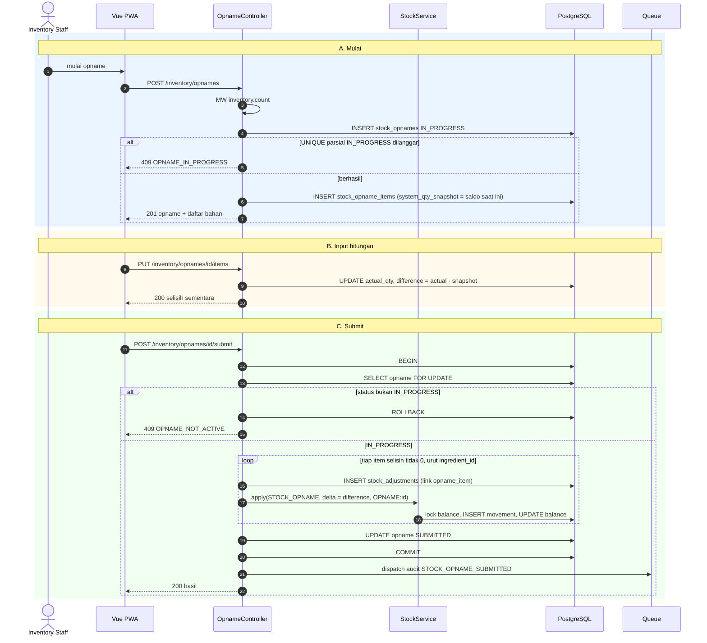
**Catatan:** selisih dihitung terhadap snapshot awal lalu diterapkan ke stok live, sehingga penjualan selama penghitungan tidak hilang (BR-017). Karena `reference_id` movement `STOCK_OPNAME` = id opname, unique idempotensi tetap valid (satu movement per bahan per opname).

#### 3.2.6 SEQ-REC-01: Simpan Recipe Versi Baru (UC-REC-01)
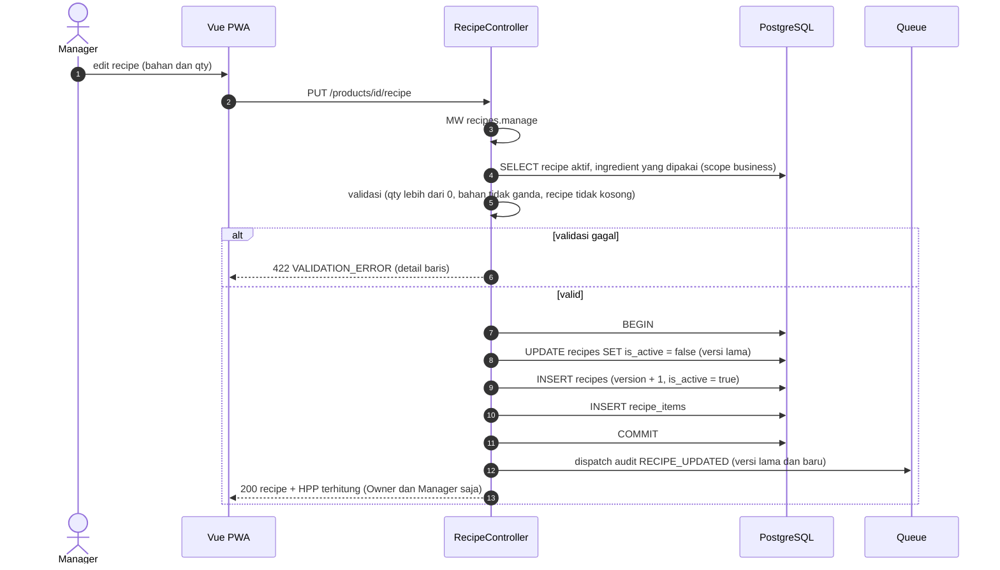
**Catatan:** HPP dihitung saat dibaca (Σ qty × `last_cost`), tidak disimpan di `products`. Order lama tetap menunjuk `recipe_id` versi lamanya (BR-013).

#### 3.2.6a SEQ-PUR-01: Terima Purchase (UC-PUR-03)
```mermaid
sequenceDiagram
    actor U as Inventory/Manager
    participant FE as Vue PWA
    participant API as Laravel API
    participant PS as ReceivePurchase
    participant SS as StockService
    participant DB as PostgreSQL
    U->>FE: Klik "Terima" (konfirmasi ringkasan)
    FE->>API: POST /purchases/{id}/receive
    API->>API: auth, outlet.context, permission purchases.receive
    API->>PS: handle(purchase_id)
    PS->>DB: BEGIN; SELECT purchase FOR UPDATE
    alt status != DRAFT
        PS-->>API: 409 INVALID_STATE_TRANSITION
        API-->>FE: 409
    else DRAFT
        loop item urut ingredient_id
            PS->>SS: apply(PURCHASE, +quantity_base, ref PURCHASE:id, unit_cost_base)
            SS->>DB: lock balance, insert movement (idempoten), update balance
            PS->>DB: UPDATE ingredients SET last_cost = unit_cost_base
        end
        PS->>DB: UPDATE purchases SET status RECEIVED, received_by, received_at
        PS->>DB: COMMIT
        PS-->>API: purchase + ringkasan stok & last_cost
        API->>API: afterCommit: audit PURCHASE_RECEIVED, event PurchaseReceived
        API-->>FE: 200
    end
```
**Catatan:** gagal di langkah mana pun = rollback total (BR-045). Klik ganda: request kedua melihat status RECEIVED → 409, tidak ada movement baru (UNIQUE idempotensi movement sebagai pengaman kedua).

#### 3.2.7 SEQ-AUTH-01: Register Business & Login (UC-AUTH-01, 02)
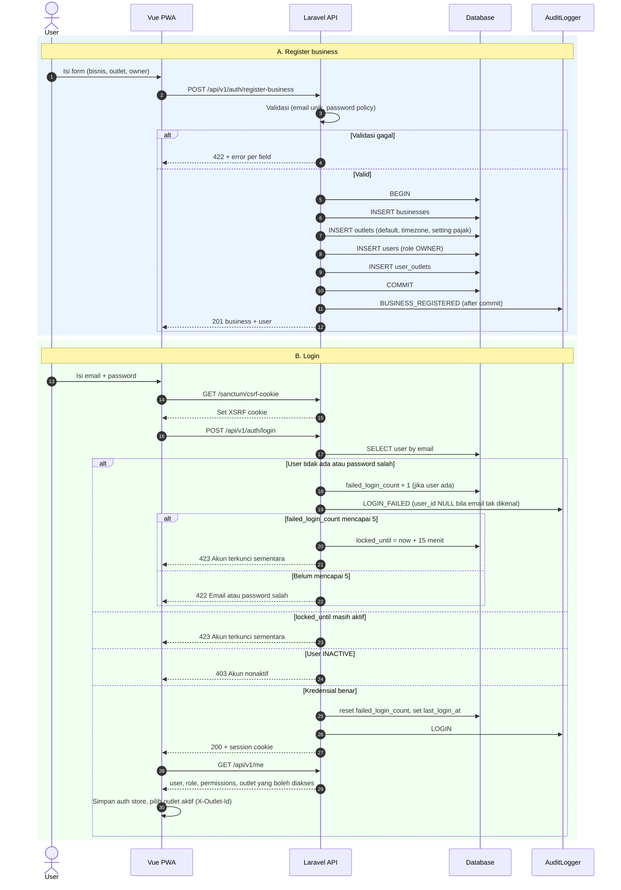

#### 3.2.8 SEQ-USER-01: Kelola User & Cek Permission (UC-USER-01)
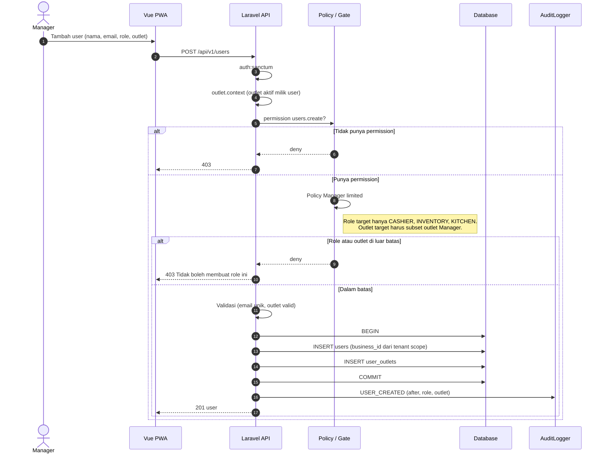

#### 3.2.9 SEQ-CAT-01: Simpan Product & Katalog POS (UC-CAT-01)
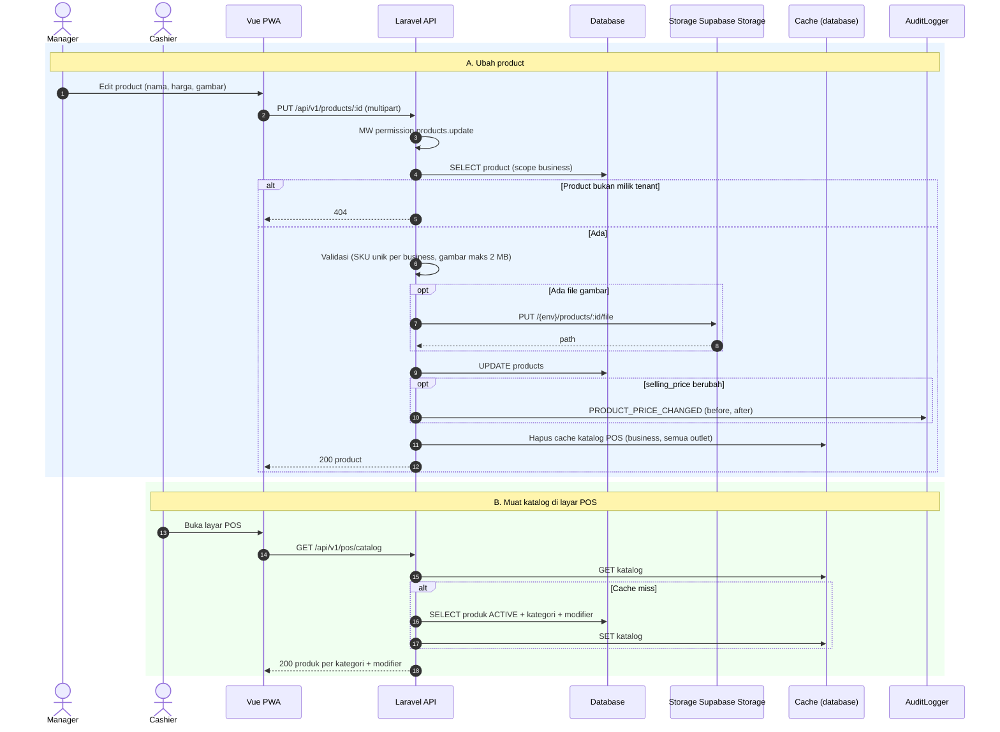
**Catatan:** respons katalog POS tidak memuat HPP; produk tidak punya kolom biaya (FR-CAT-002, NFR-SEC-007).

#### 3.2.10 SEQ-SHF-01: Open Shift, Cash In/Out, Close Shift (UC-SHF-01…03)
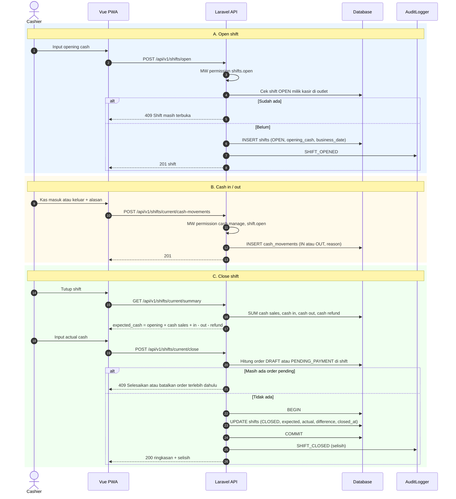
**Catatan:** Expected Cash memakai `payments.amount` tunai (sudah termasuk pembulatan, bersih kembalian) ditambah kas masuk, dikurangi kas keluar dan refund tunai (BR-004). `GET /shifts/current` juga mengembalikan `open_hours_exceeded` (BR-026). Pembayaran gateway (non-tunai) tidak masuk Expected Cash dan tampil di `non_cash` per metode (BR-042).

#### 3.2.11 SEQ-ORD-02: Cancel Order (UC-ORD-03)
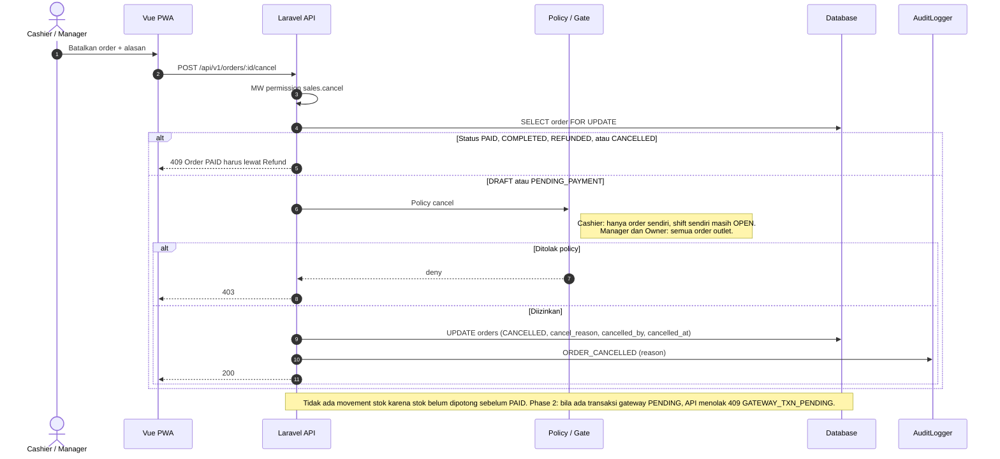

#### 3.2.12 SEQ-KIT-01: Antrian Dapur (UC-KIT-01) `[R1.1]`
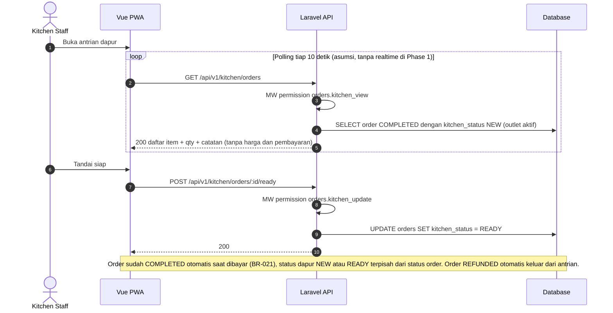

#### 3.2.13 SEQ-RPT-01: Dashboard & Laporan (UC-RPT-01, 02)
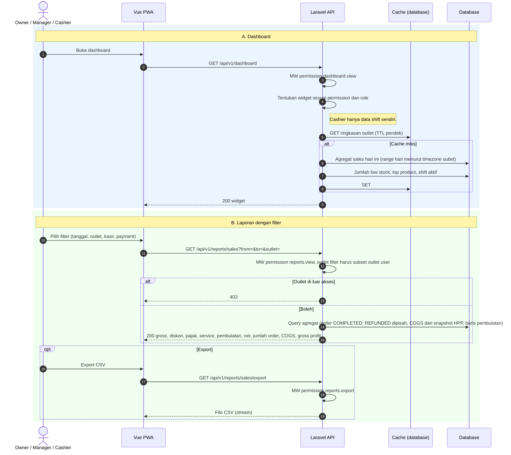

#### 3.2.14 SEQ-GW-01: Mulai Pembayaran Midtrans [P2] (UC-PAY-03)
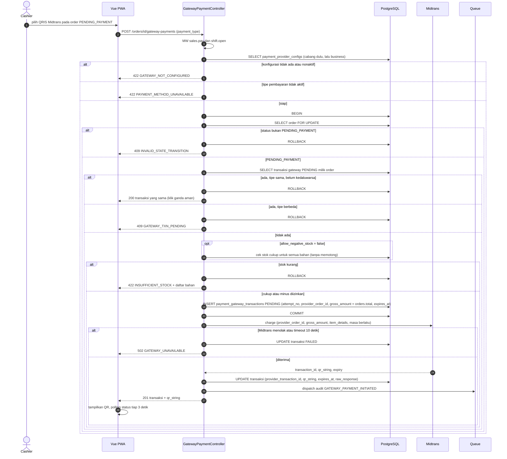
**Catatan:** transaksi dicatat dan di-commit **sebelum** memanggil Midtrans, sehingga tidak ada transaksi di Midtrans yang tidak kita kenal. Jika dua request berebut, index unik parsial `(order_id) WHERE status = 'PENDING'` menolak yang kedua, lalu dijawab sebagai replay. `item_details` disusun agar jumlahnya sama dengan `gross_amount` (item, diskon sebagai nilai negatif, service, pajak, pembulatan).

#### 3.2.15 SEQ-GW-02: Webhook Midtrans dan Proses Settlement [P2] (UC-SYS-01)
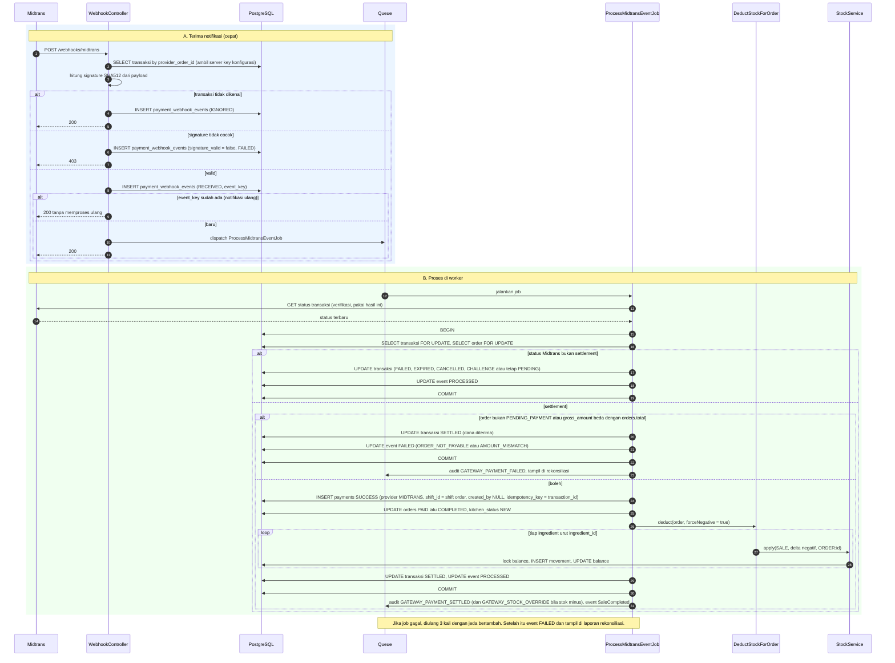
**Catatan:** bagian A hanya menyimpan dan membalas (target p95 < 300 ms). Bagian B berjalan di worker (target selesai p95 ≤ 5 detik sejak diterima). `idempotency_key = transaction_id` membuat pembuatan payment aman bila job berjalan dua kali. FE mengetahui hasil lewat polling `GET /orders/{id}/gateway-payments/current`.

#### 3.2.16 SEQ-GW-03: Batalkan Transaksi dan Penyapu Kedaluwarsa [P2] (UC-PAY-03)
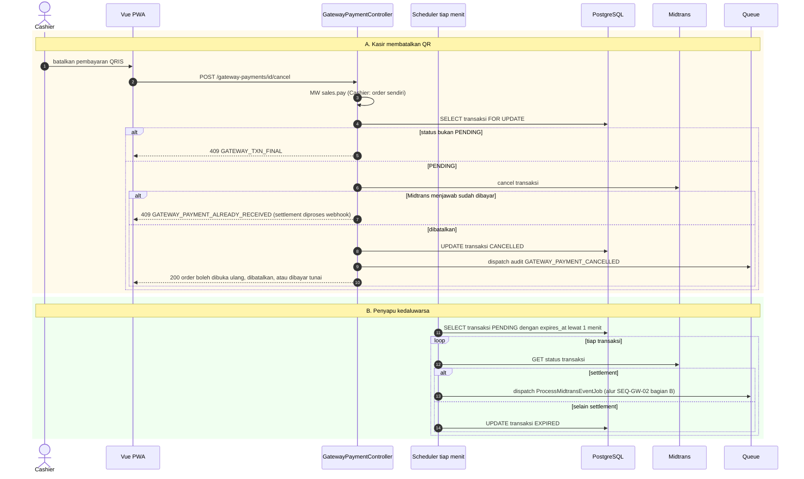
**Catatan:** penyapu juga mengulang event `RECEIVED`/`FAILED` yang belum terproses.

#### 3.2.17 SEQ-GW-04: Refund Pembayaran Midtrans [P2] (UC-RFD-01)
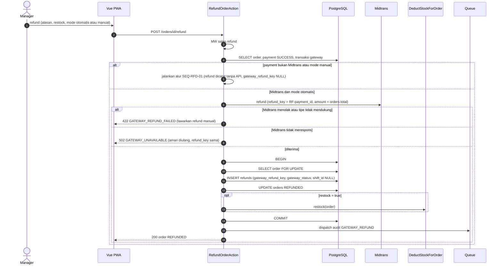
**Catatan:** `refund_key` deterministik (`RF-{payment_id}`), sehingga bila commit DB gagal setelah Midtrans menerima, pengulangan request tidak menggandakan refund. Dukungan refund via API berbeda per tipe pembayaran `[ASUMSI]`; jalur manual selalu tersedia.

### 3.3 Activity Diagram
#### ACT-ORD-02: Hitung Total Order (dipakai SEQ-ORD-01)
```mermaid
flowchart TD
  S([Mulai]) --> A["subtotal = jumlah (harga + price_delta) x qty"]
  A --> B{"Ada diskon order?"}
  B -- Tidak --> C["diskon = 0"]
  B -- Ya --> D{"Tipe PERCENT?"}
  D -- Ya --> E["diskon = half_up(subtotal x persen / 100)"]
  D -- Tidak --> F["diskon = nominal"]
  E --> G{"diskon lebih dari subtotal?"}
  F --> G
  G -- Ya --> X1(["Tolak: DISCOUNT_INVALID"])
  G -- Tidak --> H["dpp = subtotal - diskon"]
  C --> H
  H --> I["service = half_up(dpp x service_rate / 100)"]
  I --> J["pajak = half_up((dpp + service) x tax_rate / 100)"]
  J --> K["sebelum = dpp + service + pajak"]
  K --> L{"increment = 0?"}
  L -- Ya --> M["rounding = 0"]
  L -- Tidak --> N["rounded = half_up(sebelum / increment) x increment"]
  N --> O{"sebelum lebih dari 0 dan rounded = 0?"}
  O -- Ya --> P["rounded = increment"]
  O -- Tidak --> Q["rounding = rounded - sebelum"]
  P --> Q
  M --> R["total = sebelum + rounding"]
  Q --> R
  R --> Z([Selesai])
```
**Catatan:** urutan sesuai BR-005 dan BR-036. Contoh uji (increment 100, service 5%, pajak 10%): subtotal 54.000 → total 62.400 (rounding +30); dengan diskon 10% → total 56.100 (rounding −33). Vektor uji ini dipakai bersama oleh test backend dan frontend.

#### ACT-INV-01: `StockService::apply()`
```mermaid
flowchart TD
  S([Mulai]) --> A["Ambil balance FOR UPDATE, buat bila belum ada"]
  A --> B{"Movement dengan referensi sama sudah ada?"}
  B -- Ya --> R1(["Kembalikan movement lama: idempoten"])
  B -- Tidak --> C["after = before + delta"]
  C --> D{"after kurang dari 0?"}
  D -- Tidak --> F["INSERT movement + UPDATE balance"]
  D -- Ya --> E{"allow_negative_stock?"}
  E -- Ya --> F
  E -- Tidak --> X1(["Lempar InsufficientStock"])
  F --> Z([Selesai])
```
**Catatan:** dipanggil dari semua jalur (SALE, RETURN, OPENING, ADJUSTMENT, WASTE, STOCK_OPNAME). `after < 0` pada `allow_negative_stock = true` ditandai sebagai `stock_shortage` untuk SALE. Parameter `forceNegative = true` dipakai **hanya** oleh settlement gateway (BR-041): stok tetap dipotong walau minus dan ditandai `GATEWAY_STOCK_OVERRIDE` [P2].

### 3.4 State Diagram
#### STM-ORDER: Status `orders.status`
```mermaid
stateDiagram-v2
    [*] --> DRAFT : buat order
    DRAFT --> PENDING_PAYMENT : konfirmasi
    PENDING_PAYMENT --> DRAFT : buka kembali
    DRAFT --> CANCELLED : batal
    PENDING_PAYMENT --> CANCELLED : batal
    PENDING_PAYMENT --> PAID : bayar sukses
    PAID --> COMPLETED : otomatis dalam transaksi yang sama
    PAID --> REFUNDED : refund
    COMPLETED --> REFUNDED : refund
    CANCELLED --> [*]
    REFUNDED --> [*]
```
| Dari | Ke | Pemicu | Aktor | Guard / Syarat | Efek Samping |
|------|----|--------|-------|----------------|--------------|
| (awal) | DRAFT | `POST /orders` | Cashier | Shift OPEN milik pelaku | Nomor order, snapshot item, total |
| DRAFT | PENDING_PAYMENT | `confirm` | Cashier | ≥ 1 item, semua produk ACTIVE | Item terkunci |
| PENDING_PAYMENT | DRAFT | `reopen` | Cashier, Manager, Owner | Belum ada payment `SUCCESS` **dan** tanpa transaksi gateway `PENDING` (BR-038) | Item dapat diubah |
| DRAFT, PENDING_PAYMENT | CANCELLED | `cancel` | Cashier (Limited), Manager, Owner | Alasan wajib; Cashier hanya order sendiri di shift OPEN; tanpa transaksi gateway `PENDING` (BR-038) | Audit; tanpa movement |
| PENDING_PAYMENT | PAID | `pay` (Cash, QRIS manual) atau settlement Midtrans [P2] | Cashier; Sistem (settlement) | Kasir: nominal valid, key baru, stok cukup atau minus diizinkan. Settlement: terverifikasi, nominal = total, stok tidak pernah menolak (BR-041) | Payment, movement SALE, `kitchen_status = NEW` |
| PAID | COMPLETED | otomatis | Sistem | Dalam transaksi yang sama dengan `pay` | `completed_at = paid_at` |
| PAID, COMPLETED | REFUNDED | `refund` | Manager, Owner | Belum ada refund; tunai butuh shift OPEN pelaku | Refund, kas keluar, RETURN opsional |

Transisi yang tidak tercantum **dilarang** → `409 INVALID_STATE_TRANSITION`. `CANCELLED` dan `REFUNDED` terminal.

**Status dapur** (`orders.kitchen_status`, terpisah dari status order):
| Dari | Ke | Pemicu | Aktor | Guard |
|------|----|--------|-------|-------|
| NULL | NEW | `pay` sukses | Sistem | — |
| NEW | READY | `POST /kitchen/orders/{id}/ready` | Kitchen, Manager, Owner | Order `COMPLETED` |

#### STM-GATEWAY: Status `payment_gateway_transactions.status` [P2]
```mermaid
stateDiagram-v2
    [*] --> PENDING : kasir mulai bayar, transaksi dibuat
    PENDING --> SETTLED : settlement terverifikasi
    PENDING --> CHALLENGE : kartu ditahan fraud check
    CHALLENGE --> SETTLED : disetujui
    CHALLENGE --> FAILED : ditolak
    PENDING --> FAILED : deny, failure, atau Midtrans menolak
    PENDING --> CANCELLED : kasir membatalkan
    PENDING --> EXPIRED : lewat batas waktu
    SETTLED --> [*]
    FAILED --> [*]
    CANCELLED --> [*]
    EXPIRED --> [*]
```
| Dari | Ke | Pemicu | Aktor | Guard / Syarat | Efek Samping |
|------|----|--------|-------|----------------|--------------|
| (awal) | PENDING | `POST /orders/{id}/gateway-payments` | Cashier | Order `PENDING_PAYMENT`, tidak ada transaksi PENDING lain (BR-038) | Order terkunci dari reopen/cancel |
| PENDING | SETTLED | Webhook atau penyapu | Sistem | Status Midtrans `settlement` (atau `capture` + `accept`) | Bila order boleh: payment + order `COMPLETED` + potong stok (SEQ-GW-02). Bila tidak: hanya status, masuk rekonsiliasi |
| PENDING | FAILED | Webhook `deny`/`failure`, atau Midtrans menolak charge | Sistem | — | Order tetap `PENDING_PAYMENT` |
| PENDING | CANCELLED | `POST /gateway-payments/{id}/cancel` | Cashier (order sendiri), Manager, Owner | Midtrans menerima cancel | Order dapat dibuka ulang atau dibayar tunai |
| PENDING | EXPIRED | Webhook `expire` atau penyapu | Sistem | Lewat `expires_at` dan Midtrans tidak settlement | Order tetap `PENDING_PAYMENT` |
| PENDING | CHALLENGE | Webhook `capture` + `challenge` | Sistem | Hanya kartu | Menunggu keputusan di dashboard Midtrans |
| CHALLENGE | SETTLED, FAILED | Webhook lanjutan | Sistem | | Sama seperti di atas |

Transisi lain **diabaikan** (event ditandai `IGNORED`). Status akhir tidak berubah lagi.

#### STM-SHIFT: Status `shifts.status`
```mermaid
stateDiagram-v2
    [*] --> OPEN : buka shift
    OPEN --> CLOSED : tutup shift
    CLOSED --> [*]
```
| Dari | Ke | Pemicu | Aktor | Guard / Syarat | Efek Samping |
|------|----|--------|-------|----------------|--------------|
| (awal) | OPEN | `open` | Cashier | Tidak ada shift OPEN milik pelaku di outlet (UNIQUE parsial) | `business_date` terisi |
| OPEN | CLOSED | `close` | Cashier | Tidak ada order DRAFT/PENDING_PAYMENT di shift | `expected_cash`, `actual_cash`, `difference`, audit |

#### STM-OPNAME: Status `stock_opnames.status` `[R1.1]`
```mermaid
stateDiagram-v2
    [*] --> IN_PROGRESS : mulai opname
    IN_PROGRESS --> SUBMITTED : submit
    IN_PROGRESS --> CANCELLED : batalkan
    SUBMITTED --> [*]
    CANCELLED --> [*]
```
| Dari | Ke | Pemicu | Aktor | Guard / Syarat | Efek Samping |
|------|----|--------|-------|----------------|--------------|
| (awal) | IN_PROGRESS | `POST /inventory/opnames` | Inventory | Tidak ada opname IN_PROGRESS di outlet | Snapshot stok |
| IN_PROGRESS | SUBMITTED | `submit` | Inventory | Status masih IN_PROGRESS | Movement STOCK_OPNAME per selisih ≠ 0, audit |
| IN_PROGRESS | CANCELLED | `cancel` | Inventory, Manager | — | Stok tidak berubah |

#### STM-PURCHASE: Status `purchases.status`
```mermaid
stateDiagram-v2
    [*] --> DRAFT: buat purchase
    DRAFT --> DRAFT: ubah item / supplier
    DRAFT --> RECEIVED: receive (stok + last_cost)
    DRAFT --> CANCELLED: cancel (R1.1)
    RECEIVED --> [*]
    CANCELLED --> [*]
```
| Dari | Ke | Pemicu | Guard | Efek |
|------|----|--------|-------|------|
| DRAFT | RECEIVED | `POST /purchases/{id}/receive` | `purchases.receive`; supplier ACTIVE; item ≥ 1 | movement `PURCHASE`, `last_cost`, audit |
| DRAFT | CANCELLED `[R1.1]` | `POST /purchases/{id}/cancel` | `purchases.cancel`; alasan wajib | Tanpa movement |
| RECEIVED, CANCELLED | — | — | Final | Tidak dapat diubah (BR-048) |


---


## 4. API Specification

### 4.1 Konvensi
- **Base URL:** `https://{domain}/api/v1`; CSRF: `GET /sanctum/csrf-cookie` (di luar prefix versi)
- **Format:** JSON; field `snake_case`; URL `kebab-case`; multipart hanya untuk upload gambar produk
- **Auth:** Sanctum SPA (cookie). Header wajib pada endpoint outlet: `X-Outlet-Id: {id}`
- **Uang:** bilangan bulat rupiah. **Qty/biaya desimal dikirim sebagai string** (`"150.0000"`) agar tidak kehilangan presisi. Waktu: ISO-8601 UTC (`2026-10-12T03:15:00Z`); `business_date` berupa `YYYY-MM-DD`
- **Pagination:** `?page=1&per_page=20` (maks 100) → `meta` + `links`
- **Idempotency:** `POST /orders/{id}/pay` wajib header `Idempotency-Key` (UUID). Replay → `200` + header `Idempotent-Replay: true`
- **Rate limit:** login `5/menit/IP+email`, pay `30/menit/user`, gateway `30/menit/user`, umum `120/menit/user`, webhook `600/menit/IP` `[ASUMSI]`; lewat batas → `429 RATE_LIMITED`
- **Webhook [P2]:** `POST /webhooks/midtrans` publik, tanpa sesi, `X-Outlet-Id`, dan CSRF; keamanan lewat signature (§1.5). Idempotensi lewat `event_key`; refund lewat `gateway_refund_key`
- **Versi:** path-based (`/api/v1`)
- **Tenant:** data business lain → `404 NOT_FOUND`, tidak pernah `403`

### 4.2 Standar Response
**Sukses**
```json
{ "success": true, "data": { }, "message": "Berhasil", "meta": { "page": 1, "per_page": 20, "total": 100 } }
```
**Error**
```json
{ "success": false, "error": { "code": "VALIDATION_ERROR", "message": "Input tidak valid", "details": { "email": ["Email sudah digunakan."] } } }
```

### 4.3 Kode Error Global
| HTTP | Code | Kondisi | Rujukan |
|------|------|---------|---------|
| 401 | UNAUTHENTICATED | Belum login / sesi habis | FR-AUTH-002 |
| 403 | FORBIDDEN | Tanpa permission, outlet di luar akses, aturan "Limited" | FR-USER-002 |
| 403 | ACCOUNT_INACTIVE | Akun nonaktif | FR-AUTH-002 |
| 403 | DISCOUNT_LIMIT_EXCEEDED | Diskon Cashier melebihi batas outlet | FR-ORD-003 |
| 404 | NOT_FOUND | Tidak ada / milik tenant lain | BR-022 |
| 409 | NO_OPEN_SHIFT | Butuh shift OPEN | BR-001, BR-012 |
| 409 | SHIFT_ALREADY_OPEN | Sudah ada shift OPEN | BR-002 |
| 409 | SHIFT_HAS_PENDING_ORDERS | Ada order DRAFT/PENDING saat close | BR-003 |
| 409 | INVALID_STATE_TRANSITION | Transisi status dilarang | STM-* |
| 409 | ORDER_ALREADY_REFUNDED | Refund ganda | BR-035 |
| 409 | IDEMPOTENCY_KEY_CONFLICT | Key dipakai untuk order lain | BR-008 |
| 409 | OPNAME_IN_PROGRESS | Opname lain berjalan | BR-017 |
| 409 | OPNAME_NOT_ACTIVE | Opname sudah selesai/batal | BR-017 |
| 422 | VALIDATION_ERROR | Input tidak valid (per field di `details`) | SRS validasi |
| 422 | INVALID_CREDENTIALS | Email/password salah | FR-AUTH-002 |
| 422 | PRODUCT_UNAVAILABLE | Produk/modifier INACTIVE | BR-029 |
| 422 | DISCOUNT_INVALID | Diskon melebihi subtotal | BR-006 |
| 422 | PAYMENT_INSUFFICIENT | Tunai kurang dari total | BR-007 |
| 422 | PAYMENT_AMOUNT_MISMATCH | Nominal QRIS ≠ total | BR-007 |
| 422 | PAYMENT_METHOD_UNAVAILABLE | CARD/GATEWAY | FR-PAY-001 |
| 422 | IDEMPOTENCY_KEY_REQUIRED | Header hilang | BR-008 |
| 422 | INSUFFICIENT_STOCK | Stok kurang dan minus dilarang | BR-011 |
| 423 | ACCOUNT_LOCKED | Terkunci 15 menit | BR-023 |
| 429 | RATE_LIMITED | Terlalu banyak permintaan | NFR-SEC-006 |
| 403 | INVALID_SIGNATURE | [P2] Signature webhook tidak cocok | BR-040 |
| 409 | GATEWAY_TXN_PENDING | [P2] Sudah ada transaksi gateway PENDING untuk order (reopen, cancel, atau tipe lain) | BR-038 |
| 409 | GATEWAY_TXN_FINAL | [P2] Transaksi sudah selesai, tidak bisa dibatalkan | FR-PAY-005 |
| 409 | GATEWAY_PAYMENT_ALREADY_RECEIVED | [P2] Cancel ditolak karena dana sudah diterima | FR-PAY-005 |
| 422 | GATEWAY_NOT_CONFIGURED | [P2] Midtrans belum dikonfigurasi atau nonaktif di outlet | FR-PAY-003 |
| 422 | GATEWAY_REFUND_FAILED | [P2] Midtrans menolak refund | BR-043 |
| 502 | GATEWAY_UNAVAILABLE | [P2] Midtrans tidak merespons atau menolak charge | FR-PAY-003 |

### 4.4 Daftar Endpoint
Permission mengikuti SRS §2.1 (Final). "Login" = cukup sesi + outlet context.

| ID | Method | Endpoint | Permission | UC | FR | Deskripsi |
|----|--------|----------|-----------|----|----|-----------|
| API-AUTH-01 | POST | `/auth/register-business` | Publik | UC-AUTH-01 | FR-AUTH-001 | Buat business, outlet, Owner |
| API-AUTH-02 | POST | `/auth/login` | Publik | UC-AUTH-02 | FR-AUTH-002 | Login |
| API-AUTH-03 | POST | `/auth/logout` | Login | UC-AUTH-02 | FR-AUTH-002 | Logout |
| API-AUTH-04 | GET | `/me` | Login | UC-AUTH-02 | FR-AUTH-004 | User, role, permission, outlet |
| API-AUTH-05 | PUT | `/me` | Login | UC-AUTH-03 | FR-AUTH-003 | Ubah profil |
| API-AUTH-06 | PUT | `/me/password` | Login | UC-AUTH-03 | FR-AUTH-003 | Ganti password |
| API-BIZ-01 | GET | `/business` | `settings.view` | UC-BIZ-01 | FR-BIZ-001 | Profil + license |
| API-BIZ-02 | PUT | `/business` | `settings.update` (Owner) | UC-BIZ-01 | FR-BIZ-001 | Ubah profil + license |
| API-BIZ-03 | GET | `/outlets` | `outlets.view` | UC-BIZ-01 | FR-BIZ-002 | Daftar outlet yang diakses |
| API-BIZ-04 | POST | `/outlets` | `outlets.manage` | UC-BIZ-01 | FR-BIZ-002 | Tambah outlet |
| API-BIZ-05 | PUT | `/outlets/{id}` | `outlets.manage` | UC-BIZ-01 | FR-BIZ-002 | Ubah/nonaktifkan outlet |
| API-BIZ-06 | GET | `/outlets/{id}/settings` | `settings.view` | UC-BIZ-02 | FR-BIZ-003 | Baca pengaturan |
| API-BIZ-07 | PUT | `/outlets/{id}/settings` | `settings.update` (Manager Limited) | UC-BIZ-02 | FR-BIZ-003 | Ubah pengaturan |
| API-USER-01 | GET | `/users` | `users.view` | UC-USER-01 | FR-USER-001 | Daftar user |
| API-USER-02 | POST | `/users` | `users.create` | UC-USER-01 | FR-USER-001 | Tambah user |
| API-USER-03 | GET | `/users/{id}` | `users.view` | UC-USER-01 | FR-USER-001 | Detail |
| API-USER-04 | PUT | `/users/{id}` | `users.update` | UC-USER-01 | FR-USER-001 | Ubah role/outlet/profil |
| API-USER-05 | PATCH | `/users/{id}/status` | `users.delete` | UC-USER-01 | FR-USER-001 | Aktif/nonaktif |
| API-USER-06 | GET | `/roles` | `users.view` | UC-USER-01 | FR-USER-001 | Role yang boleh dipilih pelaku |
| API-CAT-01 | GET | `/categories` | `products.view` | UC-CAT-01 | FR-CAT-001 | Daftar kategori |
| API-CAT-02 | POST | `/categories` | `products.create` | UC-CAT-01 | FR-CAT-001 | Tambah |
| API-CAT-03 | PUT | `/categories/{id}` | `products.update` | UC-CAT-01 | FR-CAT-001 | Ubah |
| API-CAT-04 | DELETE | `/categories/{id}` | `products.delete` | UC-CAT-01 | FR-CAT-001 | Soft delete / INACTIVE |
| API-CAT-05 | GET | `/products` | `products.view` | UC-CAT-01 | FR-CAT-002 | Daftar produk |
| API-CAT-06 | POST | `/products` | `products.create` | UC-CAT-01 | FR-CAT-002 | Tambah (multipart bila ada gambar) |
| API-CAT-07 | GET | `/products/{id}` | `products.view` | UC-CAT-01 | FR-CAT-002 | Detail |
| API-CAT-08 | POST | `/products/{id}` (`_method=PUT`) | `products.update` | UC-CAT-01 | FR-CAT-002 | Ubah (multipart) |
| API-CAT-09 | DELETE | `/products/{id}` | `products.delete` | UC-CAT-01 | FR-CAT-002 | Soft delete / INACTIVE |
| API-CAT-10 | GET | `/modifier-groups` | `products.view` | UC-CAT-02 | FR-CAT-003 | Daftar group + option |
| API-CAT-11 | POST | `/modifier-groups` | `products.create` | UC-CAT-02 | FR-CAT-003 | Tambah group |
| API-CAT-12 | PUT | `/modifier-groups/{id}` | `products.update` | UC-CAT-02 | FR-CAT-003 | Ubah group |
| API-CAT-13 | DELETE | `/modifier-groups/{id}` | `products.delete` | UC-CAT-02 | FR-CAT-003 | Soft delete |
| API-CAT-14 | POST | `/modifier-groups/{id}/options` | `products.create` | UC-CAT-02 | FR-CAT-003 | Tambah option |
| API-CAT-15 | PUT | `/modifier-options/{id}` | `products.update` | UC-CAT-02 | FR-CAT-003 | Ubah option |
| API-CAT-16 | DELETE | `/modifier-options/{id}` | `products.delete` | UC-CAT-02 | FR-CAT-003 | Soft delete |
| API-CAT-17 | PUT | `/products/{id}/modifier-groups` | `products.update` | UC-CAT-02 | FR-CAT-003 | Pasang group ke produk (sync) |
| API-CAT-18 | GET | `/pos/catalog` | `sales.create` | UC-ORD-01 | FR-CAT-004 | Katalog POS (cache) |
| API-ING-01 | GET | `/ingredients` | `inventory.view` | UC-ING-01 | FR-ING-001 | Daftar bahan |
| API-ING-02 | POST | `/ingredients` | `inventory.adjust` | UC-ING-01 | FR-ING-001 | Tambah |
| API-ING-03 | GET | `/ingredients/{id}` | `inventory.view` | UC-ING-01 | FR-ING-001 | Detail |
| API-ING-04 | PUT | `/ingredients/{id}` | `inventory.adjust` | UC-ING-01 | FR-ING-001 | Ubah |
| API-ING-05 | DELETE | `/ingredients/{id}` | `inventory.adjust` | UC-ING-01 | FR-ING-001 | Soft delete / INACTIVE |
| API-ING-06 | GET | `/units` | `inventory.view` | UC-ING-01 | FR-ING-001 | Daftar satuan |
| API-REC-01 | GET | `/products/{id}/recipe` | `recipes.view` | UC-REC-01, 03 | FR-REC-001, 003 | Recipe aktif (+HPP untuk Owner/Manager) |
| API-REC-02 | PUT | `/products/{id}/recipe` | `recipes.manage` | UC-REC-01 | FR-REC-001 | Simpan versi baru |
| API-REC-03 | GET | `/modifier-options/{id}/recipe` | `recipes.view` | UC-REC-02 | FR-REC-002 | Recipe option `[R1.1]` |
| API-REC-04 | PUT | `/modifier-options/{id}/recipe` | `recipes.manage` | UC-REC-02 | FR-REC-002 | Simpan recipe option `[R1.1]` |
| API-SHF-01 | POST | `/shifts/open` | `shifts.open` | UC-SHF-01 | FR-SHF-001 | Buka shift |
| API-SHF-02 | GET | `/shifts/current` | `shifts.open` | UC-SHF-01 | FR-SHF-004 | Shift OPEN + `open_hours_exceeded` |
| API-SHF-03 | GET | `/shifts/current/summary` | `shifts.close` | UC-SHF-03 | FR-SHF-003 | Ringkasan + Expected Cash |
| API-SHF-04 | POST | `/shifts/current/cash-movements` | `cash.manage` | UC-SHF-02 | FR-SHF-002 | Kas masuk/keluar |
| API-SHF-05 | POST | `/shifts/current/close` | `shifts.close` | UC-SHF-03 | FR-SHF-003 | Tutup shift |
| API-SHF-06 | GET | `/shifts` | `shifts.view_all` | UC-SHF-03 | FR-SHF-004 | Daftar shift outlet |
| API-SHF-07 | GET | `/shifts/{id}` | `shifts.view_all` | UC-SHF-03 | FR-SHF-004 | Detail + ringkasan |
| API-ORD-01 | POST | `/orders` | `sales.create` | UC-ORD-01 | FR-ORD-001, 002, 007 | Buat draft |
| API-ORD-02 | GET | `/orders` | `sales.view` (Own) | UC-ORD-04 | FR-ORD-006 | Riwayat |
| API-ORD-03 | GET | `/orders/{id}` | `sales.view` (Own) | UC-ORD-04 | FR-ORD-006 | Detail |
| API-ORD-04 | PUT | `/orders/{id}` | `sales.update` | UC-ORD-01 | FR-ORD-001 | Ganti seluruh item (DRAFT) |
| API-ORD-05 | PUT | `/orders/{id}/discount` | `discounts.apply` | UC-ORD-02 | FR-ORD-003 | Diskon order |
| API-ORD-06 | POST | `/orders/{id}/confirm` | `sales.update` | UC-ORD-01 | FR-ORD-004 | → PENDING_PAYMENT |
| API-ORD-07 | POST | `/orders/{id}/reopen` | `sales.update` | UC-ORD-01 | FR-ORD-004 | → DRAFT |
| API-ORD-08 | POST | `/orders/{id}/cancel` | `sales.cancel` (Limited) | UC-ORD-03 | FR-ORD-005 | Batalkan |
| API-PAY-01 | POST | `/orders/{id}/pay` | `sales.pay` | UC-PAY-01 | FR-PAY-001 | Bayar + potong stok |
| API-PAY-02 | GET | `/orders/{id}/receipt` | `sales.view` | UC-PAY-02 | FR-PAY-002 | Data struk |
| API-RFD-01 | POST | `/orders/{id}/refund` | `sales.refund` | UC-RFD-01 | FR-RFD-001 | Refund penuh |
| API-ENG-01 | GET | `/orders/{id}/stock-trace` | `inventory.view` | UC-ENG-01 | FR-ENG-003 | Order → movement |
| API-KIT-01 | GET | `/kitchen/orders` | `orders.kitchen_view` | UC-KIT-01 | FR-KIT-001 | Antrian dapur `[R1.1]` |
| API-KIT-02 | POST | `/kitchen/orders/{id}/ready` | `orders.kitchen_update` | UC-KIT-01 | FR-KIT-001 | Tandai siap `[R1.1]` |
| API-INV-01 | GET | `/inventory/stocks` | `inventory.view` | UC-INV-02 | FR-INV-002 | Stok per bahan |
| API-INV-02 | GET | `/inventory/movements` | `inventory.view` | UC-INV-02 | FR-INV-002 | Riwayat movement |
| API-INV-03 | GET | `/inventory/low-stock` | `inventory.view` | UC-INV-02 | FR-INV-005 | Low stock + minus |
| API-INV-04 | POST | `/inventory/opening-stock` | `inventory.adjust` | UC-INV-01 | FR-INV-001 | Stok awal |
| API-INV-05 | POST | `/inventory/adjustments` | `inventory.adjust` | UC-INV-03 | FR-INV-003 | Adjustment |
| API-INV-06 | GET | `/inventory/adjustments` | `inventory.view` | UC-INV-03 | FR-INV-003 | Daftar adjustment |
| API-INV-07 | POST | `/inventory/waste` | `inventory.waste` | UC-INV-04 | FR-INV-004 | Catat waste |
| API-INV-08 | GET | `/inventory/waste` | `inventory.waste` | UC-INV-04 | FR-INV-004 | Daftar waste (Kitchen tanpa biaya) `[R1.1]` |
| API-INV-09 | POST | `/inventory/opnames` | `inventory.count` | UC-INV-05 | FR-INV-006 | Mulai opname `[R1.1]` |
| API-INV-10 | GET | `/inventory/opnames` | `inventory.count` | UC-INV-05 | FR-INV-006 | Daftar opname `[R1.1]` |
| API-INV-11 | GET | `/inventory/opnames/{id}` | `inventory.count` | UC-INV-05 | FR-INV-006 | Detail `[R1.1]` |
| API-INV-12 | PUT | `/inventory/opnames/{id}/items` | `inventory.count` | UC-INV-05 | FR-INV-006 | Input hitungan `[R1.1]` |
| API-INV-13 | POST | `/inventory/opnames/{id}/submit` | `inventory.count` | UC-INV-05 | FR-INV-006 | Submit `[R1.1]` |
| API-INV-14 | POST | `/inventory/opnames/{id}/cancel` | `inventory.count` | UC-INV-05 | FR-INV-006 | Batalkan `[R1.1]` |
| API-PUR-01 | GET | `/suppliers` | `suppliers.view` | UC-PUR-01 | FR-PUR-001 | Daftar supplier |
| API-PUR-02 | POST | `/suppliers` | `suppliers.create` | UC-PUR-01 | FR-PUR-001 | Tambah supplier |
| API-PUR-03 | PUT | `/suppliers/{id}` | `suppliers.update` | UC-PUR-01 | FR-PUR-001 | Ubah/nonaktifkan |
| API-PUR-04 | DELETE | `/suppliers/{id}` | `suppliers.delete` | UC-PUR-01 | FR-PUR-001 | Hapus (soft) |
| API-PUR-05 | GET | `/purchases` | `purchases.view` | UC-PUR-04 | FR-PUR-004 | Daftar purchase (filter status, supplier, tanggal) |
| API-PUR-06 | POST | `/purchases` | `purchases.create` | UC-PUR-02 | FR-PUR-002 | Buat purchase DRAFT |
| API-PUR-07 | GET | `/purchases/{id}` | `purchases.view` | UC-PUR-04 | FR-PUR-004 | Detail purchase |
| API-PUR-08 | PUT | `/purchases/{id}` | `purchases.create` | UC-PUR-02 | FR-PUR-002 | Ubah DRAFT |
| API-PUR-09 | POST | `/purchases/{id}/receive` | `purchases.receive` | UC-PUR-03 | FR-PUR-003 | Terima purchase |
| API-PUR-10 | POST | `/purchases/{id}/cancel` | `purchases.cancel` | UC-PUR-05 | FR-PUR-005 | Cancel DRAFT `[R1.1]` |
| API-RPT-01 | GET | `/reports/sales` | `reports.view` | UC-RPT-01 | FR-RPT-001 | Laporan penjualan |
| API-RPT-02 | GET | `/reports/products` | `reports.view` | UC-RPT-01 | FR-RPT-002 | Laporan produk + "no recipe" `[R1.1]` |
| API-RPT-03 | GET | `/reports/payments` | `reports.view` | UC-RPT-01 | FR-RPT-003 | Laporan pembayaran |
| API-RPT-04 | GET | `/reports/inventory` | `reports.view` | UC-RPT-01 | FR-RPT-004 | Stok, movement, low stock, minus `[R1.1]` |
| API-RPT-05 | GET | `/reports/waste` | `reports.view` | UC-RPT-01 | FR-RPT-004 | Waste + biaya `[R1.1]` |
| API-RPT-06 | GET | `/dashboard` | `dashboard.view` | UC-RPT-02 | FR-RPT-005 | Widget sesuai permission `[R1.1]` |
| API-RPT-07 | GET | `/reports/sales/export` | `reports.export` | UC-RPT-03 | FR-RPT-006 | CSV sales `[R1.1]` |
| API-RPT-08 | GET | `/reports/movements/export` | `reports.export` | UC-RPT-03 | FR-RPT-006 | CSV movement `[R1.1]` |
| API-AUD-01 | GET | `/audit-logs` | `audit.view` | UC-AUD-01 | FR-AUD-002 | Audit log `[R1.1]` |

Total 91 endpoint Phase 1.

#### Endpoint Phase 2 (Midtrans) [P2]
| ID | Method | Endpoint | Permission | UC | FR | Deskripsi |
|----|--------|----------|-----------|----|----|-----------|
| API-GW-01 | POST | `/orders/{id}/gateway-payments` | `sales.pay` | UC-PAY-03 | FR-PAY-003 | Mulai pembayaran Midtrans (buat transaksi + QR) |
| API-GW-02 | GET | `/orders/{id}/gateway-payments/current` | `sales.pay` / `sales.view` | UC-PAY-03 | FR-PAY-005 | Status transaksi aktif (polling 3 detik) |
| API-GW-03 | POST | `/gateway-payments/{id}/cancel` | `sales.pay` | UC-PAY-03 | FR-PAY-005 | Batalkan transaksi PENDING |
| API-GW-04 | POST | `/webhooks/midtrans` | Publik (signature) | UC-SYS-01 | FR-PAY-004 | Terima notifikasi Midtrans |
| API-GW-05 | GET | `/payment-providers` | `payment_config.manage` | UC-PAY-04 | FR-BIZ-004 | Baca konfigurasi (server key tersamar) |
| API-GW-06 | PUT | `/payment-providers` | `payment_config.manage` | UC-PAY-04 | FR-BIZ-004 | Simpan konfigurasi business atau override outlet |
| API-GW-07 | GET | `/payment-methods` | `sales.pay` | UC-PAY-03 | FR-PAY-003 | Metode bayar yang aktif di outlet (Cash, QRIS manual, Midtrans) |
| API-RPT-09 | GET | `/reports/gateway-reconciliation` | `reports.view` | UC-PAY-05 | FR-RPT-007 | Rekonsiliasi transaksi gateway |

`POST /orders/{id}/refund` (API-RFD-01) menangani juga refund Midtrans (FR-RFD-002) lewat field `refund_mode`. Total Phase 1 + Phase 2 = **99 endpoint**.

### 4.5 Detail Endpoint (Must Have inti)
Semua contoh memakai outlet `KP01` (pajak 10%, service 5%, `rounding_increment` 100) dan header `X-Outlet-Id` yang valid. Respons `success`/`message` dipersingkat menjadi `data` bila tidak relevan.

#### API-AUTH-01 · POST /auth/register-business
**Request:**
```json
{ "business_name": "Kopi Pagi", "outlet_name": "Kopi Pagi Banjar", "outlet_code": "KP01", "timezone": "Asia/Jakarta",
  "owner_name": "Iki", "email": "owner@kopipagi.test", "password": "Rahasia123", "password_confirmation": "Rahasia123" }
```
**Response 201:**
```json
{ "success": true, "data": { "business": { "id": 1, "name": "Kopi Pagi" }, "outlet": { "id": 1, "code": "KP01" }, "user": { "id": 1, "email": "owner@kopipagi.test", "role": "OWNER" } }, "message": "Business berhasil dibuat" }
```
**Validasi:**
| Field | Rule | Pesan Error |
|-------|------|-------------|
| email | required, email, unique:users | "Email sudah digunakan, silakan gunakan email lain." |
| password | required, min:8, mixed case, numbers, confirmed | "Password minimal 8 karakter, mengandung huruf besar dan angka." |
| outlet_code | required, alpha_num, between:2,6 | "Kode outlet 2–6 karakter huruf atau angka." |
| timezone | required, timezone | "Timezone tidak valid." |

**Error Codes:** 422 `VALIDATION_ERROR` (FR-AUTH-001).

#### API-AUTH-02 · POST /auth/login
**Request:** `{ "email": "owner@kopipagi.test", "password": "Rahasia123" }`
**Response 200:** `{ "success": true, "data": { "user": { "id": 1, "name": "Iki", "role": "OWNER" } }, "message": "Login berhasil" }` + cookie sesi.
**Error Codes:**
| HTTP | Code | Kondisi | Rujukan |
|------|------|---------|---------|
| 422 | INVALID_CREDENTIALS | "Email atau password salah." | FR-AUTH-002 |
| 423 | ACCOUNT_LOCKED | Gagal ke-5 atau masih terkunci | BR-023 |
| 403 | ACCOUNT_INACTIVE | "Akun nonaktif. Hubungi pemilik." | FR-AUTH-002 |
| 429 | RATE_LIMITED | > 5 percobaan/menit | NFR-SEC-006 |

#### API-AUTH-04 · GET /me
**Response 200:**
```json
{ "success": true, "data": {
  "user": { "id": 7, "name": "Sari", "email": "sari@kopipagi.test", "role": "CASHIER" },
  "outlets": [ { "id": 1, "code": "KP01", "name": "Kopi Pagi Banjar", "timezone": "Asia/Jakarta" } ],
  "permissions": [ { "code": "sales.create", "scope": null }, { "code": "sales.view", "scope": "OWN_ONLY" }, { "code": "sales.cancel", "scope": "LIMITED" } ] } }
```
FE memakai `permissions` untuk `v-can` / `useCan`; backend tetap menegakkan akses.

#### API-SHF-01 · POST /shifts/open
**Request:** `{ "opening_cash": 200000 }`
**Response 201:** `{ "data": { "id": 31, "status": "OPEN", "business_date": "2026-10-12", "opening_cash": 200000, "opened_at": "2026-10-12T01:02:00Z" } }`
**Validasi:** `opening_cash` required, integer, min:0 → "Kas awal tidak boleh negatif."
**Error Codes:** 409 `SHIFT_ALREADY_OPEN` ("Anda masih memiliki shift yang terbuka.") — BR-002.

#### API-SHF-03 · GET /shifts/current/summary · API-SHF-05 · POST /shifts/current/close
**Summary 200:**
```json
{ "data": { "shift_id": 31, "opening_cash": 200000, "cash_sales": 560000, "cash_in": 50000, "cash_out": 20000, "cash_refund": 56100, "expected_cash": 733900,
  "non_cash": { "QRIS": 310000 }, "order_count": 18, "pending_orders": 0 } }
```
**Close request:** `{ "actual_cash": 730000, "note": "Selisih receh" }`
**Close 200:** `{ "data": { "id": 31, "status": "CLOSED", "expected_cash": 733900, "actual_cash": 730000, "difference": -3900, "closed_at": "2026-10-12T10:05:00Z" } }`
**Error Codes:** 409 `SHIFT_HAS_PENDING_ORDERS` ("Selesaikan atau batalkan {n} order sebelum menutup shift."), 409 `INVALID_STATE_TRANSITION` ("Shift sudah ditutup.") — BR-003, BR-004.

#### API-ORD-01 · POST /orders
**Request:**
```json
{ "order_type": "DINE_IN", "table_number": "A3", "note": null,
  "items": [ { "product_id": 12, "quantity": 2, "modifier_option_ids": [5], "note": "Less ice" } ] }
```
**Response 201 (OrderResource, dipakai juga oleh endpoint order lain):**
```json
{ "success": true, "data": {
  "id": 5012, "order_number": "KP01-261012-0007", "order_type": "DINE_IN", "table_number": "A3",
  "status": "DRAFT", "kitchen_status": null, "business_date": "2026-10-12",
  "items": [ { "id": 9001, "product_id": 12, "name": "Es Kopi Susu", "sku": "KOP-001", "quantity": 2, "unit_price": 22000,
               "modifiers": [ { "modifier_option_id": 5, "name": "Extra Shot", "price_delta": 5000 } ], "line_total": 54000, "note": "Less ice" } ],
  "subtotal": 54000, "discount": { "type": null, "value": null, "amount": 0 },
  "service_charge_amount": 2700, "tax_amount": 5670, "rounding_amount": 30, "total": 62400,
  "rates": { "tax": "10.00", "service": "5.00" }, "created_at": "2026-10-12T03:10:00Z" } }
```
Respons POS **tidak** memuat HPP (NFR-SEC-007).
**Validasi:**
| Field | Rule | Pesan Error |
|-------|------|-------------|
| order_type | required, in:DINE_IN,TAKEAWAY | "Tipe order tidak valid." |
| table_number | nullable, max:20, hanya bila DINE_IN | "Nomor meja hanya untuk Dine In." |
| items | required, array, min:1 | "Tambahkan minimal satu item." |
| items.*.quantity | integer, between:1,999 | "Jumlah harus antara 1 dan 999." |
| items.*.modifier_option_ids | array; sesuai min/max group | "Pilih opsi untuk {nama group}." |

**Error Codes:** 409 `NO_OPEN_SHIFT`, 422 `PRODUCT_UNAVAILABLE` ("Produk tidak tersedia."), 422 `VALIDATION_ERROR` — FR-ORD-001, BR-001, BR-029, BR-030.

#### API-ORD-04 · PUT /orders/{id}
**Request:** sama dengan `items` + `order_type`/`table_number`/`note` pada API-ORD-01 (mengganti seluruh item). Hanya status `DRAFT`.
**Response 200:** OrderResource. **Error:** 409 `INVALID_STATE_TRANSITION` bila bukan DRAFT. Item yang tetap memakai snapshot lama; item baru mengambil snapshot saat ditambahkan.

#### API-ORD-05 · PUT /orders/{id}/discount
**Request:** `{ "type": "PERCENT", "value": 10 }` (hapus diskon: `{ "type": null }`)
**Response 200:** OrderResource dengan `discount: { "type": "PERCENT", "value": "10.00", "amount": 5400 }`, `service_charge_amount: 2430`, `tax_amount: 5103`, `rounding_amount: -33`, `total: 56100`.
**Error Codes:**
| HTTP | Code | Kondisi | Rujukan |
|------|------|---------|---------|
| 403 | FORBIDDEN | Tanpa `discounts.apply` | BR-006 |
| 403 | DISCOUNT_LIMIT_EXCEEDED | "Diskon melebihi batas {x}% untuk kasir." | FR-ORD-003 |
| 422 | DISCOUNT_INVALID | "Diskon melebihi nilai order." | BR-006 |
| 409 | INVALID_STATE_TRANSITION | Bukan DRAFT | |

#### API-ORD-06 · POST /orders/{id}/confirm
**Request:** — **Response 200:** OrderResource `status: "PENDING_PAYMENT"`.
**Error:** 422 `VALIDATION_ERROR` ("Tambahkan minimal satu item."), 422 `PRODUCT_UNAVAILABLE`, 409 `INVALID_STATE_TRANSITION` — FR-ORD-004.

#### API-ORD-08 · POST /orders/{id}/cancel
**Request:** `{ "reason": "Pelanggan batal" }` **Response 200:** OrderResource `status: "CANCELLED"`.
**Error:** 422 `VALIDATION_ERROR` ("Alasan wajib diisi."), 409 `INVALID_STATE_TRANSITION` ("Order yang sudah dibayar harus melalui refund."), 403 `FORBIDDEN` (Cashier membatalkan order orang lain atau shift sudah tertutup) — FR-ORD-005, BR-025.

#### API-PAY-01 · POST /orders/{id}/pay
**Headers:** `Idempotency-Key: 6f1d3c0e-3b52-4d0f-9a2b-1c9e4f7a8b10` (wajib)
**Request (Cash):** `{ "method": "CASH", "tendered_amount": 60000 }`
**Request (QRIS):** `{ "method": "QRIS", "reference_no": "QR-8821", "amount": 56100 }`
**Response 200:**
```json
{ "success": true, "data": {
  "order": { "id": 5012, "order_number": "KP01-261012-0007", "status": "COMPLETED", "kitchen_status": "NEW", "total": 56100, "paid_at": "2026-10-12T03:15:00Z" },
  "payment": { "id": 880, "method": "CASH", "amount": 56100, "tendered_amount": 60000, "change_amount": 3900 },
  "stock_shortage": [] }, "message": "Pembayaran berhasil" }
```
Bila stok menjadi minus (diizinkan): `"stock_shortage": [ { "ingredient_id": 3, "name": "Susu", "quantity_after": "-150.0000" } ]`.
**Validasi:**
| Field | Rule | Pesan Error |
|-------|------|-------------|
| Idempotency-Key | required, uuid | "Idempotency-Key wajib." |
| method | required, in:CASH,QRIS | "Metode pembayaran belum tersedia." |
| tendered_amount | required jika CASH, integer, ≥ total | "Uang diterima kurang dari total." |
| amount | required jika QRIS, integer, = total | "Nominal QRIS harus sama dengan total." |
| reference_no | nullable, max:50 | — |

**Error Codes:**
| HTTP | Code | Kondisi | Rujukan |
|------|------|---------|---------|
| 409 | INVALID_STATE_TRANSITION | "Order tidak dapat dibayar." | BR-021 |
| 409 | IDEMPOTENCY_KEY_CONFLICT | Key dipakai untuk order lain | BR-008 |
| 409 | NO_OPEN_SHIFT | Kasir tanpa shift OPEN | BR-001 |
| 422 | PAYMENT_INSUFFICIENT / PAYMENT_AMOUNT_MISMATCH / PAYMENT_METHOD_UNAVAILABLE / IDEMPOTENCY_KEY_REQUIRED | Lihat ERD v3.0 §7.1 | BR-007 |
| 422 | INSUFFICIENT_STOCK | "Stok tidak cukup: {daftar bahan}." (`details.ingredients`) | BR-011 |

Replay (key sama, order sama) mengembalikan `200` dengan body identik dan header `Idempotent-Replay: true`.

#### API-RFD-01 · POST /orders/{id}/refund
**Request:** `{ "reason": "Salah pesanan", "restock": false }`
**Response 200:**
```json
{ "data": { "order": { "id": 5012, "status": "REFUNDED" },
  "refund": { "id": 14, "amount": 56100, "method": "CASH", "restock": false, "shift_id": 32, "refunded_at": "2026-10-12T06:20:00Z" } } }
```
**Error Codes:** 409 `INVALID_STATE_TRANSITION` ("Order tidak dapat direfund."), 409 `ORDER_ALREADY_REFUNDED` ("Order sudah direfund."), 409 `NO_OPEN_SHIFT` ("Buka shift terlebih dahulu untuk refund tunai."), 422 `VALIDATION_ERROR` ("Alasan wajib diisi.") — FR-RFD-001, BR-012, BR-035.

#### API-INV-04 · POST /inventory/opening-stock
**Request:** `{ "note": "Stok awal 12 Okt", "items": [ { "ingredient_id": 3, "quantity": "20000" }, { "ingredient_id": 4, "quantity": "5000" } ] }`
**Response 201:** `{ "data": { "batch_id": 4, "items": [ { "ingredient_id": 3, "quantity_after": "20000.0000" }, { "ingredient_id": 4, "quantity_after": "5000.0000" } ] } }`
**Validasi:** `items.*.quantity` numeric, > 0, maks 4 desimal → "Jumlah harus lebih dari 0." Bahan ganda dalam satu batch ditolak.

#### API-INV-05 · POST /inventory/adjustments
**Request:** `{ "ingredient_id": 3, "direction": "DECREASE", "quantity": "2000", "reason": "Selisih stok" }`
**Response 201:** `{ "data": { "id": 21, "ingredient_id": 3, "quantity_before": "20000.0000", "quantity_delta": "-2000.0000", "quantity_after": "18000.0000", "reason": "Selisih stok" } }`
**Validasi:** `direction` in:INCREASE,DECREASE; `quantity` > 0; `reason` required, max:255 ("Alasan wajib diisi.").
**Error:** 422 `INSUFFICIENT_STOCK` ("Stok tidak mencukupi untuk pengurangan ini.") bila minus dilarang — FR-INV-003, BR-016.

#### API-INV-07 · POST /inventory/waste
**Request:** `{ "ingredient_id": 3, "quantity": "1000", "reason": "EXPIRED", "note": null }`
**Response 201:** `{ "data": { "id": 9, "ingredient_id": 3, "quantity": "1000.0000", "reason": "EXPIRED", "total_cost": 20000, "quantity_after": "17000.0000" } }` — `total_cost` dihilangkan untuk role Kitchen (BR-034).
**Validasi:** `reason` in:EXPIRED,SPOILED,SPILLED,PRODUCTION_ERROR,OTHER; `note` required_if reason=OTHER ("Catatan wajib untuk alasan Lainnya.").

#### API-INV-09, 12, 13 · Opname
- `POST /inventory/opnames` → `201 { "data": { "id": 6, "code": "OPN-KP01-261012-1", "status": "IN_PROGRESS", "items": [ { "ingredient_id": 3, "name": "Susu", "system_qty_snapshot": "17000.0000", "actual_qty": null } ] } }`. Error `409 OPNAME_IN_PROGRESS`.
- `PUT /inventory/opnames/{id}/items` body `{ "items": [ { "ingredient_id": 3, "actual_qty": "16500" } ] }` → `200` dengan `difference: "-500.0000"` per item. Validasi `actual_qty` ≥ 0 ("Hitungan tidak boleh negatif.").
- `POST /inventory/opnames/{id}/submit` → `200 { "data": { "status": "SUBMITTED", "adjusted_items": 1 } }`. Error `409 OPNAME_NOT_ACTIVE`.

#### API-PUR-06 · POST /purchases
Header: `X-Outlet-Id`. Permission `purchases.create`.
```json
{
  "supplier_id": 4,
  "supplier_invoice_no": "INV-2210-77",
  "note": "Belanja mingguan",
  "items": [
    {"ingredient_id": 12, "unit": "kg", "quantity": "2.5000", "unit_price": 98000},
    {"ingredient_id": 15, "unit": "L",  "quantity": "6.0000", "unit_price": 18500}
  ]
}
```
`201`:
```json
{"success": true, "data": {
  "id": 31, "code": "PO-KP01-261104-001", "status": "DRAFT", "total": 356000,
  "items": [
    {"ingredient_id": 12, "unit": "kg", "quantity": "2.5000", "conversion_factor": "1000.0000", "quantity_base": "2500.0000", "unit_price": 98000, "unit_cost_base": "98.0000", "line_total": 245000},
    {"ingredient_id": 15, "unit": "L", "quantity": "6.0000", "conversion_factor": "1000.0000", "quantity_base": "6000.0000", "unit_price": 18500, "unit_cost_base": "18.5000", "line_total": 111000}
  ]}}
```
Error: `422 VALIDATION_ERROR` (supplier tidak tersedia, qty ≤ 0, satuan tidak dapat dikonversi, bahan ganda).

#### API-PUR-09 · POST /purchases/{id}/receive
Permission `purchases.receive`. Tanpa body (opsional `note`).
`200`:
```json
{"success": true, "data": {
  "id": 31, "status": "RECEIVED", "received_at": "2026-11-04T07:42:10Z",
  "items": [
    {"ingredient_id": 12, "quantity_after": "3100.0000", "last_cost_before": "95.0000", "last_cost_after": "98.0000"},
    {"ingredient_id": 15, "quantity_after": "8200.0000", "last_cost_before": "18.0000", "last_cost_after": "18.5000"}
  ]}}
```
Error: `409 INVALID_STATE_TRANSITION` (bukan DRAFT / sudah diterima), `403`, `404`.

#### API-RPT-01 · GET /reports/sales
**Query:** `from=2026-10-01&to=2026-10-12&outlet_ids[]=1&cashier_id=7&method=CASH` (tanggal = `business_date`).
**Response 200:**
```json
{ "data": { "summary": { "gross_sales": 4800000, "discount": 120000, "service_charge": 234000, "tax": 468000, "rounding": -1200, "net_sales": 4680000, "order_count": 128,
  "cogs": 1620000, "gross_profit": 3060000, "refunded_total": 56100, "refunded_count": 1 },
  "daily": [ { "business_date": "2026-10-12", "net_sales": 560000, "order_count": 18 } ] } }
```
**Error:** 403 `FORBIDDEN` bila `outlet_ids` di luar akses. Cashier hanya menerima ringkasan miliknya.

*(Endpoint lain mengikuti konvensi §4.1–4.3 dan aturan validasi di SRS §2; contoh lengkap per endpoint ditulis saat implementasi di dokumentasi OpenAPI `DOC-001`.)*

#### API-GW-01 · POST /orders/{id}/gateway-payments [P2]
**Request:** `{ "payment_type": "qris" }`
**Response 201:**
```json
{ "success": true, "data": {
  "id": 31, "order_id": 5012, "attempt_no": 1, "provider": "MIDTRANS",
  "provider_order_id": "KP01-261012-0007-1", "payment_type": "qris",
  "gross_amount": 56100, "status": "PENDING",
  "qr_string": "00020101021226...", "expires_at": "2026-10-12T03:30:00Z" },
  "message": "Transaksi dibuat" }
```
Klik ganda saat transaksi sama masih aktif mengembalikan `200` dengan data yang sama.
**Error Codes:**
| HTTP | Code | Kondisi |
|------|------|---------|
| 409 | INVALID_STATE_TRANSITION | "Order tidak dapat dibayar." |
| 409 | NO_OPEN_SHIFT | "Buka shift terlebih dahulu." |
| 409 | GATEWAY_TXN_PENDING | "Batalkan pembayaran yang sedang berjalan terlebih dahulu." |
| 422 | GATEWAY_NOT_CONFIGURED | "Pembayaran QRIS Midtrans belum diaktifkan di outlet ini." |
| 422 | PAYMENT_METHOD_UNAVAILABLE | "Metode pembayaran belum tersedia." |
| 422 | INSUFFICIENT_STOCK | "Stok tidak cukup: {daftar bahan}." (hanya bila minus dilarang) |
| 502 | GATEWAY_UNAVAILABLE | "Layanan pembayaran sedang tidak tersedia. Coba lagi atau gunakan tunai." |

#### API-GW-02 · GET /orders/{id}/gateway-payments/current [P2]
**Response 200 (selesai):** `{ "data": { "id": 31, "status": "SETTLED", "order": { "status": "COMPLETED", "total": 56100 }, "stock_shortage": [] } }`. Selama `PENDING`: `{ "data": { "id": 31, "status": "PENDING", "expires_at": "2026-10-12T03:30:00Z" } }`.

#### API-GW-04 · POST /webhooks/midtrans [P2]
**Request (dari Midtrans, field penting):**
```json
{ "transaction_time": "2026-10-12 10:16:02", "transaction_status": "settlement",
  "transaction_id": "c2a4d8f0-aaaa-bbbb-cccc-1234567890ab", "status_code": "200",
  "signature_key": "9f1c...", "payment_type": "qris",
  "order_id": "KP01-261012-0007-1", "gross_amount": "56100.00", "fraud_status": "accept" }
```
**Response:** `200 { "success": true }` (juga untuk notifikasi ulang dan transaksi tidak dikenal, agar Midtrans berhenti mengulang). `403 INVALID_SIGNATURE` bila signature salah. Signature dihitung dengan `gross_amount` persis seperti diterima (`"56100.00"`).

#### API-GW-06 · PUT /payment-providers [P2]
**Request:** `{ "outlet_id": null, "environment": "SANDBOX", "merchant_id": "G123456789", "client_key": "SB-Mid-client-xxxx", "server_key": "SB-Mid-server-xxxx", "enabled_payment_types": ["qris"], "expiry_minutes": 15, "is_active": true }`
**Response 200:** sama tetapi `server_key` diganti `"server_key_masked": "****xxxx"`. `server_key` boleh dikosongkan saat update (tidak mengubah kunci lama).
**Error Codes:** 403 `FORBIDDEN` (bukan Owner), 422 `VALIDATION_ERROR` ("Masa berlaku harus antara 1 dan 1440 menit.").

#### API-RFD-01 · tambahan untuk Midtrans [P2]
**Request:** `{ "reason": "Salah pesanan", "restock": false, "refund_mode": "AUTO" }` (`refund_mode`: `AUTO` bawaan, `MANUAL` untuk refund tanpa API). **Response 200:** `refund` memuat `gateway_status` (`PENDING`/`SUCCESS`/`null`).
**Error Codes tambahan:** 422 `GATEWAY_REFUND_FAILED` ("Refund ke Midtrans gagal. Anda dapat mencatat refund manual."), 502 `GATEWAY_UNAVAILABLE`.

### 4.6 Event & Notifikasi
| Event | Pemicu | Listener / Job | Channel | Payload |
|-------|--------|----------------|---------|---------|
| `AuditRecorded` | Setiap aksi di FR-AUD-001 (setelah commit) | `WriteAuditLogJob` | Queue (database) | actor, outlet, action, resource, before/after |
| `SaleCompleted` | `POST /orders/{id}/pay` sukses (setelah commit) | Invalidasi cache dashboard; (Phase 2: notifikasi low stock) | Queue (driver database) | `order_id`, `outlet_id`, `ingredient_ids` |
| `PurchaseReceived` | `POST /purchases/{id}/receive` sukses (setelah commit) | Audit `PURCHASE_RECEIVED`; invalidasi cache stok/dashboard | Queue (database) | `purchase_id`, `outlet_id`, `ingredient_ids` |
| `CatalogChanged` | Produk/kategori/modifier/recipe option berubah | Hapus cache `GET /pos/catalog` | Sinkron | `business_id` |
| `StockBelowMinimum` | Balance turun ≤ minimum | Phase 2 (notifikasi) | — | `outlet_id`, `ingredient_id` |
| `MidtransEventReceived` [P2] | Webhook valid dan baru | `ProcessMidtransEventJob` (verifikasi, settlement, potong stok) | Queue (driver database) | `payment_webhook_event_id` |
| `GatewayPaymentSettled` [P2] | Settlement diproses (setelah commit) | Audit, `SaleCompleted`, invalidasi cache dashboard | Queue (driver database) | `order_id`, `gateway_transaction_id` |
| `GatewaySweepDue` [P2] | Scheduler tiap menit | Penyapu transaksi kedaluwarsa dan retry event gagal | Scheduler | — |

Phase 1 tidak memiliki webhook. Webhook Midtrans masuk di Phase 2 (§3.2.15, API-GW-04).

---


## 5. Status Temuan Desain
Semua temuan G3/G4 dari audit sebelumnya sudah diserap di baseline ini. Yang tersisa dicatat di `docs/12_Keputusan_dan_Open_Items.md`.

## 6. Checklist Kelengkapan
- [x] Setiap UC kritikal punya sequence (SEQ-*) dengan jalur gagal; entitas bersiklus-status punya STM-* (ORDER, SHIFT, OPNAME, PURCHASE, GATEWAY)
- [x] Setiap endpoint punya FR dan UC; endpoint Must punya contoh request/response
- [x] Nilai status di diagram sama dengan enum CHECK di ERD v3.0
- [x] Penanda rilis `[R1.1]` dan `[P2]` konsisten dengan SRS §1.5

## 7. Changelog
| Versi | Tanggal | Perubahan | Author |
|-------|---------|-----------|--------|
| 3.0 | 2026-10-25 | Baseline final: Vue 3 (stack awal), Spatie, Supabase, cache/queue database (ADR-001/005/006/014), Purchasing (SEQ-PUR-01, STM-PURCHASE, API-PUR-01…10, ADR-015), data model dipindah ke ERD v3.0, penanda rilis | Claude |
