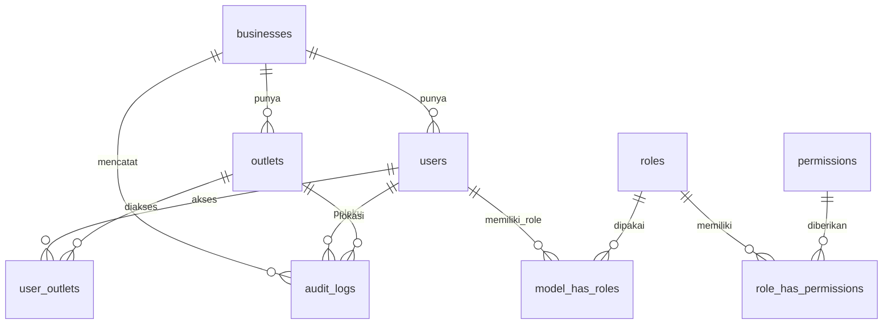
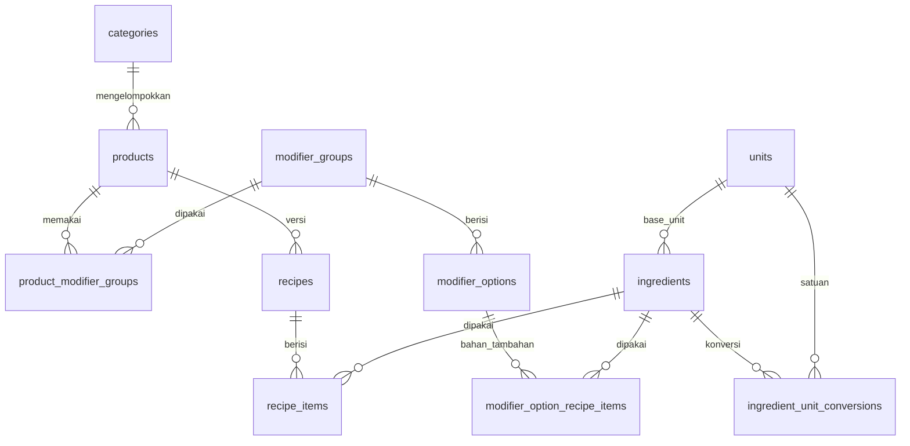
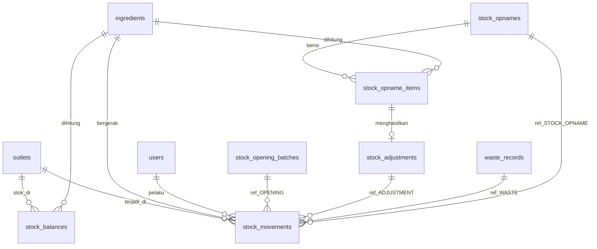
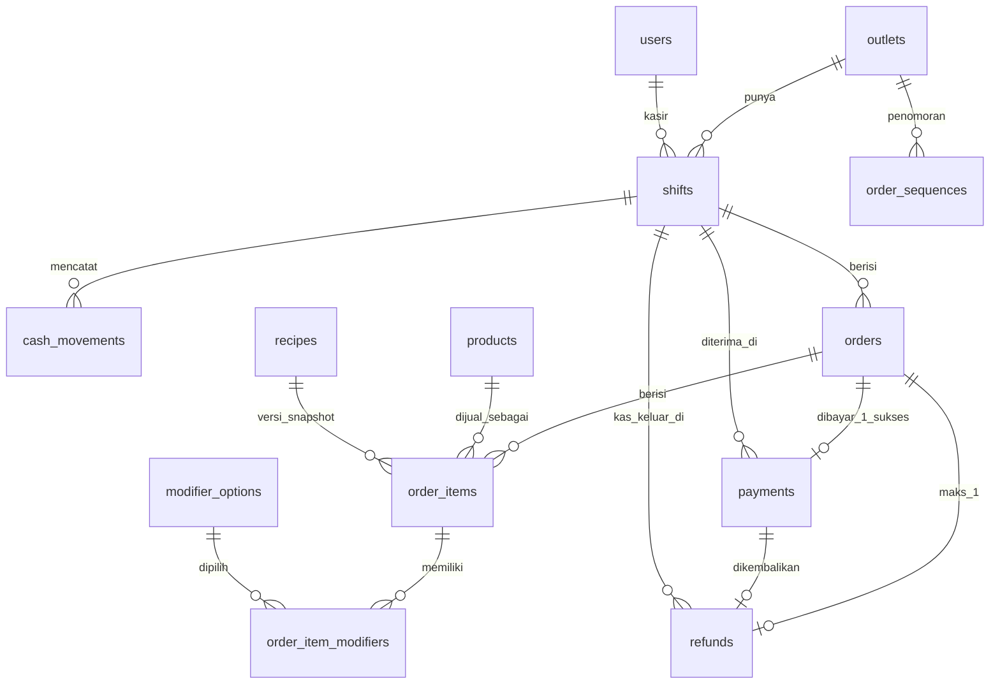
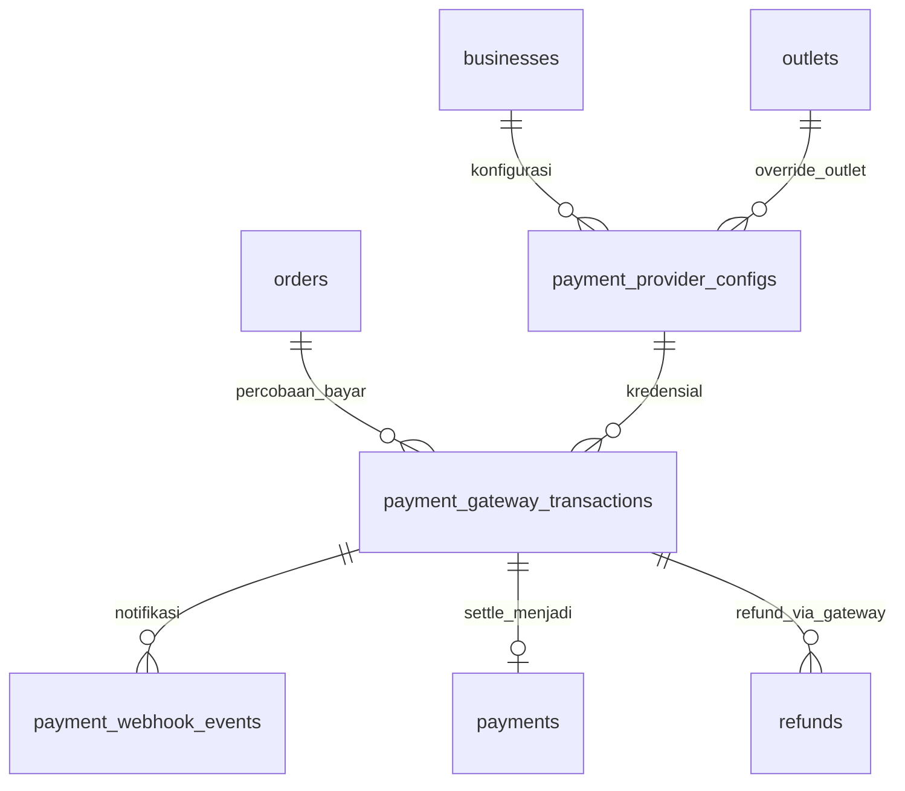
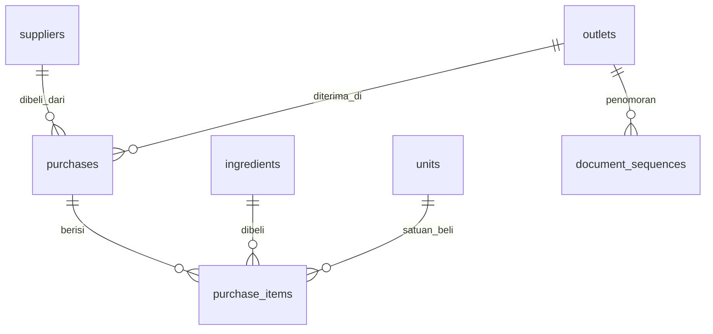
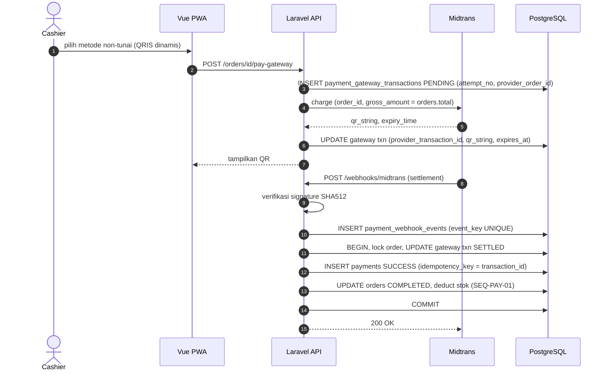

# ERD Lengkap + Indexing — F&B POS & Inventory
> **Versi:** 3.0 (Baseline final) | **Tanggal:** 2026-10-25 | **Status:** Disetujui — sumber kebenaran skema
> **DB:** PostgreSQL (Supabase; koneksi direct atau session pooler).
> **Total:** **40 tabel domain Phase 1** (36 inti + 3 purchasing + `document_sequences`), **+ 3 tabel Midtrans [P2]** = 43 tabel. Tabel `stock_opnames` dan `stock_opname_items` dimigrasi di rilis 1.1 (DB-INV-002); `purchase_receipts` ditambah di rilis 1.1 bersama partial receive.
> **Tabel framework Laravel** (`sessions`, `cache`, `cache_locks`, `jobs`, `job_batches`, `failed_jobs`, `password_reset_tokens`) dibuat lewat migrasi bawaan yang **diberi nama berprefix modul** (`platform_...`) dan **tidak dihitung** dalam angka tabel domain di atas; migrasi `users` bawaan dihapus karena digantikan skema §3.1 (`DB-TEN-001`).
> **Perubahan dari v2.1:** (1) RBAC memakai tabel Spatie Permission (`roles`, `permissions`, `model_has_roles`, `model_has_permissions`, `role_has_permissions`) dengan `teams` = `business_id`; `users.role_id` dihapus; (2) Purchasing pindah ke Phase 1; (3) tabel `document_sequences` baru; (4) `purchases` dan `purchase_items` dilengkapi; (5) penanda rilis.

---

## 1. Konvensi

**Kolom standar (tidak diulang di tiap tabel):**
| Kolom | Aturan |
|-------|--------|
| `id` | `BIGINT GENERATED ALWAYS AS IDENTITY`, PK (kecuali tabel dengan PK komposit) |
| `business_id` | `BIGINT NOT NULL` FK `businesses`, `ON DELETE RESTRICT`. Tidak ada di `businesses`, `units`, `permissions`. Di `roles` dan `model_has_roles` berfungsi sebagai team key Spatie |
| `created_at`, `updated_at` | `TIMESTAMP(0) NOT NULL`, UTC. Tabel **append-only** (🔒) hanya punya `created_at` / kolom waktu kejadian |

Aturan lain: uang `BIGINT` rupiah · qty `DECIMAL(18,4)` base unit · enum = `VARCHAR` + `CHECK` · semua FK `ON DELETE RESTRICT` · `deleted_at` = soft delete · 🔒 = trigger DB menolak UPDATE/DELETE (ADR-007).

---

## 2. Diagram ERD (relasi per domain)

### A. Tenant, Akses, Audit

### B. Katalog, Ingredient, Recipe

### C. Inventory (Ledger + Balance)

Referensi `stock_movements.reference_*` polimorfik, **tanpa FK fisik** (§7.1).

### D. Sales: Shift, Order, Payment, Refund

### E. Midtrans (Phase 2, baru)

### F. Purchasing (Phase 1)

---

## 3. Definisi Tabel

Notasi kolom **Null**: NN = NOT NULL, N = nullable. Tipe `V(n)` = `VARCHAR(n)`, `DEC(p,s)` = `DECIMAL`.

### 3.1 Domain A — Tenant, Akses, Audit

**`businesses`**
| Kolom | Tipe | Null | Constraint | Keterangan |
|-------|------|------|-----------|------------|
| name | V(100) | NN | | |
| slug | V(120) | NN | UNIQUE | |
| status | V(20) | NN | CHECK `ACTIVE`,`INACTIVE` | |
| address | V(255) | N | | |
| license_plan | V(50) | N | | Tanpa enforcement |
| license_valid_until | DATE | N | | Tanpa enforcement |

**`outlets`**
| Kolom | Tipe | Null | Constraint | Keterangan |
|-------|------|------|-----------|------------|
| code | V(6) | NN | UNIQUE(business_id, code) | Dipakai nomor order; tidak berubah setelah ada order |
| name | V(100) | NN | | |
| address | V(255) | N | | |
| timezone | V(50) | NN | DEFAULT `Asia/Jakarta` | |
| tax_rate | DEC(5,2) | NN | DEFAULT 0, CHECK 0–100 | Exclusive |
| service_charge_rate | DEC(5,2) | NN | DEFAULT 0, CHECK 0–100 | |
| allow_negative_stock | BOOLEAN | NN | DEFAULT true | BR-011 |
| cashier_max_discount_percent | DEC(5,2) | NN | DEFAULT 10, CHECK 0–100 | |
| rounding_increment | INT | NN | DEFAULT 100, CHECK IN (0,100,500,1000) | BR-036 |
| receipt_header, receipt_footer | V(255) | N | | |
| status | V(20) | NN | CHECK | |
| deleted_at | TIMESTAMP | N | | |

**`users`**
| Kolom | Tipe | Null | Constraint | Keterangan |
|-------|------|------|-----------|------------|
| name | V(100) | NN | | |
| email | V(255) | NN | UNIQUE `lower(email)` | Unik global, case-insensitive |
| password | V(255) | NN | | Hash |
| status | V(20) | NN | CHECK | |
| failed_login_count | SMALLINT | NN | DEFAULT 0 | BR-023 |
| locked_until | TIMESTAMP | N | | |
| last_login_at | TIMESTAMP | N | | |
| remember_token | V(100) | N | | |
| deleted_at | TIMESTAMP | N | | |

**`user_outlets`**: PK `(user_id, outlet_id)`; `user_id` FK users NN; `outlet_id` FK outlets NN; `business_id` NN. Tanpa `id`/`updated_at`.

**RBAC (tabel standar Spatie Permission, `teams` aktif, team key = `business_id`)**
- **`roles`**: `business_id` NN (team key) · `name` V(30) NN CHECK `OWNER`,`MANAGER`,`CASHIER`,`INVENTORY`,`KITCHEN` · `guard_name` V(30) NN · UNIQUE `(business_id, name, guard_name)`. Lima role di-seed per business saat register.
- **`permissions`**: `name` V(60) NN (= kode permission SRS §2.1) · `guard_name` V(30) NN · UNIQUE `(name, guard_name)`. Global.
- **`role_has_permissions`**: PK `(permission_id, role_id)`; FK keduanya.
- **`model_has_roles`**: PK `(business_id, role_id, model_id, model_type)`; relasi ke `users`. Aplikasi memaksa **satu role per user** (`syncRoles`).
- **`model_has_permissions`**: dibuat package, **tidak dipakai** (izin hanya lewat role).
- **Scope `OWN_ONLY` / `LIMITED`** tidak disimpan di tabel, tetapi di `config/rbac_scopes.php` dan dieksekusi oleh Policy (BR-024, BR-025).

**`audit_logs`** 🔒
| Kolom | Tipe | Null | Constraint | Keterangan |
|-------|------|------|-----------|------------|
| outlet_id | BIGINT | N | FK outlets | |
| user_id | BIGINT | N | FK users | NULL untuk `LOGIN_FAILED` email tak dikenal |
| action | V(50) | NN | | Daftar di SRS FR-AUD-001 |
| resource_type | V(50) | NN | | |
| resource_id | BIGINT | N | | |
| before_data, after_data | JSONB | N | | |
| reason | V(255) | N | | |
| ip_address | V(45) | N | | |

### 3.2 Domain B — Katalog, Ingredient, Recipe

**`categories`**: `name` V(100) NN · `description` V(255) N · `status` V(20) NN · `sort_order` INT NN DEFAULT 0 · `deleted_at` N. UNIQUE parsial `(business_id, name) WHERE deleted_at IS NULL`.

**`products`**
| Kolom | Tipe | Null | Constraint | Keterangan |
|-------|------|------|-----------|------------|
| category_id | BIGINT | NN | FK categories | |
| sku | V(50) | NN | UNIQUE parsial `(business_id, sku) WHERE deleted_at IS NULL` | |
| name | V(150) | NN | | |
| description | TEXT | N | | |
| selling_price | BIGINT | NN | CHECK ≥ 0 | |
| status | V(20) | NN | CHECK | |
| image_path | V(255) | N | | Supabase Storage |
| deleted_at | TIMESTAMP | N | | |

Tidak ada `cost_price` (HPP dihitung dari recipe).

**`modifier_groups`**: `name` V(100) NN · `selection_type` V(10) NN CHECK `SINGLE`,`MULTI` · `is_required` BOOLEAN NN · `min_select` SMALLINT NN DEFAULT 0 · `max_select` SMALLINT NN · CHECK `min_select <= max_select` · `sort_order` INT · `status` V(20) NN · `deleted_at` N.

**`modifier_options`**: `modifier_group_id` FK NN · `name` V(100) NN · `price_delta` BIGINT NN CHECK ≥ 0 · `sort_order` INT · `status` V(20) NN · `deleted_at` N.

**`product_modifier_groups`**: PK `(product_id, modifier_group_id)` · `business_id` NN · `sort_order` INT.

**`units`** (global): `code` V(10) NN UNIQUE (`g`,`kg`,`ml`,`L`,`pcs`) · `name` V(50) NN.

**`ingredients`**
| Kolom | Tipe | Null | Constraint | Keterangan |
|-------|------|------|-----------|------------|
| base_unit_id | BIGINT | NN | FK units | Hanya `g`,`ml`,`pcs`; tidak berubah setelah ada movement |
| sku | V(50) | NN | UNIQUE parsial `(business_id, sku) WHERE deleted_at IS NULL` | |
| name | V(150) | NN | | |
| last_cost | DEC(18,4) | NN | DEFAULT 0, CHECK ≥ 0 | Per base unit |
| min_stock | DEC(18,4) | NN | DEFAULT 0, CHECK ≥ 0 | Default; override di `stock_balances` |
| status | V(20) | NN | CHECK | |
| deleted_at | TIMESTAMP | N | | |

**`ingredient_unit_conversions`**: `ingredient_id` FK NN · `unit_id` FK NN · `factor_to_base` DEC(18,6) NN CHECK > 0 · UNIQUE `(ingredient_id, unit_id)`.

**`recipes`**: `product_id` FK NN · `version` INT NN · `is_active` BOOLEAN NN · `created_by` FK users NN · UNIQUE `(product_id, version)` · UNIQUE parsial `(product_id) WHERE is_active`.

**`recipe_items`**: `recipe_id` FK NN · `ingredient_id` FK NN · `quantity` DEC(18,4) NN CHECK > 0 · UNIQUE `(recipe_id, ingredient_id)`.

**`modifier_option_recipe_items`**: `modifier_option_id` FK NN · `ingredient_id` FK NN · `quantity` DEC(18,4) NN CHECK > 0 · UNIQUE `(modifier_option_id, ingredient_id)`.

### 3.3 Domain C — Inventory

**`stock_balances`**: `outlet_id` FK NN · `ingredient_id` FK NN · `quantity` DEC(18,4) NN DEFAULT 0 (**boleh negatif**) · `min_stock` DEC(18,4) N (override) · `last_movement_id` BIGINT N · UNIQUE `(outlet_id, ingredient_id)`.

**`stock_opening_batches`**: `outlet_id` FK NN · `user_id` FK NN · `note` V(255) N · `created_at`.

**`stock_movements`** 🔒
| Kolom | Tipe | Null | Constraint | Keterangan |
|-------|------|------|-----------|------------|
| outlet_id | BIGINT | NN | FK | |
| ingredient_id | BIGINT | NN | FK | |
| type | V(20) | NN | CHECK `OPENING`,`PURCHASE`,`SALE`,`WASTE`,`ADJUSTMENT`,`STOCK_OPNAME`,`RETURN` | |
| quantity_delta | DEC(18,4) | NN | CHECK ≠ 0 | Bertanda. `SALE`,`WASTE` < 0; `OPENING`,`RETURN`,`PURCHASE` > 0 |
| quantity_before, quantity_after | DEC(18,4) | NN | | `after = before + delta` |
| unit_cost | DEC(18,4) | NN | | Snapshot `last_cost` |
| reference_type | V(20) | NN | | `OPENING`,`ORDER`,`REFUND`,`WASTE`,`ADJUSTMENT`,`OPNAME`,`PURCHASE` |
| reference_id | BIGINT | NN | | Polimorfik |
| user_id | BIGINT | N | FK users | NULL jika sistem |
| note | V(255) | N | | |
| occurred_at | TIMESTAMP | NN | | |

UNIQUE `(outlet_id, ingredient_id, type, reference_type, reference_id)` = idempotensi deduct (BR-009).

**`stock_adjustments`** (dibuat **sebelum** movement): `outlet_id`, `ingredient_id` FK NN · `opname_item_id` FK N · `quantity_before`, `quantity_delta`, `quantity_after` DEC(18,4) NN · `reason` V(255) NN · `user_id` FK NN · `created_at`.

**`waste_records`** (dibuat sebelum movement): `outlet_id`, `ingredient_id` FK NN · `quantity` DEC(18,4) NN CHECK > 0 · `reason` V(20) NN CHECK `EXPIRED`,`SPOILED`,`SPILLED`,`PRODUCTION_ERROR`,`OTHER` · `note` V(255) N (CHECK `OTHER` ⇒ NOT NULL) · `unit_cost` DEC(18,4) NN · `total_cost` BIGINT NN · `user_id` FK NN · `wasted_at` NN.

**`stock_opnames`**: `outlet_id` FK NN · `code` V(30) NN UNIQUE `(outlet_id, code)` · `status` V(20) NN CHECK `IN_PROGRESS`,`SUBMITTED`,`CANCELLED` · `started_by` FK NN · `submitted_by` FK N · `started_at` NN · `submitted_at` N · `note` V(255) N. UNIQUE parsial `(outlet_id) WHERE status = 'IN_PROGRESS'`.

**`stock_opname_items`**: `opname_id` FK NN · `ingredient_id` FK NN · `system_qty_snapshot` DEC(18,4) NN · `actual_qty` DEC(18,4) N CHECK ≥ 0 · `difference` DEC(18,4) N · UNIQUE `(opname_id, ingredient_id)`.

### 3.4 Domain D — Sales

**`shifts`**
| Kolom | Tipe | Null | Constraint | Keterangan |
|-------|------|------|-----------|------------|
| outlet_id | BIGINT | NN | FK | |
| cashier_id | BIGINT | NN | FK users | |
| status | V(10) | NN | CHECK `OPEN`,`CLOSED` | |
| business_date | DATE | NN | | Tanggal buka (timezone outlet) |
| opening_cash | BIGINT | NN | CHECK ≥ 0 | |
| expected_cash, actual_cash, difference | BIGINT | N | | Diisi saat close |
| closed_by | BIGINT | N | FK users | |
| opened_at | TIMESTAMP | NN | | |
| closed_at | TIMESTAMP | N | | |
| note | V(255) | N | | |

UNIQUE parsial `(outlet_id, cashier_id) WHERE status = 'OPEN'` (BR-002).

**`cash_movements`** 🔒: `shift_id` FK NN · `type` V(3) NN CHECK `IN`,`OUT` · `amount` BIGINT NN CHECK > 0 · `reason` V(255) NN · `user_id` FK NN · `created_at`.

**`order_sequences`**: PK `(outlet_id, business_date)` · `business_id` NN · `last_number` INT NN. Dikunci `FOR UPDATE` saat membuat order.

**`orders`**
| Kolom | Tipe | Null | Constraint | Keterangan |
|-------|------|------|-----------|------------|
| outlet_id | BIGINT | NN | FK | |
| shift_id | BIGINT | NN | FK shifts | BR-001 |
| cashier_id | BIGINT | NN | FK users | |
| business_date | DATE | NN | | Salinan dari shift |
| order_number | V(30) | NN | UNIQUE `(outlet_id, order_number)` | `{OUTLET}-{YYMMDD}-{urut}` |
| order_type | V(10) | NN | CHECK `DINE_IN`,`TAKEAWAY` | |
| table_number | V(20) | N | CHECK NOT NULL ⇒ `DINE_IN` | |
| status | V(20) | NN | CHECK `DRAFT`,`PENDING_PAYMENT`,`PAID`,`COMPLETED`,`CANCELLED`,`REFUNDED` | |
| kitchen_status | V(10) | N | CHECK `NEW`,`READY` | NULL sebelum dibayar |
| subtotal | BIGINT | NN | DEFAULT 0 | |
| discount_type | V(10) | N | CHECK `PERCENT`,`AMOUNT` | Order-level |
| discount_value | DEC(10,2) | N | | |
| discount_amount | BIGINT | NN | DEFAULT 0 | |
| service_charge_amount | BIGINT | NN | DEFAULT 0 | |
| tax_amount | BIGINT | NN | DEFAULT 0 | |
| rounding_amount | BIGINT | NN | DEFAULT 0 | Boleh negatif |
| total | BIGINT | NN | DEFAULT 0, CHECK ≥ 0 | Setelah pembulatan |
| paid_amount | BIGINT | NN | DEFAULT 0 | = total saat dibayar |
| tax_rate_snapshot, service_rate_snapshot | DEC(5,2) | NN | | |
| note, cancel_reason | V(255) | N | | |
| cancelled_by | BIGINT | N | FK users | |
| paid_at, completed_at, cancelled_at | TIMESTAMP | N | | `paid_at = completed_at` |

**`order_items`**: `order_id` FK NN · `product_id` FK NN · `recipe_id` FK N (NULL = tanpa recipe) · `product_name_snapshot` V(150) NN · `sku_snapshot` V(50) NN · `unit_price` BIGINT NN · `unit_cost_snapshot` BIGINT NN DEFAULT 0 · `quantity` INT NN CHECK 1–999 · `line_total` BIGINT NN · `note` V(255) N.

**`order_item_modifiers`**: `order_item_id` FK NN · `modifier_option_id` FK NN · `name_snapshot` V(100) NN · `price_delta` BIGINT NN.

**`payments`** 🔒 (hanya pembayaran **berhasil**; berubah dari v2.0: + kolom gateway)
| Kolom | Tipe | Null | Constraint | Keterangan |
|-------|------|------|-----------|------------|
| outlet_id | BIGINT | NN | FK | |
| order_id | BIGINT | NN | FK | |
| shift_id | BIGINT | NN | FK shifts | Shift order; gateway = shift asal order |
| method | V(10) | NN | CHECK `CASH`,`QRIS`,`CARD`,`GATEWAY` | QRIS Midtrans = `QRIS`; VA/e-wallet/kartu = `GATEWAY` |
| provider | V(20) | N | CHECK `MIDTRANS` | ➕ NULL = manual (Cash, QRIS manual) |
| gateway_transaction_id | BIGINT | N | FK payment_gateway_transactions | ➕ |
| gateway_payment_type | V(30) | N | | ➕ mis. `qris`, `gopay`, `bank_transfer` |
| status | V(10) | NN | CHECK `SUCCESS`,`FAILED`,`VOID` | Phase 1/2 hanya `SUCCESS` ditulis |
| amount | BIGINT | NN | CHECK ≥ 0 | = `orders.total` |
| tendered_amount, change_amount | BIGINT | N | | Cash saja |
| reference_no | V(50) | N | | QRIS manual |
| idempotency_key | V(64) | NN | UNIQUE `(business_id, idempotency_key)` | Webhook: pakai Midtrans `transaction_id` |
| created_by | BIGINT | N | FK users | NULL bila dibuat oleh webhook |
| paid_at | TIMESTAMP | NN | | Midtrans: `settlement_time` |

UNIQUE parsial `(order_id) WHERE status = 'SUCCESS'`. `created_by` jadi **nullable** (webhook tidak punya user).

**`refunds`** (perluasan v2.0: + kolom gateway)
| Kolom | Tipe | Null | Constraint | Keterangan |
|-------|------|------|-----------|------------|
| outlet_id | BIGINT | NN | FK | |
| order_id | BIGINT | NN | FK, UNIQUE | BR-035 |
| payment_id | BIGINT | NN | FK | |
| shift_id | BIGINT | N | FK shifts | Shift OPEN pelaku; NULL hanya untuk non-tunai. CHECK `CASH` ⇒ NOT NULL |
| amount | BIGINT | NN | | = `orders.total` |
| method | V(10) | NN | | Mengikuti pembayaran asli |
| reason | V(255) | NN | | |
| restock | BOOLEAN | NN | DEFAULT false | |
| gateway_refund_key | V(100) | N | UNIQUE `(business_id, gateway_refund_key)` | ➕ idempotensi refund Midtrans |
| gateway_status | V(20) | N | CHECK `PENDING`,`SUCCESS`,`FAILED` | ➕ NULL = refund manual |
| refunded_by | BIGINT | NN | FK users | |
| refunded_at | TIMESTAMP | NN | | |

### 3.5 Domain E — Midtrans (baru, Phase 2)

**`payment_provider_configs`**
| Kolom | Tipe | Null | Constraint | Keterangan |
|-------|------|------|-----------|------------|
| outlet_id | BIGINT | N | FK outlets | NULL = default business; terisi = override outlet |
| provider | V(20) | NN | CHECK `MIDTRANS` | |
| environment | V(15) | NN | CHECK `SANDBOX`,`PRODUCTION` | |
| merchant_id | V(50) | NN | | |
| client_key | V(100) | NN | | Boleh tampil di FE |
| server_key_encrypted | TEXT | NN | | **Terenkripsi** (Laravel `encrypted` cast); tidak pernah ada di respons API atau log |
| enabled_payment_types | JSONB | N | | mis. `["qris","gopay","bank_transfer"]` |
| expiry_minutes | SMALLINT | NN | DEFAULT 15, CHECK 1–1440 | Masa berlaku transaksi |
| is_active | BOOLEAN | NN | DEFAULT true | |

UNIQUE `(business_id, COALESCE(outlet_id,0), provider)`.

**`payment_gateway_transactions`** (mutable, satu baris per percobaan bayar)
| Kolom | Tipe | Null | Constraint | Keterangan |
|-------|------|------|-----------|------------|
| outlet_id | BIGINT | NN | FK | |
| order_id | BIGINT | NN | FK orders | |
| config_id | BIGINT | NN | FK payment_provider_configs | |
| provider | V(20) | NN | CHECK `MIDTRANS` | |
| attempt_no | SMALLINT | NN | DEFAULT 1 | Percobaan ke-n untuk order ini |
| provider_order_id | V(50) | NN | UNIQUE `(provider, provider_order_id)` | `order_id` yang dikirim ke Midtrans, mis. `KP01-261012-0007-1` (maks 50 karakter) |
| provider_transaction_id | V(64) | N | UNIQUE parsial `(provider, provider_transaction_id) WHERE NOT NULL` | `transaction_id` dari Midtrans |
| payment_type | V(30) | N | | `qris`, `gopay`, `bank_transfer`, `credit_card`, … |
| gross_amount | BIGINT | NN | CHECK > 0 | = `orders.total` |
| status | V(15) | NN | CHECK `PENDING`,`SETTLED`,`FAILED`,`EXPIRED`,`CANCELLED`,`CHALLENGE` | Status internal (lihat §5) |
| provider_status | V(20) | N | | Mentah: `pending`, `settlement`, `capture`, `deny`, `cancel`, `expire`, `failure`, … |
| fraud_status | V(15) | N | | `accept`, `challenge`, `deny` (kartu) |
| snap_token | V(100) | N | | Bila memakai Snap |
| redirect_url | V(255) | N | | |
| qr_string | TEXT | N | | QRIS dinamis |
| expires_at | TIMESTAMP | N | | |
| settled_at | TIMESTAMP | N | | |
| raw_response | JSONB | N | | Respons charge terakhir |
| created_by | BIGINT | NN | FK users | Kasir yang memulai |

UNIQUE `(order_id, attempt_no)` · UNIQUE parsial `(order_id) WHERE status = 'PENDING'` (satu transaksi aktif per order).

**`payment_webhook_events`** (inbox idempoten; **bukan** append-only: hanya `processing_status`, `error_message`, `processed_at` yang di-update, kolom lain tidak berubah)

| Kolom | Tipe | Null | Constraint | Keterangan |
|-------|------|------|-----------|------------|
| business_id | BIGINT | N | FK | NULL bila `order_id` tak dikenal |
| gateway_transaction_id | BIGINT | N | FK payment_gateway_transactions | |
| provider | V(20) | NN | | |
| provider_order_id | V(50) | NN | | Dari payload |
| provider_transaction_id | V(64) | N | | |
| transaction_status | V(20) | NN | | |
| status_code | V(5) | NN | | |
| gross_amount | V(20) | NN | | String dari payload (dipakai verifikasi signature) |
| signature_valid | BOOLEAN | NN | | `SHA512(order_id + status_code + gross_amount + ServerKey)` |
| event_key | V(64) | NN | UNIQUE | `sha256(provider_order_id|transaction_id|transaction_status|status_code|gross_amount)` → replay aman |
| payload | JSONB | NN | | Payload mentah |
| processing_status | V(15) | NN | DEFAULT `RECEIVED`, CHECK `RECEIVED`,`PROCESSED`,`IGNORED`,`FAILED` | |
| error_message | V(255) | N | | |
| received_at | TIMESTAMP | NN | | |
| processed_at | TIMESTAMP | N | | |

### 3.6 Domain F — Purchasing (Phase 1)

**`suppliers`**: `name` V(150) NN · `contact` V(100) N · `phone` V(30) N · `email` V(255) N · `address` V(255) N · `status` V(20) NN CHECK `ACTIVE`,`INACTIVE` · `deleted_at` N · UNIQUE parsial `(business_id, lower(name)) WHERE deleted_at IS NULL`.

**`purchases`**: `outlet_id` FK NN · `supplier_id` FK NN · `code` V(30) NN, UNIQUE `(outlet_id, code)` (BR-049) · `supplier_invoice_no` V(50) N · `status` V(15) NN CHECK `DRAFT`,`RECEIVED`,`CANCELLED` · `note` V(255) N · `total` BIGINT NN CHECK ≥ 0 · `created_by` FK users NN · `received_by` FK users N · `received_at` TIMESTAMP N · `cancelled_by`, `cancelled_at`, `cancel_reason` N (dipakai R1.1) · CHECK `(status='RECEIVED') = (received_at IS NOT NULL)`.

**`purchase_items`**: `purchase_id` FK NN · `ingredient_id` FK NN · `unit_id` FK NN (satuan beli) · `quantity` DEC(18,4) NN CHECK > 0 · `conversion_factor` DEC(18,4) NN CHECK > 0 (salinan faktor saat dibuat) · `quantity_base` DEC(18,4) NN (= quantity × factor) · `unit_price` BIGINT NN CHECK ≥ 0 (per satuan beli) · `unit_cost_base` DEC(18,4) NN (= unit_price ÷ factor; menjadi `last_cost`, BR-047) · `line_total` BIGINT NN (= round half-up(quantity × unit_price)) · UNIQUE `(purchase_id, ingredient_id)`.

**`document_sequences`**: PK `(outlet_id, doc_type, seq_date)` · `business_id` NN · `doc_type` V(20) NN CHECK `PURCHASE` (opname dapat ditambahkan di R1.1) · `seq_date` DATE NN (tanggal lokal outlet) · `last_number` INT NN. Dikunci `FOR UPDATE` saat menerbitkan nomor (BR-049).

---

## 4. Indexing

Prinsip: (1) PostgreSQL **tidak otomatis mengindeks kolom FK**, padahal `ON DELETE RESTRICT` dan join membutuhkannya; (2) index dibuat dari query nyata di SRS; (3) tabel kecil dan jarang berubah tidak diindeks tambahan (§4.3).

### 4.1 Index yang wajib (dari query nyata)
`U` = unique, `P` = partial, `B` = B-tree biasa.

| Tabel | Index (kolom) | Tipe | Query yang dilayani |
|-------|---------------|------|---------------------|
| users | `lower(email)` | U | Login (FR-AUTH-002) |
| users | `(business_id, status)` | B | Daftar user (API-USER-01) |
| user_outlets | PK `(user_id, outlet_id)` + `(outlet_id)` | B | Cek akses outlet tiap request; user per outlet |
| outlets | `(business_id, code)` | U | Kode outlet unik |
| role_has_permissions | PK `(permission_id, role_id)` + `(role_id)` | U | Muat permission saat `/me` |
| model_has_roles | PK `(business_id, role_id, model_id, model_type)` + `(model_id, model_type)` | U/B | Role user saat login dan `/me` |
| suppliers | `(business_id, status)` · UNIQUE parsial `(business_id, lower(name))` | B/U | API-PUR-01, nama unik |
| purchases | UNIQUE `(outlet_id, code)` · `(outlet_id, status, created_at DESC)` · `(supplier_id)` | U/B | Daftar purchase (API-PUR-05) |
| purchase_items | UNIQUE `(purchase_id, ingredient_id)` · `(ingredient_id)` | U/B | Detail dan riwayat bahan |
| audit_logs | `(business_id, created_at DESC)` | B | Daftar/filter audit (API-AUD-01) |
| audit_logs | `(business_id, action, created_at DESC)` | B | Filter per aksi |
| audit_logs | `(resource_type, resource_id)` | B | Riwayat satu resource |
| audit_logs | `(user_id, created_at DESC)` | B | Filter per user |
| categories | `(business_id, name) WHERE deleted_at IS NULL` | U,P | Nama unik |
| products | `(business_id, sku) WHERE deleted_at IS NULL` | U,P | SKU unik |
| products | `(business_id, category_id, status) WHERE deleted_at IS NULL` | B,P | Katalog POS, daftar produk |
| modifier_options | `(modifier_group_id, status)` | B | Muat option per group |
| product_modifier_groups | PK `(product_id, modifier_group_id)` + `(modifier_group_id)` | B | Group → produk |
| ingredients | `(business_id, sku) WHERE deleted_at IS NULL` | U,P | SKU unik |
| ingredients | `(business_id, status) WHERE deleted_at IS NULL` | B,P | Daftar bahan, opname |
| recipes | `(product_id, version)` | U | Versioning |
| recipes | `(product_id) WHERE is_active` | U,P | 1 versi aktif; ambil recipe aktif |
| recipe_items | `(recipe_id, ingredient_id)` | U | Muat item recipe |
| recipe_items | `(ingredient_id)` | B | "Bahan dipakai di produk mana" + cek FK |
| modifier_option_recipe_items | `(modifier_option_id, ingredient_id)` + `(ingredient_id)` | U,B | Recipe modifier saat bayar |
| stock_balances | `(outlet_id, ingredient_id)` | U | **Lock saat deduct** (hot path) |
| stock_balances | `(outlet_id) WHERE quantity < 0` | B,P | Laporan stok minus |
| stock_movements | `(outlet_id, ingredient_id, type, reference_type, reference_id)` | U | **Idempotensi deduct** (BR-009) |
| stock_movements | `(outlet_id, ingredient_id, occurred_at DESC)` | B | Riwayat movement |
| stock_movements | `(reference_type, reference_id)` | B | Stock trace order, refund restock |
| stock_movements | `(outlet_id, type, occurred_at)` | B | Laporan ringkasan per tipe, export CSV |
| stock_adjustments | `(outlet_id, created_at DESC)` | B | Daftar adjustment |
| stock_adjustments | `(opname_item_id) WHERE opname_item_id IS NOT NULL` | B,P | Cek FK opname |
| waste_records | `(outlet_id, wasted_at DESC)` | B | Waste report |
| stock_opnames | `(outlet_id, code)` | U | |
| stock_opnames | `(outlet_id) WHERE status = 'IN_PROGRESS'` | U,P | Maks 1 opname berjalan (BR-017) |
| stock_opname_items | `(opname_id, ingredient_id)` | U | Input hitungan |
| shifts | `(outlet_id, cashier_id) WHERE status = 'OPEN'` | U,P | 1 shift OPEN per kasir (BR-002); shift saat ini |
| shifts | `(outlet_id, business_date)` | B | Laporan harian, `GET /shifts` |
| shifts | `(outlet_id, opened_at) WHERE status = 'OPEN'` | B,P | Peringatan shift > 24 jam |
| cash_movements | `(shift_id, type)` | B | Ringkasan kas shift |
| order_sequences | PK `(outlet_id, business_date)` | U | Penomoran aman konkurensi |
| orders | `(outlet_id, order_number)` | U | Nomor unik, cari nomor order |
| orders | `(outlet_id, business_date, status)` | B | Dashboard, laporan harian, riwayat |
| orders | `(shift_id, status)` | B | Close shift, ringkasan kas |
| orders | `(cashier_id, created_at DESC)` | B | Riwayat order Cashier (Own) |
| orders | `(outlet_id, completed_at) WHERE kitchen_status = 'NEW' AND status = 'COMPLETED'` | B,P | **Antrian dapur** (polling 10 detik) |
| order_items | `(order_id)` | B | Detail order, deduct stok |
| order_items | `(business_id, product_id)` | B | Laporan produk |
| order_item_modifiers | `(order_item_id)` | B | Detail item |
| order_item_modifiers | `(modifier_option_id)` | B | Cek FK, laporan modifier |
| payments | `(business_id, idempotency_key)` | U | **Idempotensi bayar** (BR-008) |
| payments | `(order_id) WHERE status = 'SUCCESS'` | U,P | Tanpa split payment (BR-007) |
| payments | `(shift_id, method)` | B | Rekonsiliasi kas per metode |
| payments | `(outlet_id, paid_at)` | B | Laporan payment |
| payments | `(gateway_transaction_id) WHERE gateway_transaction_id IS NOT NULL` | U,P | ➕ 1 payment per transaksi gateway |
| refunds | `(order_id)` | U | 1 refund per order (BR-035) |
| refunds | `(shift_id) WHERE shift_id IS NOT NULL` | B,P | Cash refund di ringkasan shift |
| refunds | `(business_id, gateway_refund_key) WHERE gateway_refund_key IS NOT NULL` | U,P | ➕ Idempotensi refund Midtrans |
| refunds | `(payment_id)` | B | Cek FK |

### 4.2 Index Midtrans (baru)
| Tabel | Index | Tipe | Alasan |
|-------|-------|------|--------|
| payment_provider_configs | `(business_id, COALESCE(outlet_id,0), provider)` | U | Satu konfigurasi aktif per scope |
| payment_gateway_transactions | `(provider, provider_order_id)` | U | **Lookup saat webhook masuk** (hot path); order_id Midtrans harus unik |
| payment_gateway_transactions | `(provider, provider_transaction_id) WHERE provider_transaction_id IS NOT NULL` | U,P | Cocokkan `transaction_id`, cek status ke Midtrans |
| payment_gateway_transactions | `(order_id, attempt_no)` | U | Hitung percobaan ke-n |
| payment_gateway_transactions | `(order_id) WHERE status = 'PENDING'` | U,P | Satu transaksi aktif per order; blok `reopen`/`cancel` bila ada |
| payment_gateway_transactions | `(expires_at) WHERE status = 'PENDING'` | B,P | Job penyapu transaksi kedaluwarsa |
| payment_gateway_transactions | `(outlet_id, created_at DESC)` | B | Daftar transaksi gateway untuk rekonsiliasi |
| payment_webhook_events | `(event_key)` | U | **Dedup webhook** (Midtrans mengirim ulang) |
| payment_webhook_events | `(provider, provider_order_id, received_at DESC)` | B | Telusuri semua notifikasi satu transaksi |
| payment_webhook_events | `(received_at) WHERE processing_status IN ('RECEIVED','FAILED')` | B,P | Job retry notifikasi yang belum terproses |
| payment_webhook_events | `(gateway_transaction_id)` | B | Cek FK |

### 4.3 Sengaja tidak diindeks tambahan
| Tabel | Alasan |
|-------|--------|
| units, permissions, roles, role_has_permissions | Puluhan baris; PK/UNIQUE cukup |
| ingredient_unit_conversions | Kecil; UNIQUE sudah ada |
| Kueri low stock (`quantity ≤ minimum`) | Membandingkan dua kolom + fallback ke `ingredients.min_stock`; jumlah baris per outlet kecil (ratusan). Cukup scan lewat `(outlet_id, ingredient_id)` |
| Kolom `status` berdiri sendiri | Selektivitas rendah; selalu dipasangkan dengan `outlet_id`/`business_id` di index komposit |
| `stock_movements.user_id`, `audit_logs.outlet_id` | Dipakai sebagai filter sekunder; ditambahkan bila EXPLAIN menunjukkan perlu |

### 4.4 Ditunda sampai ada bukti (monitor `pg_stat_statements`)
| Kandidat | Pemicu |
|----------|--------|
| BRIN `(created_at)` / `(occurred_at)` di `audit_logs`, `stock_movements` | Tabel > ±10 juta baris (±2–3 tahun pada beban acuan NFR-PERF-006) |
| `pg_trgm` GIN pada `products.name`, `ingredients.name` | Ada pencarian teks bebas di layar admin |
| Partisi bulanan `stock_movements`, `audit_logs`, `payment_webhook_events` | Setelah ±3 tahun atau query laporan > 3 detik |

---

## 5. Alur Midtrans terhadap tabel (ringkas)

Pemetaan status Midtrans → internal:
| `transaction_status` Midtrans | `status` internal | Efek pada order |
|-------------------------------|-------------------|-----------------|
| `pending` | `PENDING` | Order tetap `PENDING_PAYMENT`; `reopen` dan `cancel` diblok sampai transaksi selesai atau dibatalkan lewat API |
| `settlement`; `capture` + `fraud_status = accept` | `SETTLED` | Buat `payments`, order `COMPLETED`, potong stok (atomik) |
| `capture` + `fraud_status = challenge` | `CHALLENGE` | Tidak ada efek; menunggu keputusan di dashboard Midtrans |
| `deny`, `failure` | `FAILED` | Order tetap `PENDING_PAYMENT`; kasir boleh buat percobaan baru (`attempt_no + 1`) |
| `cancel` | `CANCELLED` | Sama dengan `FAILED` |
| `expire` | `EXPIRED` | Sama dengan `FAILED` |
| `refund`, `partial_refund`, `chargeback` | tidak mengubah status | Dicatat di `payment_webhook_events`; rekonsiliasi manual (Phase 2) |

---

## 6. Keputusan Midtrans (disetujui B1–B6, 2026-10-24)

| # | Keputusan | Usulan ⭐ | Dampak |
|---|-----------|----------|--------|
| 1 | Webhook idempoten | `event_key` UNIQUE. `payment_webhook_events` **dikecualikan dari trigger append-only** (ADR-007) karena `processing_status` di-update; `payments` tetap 🔒 | ADR-007 diperbarui |
| 2 | Order dengan transaksi gateway `PENDING` | Blok `reopen`/`cancel` sampai transaksi selesai atau di-cancel ke Midtrans. Close shift tetap ditolak selama order `PENDING_PAYMENT` | Guard di `BE-ORD-005`, `BE-SHF-004` |
| 3 | Pembulatan vs `gross_amount` | Kirim `gross_amount = orders.total` (sudah dibulatkan), sebagai satu item_details dan baris pembulatan eksplisit agar jumlahnya cocok | `PriceCalculator` tetap; payload Midtrans disusun di adapter |
| 4 | `payments.created_by` nullable | Ya, karena webhook tidak punya user | Migrasi `payments` |
| 4a | Migrasi Phase 1 `payments`/`refunds` | Sertakan kolom nullable gateway sekarang (`provider`, `gateway_payment_type`, `gateway_transaction_id` tanpa FK, `created_by` nullable; `refunds.gateway_refund_key`, `gateway_status`). Alasan: `payments` memakai trigger append-only, ALTER belakangan lebih mahal | `DB-PAY-001` (+XS); FK ditambah di Phase 2 |
| 4b | Stok saat settlement | Pre-check saat transaksi dimulai; settlement tetap memotong stok dengan override minus (SRS BR-041) | Konsisten dengan SRS v3.0 |
| 5 | Server key | Terenkripsi di DB (`server_key_encrypted`), tidak dikirim ke FE, tidak masuk log | Keamanan; tambah ke checklist `TEST-SEC-001` |
| 6 | Jadwal | Midtrans tetap **Phase 2** (PRD §3.2). Tabel di sini hanya desain; tidak masuk migrasi Phase 1 | Midtrans tidak masuk margin core |

> Nama status, field notifikasi, dan rumus signature di atas berdasarkan dokumentasi Midtrans yang gua ketahui. Verifikasi ulang ke dokumentasi resmi Midtrans (Core API / Snap, HTTP notification) saat Phase 2 dimulai, karena detail bisa berubah.

---

## 7. Lampiran — Relasi, Eloquent, dan Catatan Database
### 7.1 Relasi & Aturan Integritas
| Relasi | Kardinalitas | ON DELETE | BR |
|--------|--------------|-----------|----|
| businesses → outlets, users, semua tabel tenant | 1:N | RESTRICT | BR-022 |
| users ↔ outlets (`user_outlets`) | N:M | RESTRICT | |
| roles → users | 1:N | RESTRICT | |
| categories → products | 1:N | RESTRICT | BR-018 |
| products → recipes → recipe_items | 1:N:N | RESTRICT | BR-013 |
| ingredients → stock_balances (per outlet) | 1:N | RESTRICT | |
| shifts → orders | 1:N | RESTRICT | BR-001 |
| orders → order_items → order_item_modifiers | 1:N:N | RESTRICT | BR-014 |
| orders → payments | 1:0..1 sukses | RESTRICT | BR-007 |
| orders → refunds | 1:0..1 | RESTRICT | BR-035 |
| orders → payment_gateway_transactions [P2] | 1:N (maks 1 `PENDING`) | RESTRICT | BR-038 |
| payment_gateway_transactions → payment_webhook_events [P2] | 1:N | RESTRICT | BR-040 |
| payment_gateway_transactions → payments [P2] | 1:0..1 | RESTRICT | BR-040 |
| stock_opnames → stock_opname_items | 1:N | RESTRICT | BR-017 |

**Referensi polimorfik `stock_movements`** (tanpa FK fisik; integritas oleh aplikasi + unique idempotensi):
| `type` | `reference_type` | `reference_id` → | Arah |
|--------|------------------|------------------|------|
| `OPENING` | `OPENING` | `stock_opening_batches.id` | + |
| `SALE` | `ORDER` | `orders.id` | − |
| `RETURN` | `REFUND` | `refunds.id` | + |
| `WASTE` | `WASTE` | `waste_records.id` | − |
| `ADJUSTMENT` | `ADJUSTMENT` | `stock_adjustments.id` | ± |
| `STOCK_OPNAME` | `OPNAME` | `stock_opnames.id` | ± |
| `PURCHASE` | `PURCHASE` | `purchases.id` | + |

**Konsistensi tenant:** `business_id` anak harus sama dengan induk. Ditegakkan oleh trait + test `TEST-AUTH-001`; FK komposit sengaja tidak dipakai (kompleksitas Eloquent) `[ASUMSI]`.

**Penegakan BR di database:**
| BR | Mekanisme |
|----|-----------|
| BR-002 | UNIQUE parsial shifts |
| BR-007 | UNIQUE parsial payments sukses per order |
| BR-008 | UNIQUE `(business_id, idempotency_key)` |
| BR-009 | UNIQUE idempotensi `stock_movements` |
| BR-012 | CHECK refunds tunai wajib `shift_id` |
| BR-013 | UNIQUE parsial recipe aktif |
| BR-017 | UNIQUE parsial opname `IN_PROGRESS` |
| BR-018 | `deleted_at` + `ON DELETE RESTRICT` |
| BR-019 | `order_sequences` + UNIQUE `(outlet_id, order_number)` |
| BR-020 | Trigger append-only (ADR-007) |
| BR-031 | UNIQUE parsial SKU, UNIQUE kode outlet |
| BR-035 | UNIQUE `refunds(order_id)` |
| BR-036 | CHECK `rounding_increment IN (0,100,500,1000)` |
| BR-038 | UNIQUE parsial `payment_gateway_transactions(order_id) WHERE status='PENDING'` |
| BR-040 | UNIQUE `payment_webhook_events(event_key)`; UNIQUE `payments(business_id, idempotency_key)` (webhook memakai `transaction_id`); UNIQUE parsial `payments(gateway_transaction_id)` |
| BR-043 | UNIQUE parsial `refunds(business_id, gateway_refund_key)`; kunci deterministik `RF-{payment_id}` |
| BR-037 | `payment_provider_configs.server_key_encrypted` terenkripsi aplikasi; UNIQUE `(business_id, COALESCE(outlet_id,0), provider)` |

### 7.2 Pemetaan Eloquent
Semua model tenant memakai trait `BelongsToBusiness`. Enum PHP backed di `app/Enums`.

| Model | Tabel | Relasi | Cast / Enum | Scope penting |
|-------|-------|--------|-------------|---------------|
| Business | businesses | hasMany Outlet, User | `status` StatusUmum | — |
| Outlet | outlets | belongsTo Business; belongsToMany User | `allow_negative_stock` bool; rate decimal | `active()` |
| User | users | belongsTo Role; belongsToMany Outlet | `status` | `forOutlet()` |
| Role / Permission | roles / permissions | belongsToMany | `code` RoleCode | — |
| AuditLog | audit_logs | belongsTo User, Outlet | `before_data`/`after_data` array | append-only (tanpa update) |
| Category | categories | hasMany Product | `status` | `active()` |
| Product | products | belongsTo Category; hasMany Recipe, belongsToMany ModifierGroup | `status` | `active()`, `sellable()` |
| ModifierGroup / ModifierOption | modifier_groups / options | hasMany | `selection_type` SelectionType | `active()` |
| Unit | units | hasMany Ingredient | — | — |
| Ingredient | ingredients | belongsTo Unit; hasMany StockBalance | `last_cost` decimal:4 | `active()` |
| Recipe | recipes | belongsTo Product; hasMany RecipeItem | `is_active` bool | `active()` |
| RecipeItem / ModifierOptionRecipeItem | | belongsTo Ingredient | `quantity` decimal:4 | — |
| StockBalance | stock_balances | belongsTo Outlet, Ingredient | `quantity` decimal:4 | `lowStock()`, `negative()` |
| StockMovement | stock_movements | belongsTo Outlet, Ingredient, User; morph via `reference_*` | `type` MovementType | append-only |
| StockAdjustment / WasteRecord / StockOpening Batch | | belongsTo Ingredient, User | `reason` WasteReason | — |
| StockOpname / StockOpnameItem | | hasMany / belongsTo | `status` OpnameStatus | `inProgress()` |
| Shift | shifts | belongsTo Outlet, User(cashier); hasMany CashMovement, Order | `status` ShiftStatus | `open()`, `forCashier()` |
| CashMovement | cash_movements | belongsTo Shift | `type` CashMovementType | append-only |
| Order | orders | belongsTo Outlet, Shift, User; hasMany OrderItem; hasOne Payment, Refund | `status` OrderStatus; `order_type` OrderType; `kitchen_status` | `ownedBy()`, `onBusinessDate()`, `kitchenQueue()` |
| OrderItem / OrderItemModifier | | belongsTo Order, Product, Recipe | | — |
| Payment | payments | belongsTo Order, Shift; belongsTo GatewayTransaction (nullable) | `method` PaymentMethod; `status` PaymentStatus; `provider` PaymentProvider | append-only |
| Refund | refunds | belongsTo Order, Payment, Shift | `restock` bool | — |
| PaymentProviderConfig [P2] | payment_provider_configs | belongsTo Business, Outlet (nullable) | `server_key_encrypted` encrypted (hidden); `enabled_payment_types` array; `environment` GatewayEnvironment | `forOutlet()` (override outlet lalu business) |
| PaymentGatewayTransaction [P2] | payment_gateway_transactions | belongsTo Order, PaymentProviderConfig; hasMany PaymentWebhookEvent; hasOne Payment | `status` GatewayTxnStatus; `raw_response` array | `pending()`, `expiredPending()` |
| PaymentWebhookEvent [P2] | payment_webhook_events | belongsTo PaymentGatewayTransaction | `payload` array; `processing_status` WebhookProcessingStatus | `unprocessed()` (bukan append-only) |

### 7.3 Catatan Database
- **Waktu:** semua `TIMESTAMP` UTC. `business_date` DATE dihitung dari timezone outlet saat shift dibuka. Laporan memfilter `business_date`, bukan `created_at`.
- **ID:** `BIGINT` identity `[ASUMSI]`. Jika ID perlu tampil di URL publik atau dipakai Flutter offline, tambahkan kolom `ulid` tanpa mengubah PK.
- **Uang & pembulatan:** `BIGINT` rupiah. Urutan: half-up per komponen (diskon persen, service, pajak) → `total_sebelum = dpp + service + pajak` → pembulatan ke `rounding_increment` → `total`. `unit_cost_snapshot` dan `waste_records.total_cost` half-up ke rupiah; `COGS = Σ(unit_cost_snapshot × qty)`.
- **Soft delete & retensi:** tabel master soft delete (BR-018); transaksi tidak dihapus. Retensi data transaksi tanpa batas di Phase 1; arsip dibahas di G6 (operasi).
- **Lock order saat bayar:** lock `orders` → lock `stock_balances` urut `ingredient_id` (ADR-002). Semua flow yang menyentuh banyak bahan (opname submit, refund restock) mengikuti urutan yang sama.
- **Seeder wajib:** `units` (g, kg, ml, L, pcs), `permissions` (SRS §2.1 + Phase 2 nonaktif), 5 `roles` per business (Spatie, di-seed saat register), `role_has_permissions` mengikuti matriks SRS §2.1.
- **Backup:** harian + uji restore (NFR-REL-002).
- **[P2] Lock order saat settlement:** lock `payment_gateway_transactions` → `orders` → `stock_balances` urut `ingredient_id`. Urutan ini tidak boleh dibalik dibanding alur bayar biasa (ADR-002).
- **[P2] Enkripsi server key:** memakai enkripsi aplikasi (`APP_KEY`); kolom disembunyikan dari serialisasi model; tidak pernah di-log.
- **Seeder:** `permissions` ditambah `payment_config.manage` (hanya Owner).
- **Migrasi Phase 1 (disarankan, XS):** `payments` diberi kolom nullable `provider`, `gateway_payment_type`, `gateway_transaction_id` (tanpa FK) dan `created_by` nullable; `refunds` diberi `gateway_refund_key`, `gateway_status`. Alasan: `payments` memakai trigger append-only sehingga `ALTER` belakangan lebih mahal. FK ke `payment_gateway_transactions` ditambah di Phase 2.

---

### 7.4 Tambahan Purchasing & RBAC (v3.0)
- Relasi BR → DB: BR-045 (status + transaksi), BR-046 (`ingredient_unit_conversions` + salinan `conversion_factor` di item), BR-047 (`unit_cost_base` → `ingredients.last_cost`), BR-048 (CHECK status + guard aplikasi), BR-049 (`document_sequences` + UNIQUE `(outlet_id, code)`).
- Eloquent: `User` memakai trait `HasRoles` (Spatie) dengan `setPermissionsTeamId($business_id)` di middleware sebelum pengecekan; `Purchase hasMany PurchaseItem`, `Purchase belongsTo Supplier`, `PurchaseItem belongsTo Ingredient, Unit`.
- Supabase: migrasi dijalankan lewat direct connection; aplikasi memakai direct atau session pooler. Transaction pooler dilarang karena `SELECT … FOR UPDATE` (ADR-006).

## 8. Changelog
| Versi | Tanggal | Perubahan | Author |
|-------|---------|-----------|--------|
| 3.0 | 2026-10-25 | Baseline final: Spatie, Purchasing Phase 1 (lengkap), `document_sequences`, Supabase, lampiran relasi dan Eloquent dari SDD | Claude |
| 2.1 | 2026-10-12 | ERD lengkap, index, Midtrans | Claude |
