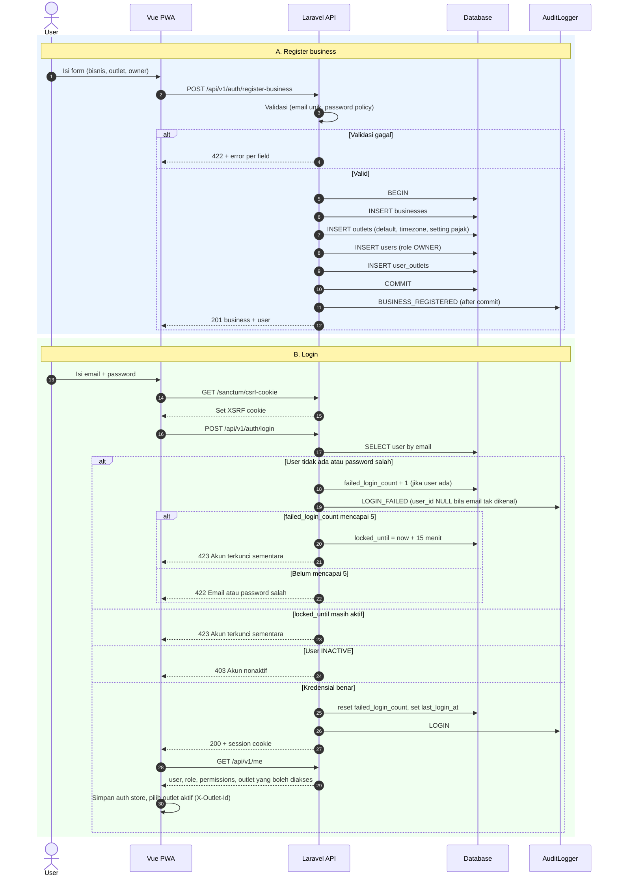

# Modul AUTH — Autentikasi, Tenant, RBAC

> Sumber kebenaran tetap `docs/` v3.0; file ini hanya **kumpulan per modul** supaya developer cukup membuka satu folder. Bila ada beda, `docs/` menang.

| | |
|---|---|
| Owner | Ongki (9 tiket), Naufaldi (4 tiket) |
| Tiket | 13 core (11.50 hari) + 0 rilis 1.1 (0.00 hari) |

## 1. Ringkasan buat developer

Ini fondasi semua modul lain. Tugasnya: orang bisa daftar business, login, dan **hanya melihat data business-nya sendiri** (tenant) dengan izin sesuai role (Spatie). Kalau modul ini bocor, semua modul bocor.

**Hati-hati**
- Semua model tenant wajib `BelongsToBusiness`; jangan `DB::table()` tanpa helper scope.
- Set `setPermissionsTeamId(business_id)` sebelum cek permission (Spatie teams).
- Lockout 5× gagal / 15 menit; pesan error login tidak boleh membocorkan mana yang salah.
- Setiap endpoint baru dari modul manapun masuk dataset test isolasi tenant.

**Dianggap selesai kalau:** Register→login→/me bekerja; suite isolasi tenant dan matriks RBAC hijau; modul lain bisa memakai `permission:*` dan `outlet.context`.

## 2. Kebutuhan Fungsional (dari SRS v3.0)

### Modul AUTH — Autentikasi

#### FR-AUTH-001: Register Business
**Deskripsi:** Calon pemilik membuat business, outlet default, dan akun Owner dalam satu proses atomik.
**Input:** nama business (wajib, ≤ 100), nama outlet (wajib, ≤ 100), kode outlet (wajib, 2–6 huruf/angka, unik per business), timezone (wajib, default `Asia/Jakarta`), nama owner (wajib, ≤ 100), email (wajib), password (wajib).
**Aturan:** membuat `businesses`, `outlets`, `users` (role OWNER), `user_outlets` dalam satu transaksi. Audit `BUSINESS_REGISTERED` (BR-022).
| Kondisi | Pesan Error |
|---------|-------------|
| Email sudah terdaftar | "Email sudah digunakan, silakan gunakan email lain." |
| Password < 8 karakter atau tanpa huruf besar dan angka | "Password minimal 8 karakter, mengandung huruf besar dan angka." |
| Konfirmasi password tidak sama | "Konfirmasi password tidak cocok." |
| Kode outlet tidak valid | "Kode outlet 2–6 karakter huruf atau angka." |
**Output:** `201` business + user; gagal: `422` per field.

#### FR-AUTH-002: Login & Logout
**Deskripsi:** User masuk dan keluar dengan sesi Sanctum SPA.
**Input:** email, password.
**Aturan:** gagal 5× berturut-turut → `locked_until = now + 15 menit` (BR-023). Login sukses mereset hitungan, menyimpan `last_login_at`. User INACTIVE tidak bisa login. Login sukses **dan gagal** tercatat di audit (`LOGIN`, `LOGIN_FAILED`). Sesi berakhir setelah 120 menit tidak aktif `[ASUMSI]`.
| Kondisi | Pesan Error |
|---------|-------------|
| Email tidak ada atau password salah | "Email atau password salah." (`422`) |
| Akun terkunci | "Akun terkunci sementara. Coba lagi dalam 15 menit." (`423`) |
| Akun nonaktif | "Akun nonaktif. Hubungi pemilik." (`403`) |
**Output:** `200` + cookie sesi; logout `204`.

#### FR-AUTH-003: Profil & Ganti Password
**Input:** nama, password lama, password baru.
**Aturan:** password baru wajib sesuai FR-AUTH-001; mengganti password mengakhiri sesi lain milik user.
| Kondisi | Pesan Error |
|---------|-------------|
| Password lama salah | "Password lama tidak sesuai." |

#### FR-AUTH-004: Konteks Outlet
**Deskripsi:** `GET /me` mengembalikan user, role, permission, dan outlet yang boleh diakses. Semua endpoint outlet-scoped menerima header `X-Outlet-Id`.
**Aturan:** `X-Outlet-Id` yang tidak ada di `user_outlets` user → `403`. Owner otomatis punya akses semua outlet business.

---

## 3. Aturan Bisnis terkait

| ID | Aturan | Konsekuensi bila dilanggar |
|----|--------|---------------------------|
| BR-022 | Semua tabel tenant memiliki `business_id` dengan global scope; data business lain mengembalikan `404` | Kebocoran data |
| BR-023 | Login gagal 5× berturut-turut mengunci akun 15 menit | Brute force |
| BR-024 | Manager hanya mengelola Cashier/Inventory/Kitchen di outlet yang ia akses, dan hanya mengubah pajak, service, struk | `403` |
| BR-025 | Cashier hanya membatalkan order miliknya, DRAFT/PENDING_PAYMENT, shift OPEN | `403` |
| BR-031 | SKU produk dan ingredient unik per business; kode outlet unik per business | `422` |
| BR-032 | `recipes.manage` hanya Owner dan Manager | `403` |
| BR-034 | Kitchen tidak melihat nilai biaya waste | Kebocoran data sensitif |

## 4. Use Case

| ID | Nama | Aktor | Prioritas | FR | Proses |
|----|------|-------|-----------|----|--------|
| UC-AUTH-01 | Register Business | Owner | Must | FR-AUTH-001 | |
| UC-AUTH-02 | Login & Pilih Outlet | Semua role | Must | FR-AUTH-002, 004 | |
| UC-AUTH-03 | Kelola Profil & Password | Semua role | Must | FR-AUTH-003 | |

**Spesifikasi penuh**

##### UC-AUTH-02: Login & Pilih Outlet
| Elemen | Isi |
|--------|-----|
| Aktor utama | Semua role |
| Tujuan | Masuk dan bekerja di satu outlet |
| Prakondisi | Akun ACTIVE, tidak terkunci |
| Pascakondisi sukses | Sesi aktif; audit `LOGIN`; `X-Outlet-Id` terpilih dari outlet yang boleh diakses |
| Pascakondisi gagal | Tidak ada sesi; `failed_login_count` bertambah; audit `LOGIN_FAILED` |
| FR / BR | FR-AUTH-002, 004 / BR-023 |

**Alur utama:** (1) Aktor mengisi email dan password. (2) Sistem memvalidasi dan membuat sesi. (3) Sistem mengembalikan user, role, permission, daftar outlet. (4) Aktor memilih outlet aktif (otomatis bila hanya satu).

| Kode | Kondisi | Respon |
|------|---------|--------|
| 2a | Email atau password salah | "Email atau password salah." (hitungan gagal +1) |
| 2b | Gagal ke-5 | Akun terkunci 15 menit, `423` |
| 2c | Akun terkunci | "Akun terkunci sementara…" `423` |
| 2d | Akun INACTIVE | `403` |
| 4a | User tidak punya outlet | Tampil pesan "Hubungi pemilik", tidak bisa lanjut |

**Spesifikasi ringkas**

| ID | Prakondisi | Alur utama | Pascakondisi sukses | Alternatif / gagal | FR / BR |
|----|-----------|------------|---------------------|--------------------|---------|
| UC-AUTH-01 | Belum punya akun | Isi data business, outlet, owner → validasi → sistem membuat business, outlet, Owner dalam 1 transaksi | Akun Owner aktif; audit `BUSINESS_REGISTERED` | Email ganda, password lemah → `422`; tidak ada data tersimpan | FR-AUTH-001 / BR-022 |
| UC-AUTH-03 | Login | Ubah nama atau password (lama + baru) | Tersimpan; sesi lain berakhir | Password lama salah → `422` | FR-AUTH-003 |

## 5. Tabel Database (ERD v3.0)

**`users`**
| Kolom | Tipe | Null | Constraint | Keterangan |
|-------|------|------|-----------|------------|
| name | V(100) | NN | | |
| email | V(255) | NN | UNIQUE `lower(email)` | Unik global, case-insensitive |
| password | V(255) | NN | | Hash |
| status | V(20) | NN | CHECK | |
| failed_login_count | SMALLINT | NN | DEFAULT 0 | BR-023 |
| locked_until | TIMESTAMP | N | | |
| last_login_at | TIMESTAMP | N | | |
| remember_token | V(100) | N | | |
| deleted_at | TIMESTAMP | N | | |

**`user_outlets`**: PK `(user_id, outlet_id)`; `user_id` FK users NN; `outlet_id` FK outlets NN; `business_id` NN. Tanpa `id`/`updated_at`.

**`businesses`**
| Kolom | Tipe | Null | Constraint | Keterangan |
|-------|------|------|-----------|------------|
| name | V(100) | NN | | |
| slug | V(120) | NN | UNIQUE | |
| status | V(20) | NN | CHECK `ACTIVE`,`INACTIVE` | |
| address | V(255) | N | | |
| license_plan | V(50) | N | | Tanpa enforcement |
| license_valid_until | DATE | N | | Tanpa enforcement |

## 6. Behavior (Sequence / State / Activity)

#### 3.2.7 SEQ-AUTH-01: Register Business & Login (UC-AUTH-01, 02)


## 7. Endpoint (SDD v3.0 §4)

| ID | Method | Endpoint | Permission | UC | FR | Deskripsi |
|----|--------|----------|-----------|----|----|-----------|
| API-AUTH-01 | POST | `/auth/register-business` | Publik | UC-AUTH-01 | FR-AUTH-001 | Buat business, outlet, Owner |
| API-AUTH-02 | POST | `/auth/login` | Publik | UC-AUTH-02 | FR-AUTH-002 | Login |
| API-AUTH-03 | POST | `/auth/logout` | Login | UC-AUTH-02 | FR-AUTH-002 | Logout |
| API-AUTH-04 | GET | `/me` | Login | UC-AUTH-02 | FR-AUTH-004 | User, role, permission, outlet |
| API-AUTH-05 | PUT | `/me` | Login | UC-AUTH-03 | FR-AUTH-003 | Ubah profil |
| API-AUTH-06 | PUT | `/me/password` | Login | UC-AUTH-03 | FR-AUTH-003 | Ganti password |

**Contoh request/response**

#### API-AUTH-01 · POST /auth/register-business
**Request:**
```json
{ "business_name": "Kopi Pagi", "outlet_name": "Kopi Pagi Banjar", "outlet_code": "KP01", "timezone": "Asia/Jakarta",
  "owner_name": "Iki", "email": "owner@kopipagi.test", "password": "Rahasia123", "password_confirmation": "Rahasia123" }
```
**Response 201:**
```json
{ "success": true, "data": { "business": { "id": 1, "name": "Kopi Pagi" }, "outlet": { "id": 1, "code": "KP01" }, "user": { "id": 1, "email": "owner@kopipagi.test", "role": "OWNER" } }, "message": "Business berhasil dibuat" }
```
**Validasi:**
| Field | Rule | Pesan Error |
|-------|------|-------------|
| email | required, email, unique:users | "Email sudah digunakan, silakan gunakan email lain." |
| password | required, min:8, mixed case, numbers, confirmed | "Password minimal 8 karakter, mengandung huruf besar dan angka." |
| outlet_code | required, alpha_num, between:2,6 | "Kode outlet 2–6 karakter huruf atau angka." |
| timezone | required, timezone | "Timezone tidak valid." |

**Error Codes:** 422 `VALIDATION_ERROR` (FR-AUTH-001).

#### API-AUTH-02 · POST /auth/login
**Request:** `{ "email": "owner@kopipagi.test", "password": "Rahasia123" }`
**Response 200:** `{ "success": true, "data": { "user": { "id": 1, "name": "Iki", "role": "OWNER" } }, "message": "Login berhasil" }` + cookie sesi.
**Error Codes:**
| HTTP | Code | Kondisi | Rujukan |
|------|------|---------|---------|
| 422 | INVALID_CREDENTIALS | "Email atau password salah." | FR-AUTH-002 |
| 423 | ACCOUNT_LOCKED | Gagal ke-5 atau masih terkunci | BR-023 |
| 403 | ACCOUNT_INACTIVE | "Akun nonaktif. Hubungi pemilik." | FR-AUTH-002 |
| 429 | RATE_LIMITED | > 5 percobaan/menit | NFR-SEC-006 |

#### API-AUTH-04 · GET /me
**Response 200:**
```json
{ "success": true, "data": {
  "user": { "id": 7, "name": "Sari", "email": "sari@kopipagi.test", "role": "CASHIER" },
  "outlets": [ { "id": 1, "code": "KP01", "name": "Kopi Pagi Banjar", "timezone": "Asia/Jakarta" } ],
  "permissions": [ { "code": "sales.create", "scope": null }, { "code": "sales.view", "scope": "OWN_ONLY" }, { "code": "sales.cancel", "scope": "LIMITED" } ] } }
```
FE memakai `permissions` untuk `v-can` / `useCan`; backend tetap menegakkan akses.

## 8. Tiket

Detail AC lengkap ada di `tickets/tickets.md` (ID sama).

| ID | Task | Est | Owner | Sprint | Depends on | Test |
|----|------|-----|-------|--------|-----------|------|
| BE-AUTH-001 | POST /auth/register-business (business + outlet + Owner + seed role, satu transaksi) | M | Ongki | S1 | DB-TEN-002, DB-RBAC-001, BE-AUD-001 | TC-AUTH-001, TC-AUTH-002, TC-AUTH-003 |
| BE-AUTH-002 | Login/logout Sanctum SPA, throttle, lockout 5×/15 menit, audit LOGIN dan LOGIN_FAILED | M | Ongki | S2 | BE-AUTH-001 | TC-AUTH-004, TC-AUTH-005, TC-AUTH-006 |
| BE-AUTH-003 | GET/PUT /me dan PUT /me/password | S | Naufaldi | S5 | BE-AUTH-002 | TC-AUTH-009 |
| BE-AUTH-004 | /me mengembalikan outlet + permission dengan scope | S | Ongki | S2 | BE-AUTH-002, BE-RBAC-001 | TC-AUTH-007, TC-AUTH-008 |
| BE-RBAC-001 | Middleware permission + outlet.context, Policy aturan Limited/Own | M | Ongki | S1 | DB-RBAC-001, DB-TEN-002 | TC-RBAC-002, TC-RBAC-003 |
| DB-RBAC-001 | Install Spatie Permission (teams = business_id), seeder 5 role × matriks, config scope Limited/Own | M | Ongki | S1 | DB-TEN-001 | TC-RBAC-001 |
| DB-TEN-001 | Migrasi businesses, outlets, users, user_outlets | M | Ongki | S1 | SETUP-005 | TC-TEN-003 |
| DB-TEN-002 | Trait BelongsToBusiness (global scope + auto-fill business_id) + helper scope outlet | M | Ongki | S1 | DB-TEN-001 | TC-TEN-001, TC-TEN-002 |
| FE-AUTH-001 | Halaman Login | M | Naufaldi | S2 | BE-AUTH-002, SETUP-006 | TC-AUTH-004 |
| FE-AUTH-002 | Halaman Register Business | S | Naufaldi | S5 | BE-AUTH-001, SETUP-006 | TC-AUTH-001 |
| FE-AUTH-003 | Auth store (Pinia), route guard (Vue Router), direktif v-can + composable useCan, outlet switcher | M | Naufaldi | S2 | FE-AUTH-001, BE-AUTH-004 | TC-AUTH-007 |
| TEST-AUTH-001 | Suite isolasi tenant dataset-driven (Business A tidak bisa membaca/ubah B di tiap endpoint) | M | Ongki | S3 | BE-USER-001 | TC-TEN-001 |
| TEST-RBAC-001 | Test matriks role × endpoint | M | Ongki | S4 | BE-USER-001 | TC-RBAC-001 |

**Acceptance Criteria ringkas**

- **BE-AUTH-001** 
  - [ ] Data valid mengembalikan 201 dan membuat business, outlet, Owner, user_outlets
  - [ ] Email ganda dan password lemah mengembalikan 422 dengan pesan SRS FR-AUTH-001
- **BE-AUTH-002** 
  - [ ] Gagal ke-5 mengunci akun 15 menit (423 ACCOUNT_LOCKED)
  - [ ] Akun INACTIVE 403; login gagal email tak dikenal tercatat dengan user_id NULL
- **BE-AUTH-003** 
  - [ ] Password lama salah mengembalikan 422 "Password lama tidak sesuai."
  - [ ] Ganti password mengakhiri sesi lain milik user
- **BE-AUTH-004** 
  - [ ] Respons memuat role, outlets, permissions[{code, scope}] sesuai SDD §4.5
  - [ ] Owner otomatis punya semua outlet business
- **BE-RBAC-001** 
  - [ ] Tanpa permission = 403; X-Outlet-Id di luar user_outlets = 403
  - [ ] Policy Cashier hanya order sendiri; Manager hanya mengelola Cashier/Inventory/Kitchen
- **DB-RBAC-001** 
  - [ ] 5 role dan semua permission SRS §2.1 ter-seed per business saat register
  - [ ] Config scope (`OWN_ONLY`, `LIMITED`) terbaca untuk /me
- **DB-TEN-001** 
  - [ ] Semua kolom, CHECK, dan UNIQUE sesuai ERD §3.1
  - [ ] Rollback migrasi bersih
  - [ ] Migrasi `users` bawaan Laravel dihapus (diganti skema ERD); migrasi framework (sessions, cache, jobs, failed_jobs) dan Spatie diberi nama berprefix modul (`platform_`, `rbac_`), dan tabel framework dihitung terpisah dari 40 tabel domain
- **DB-TEN-002** 
  - [ ] Query model tenant otomatis terfilter business_id
  - [ ] Insert otomatis mengisi business_id; data business lain mengembalikan 404
- **FE-AUTH-001** 
  - [ ] Pesan error mengikuti SRS dan tidak membocorkan email atau password yang salah
  - [ ] Akun terkunci menampilkan pesan 423 dan state loading/error ada
- **FE-AUTH-002** 
  - [ ] Validasi per field menampilkan pesan SRS
  - [ ] Sukses mengarahkan ke login/onboarding
- **FE-AUTH-003** 
  - [ ] Halaman terproteksi mengarahkan ke login bila 401
  - [ ] v-can menyembunyikan UI sesuai permission dan scope; backend tetap menegakkan
- **TEST-AUTH-001** 
  - [ ] Setiap endpoint terdaftar dites lintas tenant dan mengembalikan 404
  - [ ] Dataset otomatis bertambah saat endpoint baru didaftarkan (DoD tiap modul)
- **TEST-RBAC-001** 
  - [ ] Tiap sel matriks permission diuji (ijin/tolak)
  - [ ] Aturan Own/Limited diuji untuk Cashier, Manager, Inventory

## 9. Test Case (Test Plan v3.0)

| ID | Skenario | FR / BR | Level | Rilis |
|----|----------|---------|-------|-------|
| TC-AUTH-001 | Register business sukses: business, outlet, Owner, 5 role ter-seed dalam 1 transaksi | FR-AUTH-001 | Feature | Core |
| TC-AUTH-002 | Email sudah terdaftar → 422 "Email sudah terdaftar." | FR-AUTH-001; BR-022 | Feature | Core |
| TC-AUTH-003 | Password lemah / konfirmasi tidak cocok → 422 per field | FR-AUTH-001 | Feature | Core |
| TC-AUTH-004 | Login sukses + audit LOGIN; pesan error tidak membocorkan email/password | FR-AUTH-002 | Feature | Core |
| TC-AUTH-005 | 5 kali gagal → 423 ACCOUNT_LOCKED 15 menit; sukses setelah kedaluwarsa | FR-AUTH-002; BR-023 | Feature | Core |
| TC-AUTH-006 | Akun INACTIVE 403; email tak dikenal tercatat LOGIN_FAILED user_id NULL | FR-AUTH-002 | Feature | Core |
| TC-AUTH-007 | /me memuat role, outlet, permission dengan scope | FR-AUTH-004 | Feature | Core |
| TC-AUTH-008 | X-Outlet-Id di luar akses → 403 | FR-AUTH-004; BR-024 | Feature | Core |
| TC-AUTH-009 | Ganti password: lama salah 422; sukses mengakhiri sesi lain | FR-AUTH-003 | Feature | Core |
| TC-TEN-001 | Isolasi tenant: tiap endpoint terdaftar mengembalikan 404 untuk data business lain (dataset-driven) | NFR-SEC-001; ADR-003 | Feature | Core |
| TC-TEN-002 | Arch test: query model tenant tanpa scope / DB::table tanpa helper gagal | NFR-SEC-001 | Unit | Core |
| TC-TEN-003 | UNIQUE komposit per business (SKU, kode outlet, nama) benar di DB | BR-022; BR-031 | Unit | Core |
| TC-RBAC-001 | Matriks role × endpoint sesuai SRS §2.1 (ijin dan tolak) | FR-USER-002 | Feature | Core |
| TC-RBAC-002 | Cashier: Own/Limited (order sendiri, cancel milik sendiri) | FR-USER-002; BR-025 | Feature | Core |
| TC-RBAC-003 | Manager hanya mengelola Cashier/Inventory/Kitchen; tidak bisa ubah Owner | FR-USER-001; BR-024 | Feature | Core |
| TC-RBAC-004 | Kitchen/Inventory tanpa HPP dan nilai biaya di respons manapun | BR-032; BR-034 | Feature | Core |
