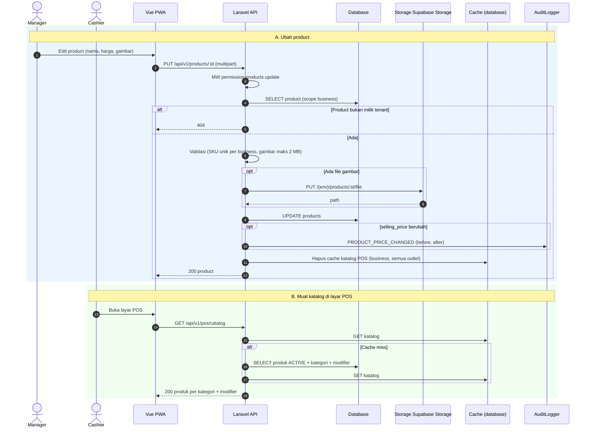

# Modul CAT — Katalog (Category, Product, Modifier)

> Sumber kebenaran tetap `docs/` v3.0; file ini hanya **kumpulan per modul** supaya developer cukup membuka satu folder. Bila ada beda, `docs/` menang.

| | |
|---|---|
| Owner | Naufaldi (9 tiket), Akmal (1 tiket) |
| Tiket | 10 core (8.00 hari) + 0 rilis 1.1 (0.00 hari) |

## 1. Ringkasan buat developer

Menu yang dijual: kategori, produk (harga, SKU, gambar), dan modifier. Katalog POS di-cache agar layar kasir cepat.

**Hati-hati**
- Produk **tidak punya `cost_price`**; HPP dihitung dari recipe.
- Harga berubah → audit `PRODUCT_PRICE_CHANGED`.
- Cache `/pos/catalog` harus dibatalkan setiap katalog berubah.
- Respons POS tidak boleh memuat HPP.

**Dianggap selesai kalau:** CRUD lengkap, `/pos/catalog` ter-cache dan tervalidasi, test CAT hijau.

## 2. Kebutuhan Fungsional (dari SRS v3.0)

### Modul CAT — Katalog

#### FR-CAT-001: Category
**Input:** nama (wajib, ≤ 100, unik per business), deskripsi, status, sort order.
**Aturan:** category INACTIVE menyembunyikan produknya dari POS. Soft delete (BR-018).

#### FR-CAT-002: Product
**Input:** category (wajib), SKU (wajib, ≤ 50, unik per business), nama (wajib, ≤ 150), deskripsi, harga jual (wajib, bilangan bulat ≥ 0), status, gambar (jpg/png/webp, ≤ 2 MB).
**Aturan:** produk INACTIVE tidak muncul di POS dan tidak bisa ditambahkan ke order baru (BR-029). Tidak ada kolom harga pokok yang diinput; HPP hasil hitungan (FR-REC-003). Perubahan harga → audit `PRODUCT_PRICE_CHANGED`. Harga sama untuk semua outlet.
| Kondisi | Pesan Error |
|---------|-------------|
| SKU sudah ada | "SKU sudah digunakan." |
| Harga negatif atau bukan angka bulat | "Harga harus bilangan bulat ≥ 0." |
| Gambar > 2 MB atau format salah | "Gambar maksimal 2 MB (jpg, png, webp)." |

#### FR-CAT-003: Modifier
**Input group:** nama, tipe (`SINGLE`/`MULTI`), wajib (bool), `min_select`, `max_select`. **Option:** nama, `price_delta` (bilangan bulat ≥ 0 `[ASUMSI]`), status. Group dihubungkan ke produk.
**Aturan:** group wajib → kasir harus memilih sesuai `min_select`/`max_select` (BR-030). `SINGLE` → maks 1 pilihan. Option INACTIVE tidak bisa dipilih.
| Kondisi | Pesan Error |
|---------|-------------|
| `min_select` > `max_select` | "Minimal pilihan tidak boleh melebihi maksimal." |
| Group wajib tidak dipilih saat order | "Pilih opsi untuk {nama group}." |

#### FR-CAT-004: Katalog POS
`GET /pos/catalog` mengembalikan kategori + produk ACTIVE + modifier. Di-cache, dibatalkan saat katalog berubah. Respons memuat harga jual, tanpa HPP.

---

## 3. Aturan Bisnis terkait

| ID | Aturan | Konsekuensi bila dilanggar |
|----|--------|---------------------------|
| BR-018 | Entitas yang pernah dipakai transaksi tidak dihapus permanen: INACTIVE atau soft delete | Laporan historis rusak |
| BR-029 | Produk, modifier, kategori INACTIVE tidak bisa masuk order baru; divalidasi saat tambah item dan saat konfirmasi | Produk nonaktif terjual |
| BR-030 | Modifier group wajib harus dipilih sesuai `min_select`/`max_select`; `SINGLE` maks 1 | `422` |

## 4. Use Case

| ID | Nama | Aktor | Prioritas | FR | Proses |
|----|------|-------|-----------|----|--------|
| UC-CAT-01 | Kelola Katalog (category, product) | Owner, Manager | Must | FR-CAT-001, 002, 004 | |
| UC-CAT-02 | Kelola Modifier | Owner, Manager | Must | FR-CAT-003 | |

**Spesifikasi ringkas**

| ID | Prakondisi | Alur utama | Pascakondisi sukses | Alternatif / gagal | FR / BR |
|----|-----------|------------|---------------------|--------------------|---------|
| UC-CAT-01 | Manager/Owner | Kelola category dan product (harga, SKU, gambar, status) | Tersimpan; cache katalog dibatalkan; harga berubah → audit | SKU ganda, gambar > 2 MB → `422`; produk bertransaksi hanya INACTIVE | FR-CAT-001, 002, 004 / BR-018, 029, 031 |
| UC-CAT-02 | Manager/Owner | Buat group dan option, pasang ke produk | Tersimpan; cache dibatalkan | `min_select > max_select` → `422` | FR-CAT-003 / BR-030 |

## 5. Tabel Database (ERD v3.0)

**`categories`**: `name` V(100) NN · `description` V(255) N · `status` V(20) NN · `sort_order` INT NN DEFAULT 0 · `deleted_at` N. UNIQUE parsial `(business_id, name) WHERE deleted_at IS NULL`.

**`products`**
| Kolom | Tipe | Null | Constraint | Keterangan |
|-------|------|------|-----------|------------|
| category_id | BIGINT | NN | FK categories | |
| sku | V(50) | NN | UNIQUE parsial `(business_id, sku) WHERE deleted_at IS NULL` | |
| name | V(150) | NN | | |
| description | TEXT | N | | |
| selling_price | BIGINT | NN | CHECK ≥ 0 | |
| status | V(20) | NN | CHECK | |
| image_path | V(255) | N | | Supabase Storage |
| deleted_at | TIMESTAMP | N | | |

Tidak ada `cost_price` (HPP dihitung dari recipe).

**`modifier_groups`**: `name` V(100) NN · `selection_type` V(10) NN CHECK `SINGLE`,`MULTI` · `is_required` BOOLEAN NN · `min_select` SMALLINT NN DEFAULT 0 · `max_select` SMALLINT NN · CHECK `min_select <= max_select` · `sort_order` INT · `status` V(20) NN · `deleted_at` N.

**`modifier_options`**: `modifier_group_id` FK NN · `name` V(100) NN · `price_delta` BIGINT NN CHECK ≥ 0 · `sort_order` INT · `status` V(20) NN · `deleted_at` N.

**`product_modifier_groups`**: PK `(product_id, modifier_group_id)` · `business_id` NN · `sort_order` INT.

## 6. Behavior (Sequence / State / Activity)

#### 3.2.9 SEQ-CAT-01: Simpan Product & Katalog POS (UC-CAT-01)

**Catatan:** respons katalog POS tidak memuat HPP; produk tidak punya kolom biaya (FR-CAT-002, NFR-SEC-007).

## 7. Endpoint (SDD v3.0 §4)

| ID | Method | Endpoint | Permission | UC | FR | Deskripsi |
|----|--------|----------|-----------|----|----|-----------|
| API-CAT-01 | GET | `/categories` | `products.view` | UC-CAT-01 | FR-CAT-001 | Daftar kategori |
| API-CAT-02 | POST | `/categories` | `products.create` | UC-CAT-01 | FR-CAT-001 | Tambah |
| API-CAT-03 | PUT | `/categories/{id}` | `products.update` | UC-CAT-01 | FR-CAT-001 | Ubah |
| API-CAT-04 | DELETE | `/categories/{id}` | `products.delete` | UC-CAT-01 | FR-CAT-001 | Soft delete / INACTIVE |
| API-CAT-05 | GET | `/products` | `products.view` | UC-CAT-01 | FR-CAT-002 | Daftar produk |
| API-CAT-06 | POST | `/products` | `products.create` | UC-CAT-01 | FR-CAT-002 | Tambah (multipart bila ada gambar) |
| API-CAT-07 | GET | `/products/{id}` | `products.view` | UC-CAT-01 | FR-CAT-002 | Detail |
| API-CAT-08 | POST | `/products/{id}` (`_method=PUT`) | `products.update` | UC-CAT-01 | FR-CAT-002 | Ubah (multipart) |
| API-CAT-09 | DELETE | `/products/{id}` | `products.delete` | UC-CAT-01 | FR-CAT-002 | Soft delete / INACTIVE |
| API-CAT-10 | GET | `/modifier-groups` | `products.view` | UC-CAT-02 | FR-CAT-003 | Daftar group + option |
| API-CAT-11 | POST | `/modifier-groups` | `products.create` | UC-CAT-02 | FR-CAT-003 | Tambah group |
| API-CAT-12 | PUT | `/modifier-groups/{id}` | `products.update` | UC-CAT-02 | FR-CAT-003 | Ubah group |
| API-CAT-13 | DELETE | `/modifier-groups/{id}` | `products.delete` | UC-CAT-02 | FR-CAT-003 | Soft delete |
| API-CAT-14 | POST | `/modifier-groups/{id}/options` | `products.create` | UC-CAT-02 | FR-CAT-003 | Tambah option |
| API-CAT-15 | PUT | `/modifier-options/{id}` | `products.update` | UC-CAT-02 | FR-CAT-003 | Ubah option |
| API-CAT-16 | DELETE | `/modifier-options/{id}` | `products.delete` | UC-CAT-02 | FR-CAT-003 | Soft delete |
| API-CAT-17 | PUT | `/products/{id}/modifier-groups` | `products.update` | UC-CAT-02 | FR-CAT-003 | Pasang group ke produk (sync) |
| API-CAT-18 | GET | `/pos/catalog` | `sales.create` | UC-ORD-01 | FR-CAT-004 | Katalog POS (cache) |

## 8. Tiket

Detail AC lengkap ada di `tickets/tickets.md` (ID sama).

| ID | Task | Est | Owner | Sprint | Depends on | Test |
|----|------|-----|-------|--------|-----------|------|
| BE-CAT-001 | CRUD category (status, sort order) | S | Naufaldi | S1 | DB-CAT-001, BE-RBAC-001 | TC-CAT-002 |
| BE-CAT-002 | CRUD product + upload gambar ke Supabase Storage (maks 2 MB, jpg/png/webp) | M | Naufaldi | S1 | BE-CAT-001 | TC-CAT-001, TC-CAT-006 |
| BE-CAT-003 | Audit perubahan harga + guard produk INACTIVE + soft delete | S | Naufaldi | S5 | BE-CAT-002, BE-AUD-001 | TC-CAT-004 |
| BE-CAT-004 | CRUD modifier group & option + pasang ke produk | M | Naufaldi | S2 | BE-CAT-002 | TC-CAT-003 |
| BE-CAT-005 | GET /pos/catalog dengan cache + invalidasi saat katalog berubah | S | Naufaldi | S2 | BE-CAT-004 | TC-CAT-005 |
| DB-CAT-001 | Migrasi categories, products, modifier_groups, modifier_options, product_modifier_groups | M | Naufaldi | S1 | DB-TEN-002 | TC-CAT-001 |
| FE-CAT-001 | Halaman kategori | S | Naufaldi | S5 | BE-CAT-001, FE-AUTH-003 | TC-CAT-002 |
| FE-CAT-002 | Halaman list + form produk (upload gambar) | M | Naufaldi | S4 | BE-CAT-002, FE-AUTH-003 | TC-CAT-001 |
| FE-CAT-003 | UI manajemen modifier | M | Naufaldi | S4 | BE-CAT-004, FE-CAT-002 | TC-CAT-003 |
| TEST-CAT-001 | Feature test katalog (tenant, SKU unik, inactive, cache) | M | Akmal | S3 | BE-CAT-005 | TC-CAT-001…006 |

**Acceptance Criteria ringkas**

- **BE-CAT-001** 
  - [ ] Nama unik per business; INACTIVE menyembunyikan produknya dari POS
  - [ ] Soft delete, bukan hard delete
- **BE-CAT-002** 
  - [ ] SKU ganda 422 "SKU sudah digunakan."; harga non-bulat/negatif 422
  - [ ] Gambar >2 MB atau format salah 422 dengan pesan SRS
- **BE-CAT-003** 
  - [ ] Perubahan selling_price menulis PRODUCT_PRICE_CHANGED (before/after)
  - [ ] Produk yang pernah dipakai transaksi tidak bisa dihapus permanen
- **BE-CAT-004** 
  - [ ] min_select > max_select ditolak dengan pesan SRS
  - [ ] SINGLE hanya memperbolehkan satu pilihan; option INACTIVE tidak bisa dipilih
- **BE-CAT-005** 
  - [ ] Respons tidak memuat HPP
  - [ ] Perubahan produk/kategori/modifier membatalkan cache
- **DB-CAT-001** 
  - [ ] UNIQUE parsial SKU dan nama sesuai ERD
  - [ ] products tidak punya kolom cost_price
- **FE-CAT-001** 
  - [ ] CRUD kategori jalan dengan state loading/empty/error
  - [ ] Aksi dibatasi v-can products.*
- **FE-CAT-002** 
  - [ ] Error 422 tampil per field
  - [ ] Preview gambar dan batas 2 MB divalidasi sebelum upload
- **FE-CAT-003** 
  - [ ] Group, option, dan pemasangan ke produk dapat dikelola
  - [ ] Aturan min/max tampil jelas
- **TEST-CAT-001** 
  - [ ] Semua baris tabel validasi FR-CAT-002/003 punya test
  - [ ] Test cache invalidasi lulus

## 9. Test Case (Test Plan v3.0)

| ID | Skenario | FR / BR | Level | Rilis |
|----|----------|---------|-------|-------|
| TC-CAT-001 | SKU produk ganda 422; harga non-bulat/negatif 422 | FR-CAT-002 | Feature | Core |
| TC-CAT-002 | Nama kategori unik; INACTIVE menyembunyikan produk dari POS | FR-CAT-001 | Feature | Core |
| TC-CAT-003 | Modifier: min>max 422; SINGLE satu pilihan; option INACTIVE tak bisa dipilih | FR-CAT-003; BR-030 | Feature | Core |
| TC-CAT-004 | Ubah harga menulis PRODUCT_PRICE_CHANGED; produk bertransaksi tidak dihapus permanen | FR-CAT-002; BR-018; BR-029 | Feature | Core |
| TC-CAT-005 | Cache /pos/catalog dibatalkan saat katalog berubah; tanpa HPP | FR-CAT-004 | Feature | Core |
| TC-CAT-006 | Upload gambar >2 MB atau format salah → 422 | FR-CAT-002 | Feature | Core |
