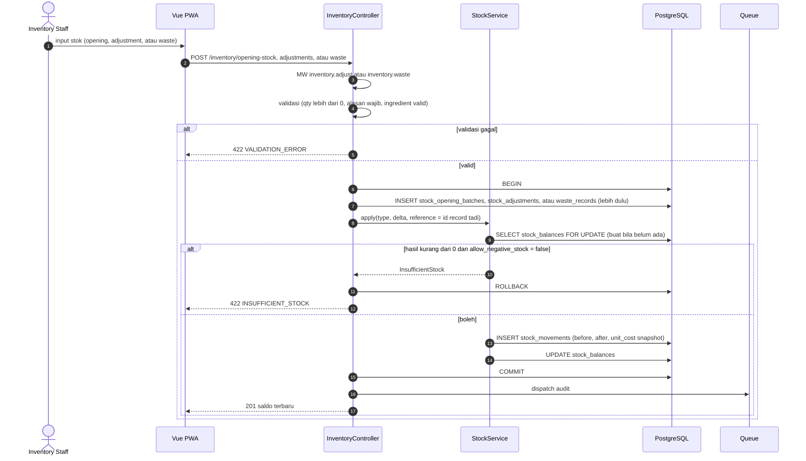
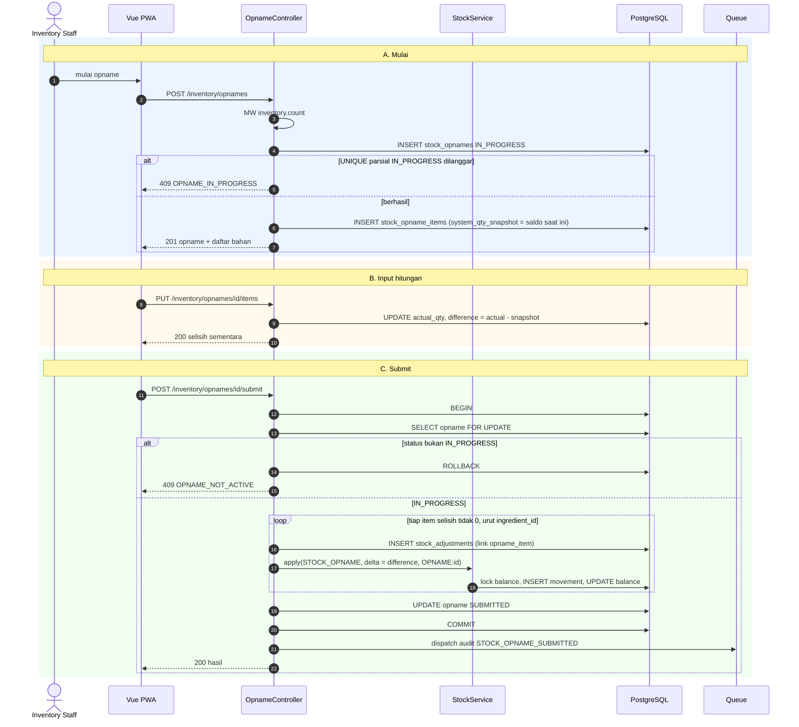
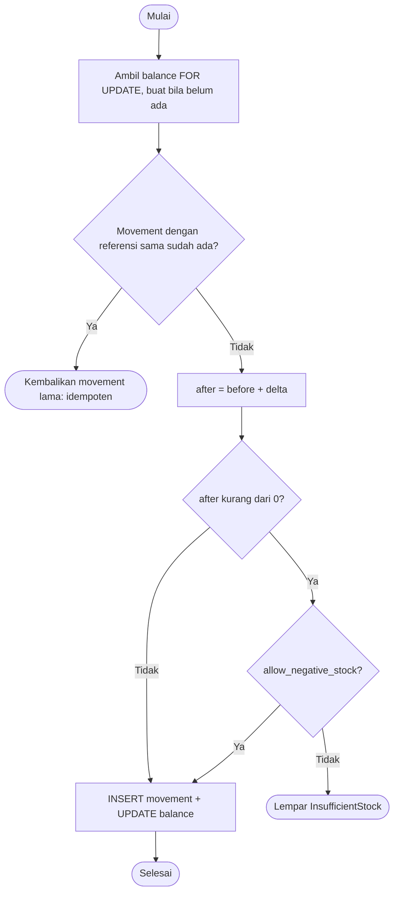
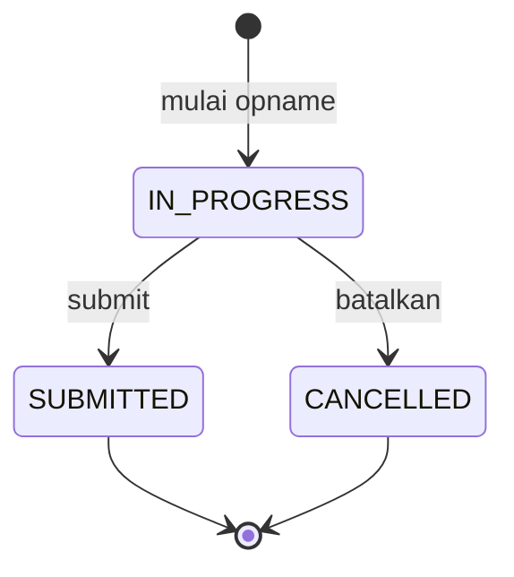

# Modul ENG-INV — Engine Sale→Inventory & Inventory

> Sumber kebenaran tetap `docs/` v3.0; file ini hanya **kumpulan per modul** supaya developer cukup membuka satu folder. Bila ada beda, `docs/` menang.

| | |
|---|---|
| Owner | Akmal (27 tiket) |
| Tiket | 21 core (16.50 hari) + 6 rilis 1.1 (4.00 hari) |

## 1. Ringkasan buat developer

Jantung stok: `StockService` mencatat setiap perubahan ke buku besar `stock_movements` dan menjaga saldo `stock_balances`. Engine memotong bahan saat bayar berdasarkan recipe. Ada opening stock, adjustment, dan waste.

**Hati-hati**
- `balance = SUM(movements)` harus selalu benar; movement append-only.
- Lock `FOR UPDATE` berurutan `ingredient_id` agar tidak deadlock.
- Idempotensi movement lewat referensi unik.
- Stok minus mengikuti setting outlet; `forceNegative` hanya untuk settlement gateway (Phase 2).
- Opname dan recipe modifier masuk rilis 1.1.

**Dianggap selesai kalau:** StockService teruji konkurensi; engine dan INT-ENG-001 hijau; adjustment/waste/stok berjalan.

## 2. Kebutuhan Fungsional (dari SRS v3.0)

### Modul ENG — Core Engine: Sale → Inventory

#### FR-ENG-001: Potong Stok Saat Pembayaran
**Aturan (BR-009, BR-010):**
1. Hitung kebutuhan: tiap item × recipe (`recipe_id` di snapshot) + recipe modifier option terpilih × qty item.
2. Agregat per ingredient untuk seluruh order.
3. Urutkan by `ingredient_id`, kunci balance (`FOR UPDATE`), lalu insert 1 movement `SALE` per ingredient (delta negatif, `unit_cost = last_cost` saat kejadian) dan update balance.
4. Produk tanpa recipe dilewati dan tampil di laporan "no recipe".
5. Idempoten: unique `(outlet_id, ingredient_id, type, reference_type, reference_id)`.

#### FR-ENG-002: Kebijakan Stok Minus
`allow_negative_stock = true` (default): pembayaran tetap sukses walau stok menjadi minus; respons memuat `stock_shortage`, audit mencatatnya, dan stok minus tampil di laporan inventory. `false`: seluruh pembayaran ditolak dan di-rollback dengan daftar bahan kurang (BR-011).

#### FR-ENG-003: Stock Trace
`GET /orders/:id/stock-trace` menampilkan movement yang dihasilkan sebuah order (termasuk `RETURN` bila ada refund). Butuh `inventory.view`.

---

### Modul INV — Inventory

#### FR-INV-001: Opening Stock
**Input:** per bahan: qty > 0 (base unit).
**Aturan:** membuat movement `OPENING` dan balance. `reference_id` berisi id batch agar idempotensi unik (BR-009). Butuh `inventory.adjust`. Audit.

#### FR-INV-002: Stok & Riwayat Movement
Daftar stok per outlet (qty, minimum, status low) dan riwayat movement (filter ingredient, tipe, tanggal; paginasi). Movement tidak punya endpoint ubah/hapus (BR-020).

#### FR-INV-003: Stock Adjustment
**Input:** ingredient, jenis (`TAMBAH`/`KURANGI`), qty (> 0), alasan (wajib).
**Aturan:** menyimpan before/after, user, waktu (BR-016). Movement `ADJUSTMENT` bertanda sesuai jenis. Berlaku `allow_negative_stock`. Butuh `inventory.adjust`. Audit `STOCK_ADJUSTMENT`.
| Kondisi | Pesan Error |
|---------|-------------|
| Qty ≤ 0 | "Jumlah harus lebih dari 0." |
| Alasan kosong | "Alasan wajib diisi." |
| Hasil minus dan minus dilarang | "Stok tidak mencukupi untuk pengurangan ini." |

#### FR-INV-004: Waste
**Input:** ingredient, qty (> 0), alasan enum (`EXPIRED`, `SPOILED`, `SPILLED`, `PRODUCTION_ERROR`, `OTHER`), catatan (wajib bila `OTHER`).
**Aturan:** selalu mengurangi stok (BR-016). Biaya = qty × `last_cost` saat kejadian, disimpan sebagai snapshot. Butuh `inventory.waste`. Kitchen tidak melihat nilai biaya (BR-034). Audit `WASTE`.

#### FR-INV-005: Low Stock
Bahan dengan `quantity ≤ minimum` (override per outlet bila ada, jika tidak memakai default ingredient) tampil sebagai low stock, termasuk di dashboard. Stok minus tampil terpisah dan menonjol.

#### FR-INV-006: Stock Opname (F-13) `[R1.1]`
**Alur:** mulai → snapshot stok sistem semua bahan aktif → input hitungan fisik → review selisih → submit atau batalkan.
**Aturan (BR-017):** maks 1 opname `IN_PROGRESS` per outlet. Selisih = hitungan − snapshot. Saat submit, selisih diterapkan ke stok live lewat movement `STOCK_OPNAME` (urut `ingredient_id`), sehingga penjualan selama penghitungan tidak hilang. Butuh `inventory.count`. Audit ringkasan selisih.
| Kondisi | Pesan Error |
|---------|-------------|
| Sudah ada opname IN_PROGRESS | "Masih ada opname yang berjalan di outlet ini." (`409`) |
| Hitungan negatif | "Hitungan tidak boleh negatif." |
| Submit opname yang bukan IN_PROGRESS | "Opname sudah selesai atau dibatalkan." (`409`) |

---

## 3. Aturan Bisnis terkait

| ID | Aturan | Konsekuensi bila dilanggar |
|----|--------|---------------------------|
| BR-009 | Saat order dibayar, dalam transaksi yang sama: 1 movement `SALE` per ingredient (agregat seluruh item) | Stok tidak akurat |
| BR-010 | Produk tanpa recipe aktif boleh dijual, tidak memotong stok, ditandai "no recipe" di daftar produk dan (R1.1) laporan "no recipe" | Kasir terblokir |
| BR-011 | `allow_negative_stock = true`: tetap jual, stok boleh minus, ditandai di laporan. `false`: bayar ditolak dengan daftar bahan kurang. Pembayaran gateway: lihat BR-041 | Sesuai setting |
| BR-013 | Edit recipe membuat versi baru; order lama merujuk versi lamanya | HPP historis berubah |
| BR-016 | Adjustment dan waste wajib alasan, qty > 0 (arah ditentukan jenis aksi); waste selalu mengurangi stok | `422` |
| BR-017 | Opname: selisih = hitungan − snapshot awal, diterapkan ke stok live; maks 1 opname IN_PROGRESS per outlet | Penjualan selama opname hilang |
| BR-020 | `audit_logs`, `stock_movements`, `payments`, `cash_movements` append-only; tidak ada endpoint ubah/hapus | Jejak audit rusak |
| BR-034 | Kitchen tidak melihat nilai biaya waste | Kebocoran data sensitif |

## 4. Use Case

| ID | Nama | Aktor | Prioritas | FR | Proses |
|----|------|-------|-----------|----|--------|
| UC-ENG-01 | Potong Stok Otomatis (dan restock) | Sistem | Must | FR-ENG-001, 002, 003 | BP-01, BP-02 |
| UC-INV-01 | Isi Stok Awal | Inventory, Manager, Owner | Must | FR-INV-001 | BP-04 |
| UC-INV-02 | Lihat Stok & Movement | Inventory, Manager, Owner, Kitchen | Must | FR-INV-002, 005 | BP-04 |
| UC-INV-03 | Koreksi Stok (Adjustment) | Inventory, Manager, Owner | Must | FR-INV-003 | BP-04 |
| UC-INV-04 | Catat Waste | Inventory, Kitchen, Manager, Owner | Must | FR-INV-004 | BP-04 |
| UC-INV-05 | Stock Opname `[R1.1]` | Inventory, Manager, Owner | Should | FR-INV-006 | BP-04 |

**Spesifikasi penuh**

##### UC-ENG-01: Potong Stok Otomatis (dan Restock)
| Elemen | Isi |
|--------|-----|
| Aktor utama | Sistem (dipicu UC-PAY-01 dan UC-RFD-01) |
| Tujuan | Stok berkurang sesuai recipe, atomik dan idempoten |
| Prakondisi | Order dibayar di dalam transaksi yang sama |
| Pascakondisi sukses | 1 movement `SALE` per ingredient; balance diperbarui; (refund + restock) movement `RETURN` |
| Pascakondisi gagal | Rollback bersama pembayaran |
| FR / BR | FR-ENG-001…003 / BR-009, 010, 011 |

**Alur utama:** (1) Hitung kebutuhan per item dari recipe di snapshot + recipe modifier terpilih. (2) Agregat per ingredient. (3) Urutkan by `ingredient_id`, kunci balance, buat movement dengan `unit_cost` snapshot, update balance.

| Kode | Kondisi | Respon |
|------|---------|--------|
| 1a | Produk tanpa recipe | Dilewati; muncul di laporan "no recipe" |
| 3a | Movement untuk order+ingredient sudah ada | Tidak diproses ulang (idempoten) |
| 3b | Stok menjadi minus dan dilarang | Gagal, rollback |

##### UC-INV-05: Stock Opname
| Elemen | Isi |
|--------|-----|
| Aktor utama | Inventory Staff |
| Tujuan | Menyamakan stok sistem dengan stok fisik |
| Prakondisi | Tidak ada opname `IN_PROGRESS` di outlet |
| Pascakondisi sukses | Opname `SUBMITTED`; movement `STOCK_OPNAME` untuk tiap selisih ≠ 0; audit |
| Pascakondisi gagal | Opname `CANCELLED` atau tetap `IN_PROGRESS`; stok tidak berubah |
| FR / BR | FR-INV-006 / BR-017 |

**Alur utama:** (1) Mulai: sistem mem-snapshot stok. (2) Aktor mengisi hitungan fisik. (3) Sistem menampilkan selisih. (4) Aktor submit; sistem menerapkan selisih ke stok live (urut `ingredient_id`).

| Kode | Kondisi | Respon |
|------|---------|--------|
| 1a | Opname lain berjalan | `409` |
| 2a | Hitungan negatif | `422` |
| 4a | Penjualan terjadi selama penghitungan | Tidak hilang: selisih terhadap snapshot diterapkan ke stok live |
| 4b | Opname sudah selesai/dibatalkan | `409` |

**Spesifikasi ringkas**

| ID | Prakondisi | Alur utama | Pascakondisi sukses | Alternatif / gagal | FR / BR |
|----|-----------|------------|---------------------|--------------------|---------|
| UC-INV-01 | `inventory.adjust` | Isi qty awal per bahan | Batch opening + movement `OPENING` | Qty ≤ 0 → `422` | FR-INV-001 / BR-015 |
| UC-INV-02 | `inventory.view` | Buka stok / riwayat movement, filter | Stok, low stock, minus, riwayat tampil | — | FR-INV-002, 005 / BR-020 |
| UC-INV-03 | `inventory.adjust` | Pilih bahan, jenis tambah/kurangi, qty, alasan | Adjustment + movement `ADJUSTMENT`; audit | Alasan kosong, qty ≤ 0 → `422`; minus dilarang → `422` | FR-INV-003 / BR-016 |
| UC-INV-04 | `inventory.waste` | Pilih bahan, qty, alasan (enum), catatan | Waste + movement `WASTE`; biaya tersimpan (Kitchen tidak melihat nilai); audit | Alasan `OTHER` tanpa catatan → `422` | FR-INV-004 / BR-016, 034 |

## 5. Tabel Database (ERD v3.0)

**`stock_balances`**: `outlet_id` FK NN · `ingredient_id` FK NN · `quantity` DEC(18,4) NN DEFAULT 0 (**boleh negatif**) · `min_stock` DEC(18,4) N (override) · `last_movement_id` BIGINT N · UNIQUE `(outlet_id, ingredient_id)`.

**`stock_movements`** 🔒
| Kolom | Tipe | Null | Constraint | Keterangan |
|-------|------|------|-----------|------------|
| outlet_id | BIGINT | NN | FK | |
| ingredient_id | BIGINT | NN | FK | |
| type | V(20) | NN | CHECK `OPENING`,`PURCHASE`,`SALE`,`WASTE`,`ADJUSTMENT`,`STOCK_OPNAME`,`RETURN` | |
| quantity_delta | DEC(18,4) | NN | CHECK ≠ 0 | Bertanda. `SALE`,`WASTE` < 0; `OPENING`,`RETURN`,`PURCHASE` > 0 |
| quantity_before, quantity_after | DEC(18,4) | NN | | `after = before + delta` |
| unit_cost | DEC(18,4) | NN | | Snapshot `last_cost` |
| reference_type | V(20) | NN | | `OPENING`,`ORDER`,`REFUND`,`WASTE`,`ADJUSTMENT`,`OPNAME`,`PURCHASE` |
| reference_id | BIGINT | NN | | Polimorfik |
| user_id | BIGINT | N | FK users | NULL jika sistem |
| note | V(255) | N | | |
| occurred_at | TIMESTAMP | NN | | |

UNIQUE `(outlet_id, ingredient_id, type, reference_type, reference_id)` = idempotensi deduct (BR-009).

**`stock_adjustments`** (dibuat **sebelum** movement): `outlet_id`, `ingredient_id` FK NN · `opname_item_id` FK N · `quantity_before`, `quantity_delta`, `quantity_after` DEC(18,4) NN · `reason` V(255) NN · `user_id` FK NN · `created_at`.

**`waste_records`** (dibuat sebelum movement): `outlet_id`, `ingredient_id` FK NN · `quantity` DEC(18,4) NN CHECK > 0 · `reason` V(20) NN CHECK `EXPIRED`,`SPOILED`,`SPILLED`,`PRODUCTION_ERROR`,`OTHER` · `note` V(255) N (CHECK `OTHER` ⇒ NOT NULL) · `unit_cost` DEC(18,4) NN · `total_cost` BIGINT NN · `user_id` FK NN · `wasted_at` NN.

**`stock_opening_batches`**: `outlet_id` FK NN · `user_id` FK NN · `note` V(255) N · `created_at`.

**`stock_opnames`**: `outlet_id` FK NN · `code` V(30) NN UNIQUE `(outlet_id, code)` · `status` V(20) NN CHECK `IN_PROGRESS`,`SUBMITTED`,`CANCELLED` · `started_by` FK NN · `submitted_by` FK N · `started_at` NN · `submitted_at` N · `note` V(255) N. UNIQUE parsial `(outlet_id) WHERE status = 'IN_PROGRESS'`.

**`stock_opname_items`**: `opname_id` FK NN · `ingredient_id` FK NN · `system_qty_snapshot` DEC(18,4) NN · `actual_qty` DEC(18,4) N CHECK ≥ 0 · `difference` DEC(18,4) N · UNIQUE `(opname_id, ingredient_id)`.

## 6. Behavior (Sequence / State / Activity)

#### 3.2.4 SEQ-INV-01: Opening Stock, Adjustment, Waste (UC-INV-01, 03, 04)

**Catatan:** record induk dibuat **sebelum** movement sehingga `reference_id` sudah ada (menutup T-01). Opening stock membuat satu `stock_opening_batches` untuk seluruh baris; tiap bahan memperoleh satu movement `OPENING` dengan `reference_id` = id batch.

#### 3.2.5 SEQ-INV-02: Stock Opname (UC-INV-05) `[R1.1]`

**Catatan:** selisih dihitung terhadap snapshot awal lalu diterapkan ke stok live, sehingga penjualan selama penghitungan tidak hilang (BR-017). Karena `reference_id` movement `STOCK_OPNAME` = id opname, unique idempotensi tetap valid (satu movement per bahan per opname).

#### ACT-INV-01: `StockService::apply()`

**Catatan:** dipanggil dari semua jalur (SALE, RETURN, OPENING, ADJUSTMENT, WASTE, STOCK_OPNAME). `after < 0` pada `allow_negative_stock = true` ditandai sebagai `stock_shortage` untuk SALE. Parameter `forceNegative = true` dipakai **hanya** oleh settlement gateway (BR-041): stok tetap dipotong walau minus dan ditandai `GATEWAY_STOCK_OVERRIDE` [P2].

#### STM-OPNAME: Status `stock_opnames.status` `[R1.1]`

| Dari | Ke | Pemicu | Aktor | Guard / Syarat | Efek Samping |
|------|----|--------|-------|----------------|--------------|
| (awal) | IN_PROGRESS | `POST /inventory/opnames` | Inventory | Tidak ada opname IN_PROGRESS di outlet | Snapshot stok |
| IN_PROGRESS | SUBMITTED | `submit` | Inventory | Status masih IN_PROGRESS | Movement STOCK_OPNAME per selisih ≠ 0, audit |
| IN_PROGRESS | CANCELLED | `cancel` | Inventory, Manager | — | Stok tidak berubah |

## 7. Endpoint (SDD v3.0 §4)

| ID | Method | Endpoint | Permission | UC | FR | Deskripsi |
|----|--------|----------|-----------|----|----|-----------|
| API-ENG-01 | GET | `/orders/{id}/stock-trace` | `inventory.view` | UC-ENG-01 | FR-ENG-003 | Order → movement |
| API-INV-01 | GET | `/inventory/stocks` | `inventory.view` | UC-INV-02 | FR-INV-002 | Stok per bahan |
| API-INV-02 | GET | `/inventory/movements` | `inventory.view` | UC-INV-02 | FR-INV-002 | Riwayat movement |
| API-INV-03 | GET | `/inventory/low-stock` | `inventory.view` | UC-INV-02 | FR-INV-005 | Low stock + minus |
| API-INV-04 | POST | `/inventory/opening-stock` | `inventory.adjust` | UC-INV-01 | FR-INV-001 | Stok awal |
| API-INV-05 | POST | `/inventory/adjustments` | `inventory.adjust` | UC-INV-03 | FR-INV-003 | Adjustment |
| API-INV-06 | GET | `/inventory/adjustments` | `inventory.view` | UC-INV-03 | FR-INV-003 | Daftar adjustment |
| API-INV-07 | POST | `/inventory/waste` | `inventory.waste` | UC-INV-04 | FR-INV-004 | Catat waste |
| API-INV-08 | GET | `/inventory/waste` | `inventory.waste` | UC-INV-04 | FR-INV-004 | Daftar waste (Kitchen tanpa biaya) `[R1.1]` |
| API-INV-09 | POST | `/inventory/opnames` | `inventory.count` | UC-INV-05 | FR-INV-006 | Mulai opname `[R1.1]` |
| API-INV-10 | GET | `/inventory/opnames` | `inventory.count` | UC-INV-05 | FR-INV-006 | Daftar opname `[R1.1]` |
| API-INV-11 | GET | `/inventory/opnames/{id}` | `inventory.count` | UC-INV-05 | FR-INV-006 | Detail `[R1.1]` |
| API-INV-12 | PUT | `/inventory/opnames/{id}/items` | `inventory.count` | UC-INV-05 | FR-INV-006 | Input hitungan `[R1.1]` |
| API-INV-13 | POST | `/inventory/opnames/{id}/submit` | `inventory.count` | UC-INV-05 | FR-INV-006 | Submit `[R1.1]` |
| API-INV-14 | POST | `/inventory/opnames/{id}/cancel` | `inventory.count` | UC-INV-05 | FR-INV-006 | Batalkan `[R1.1]` |

**Contoh request/response**

#### API-INV-04 · POST /inventory/opening-stock
**Request:** `{ "note": "Stok awal 12 Okt", "items": [ { "ingredient_id": 3, "quantity": "20000" }, { "ingredient_id": 4, "quantity": "5000" } ] }`
**Response 201:** `{ "data": { "batch_id": 4, "items": [ { "ingredient_id": 3, "quantity_after": "20000.0000" }, { "ingredient_id": 4, "quantity_after": "5000.0000" } ] } }`
**Validasi:** `items.*.quantity` numeric, > 0, maks 4 desimal → "Jumlah harus lebih dari 0." Bahan ganda dalam satu batch ditolak.

#### API-INV-05 · POST /inventory/adjustments
**Request:** `{ "ingredient_id": 3, "direction": "DECREASE", "quantity": "2000", "reason": "Selisih stok" }`
**Response 201:** `{ "data": { "id": 21, "ingredient_id": 3, "quantity_before": "20000.0000", "quantity_delta": "-2000.0000", "quantity_after": "18000.0000", "reason": "Selisih stok" } }`
**Validasi:** `direction` in:INCREASE,DECREASE; `quantity` > 0; `reason` required, max:255 ("Alasan wajib diisi.").
**Error:** 422 `INSUFFICIENT_STOCK` ("Stok tidak mencukupi untuk pengurangan ini.") bila minus dilarang — FR-INV-003, BR-016.

#### API-INV-07 · POST /inventory/waste
**Request:** `{ "ingredient_id": 3, "quantity": "1000", "reason": "EXPIRED", "note": null }`
**Response 201:** `{ "data": { "id": 9, "ingredient_id": 3, "quantity": "1000.0000", "reason": "EXPIRED", "total_cost": 20000, "quantity_after": "17000.0000" } }` — `total_cost` dihilangkan untuk role Kitchen (BR-034).
**Validasi:** `reason` in:EXPIRED,SPOILED,SPILLED,PRODUCTION_ERROR,OTHER; `note` required_if reason=OTHER ("Catatan wajib untuk alasan Lainnya.").

#### API-INV-09, 12, 13 · Opname
- `POST /inventory/opnames` → `201 { "data": { "id": 6, "code": "OPN-KP01-261012-1", "status": "IN_PROGRESS", "items": [ { "ingredient_id": 3, "name": "Susu", "system_qty_snapshot": "17000.0000", "actual_qty": null } ] } }`. Error `409 OPNAME_IN_PROGRESS`.
- `PUT /inventory/opnames/{id}/items` body `{ "items": [ { "ingredient_id": 3, "actual_qty": "16500" } ] }` → `200` dengan `difference: "-500.0000"` per item. Validasi `actual_qty` ≥ 0 ("Hitungan tidak boleh negatif.").
- `POST /inventory/opnames/{id}/submit` → `200 { "data": { "status": "SUBMITTED", "adjusted_items": 1 } }`. Error `409 OPNAME_NOT_ACTIVE`.

## 8. Tiket

Detail AC lengkap ada di `tickets/tickets.md` (ID sama).

| ID | Task | Est | Owner | Sprint | Depends on | Test |
|----|------|-----|-------|--------|-----------|------|
| BE-ENG-001 | RecipeUsageCalculator: item × recipe (versi snapshot), agregat per bahan | M | Akmal | S2 | BE-REC-001, DB-ORD-001 | TC-ENG-001, TC-ENG-002, TC-ENG-003 |
| BE-ENG-002 | DeductStockForOrder: lock urut ingredient_id, movement SALE idempoten | M | Akmal | S2 | BE-ENG-001, BE-INV-002 | TC-ENG-005 |
| BE-ENG-003 | Kebijakan stok minus: stock_shortage di respons dan audit | S | Akmal | S3 | BE-ENG-002 | TC-ENG-004 |
| BE-ENG-004 | Jalur restock refund (movement RETURN dari movement SALE order) | S | Akmal | S3 | BE-ENG-002 | TC-PAY-013 |
| BE-ENG-005 | GET /orders/{id}/stock-trace | S | Akmal | S5 | BE-ENG-002 | TC-ENG-006 |
| BE-INV-001 | StockService::apply() (lock FOR UPDATE, before/after, allow_negative_stock, forceNegative) | M | Akmal | S2 | DB-INV-001 | TC-INV-002 |
| BE-INV-002 | Idempotensi movement (referensi sama = movement lama) + helper reverse() | S | Akmal | S2 | BE-INV-001 | TC-INV-001 |
| BE-INV-003 | POST /inventory/opening-stock (batch + movement OPENING) | S | Akmal | S2 | BE-INV-001 | TC-INV-004 |
| BE-INV-004 | POST/GET /inventory/adjustments (record dibuat sebelum movement) | M | Akmal | S2 | BE-INV-001, BE-AUD-001 | TC-INV-005 |
| BE-INV-005 | POST/GET /inventory/waste (alasan enum, snapshot biaya, Kitchen tanpa biaya) | M | Akmal | S3 | BE-INV-001, BE-AUD-001 | TC-INV-006, TC-INV-007 |
| BE-INV-006 | GET stok, riwayat movement, low stock + stok minus | S | Akmal | S3 | BE-INV-001 | TC-INV-008 |
| DB-INV-001 | Migrasi stock_balances, stock_movements (trigger append-only), stock_adjustments, waste_records, stock_opening_batches | M | Akmal | S2 | DB-ING-001, DB-AUD-001 | TC-INV-011 |
| FE-ENG-001 | Indikator stok menipis/habis di layar POS | S | Akmal | S5 | BE-ENG-003, FE-ORD-002 | TC-ENG-004 |
| FE-INV-001 | Halaman stok + badge low stock/minus | M | Akmal | S3 | BE-INV-006, FE-AUTH-003 | TC-INV-008 |
| FE-INV-002 | Halaman riwayat movement | S | Akmal | S5 | BE-INV-006 | TC-INV-011 |
| FE-INV-003 | Form opening stock & adjustment | M | Akmal | S4 | BE-INV-003, BE-INV-004 | TC-INV-004, TC-INV-005 |
| FE-INV-004 | Form & daftar waste | S | Akmal | S3 | BE-INV-005 | TC-INV-006, TC-INV-007 |
| INT-ENG-001 | Integration test Sale → Payment → Recipe → Movement → Balance | M | Akmal | S3 | BE-PAY-003, BE-ENG-002 | TC-ENG-001…005 |
| TEST-ENG-001 | Edge case: tanpa recipe, recipe diubah setelah jual, 2 order paralel | M | Akmal | S5 | INT-ENG-001 | TC-ENG-002, TC-ENG-003, TC-ENG-005 |
| TEST-INV-001 | Unit test StockService: konkurensi, minus, idempotensi, presisi desimal | M | Akmal | S4 | BE-INV-002 | TC-INV-001, TC-INV-002, TC-INV-003 |
| TEST-INV-002 | Feature test opening, adjustment, waste, stok | M | Akmal | S4 | BE-INV-005, BE-INV-006 | TC-INV-004…008 |
| BE-ENG-006 | Pemakaian bahan modifier option ditambahkan ke agregat (F-18) | S | Akmal | R1.1 | BE-ENG-001, BE-REC-003 | TC-ENG-007 |
| BE-INV-007 | Opname: mulai (snapshot), input hitungan, batalkan | M | Akmal | R1.1 | DB-INV-002, BE-INV-004 | TC-INV-009, TC-INV-010 |
| BE-INV-008 | Opname submit: selisih vs snapshot diterapkan ke stok live (urut ingredient_id) | S | Akmal | R1.1 | BE-INV-007 | TC-INV-009 |
| DB-INV-002 | Migrasi stock_opnames, stock_opname_items (UNIQUE parsial IN_PROGRESS) | S | Akmal | R1.1 | DB-INV-001 | TC-INV-010 |
| FE-INV-005 | UI opname (mulai, input hitungan, review selisih, submit) | M | Akmal | R1.1 | BE-INV-008 | TC-INV-009 |
| TEST-INV-003 | Test opname (snapshot, selisih, konkurensi dengan penjualan) | S | Akmal | R1.1 | BE-INV-008 | TC-INV-009, TC-INV-010 |

**Acceptance Criteria ringkas**

- **BE-ENG-001** 
  - [ ] Bahan sama di beberapa item diagregat menjadi satu angka
  - [ ] Produk tanpa recipe dilewati
- **BE-ENG-002** 
  - [ ] Dua order paralel dengan bahan sama tidak deadlock dan stok benar
  - [ ] Movement SALE unit_cost memakai last_cost saat kejadian
- **BE-ENG-003** 
  - [ ] allow_negative_stock = true: bayar sukses dan stock_shortage terisi
  - [ ] false: 422 INSUFFICIENT_STOCK dengan details.ingredients
- **BE-ENG-004** 
  - [ ] Restock membuat RETURN positif per bahan dengan reference REFUND:id
  - [ ] Tanpa restock tidak ada movement baru
- **BE-ENG-005** 
  - [ ] Menampilkan movement SALE dan RETURN milik order
  - [ ] Butuh inventory.view; order tenant lain 404
- **BE-INV-001** 
  - [ ] Stok kurang dan minus dilarang melempar InsufficientStock
  - [ ] forceNegative hanya dipakai jalur settlement gateway (default false)
- **BE-INV-002** 
  - [ ] Pemanggilan ulang dengan referensi sama mengembalikan movement lama tanpa baris baru
  - [ ] reverse() membuat movement lawan dengan referensi baru
- **BE-INV-003** 
  - [ ] Satu batch menghasilkan satu movement OPENING per bahan dengan reference_id = id batch
  - [ ] Qty ≤ 0 dan bahan ganda dalam batch ditolak
- **BE-INV-004** 
  - [ ] Alasan wajib dan qty > 0; before/after tersimpan
  - [ ] Hasil minus saat minus dilarang 422 INSUFFICIENT_STOCK
- **BE-INV-005** 
  - [ ] Alasan OTHER tanpa catatan 422
  - [ ] total_cost tidak ada di respons untuk role Kitchen
- **BE-INV-006** 
  - [ ] Filter ingredient, tipe, tanggal dengan paginasi
  - [ ] Low stock memakai min_stock override outlet; stok minus tampil terpisah
- **DB-INV-001** 
  - [ ] UNIQUE idempotensi movement dan CHECK arah delta sesuai ERD
  - [ ] UPDATE/DELETE movement ditolak trigger
- **FE-ENG-001** 
  - [ ] Indikator tampil tanpa memblokir penjualan
  - [ ] Data berasal dari endpoint stok (tanpa HPP)
- **FE-INV-001** 
  - [ ] Badge low stock dan minus berbeda dan menonjol
  - [ ] State empty/loading/error ada
- **FE-INV-002** 
  - [ ] Filter tipe/tanggal bekerja
  - [ ] Tidak ada aksi ubah/hapus movement
- **FE-INV-003** 
  - [ ] Alasan wajib tampil pada adjustment
  - [ ] Error stok kurang menampilkan pesan SRS
- **FE-INV-004** 
  - [ ] Catatan wajib saat alasan OTHER
  - [ ] Nilai biaya disembunyikan untuk Kitchen
- **INT-ENG-001** 
  - [ ] balance = SUM(movements) untuk semua bahan pasca skenario
  - [ ] Skenario lengkap order→bayar→refund restock lulus
- **TEST-ENG-001** 
  - [ ] Recipe versi baru tidak mengubah movement order lama
  - [ ] Produk tanpa recipe tampil di laporan no recipe
- **TEST-INV-001** 
  - [ ] 20 apply paralel pada bahan sama: balance = SUM(movements)
  - [ ] Presisi DECIMAL(18,4) terjaga
- **TEST-INV-002** 
  - [ ] Semua baris tabel validasi FR-INV-003/004 diuji
  - [ ] Permission Kitchen/Inventory sesuai matriks
- **BE-ENG-006** `[R1.1]`
  - [ ] Pemakaian modifier dihitung dari recipe option aktif saat pembayaran
  - [ ] Modifier tanpa recipe tidak memotong stok
- **BE-INV-007** `[R1.1]`
  - [ ] Mulai saat ada opname berjalan 409 OPNAME_IN_PROGRESS
  - [ ] Hitungan negatif 422
- **BE-INV-008** `[R1.1]`
  - [ ] Penjualan selama penghitungan tidak hilang (selisih dihitung terhadap snapshot)
  - [ ] Submit pada opname bukan IN_PROGRESS 409 OPNAME_NOT_ACTIVE
- **DB-INV-002** `[R1.1]`
  - [ ] Hanya 1 opname IN_PROGRESS per outlet di level DB
  - [ ] UNIQUE (opname_id, ingredient_id)
- **FE-INV-005** `[R1.1]`
  - [ ] Layar nyaman di HP (target sentuh ≥ 44 px)
  - [ ] Review selisih tampil sebelum submit
- **TEST-INV-003** `[R1.1]`
  - [ ] Skenario penjualan selama opname lulus
  - [ ] Submit ganda ditolak

## 9. Test Case (Test Plan v3.0)

| ID | Skenario | FR / BR | Level | Rilis |
|----|----------|---------|-------|-------|
| TC-INV-001 | StockService idempoten: referensi sama tidak membuat movement baru | NFR-DATA-003; BR-009 | Unit | Core |
| TC-INV-002 | Stok kurang + minus dilarang → InsufficientStock; minus diizinkan → saldo negatif | FR-INV-003; BR-011 | Unit | Core |
| TC-INV-003 | 20 apply paralel: balance = SUM(movements), tanpa deadlock | NFR-DATA-001 | Unit | Core |
| TC-INV-004 | Opening stock: 1 batch = 1 movement OPENING per bahan; qty ≤ 0 ditolak | FR-INV-001 | Feature | Core |
| TC-INV-005 | Adjustment: alasan wajib; minus dilarang → 422 | FR-INV-003; BR-016 | Feature | Core |
| TC-INV-006 | Waste: alasan OTHER tanpa catatan 422; total_cost snapshot | FR-INV-004; BR-034 | Feature | Core |
| TC-INV-007 | Kitchen tidak melihat total_cost/biaya | FR-INV-004; BR-034 | Feature | Core |
| TC-INV-008 | Low stock memakai min_stock override outlet; stok minus terpisah | FR-INV-002; FR-INV-005 | Feature | Core |
| TC-INV-009 | Opname: selisih terhadap snapshot, penjualan selama opname tidak hilang | FR-INV-006; BR-017 | Feature | R1.1 |
| TC-INV-010 | Hanya 1 opname IN_PROGRESS per outlet (409); hitungan negatif 422 | FR-INV-006 | Feature | R1.1 |
| TC-INV-011 | UPDATE/DELETE stock_movements ditolak trigger DB | BR-020; ADR-007 | Unit | Core |
| TC-ENG-001 | Agregat bahan lintas item dan qty | FR-ENG-001; BR-009 | Integration | Core |
| TC-ENG-002 | Produk tanpa recipe dilewati, tidak ada movement | FR-ENG-001; BR-010 | Integration | Core |
| TC-ENG-003 | Recipe diubah setelah jual: order lama memakai versi snapshot | FR-ENG-001; BR-013 | Integration | Core |
| TC-ENG-004 | stock_shortage terisi saat minus diizinkan; 422 details.ingredients saat dilarang | FR-ENG-002; BR-011 | Feature | Core |
| TC-ENG-005 | 2 order paralel bahan sama: tanpa deadlock, stok benar | NFR-DATA-001 | Integration | Core |
| TC-ENG-006 | stock-trace menampilkan movement SALE dan RETURN order | FR-ENG-003 | Feature | Core |
| TC-ENG-007 | Pemakaian bahan modifier option ikut dipotong saat bayar | FR-REC-002; FR-ENG-001 | Integration | R1.1 |
