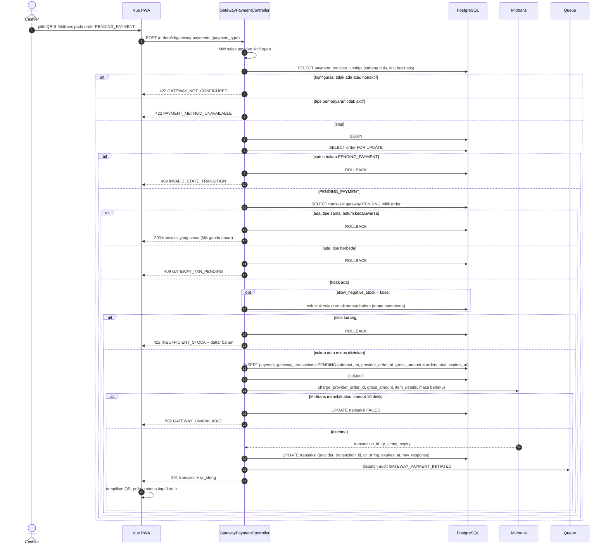
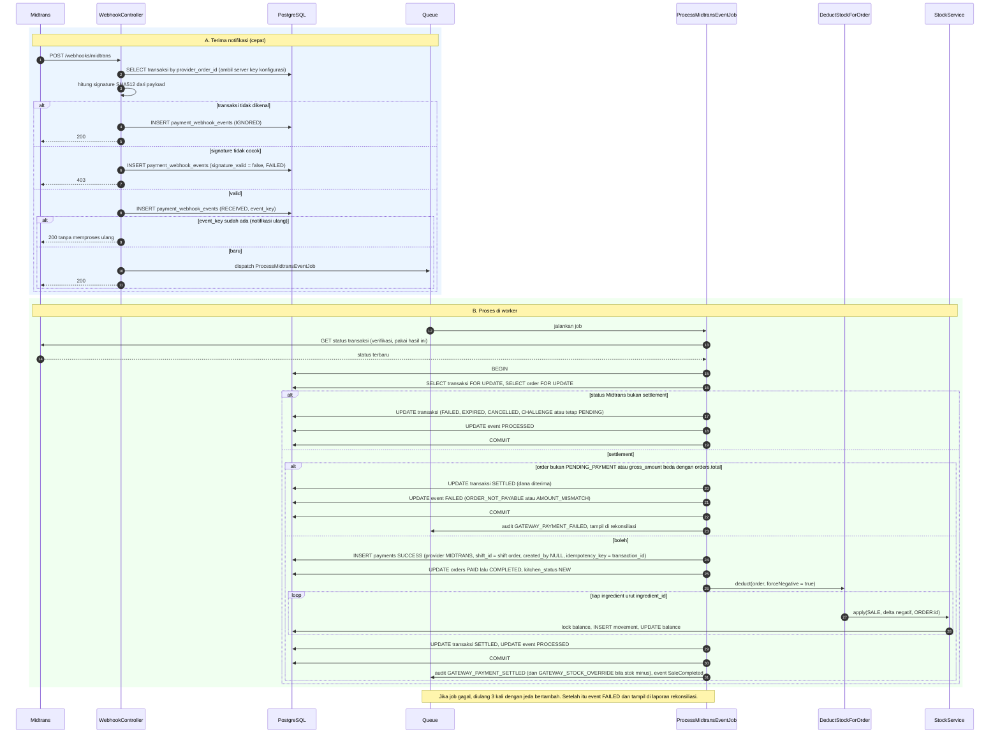
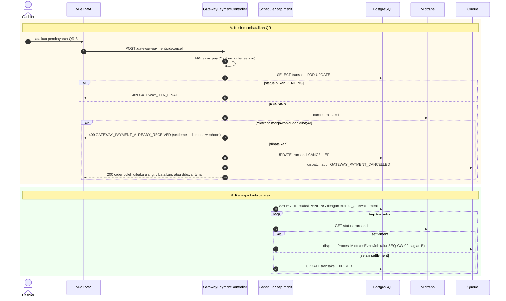
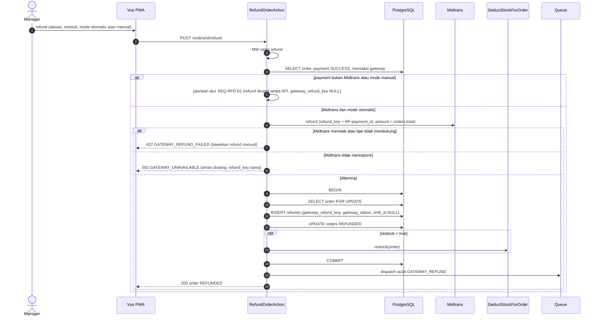
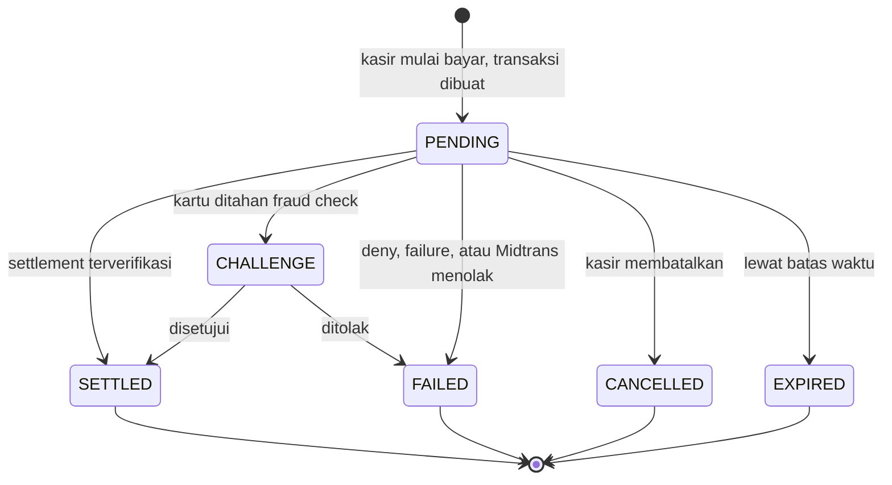

# Modul GW — Payment Gateway Midtrans [P2]

> **Belum dikerjakan di Phase 1.** Folder ini menyimpan spesifikasi supaya skema Phase 1 tetap siap dan Phase 2 bisa dimulai tanpa penggalian ulang. Tiket ditulis menjelang Phase 2.

## Keputusan (B1–B6, disetujui 2026-10-24)
- Midtrans dikerjakan **Phase 2** (pasca 30 Des; estimasi ±11 hari-orang).
- Akun Midtrans **per business** (server key terenkripsi, write-only, hanya Owner).
- Metode pilot: **QRIS via Core API** (UI QR sendiri), bukan Snap.
- Settlement dengan stok kurang **tetap memotong stok** walau minus, ditandai `GATEWAY_STOCK_OVERRIDE` (BR-041).
- Fee/MDR tidak dicatat (rekonsiliasi manual di dashboard Midtrans).
- Refund via API otomatis dulu; fallback manual bila ditolak.

## Prasyarat Phase 2
- Akun merchant (sandbox lalu produksi) dan endpoint webhook HTTPS publik.
- **Redis** untuk queue/cache dan worker aktif (ADR-014); scheduler untuk penyapu transaksi kedaluwarsa.
- Verifikasi ulang detail dokumentasi resmi Midtrans (status, signature, HTTP notification) saat Phase 2 dimulai.

## Yang sudah disiapkan di Phase 1
- Kolom gateway nullable di `payments` dan `refunds` (`DB-PAY-001`); `payments.created_by` nullable.
- Titik ekstensi guard `PENDING` gateway di state machine order (`BE-ORD-005`).
- `StockService::apply()` menerima `forceNegative` (`BE-INV-001`).
- `payment_method` CARD/GATEWAY ditolak dengan `PAYMENT_METHOD_UNAVAILABLE` (`BE-PAY-001`).

## Kebutuhan Fungsional

#### FR-BIZ-004: Konfigurasi Payment Provider Midtrans [P2]
**Input:** `environment` (`SANDBOX`/`PRODUCTION`), `merchant_id`, `client_key`, `server_key` (write-only), outlet (opsional; kosong = default business, terisi = override outlet), `enabled_payment_types` (default `["qris"]`), `expiry_minutes` (1–1440, default 15), `is_active`.
**Aturan:** hanya `payment_config.manage` (Owner) (BR-037). Server key disimpan terenkripsi; respons hanya memuat 4 karakter terakhir. Konfigurasi outlet menimpa konfigurasi business. Beralih `SANDBOX → PRODUCTION` butuh konfirmasi eksplisit. Audit `GATEWAY_CONFIG_CHANGED` tanpa nilai key. Tanpa konfigurasi aktif, opsi Midtrans tidak muncul di POS.
| Kondisi | Pesan Error |
|---------|-------------|
| Server key kosong saat pertama kali menyimpan | "Server key wajib diisi." |
| `expiry_minutes` di luar 1–1440 | "Masa berlaku harus antara 1 dan 1440 menit." |
| Tipe pembayaran tidak didukung sistem | "Tipe pembayaran tidak tersedia." |
| Selain Owner | `403` |

#### FR-PAY-003: Mulai Pembayaran Midtrans [P2]
**Input:** `payment_type` (salah satu `enabled_payment_types`; pilot: `qris`).
**Aturan:**
1. Order `PENDING_PAYMENT`; butuh `sales.pay` dan shift OPEN milik kasir; konfigurasi Midtrans aktif untuk outlet (override outlet, jika tidak ada pakai business).
2. Bila `allow_negative_stock = false`, stok dicek lebih dulu (tanpa memotong); kurang → ditolak sebelum QR dibuat (BR-041).
3. Bila order sudah punya transaksi `PENDING` yang belum kedaluwarsa dengan tipe sama, kembalikan transaksi itu (klik ganda aman); tipe berbeda → `409` (BR-038).
4. Buat transaksi `PENDING` (`attempt_no` berikutnya, `provider_order_id = {order_number}-{attempt_no}`, `gross_amount = orders.total`, `expires_at = now + expiry_minutes`), commit, **lalu** panggil Midtrans (timeout 10 detik). Rincian item dikirim sehingga jumlahnya sama dengan `gross_amount` (item, diskon sebagai nilai negatif, service, pajak, pembulatan).
5. Midtrans gagal atau menolak → transaksi `FAILED`, order tetap `PENDING_PAYMENT`.
6. Audit `GATEWAY_PAYMENT_INITIATED`.
| Kondisi | Pesan Error |
|---------|-------------|
| Order bukan PENDING_PAYMENT | "Order tidak dapat dibayar." (`409`) |
| Tidak ada shift OPEN | "Buka shift terlebih dahulu." (`409`) |
| Provider belum dikonfigurasi atau nonaktif | "Pembayaran QRIS Midtrans belum diaktifkan di outlet ini." (`422` `GATEWAY_NOT_CONFIGURED`) |
| Tipe tidak diaktifkan | "Metode pembayaran belum tersedia." (`422`) |
| Stok kurang dan minus dilarang | "Stok tidak cukup: {daftar bahan}." (`422`) |
| Transaksi PENDING dengan tipe lain | "Batalkan pembayaran yang sedang berjalan terlebih dahulu." (`409`) |
| Midtrans tidak merespons atau menolak | "Layanan pembayaran sedang tidak tersedia. Coba lagi atau gunakan tunai." (`502` `GATEWAY_UNAVAILABLE`) |
**Output:** `201` transaksi (`id`, `status`, `qr_string`/`redirect_url`, `expires_at`, `provider_order_id`).

#### FR-PAY-004: Webhook Midtrans [P2]
**Endpoint:** publik (tanpa sesi/CSRF), throttle, hanya HTTPS.
**Aturan:**
1. Hitung signature = `SHA512(order_id + status_code + gross_amount + server_key)` dengan server key milik konfigurasi transaksi terkait; tidak cocok → simpan event `signature_valid = false`, balas `403`, **tidak diproses** (BR-040).
2. Hitung `event_key`; sudah ada → balas `200` tanpa memproses ulang (BR-040).
3. Simpan event (`RECEIVED`), antrekan job, balas `200` (target p95 < 300 ms, NFR-PERF-007).
4. Job: cari transaksi lewat `provider_order_id` (tak dikenal → event `IGNORED`); **verifikasi status ke Midtrans** (Get Status) dan pakai hasilnya, bukan isi webhook saja.
5. `settlement` (atau `capture` dengan `fraud_status = accept`): dalam **satu transaksi DB** kunci order lalu cek (a) order masih `PENDING_PAYMENT`, (b) `gross_amount` = `orders.total`. Lolos → transaksi `SETTLED`, buat `payments` `SUCCESS` (`method` `QRIS`/`GATEWAY`, `provider = MIDTRANS`, `shift_id` = shift order, `created_by` NULL, `idempotency_key = transaction_id`), order `PAID → COMPLETED`, `kitchen_status = NEW`, potong stok **tanpa menolak** bila minus (BR-041). Setelah commit: audit `GATEWAY_PAYMENT_SETTLED` (+ `GATEWAY_STOCK_OVERRIDE` bila ada kekurangan), event `SaleCompleted`.
6. Tidak lolos (a) atau (b): order **tidak berubah**, transaksi tetap tercatat, event `FAILED` dengan alasan `ORDER_NOT_PAYABLE` atau `AMOUNT_MISMATCH`; muncul di FR-RPT-007 (BR-039).
7. `deny`/`failure` → `FAILED`; `cancel` → `CANCELLED`; `expire` → `EXPIRED`; `capture` + `challenge` → `CHALLENGE`; `refund`/`partial_refund`/`chargeback` hanya dicatat. Order tetap `PENDING_PAYMENT`. Audit `GATEWAY_PAYMENT_FAILED`.
8. Kegagalan pemrosesan diulang otomatis (3 kali, backoff); setelah itu event `FAILED` dan tampil di FR-RPT-007.

#### FR-PAY-005: Status, Pembatalan, dan Kedaluwarsa [P2]
**Aturan:**
- `GET` status transaksi (butuh `sales.pay` dan order milik kasir, atau `sales.view` penuh): FE polling tiap 3 detik selama dialog QR terbuka sampai status final atau `expires_at`.
- Batalkan transaksi `PENDING` (kasir pemilik order, Manager, Owner): panggil API cancel Midtrans; sukses → `CANCELLED` dan audit `GATEWAY_PAYMENT_CANCELLED`; gagal → tetap `PENDING`. Order baru dapat dibuka ulang, dibatalkan, atau dibayar tunai setelah transaksi tidak lagi `PENDING` (BR-038).
- Penyapu terjadwal tiap menit: transaksi `PENDING` yang lewat `expires_at` dicek ke Midtrans; `settlement` diproses seperti FR-PAY-004, selain itu `EXPIRED` (BR-044).
| Kondisi | Pesan Error |
|---------|-------------|
| Transaksi sudah final | "Transaksi sudah selesai." (`409`) |
| Cancel ditolak Midtrans karena sudah dibayar | "Pembayaran sudah diterima. Menunggu konfirmasi." (`409`); settlement diproses oleh FR-PAY-004 |

#### FR-RFD-002: Refund Pembayaran Gateway [P2]
**Input:** sama dengan FR-RFD-001.
**Aturan (BR-043):** berlaku untuk order yang dibayar lewat Midtrans. Sistem membuat `gateway_refund_key` unik, memanggil API refund Midtrans, dan hanya bila diterima: refund tercatat (`gateway_status` `PENDING`/`SUCCESS`), order `REFUNDED`, restock bila dipilih (satu transaksi DB). Refund ditolak atau tipe pembayaran tidak mendukung refund via API (`[ASUMSI]` tergantung tipe; verifikasi ke Midtrans) → `422 GATEWAY_REFUND_FAILED`; Manager/Owner dapat mengulang dengan **refund manual** (`gateway_refund_key` NULL, dana dikembalikan di luar sistem, seperti QRIS manual). `shift_id` NULL (non-tunai). Audit `GATEWAY_REFUND`. Key refund yang sama tidak diproses dua kali.
| Kondisi | Pesan Error |
|---------|-------------|
| Midtrans menolak refund | "Refund ke Midtrans gagal. Anda dapat mencatat refund manual." (`422`) |
| Midtrans tidak merespons | "Layanan pembayaran sedang tidak tersedia." (`502`) |

- FR-RPT-007: lihat SRS v3.0

## Aturan Bisnis (BR-037…044)

| ID | Aturan | Konsekuensi bila dilanggar |
|----|--------|---------------------------|
| BR-037 | [P2] Provider gateway = Midtrans. Kredensial per business, override per outlet; server key terenkripsi; hanya Owner (`payment_config.manage`) yang mengelola | Kebocoran kredensial |
| BR-038 | [P2] Satu transaksi gateway `PENDING` per order. Selama ada, order tidak dapat `reopen` atau cancel; transaksi harus dibatalkan atau berakhir lebih dulu | Order dibayar setelah dibatalkan |
| BR-039 | [P2] Settlement mengubah order hanya bila order `PENDING_PAYMENT` dan `gross_amount` = `orders.total`. Selain itu order tidak berubah dan event ditandai untuk tinjauan (FR-RPT-007) | Payment pada order salah status |
| BR-040 | [P2] Webhook wajib signature valid, status diverifikasi ke Midtrans, dan idempoten lewat `event_key` unik; pembuatan `payments` memakai `idempotency_key = transaction_id` | Payment ganda atau data palsu |
| BR-041 | [P2] Pembayaran gateway tidak boleh di-rollback karena stok (dana sudah diterima). Bila `allow_negative_stock = false`, stok dicek saat transaksi dimulai; saat settlement stok tetap dipotong walau menjadi minus, ditandai `GATEWAY_STOCK_OVERRIDE` dan muncul di laporan stok minus 🔶 | Uang diterima tanpa order selesai |
| BR-042 | [P2] Pembayaran gateway non-tunai: tidak masuk Expected Cash; `payments.shift_id` = shift order; masuk laporan payment per provider | Selisih kas salah |
| BR-043 | [P2] Refund gateway lewat API refund Midtrans dengan `gateway_refund_key` unik; ditolak → pilihan refund manual oleh Manager/Owner; tetap satu refund per order (BR-035) | Refund ganda atau dana tidak kembali |
| BR-044 | [P2] Transaksi `PENDING` yang lewat `expires_at` dicek ke Midtrans lalu `EXPIRED` bila tidak settlement; percobaan baru memakai `attempt_no` + 1 dan `provider_order_id` baru | Transaksi menggantung |

## Use Case

Lihat Use Case v3.0 §2.4.3 (UC-BIZ-03, UC-PAY-03…05, UC-SYS-01).

## Tabel (ERD v3.0 §3.5)

**`payment_provider_configs`**
| Kolom | Tipe | Null | Constraint | Keterangan |
|-------|------|------|-----------|------------|
| outlet_id | BIGINT | N | FK outlets | NULL = default business; terisi = override outlet |
| provider | V(20) | NN | CHECK `MIDTRANS` | |
| environment | V(15) | NN | CHECK `SANDBOX`,`PRODUCTION` | |
| merchant_id | V(50) | NN | | |
| client_key | V(100) | NN | | Boleh tampil di FE |
| server_key_encrypted | TEXT | NN | | **Terenkripsi** (Laravel `encrypted` cast); tidak pernah ada di respons API atau log |
| enabled_payment_types | JSONB | N | | mis. `["qris","gopay","bank_transfer"]` |
| expiry_minutes | SMALLINT | NN | DEFAULT 15, CHECK 1–1440 | Masa berlaku transaksi |
| is_active | BOOLEAN | NN | DEFAULT true | |

UNIQUE `(business_id, COALESCE(outlet_id,0), provider)`.

**`payment_gateway_transactions`** (mutable, satu baris per percobaan bayar)
| Kolom | Tipe | Null | Constraint | Keterangan |
|-------|------|------|-----------|------------|
| outlet_id | BIGINT | NN | FK | |
| order_id | BIGINT | NN | FK orders | |
| config_id | BIGINT | NN | FK payment_provider_configs | |
| provider | V(20) | NN | CHECK `MIDTRANS` | |
| attempt_no | SMALLINT | NN | DEFAULT 1 | Percobaan ke-n untuk order ini |
| provider_order_id | V(50) | NN | UNIQUE `(provider, provider_order_id)` | `order_id` yang dikirim ke Midtrans, mis. `KP01-261012-0007-1` (maks 50 karakter) |
| provider_transaction_id | V(64) | N | UNIQUE parsial `(provider, provider_transaction_id) WHERE NOT NULL` | `transaction_id` dari Midtrans |
| payment_type | V(30) | N | | `qris`, `gopay`, `bank_transfer`, `credit_card`, … |
| gross_amount | BIGINT | NN | CHECK > 0 | = `orders.total` |
| status | V(15) | NN | CHECK `PENDING`,`SETTLED`,`FAILED`,`EXPIRED`,`CANCELLED`,`CHALLENGE` | Status internal (lihat §5) |
| provider_status | V(20) | N | | Mentah: `pending`, `settlement`, `capture`, `deny`, `cancel`, `expire`, `failure`, … |
| fraud_status | V(15) | N | | `accept`, `challenge`, `deny` (kartu) |
| snap_token | V(100) | N | | Bila memakai Snap |
| redirect_url | V(255) | N | | |
| qr_string | TEXT | N | | QRIS dinamis |
| expires_at | TIMESTAMP | N | | |
| settled_at | TIMESTAMP | N | | |
| raw_response | JSONB | N | | Respons charge terakhir |
| created_by | BIGINT | NN | FK users | Kasir yang memulai |

UNIQUE `(order_id, attempt_no)` · UNIQUE parsial `(order_id) WHERE status = 'PENDING'` (satu transaksi aktif per order).

**`payment_webhook_events`** (inbox idempoten; **bukan** append-only: hanya `processing_status`, `error_message`, `processed_at` yang di-update, kolom lain tidak berubah)

| Kolom | Tipe | Null | Constraint | Keterangan |
|-------|------|------|-----------|------------|
| business_id | BIGINT | N | FK | NULL bila `order_id` tak dikenal |
| gateway_transaction_id | BIGINT | N | FK payment_gateway_transactions | |
| provider | V(20) | NN | | |
| provider_order_id | V(50) | NN | | Dari payload |
| provider_transaction_id | V(64) | N | | |
| transaction_status | V(20) | NN | | |
| status_code | V(5) | NN | | |
| gross_amount | V(20) | NN | | String dari payload (dipakai verifikasi signature) |
| signature_valid | BOOLEAN | NN | | `SHA512(order_id + status_code + gross_amount + ServerKey)` |
| event_key | V(64) | NN | UNIQUE | `sha256(provider_order_id|transaction_id|transaction_status|status_code|gross_amount)` → replay aman |
| payload | JSONB | NN | | Payload mentah |
| processing_status | V(15) | NN | DEFAULT `RECEIVED`, CHECK `RECEIVED`,`PROCESSED`,`IGNORED`,`FAILED` | |
| error_message | V(255) | N | | |
| received_at | TIMESTAMP | NN | | |
| processed_at | TIMESTAMP | N | | |

## Behavior (SDD v3.0 §3)

#### 3.2.14 SEQ-GW-01: Mulai Pembayaran Midtrans [P2] (UC-PAY-03)

**Catatan:** transaksi dicatat dan di-commit **sebelum** memanggil Midtrans, sehingga tidak ada transaksi di Midtrans yang tidak kita kenal. Jika dua request berebut, index unik parsial `(order_id) WHERE status = 'PENDING'` menolak yang kedua, lalu dijawab sebagai replay. `item_details` disusun agar jumlahnya sama dengan `gross_amount` (item, diskon sebagai nilai negatif, service, pajak, pembulatan).

#### 3.2.15 SEQ-GW-02: Webhook Midtrans dan Proses Settlement [P2] (UC-SYS-01)

**Catatan:** bagian A hanya menyimpan dan membalas (target p95 < 300 ms). Bagian B berjalan di worker (target selesai p95 ≤ 5 detik sejak diterima). `idempotency_key = transaction_id` membuat pembuatan payment aman bila job berjalan dua kali. FE mengetahui hasil lewat polling `GET /orders/{id}/gateway-payments/current`.

#### 3.2.16 SEQ-GW-03: Batalkan Transaksi dan Penyapu Kedaluwarsa [P2] (UC-PAY-03)

**Catatan:** penyapu juga mengulang event `RECEIVED`/`FAILED` yang belum terproses.

#### 3.2.17 SEQ-GW-04: Refund Pembayaran Midtrans [P2] (UC-RFD-01)

**Catatan:** `refund_key` deterministik (`RF-{payment_id}`), sehingga bila commit DB gagal setelah Midtrans menerima, pengulangan request tidak menggandakan refund. Dukungan refund via API berbeda per tipe pembayaran `[ASUMSI]`; jalur manual selalu tersedia.

#### STM-GATEWAY: Status `payment_gateway_transactions.status` [P2]

| Dari | Ke | Pemicu | Aktor | Guard / Syarat | Efek Samping |
|------|----|--------|-------|----------------|--------------|
| (awal) | PENDING | `POST /orders/{id}/gateway-payments` | Cashier | Order `PENDING_PAYMENT`, tidak ada transaksi PENDING lain (BR-038) | Order terkunci dari reopen/cancel |
| PENDING | SETTLED | Webhook atau penyapu | Sistem | Status Midtrans `settlement` (atau `capture` + `accept`) | Bila order boleh: payment + order `COMPLETED` + potong stok (SEQ-GW-02). Bila tidak: hanya status, masuk rekonsiliasi |
| PENDING | FAILED | Webhook `deny`/`failure`, atau Midtrans menolak charge | Sistem | — | Order tetap `PENDING_PAYMENT` |
| PENDING | CANCELLED | `POST /gateway-payments/{id}/cancel` | Cashier (order sendiri), Manager, Owner | Midtrans menerima cancel | Order dapat dibuka ulang atau dibayar tunai |
| PENDING | EXPIRED | Webhook `expire` atau penyapu | Sistem | Lewat `expires_at` dan Midtrans tidak settlement | Order tetap `PENDING_PAYMENT` |
| PENDING | CHALLENGE | Webhook `capture` + `challenge` | Sistem | Hanya kartu | Menunggu keputusan di dashboard Midtrans |
| CHALLENGE | SETTLED, FAILED | Webhook lanjutan | Sistem | | Sama seperti di atas |

Transisi lain **diabaikan** (event ditandai `IGNORED`). Status akhir tidak berubah lagi.

## Endpoint

| ID | Method | Endpoint | Permission | UC | FR | Deskripsi |
|----|--------|----------|-----------|----|----|-----------|
| API-GW-01 | POST | `/orders/{id}/gateway-payments` | `sales.pay` | UC-PAY-03 | FR-PAY-003 | Mulai pembayaran Midtrans (buat transaksi + QR) |
| API-GW-02 | GET | `/orders/{id}/gateway-payments/current` | `sales.pay` / `sales.view` | UC-PAY-03 | FR-PAY-005 | Status transaksi aktif (polling 3 detik) |
| API-GW-03 | POST | `/gateway-payments/{id}/cancel` | `sales.pay` | UC-PAY-03 | FR-PAY-005 | Batalkan transaksi PENDING |
| API-GW-04 | POST | `/webhooks/midtrans` | Publik (signature) | UC-SYS-01 | FR-PAY-004 | Terima notifikasi Midtrans |
| API-GW-05 | GET | `/payment-providers` | `payment_config.manage` | UC-PAY-04 | FR-BIZ-004 | Baca konfigurasi (server key tersamar) |
| API-GW-06 | PUT | `/payment-providers` | `payment_config.manage` | UC-PAY-04 | FR-BIZ-004 | Simpan konfigurasi business atau override outlet |
| API-GW-07 | GET | `/payment-methods` | `sales.pay` | UC-PAY-03 | FR-PAY-003 | Metode bayar yang aktif di outlet (Cash, QRIS manual, Midtrans) |
| API-RPT-09 | GET | `/reports/gateway-reconciliation` | `reports.view` | UC-PAY-05 | FR-RPT-007 | Rekonsiliasi transaksi gateway |
