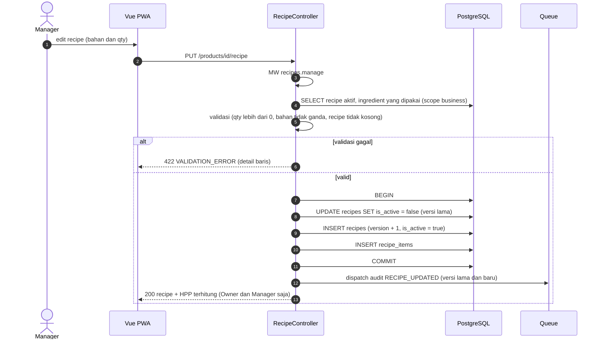

# Modul ING-REC — Ingredient & Recipe

> Sumber kebenaran tetap `docs/` v3.0; file ini hanya **kumpulan per modul** supaya developer cukup membuka satu folder. Bila ada beda, `docs/` menang.

| | |
|---|---|
| Owner | Akmal (12 tiket) |
| Tiket | 9 core (6.75 hari) + 3 rilis 1.1 (1.25 hari) |

## 1. Ringkasan buat developer

Bahan baku dan resep per produk. Setiap kali recipe disimpan, dibuat **versi baru** dan versi lama dinonaktifkan; order lama tetap memakai versi yang disnapshot.

**Hati-hati**
- Hanya 1 recipe aktif per produk (constraint DB).
- Qty recipe dalam base unit bahan.
- HPP = Σ(qty × last_cost) half-up; tampil hanya untuk Owner/Manager.
- Recipe modifier (F-18) masuk rilis 1.1.

**Dianggap selesai kalau:** Ingredient dan recipe berversi bekerja; HPP benar; Inventory/Kitchen hanya melihat tanpa HPP.

## 2. Kebutuhan Fungsional (dari SRS v3.0)

### Modul ING — Ingredient

#### FR-ING-001: Ingredient & Unit
**Input:** SKU (wajib, unik per business), nama, base unit (`g`/`ml`/`pcs`, wajib dan tidak dapat diubah setelah ada movement), `last_cost` (rupiah per base unit, `DECIMAL(18,4)` ≥ 0), minimum stock (≥ 0), status.
**Aturan:** CRUD ingredient memakai permission `inventory.adjust` (Owner, Manager, Inventory); membaca memakai `inventory.view`. `last_cost` dapat diinput manual dan diperbarui otomatis saat purchase diterima (FR-PUR-003, BR-047). Perubahan `last_cost` tidak mengubah movement dan order lama (snapshot). `ingredient_unit_conversions` dipakai oleh purchase (BR-046).
| Kondisi | Pesan Error |
|---------|-------------|
| SKU ganda | "SKU bahan sudah digunakan." |
| Ubah base unit bahan yang sudah punya movement | "Satuan dasar tidak dapat diubah karena stok sudah tercatat." |
| `last_cost` negatif | "Biaya per satuan tidak boleh negatif." |

---

### Modul REC — Recipe

#### FR-REC-001: Recipe per Product (versi)
**Input:** daftar item (ingredient, qty > 0 dalam base unit).
**Aturan:** setiap simpan membuat **versi baru** (`version + 1`) dan menonaktifkan versi lama; hanya 1 versi aktif per produk (BR-013). Hanya `recipes.manage` (Owner, Manager) (BR-032). Ingredient harus milik business yang sama. Audit `RECIPE_UPDATED` (versi lama, baru). Satu bahan tidak boleh muncul dua kali di satu recipe. Role dengan `recipes.view` (Inventory, Kitchen) hanya membaca recipe **tanpa HPP**.
| Kondisi | Pesan Error |
|---------|-------------|
| Qty ≤ 0 | "Jumlah bahan harus lebih dari 0." |
| Bahan ganda | "Bahan {nama} sudah ada di recipe." |
| Recipe kosong | "Recipe minimal memiliki satu bahan." |

#### FR-REC-002: Recipe per Modifier Option (F-18) `[R1.1]`
**Input:** daftar (ingredient, qty > 0 base unit) per modifier option.
**Aturan:** pemakaian ditambahkan ke agregat bahan saat order dibayar (FR-ENG-001). Tidak berversi di Phase 1; perubahan dicatat audit dan hanya berlaku untuk order baru karena item order menyimpan modifier yang dipilih, sedangkan pemakaian modifier dihitung dari recipe aktif **saat pembayaran** `[ASUMSI]` 🔶 (lihat §9, R-01).

#### FR-REC-003: Kalkulator HPP
**Aturan:** HPP per unit produk = Σ(qty bahan × `last_cost`) dari recipe aktif, dibulatkan half-up ke rupiah bulat; HPP modifier = Σ dari recipe option terpilih. Produk tanpa recipe memiliki HPP 0 dan ditandai "no recipe" di daftar produk (laporan khusus no recipe di R1.1). Nilai ditampilkan di form recipe hanya untuk Owner dan Manager.

---

## 3. Aturan Bisnis terkait

| ID | Aturan | Konsekuensi bila dilanggar |
|----|--------|---------------------------|
| BR-010 | Produk tanpa recipe aktif boleh dijual, tidak memotong stok, ditandai "no recipe" di daftar produk dan (R1.1) laporan "no recipe" | Kasir terblokir |
| BR-013 | Edit recipe membuat versi baru; order lama merujuk versi lamanya | HPP historis berubah |
| BR-014 | Perubahan harga, nama, recipe tidak mengubah order lama (snapshot) | Laporan historis berubah |
| BR-015 | Semua qty stok dan recipe dalam base unit | Salah hitung stok |
| BR-032 | `recipes.manage` hanya Owner dan Manager | `403` |
| BR-046 | Satuan beli dikonversi ke base unit memakai `ingredient_unit_conversions`: `kg→g` = 1000, `L→ml` = 1000, satuan sama dengan base unit = 1; kombinasi lain ditolak | Salah hitung stok |
| BR-047 | `last_cost` bahan = harga per satuan beli ÷ faktor konversi (`DECIMAL(18,4)`) dari purchase RECEIVED terbaru (Last Cost, bukan rata-rata); tidak mengubah movement/order lama | HPP historis berubah |

## 4. Use Case

| ID | Nama | Aktor | Prioritas | FR | Proses |
|----|------|-------|-----------|----|--------|
| UC-ING-01 | Kelola Ingredient | Owner, Manager | Must | FR-ING-001 | |
| UC-REC-01 | Kelola Recipe Produk | Owner, Manager | Must | FR-REC-001, 003 | |
| UC-REC-02 | Kelola Recipe Modifier `[R1.1]` | Owner, Manager | Should | FR-REC-002 | |
| UC-REC-03 | Lihat Recipe (read-only) `[R1.1]` | Inventory, Kitchen | Should | FR-REC-001 | |

**Spesifikasi ringkas**

| ID | Prakondisi | Alur utama | Pascakondisi sukses | Alternatif / gagal | FR / BR |
|----|-----------|------------|---------------------|--------------------|---------|
| UC-ING-01 | Manager/Owner | Kelola ingredient (base unit, `last_cost`, minimum) | Tersimpan | SKU ganda; ubah base unit setelah ada movement → `422` | FR-ING-001 / BR-015, 031 |
| UC-REC-01 | Manager/Owner | Isi bahan dan qty → simpan | Recipe versi baru aktif; versi lama nonaktif; audit `RECIPE_UPDATED`; HPP terhitung | Qty ≤ 0, bahan ganda, recipe kosong → `422`; role tanpa `recipes.manage` → `403` | FR-REC-001, 003 / BR-013, 032 |
| UC-REC-02 | Manager/Owner | Isi bahan tambahan per modifier option | Tersimpan; audit | Qty ≤ 0 → `422` | FR-REC-002 / BR-009 |
| UC-REC-03 | Inventory/Kitchen | Buka recipe produk | Recipe tampil **tanpa HPP** | Tanpa `recipes.view` → `403` | FR-REC-001 / BR-032 |

## 5. Tabel Database (ERD v3.0)

**`units`** (global): `code` V(10) NN UNIQUE (`g`,`kg`,`ml`,`L`,`pcs`) · `name` V(50) NN.

**`ingredients`**
| Kolom | Tipe | Null | Constraint | Keterangan |
|-------|------|------|-----------|------------|
| base_unit_id | BIGINT | NN | FK units | Hanya `g`,`ml`,`pcs`; tidak berubah setelah ada movement |
| sku | V(50) | NN | UNIQUE parsial `(business_id, sku) WHERE deleted_at IS NULL` | |
| name | V(150) | NN | | |
| last_cost | DEC(18,4) | NN | DEFAULT 0, CHECK ≥ 0 | Per base unit |
| min_stock | DEC(18,4) | NN | DEFAULT 0, CHECK ≥ 0 | Default; override di `stock_balances` |
| status | V(20) | NN | CHECK | |
| deleted_at | TIMESTAMP | N | | |

**`ingredient_unit_conversions`**: `ingredient_id` FK NN · `unit_id` FK NN · `factor_to_base` DEC(18,6) NN CHECK > 0 · UNIQUE `(ingredient_id, unit_id)`.

**`recipes`**: `product_id` FK NN · `version` INT NN · `is_active` BOOLEAN NN · `created_by` FK users NN · UNIQUE `(product_id, version)` · UNIQUE parsial `(product_id) WHERE is_active`.

**`recipe_items`**: `recipe_id` FK NN · `ingredient_id` FK NN · `quantity` DEC(18,4) NN CHECK > 0 · UNIQUE `(recipe_id, ingredient_id)`.

**`modifier_option_recipe_items`**: `modifier_option_id` FK NN · `ingredient_id` FK NN · `quantity` DEC(18,4) NN CHECK > 0 · UNIQUE `(modifier_option_id, ingredient_id)`.

## 6. Behavior (Sequence / State / Activity)

#### 3.2.6 SEQ-REC-01: Simpan Recipe Versi Baru (UC-REC-01)

**Catatan:** HPP dihitung saat dibaca (Σ qty × `last_cost`), tidak disimpan di `products`. Order lama tetap menunjuk `recipe_id` versi lamanya (BR-013).

## 7. Endpoint (SDD v3.0 §4)

| ID | Method | Endpoint | Permission | UC | FR | Deskripsi |
|----|--------|----------|-----------|----|----|-----------|
| API-ING-01 | GET | `/ingredients` | `inventory.view` | UC-ING-01 | FR-ING-001 | Daftar bahan |
| API-ING-02 | POST | `/ingredients` | `inventory.adjust` | UC-ING-01 | FR-ING-001 | Tambah |
| API-ING-03 | GET | `/ingredients/{id}` | `inventory.view` | UC-ING-01 | FR-ING-001 | Detail |
| API-ING-04 | PUT | `/ingredients/{id}` | `inventory.adjust` | UC-ING-01 | FR-ING-001 | Ubah |
| API-ING-05 | DELETE | `/ingredients/{id}` | `inventory.adjust` | UC-ING-01 | FR-ING-001 | Soft delete / INACTIVE |
| API-ING-06 | GET | `/units` | `inventory.view` | UC-ING-01 | FR-ING-001 | Daftar satuan |
| API-REC-01 | GET | `/products/{id}/recipe` | `recipes.view` | UC-REC-01, 03 | FR-REC-001, 003 | Recipe aktif (+HPP untuk Owner/Manager) |
| API-REC-02 | PUT | `/products/{id}/recipe` | `recipes.manage` | UC-REC-01 | FR-REC-001 | Simpan versi baru |
| API-REC-03 | GET | `/modifier-options/{id}/recipe` | `recipes.view` | UC-REC-02 | FR-REC-002 | Recipe option `[R1.1]` |
| API-REC-04 | PUT | `/modifier-options/{id}/recipe` | `recipes.manage` | UC-REC-02 | FR-REC-002 | Simpan recipe option `[R1.1]` |

## 8. Tiket

Detail AC lengkap ada di `tickets/tickets.md` (ID sama).

| ID | Task | Est | Owner | Sprint | Depends on | Test |
|----|------|-----|-------|--------|-----------|------|
| BE-ING-001 | CRUD ingredient (permission inventory.adjust, baca inventory.view) | M | Akmal | S1 | DB-ING-001, BE-RBAC-001 | TC-ING-001, TC-ING-002, TC-ING-003 |
| BE-ING-002 | Seeder unit + endpoint GET /units | XS | Akmal | S1 | DB-ING-001 | TC-ING-001 |
| BE-REC-001 | Recipe per produk: edit = versi baru, 1 aktif; role view tanpa HPP | M | Akmal | S2 | DB-REC-001, BE-ING-001, BE-CAT-002 | TC-REC-001, TC-REC-002, TC-REC-004 |
| BE-REC-002 | Kalkulator HPP (qty × last_cost, half-up) tanpa kolom cost_price | S | Akmal | S2 | BE-REC-001 | TC-REC-003 |
| DB-ING-001 | Migrasi units, ingredients, ingredient_unit_conversions (seed kg→g, L→ml = 1000) | M | Akmal | S1 | DB-TEN-002 | TC-ING-001 |
| DB-REC-001 | Migrasi recipes (versi), recipe_items, modifier_option_recipe_items | S | Akmal | S1 | DB-ING-001, DB-CAT-001 | TC-REC-001 |
| FE-ING-001 | Halaman ingredient | M | Akmal | S3 | BE-ING-001, FE-AUTH-003 | TC-ING-002 |
| FE-REC-001 | Editor recipe di form produk + preview HPP | M | Akmal | S4 | BE-REC-002, FE-CAT-002 | TC-REC-003, TC-REC-004 |
| TEST-REC-001 | Test recipe (versioning, validasi, HPP) | S | Akmal | S5 | BE-REC-002 | TC-REC-001…004 |
| BE-REC-003 | CRUD recipe per modifier option (F-18) | S | Akmal | R1.1 | DB-REC-001, BE-CAT-004, BE-ING-001 | TC-REC-005 |
| FE-REC-002 | Editor recipe modifier option (F-18) | S | Akmal | R1.1 | BE-REC-003, FE-CAT-003 | TC-REC-005 |
| FE-REC-003 | Tampilan recipe read-only untuk Inventory/Kitchen tanpa HPP | XS | Akmal | R1.1 | BE-REC-001, FE-AUTH-003 | TC-REC-004 |

**Acceptance Criteria ringkas**

- **BE-ING-001** 
  - [ ] SKU ganda 422; base unit tidak bisa diubah bila sudah ada movement
  - [ ] last_cost negatif ditolak; perubahan tidak mengubah movement/order lama
- **BE-ING-002** 
  - [ ] GET /units mengembalikan 5 satuan
  - [ ] Seeder idempoten (aman dijalankan ulang)
- **BE-REC-001** 
  - [ ] Simpan membuat version+1 dan menonaktifkan versi lama dalam satu transaksi
  - [ ] Qty ≤ 0, bahan ganda, recipe kosong ditolak dengan pesan SRS
- **BE-REC-002** 
  - [ ] HPP produk tanpa recipe = 0 dan ditandai no recipe
  - [ ] HPP hanya tampil untuk Owner dan Manager
- **DB-ING-001** 
  - [ ] Unit g, kg, ml, L, pcs ter-seed; faktor kg→g dan L→ml = 1000
  - [ ] last_cost DECIMAL(18,4), CHECK ≥ 0
- **DB-REC-001** 
  - [ ] UNIQUE parsial 1 recipe aktif per produk
  - [ ] UNIQUE (recipe_id, ingredient_id)
- **FE-ING-001** 
  - [ ] CRUD ingredient dengan pesan error SRS
  - [ ] Base unit terkunci bila sudah ada movement
- **FE-REC-001** 
  - [ ] Satuan input memakai base unit bahan
  - [ ] Preview HPP disembunyikan untuk non-Owner/Manager
- **TEST-REC-001** 
  - [ ] Versioning dan 1 aktif teruji (termasuk constraint DB)
  - [ ] Perhitungan HPP half-up sesuai vektor uji
- **BE-REC-003** `[R1.1]`
  - [ ] Qty > 0 dalam base unit; perubahan tercatat audit
  - [ ] Hanya recipes.manage yang boleh mengubah
- **FE-REC-002** `[R1.1]`
  - [ ] Editor muncul di UI modifier option
  - [ ] Validasi qty dan bahan ganda sama dengan recipe produk
- **FE-REC-003** `[R1.1]`
  - [ ] Role tanpa recipes.manage tidak melihat tombol ubah
  - [ ] HPP tidak ada di respons maupun UI

## 9. Test Case (Test Plan v3.0)

| ID | Skenario | FR / BR | Level | Rilis |
|----|----------|---------|-------|-------|
| TC-ING-001 | SKU ingredient ganda 422; unit & konversi ter-seed | FR-ING-001 | Feature | Core |
| TC-ING-002 | Base unit terkunci setelah ada movement | FR-ING-001; BR-015 | Feature | Core |
| TC-ING-003 | last_cost negatif ditolak; perubahan tak mengubah movement/order lama | FR-ING-001; BR-014 | Feature | Core |
| TC-REC-001 | Simpan recipe = versi baru, hanya 1 aktif (termasuk constraint DB) | FR-REC-001; BR-013 | Feature | Core |
| TC-REC-002 | Qty ≤ 0, bahan ganda, recipe kosong → 422 | FR-REC-001 | Feature | Core |
| TC-REC-003 | HPP half-up; produk tanpa recipe HPP 0 + penanda no recipe | FR-REC-003; BR-010; BR-014 | Unit | Core |
| TC-REC-004 | Inventory/Kitchen melihat recipe tanpa HPP; tanpa recipes.manage tak bisa ubah | FR-REC-001; BR-032 | Feature | Core |
| TC-REC-005 | Recipe modifier option: qty > 0, audit, permission | FR-REC-002 | Feature | R1.1 |
