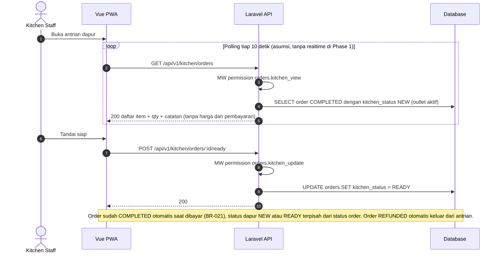

# Modul KIT — Antrian Dapur [R1.1]

> Sumber kebenaran tetap `docs/` v3.0; file ini hanya **kumpulan per modul** supaya developer cukup membuka satu folder. Bila ada beda, `docs/` menang.

| | |
|---|---|
| Owner | Ongki (2 tiket) |
| Tiket | 0 core (0.00 hari) + 2 rilis 1.1 (1.00 hari) |

## 1. Ringkasan buat developer

Layar dapur menampilkan order yang sudah dibayar (tanpa harga) dan tombol Siap. Dikerjakan di rilis 1.1; kolom `kitchen_status` sudah terisi `NEW` sejak core.

**Hati-hati**
- Respons dapur tanpa harga dan data pembayaran.
- Order REFUNDED hilang dari antrian.

**Dianggap selesai kalau:** Dapur bisa melihat dan menandai siap; polling 10 detik.

## 2. Kebutuhan Fungsional (dari SRS v3.0)

### Modul KIT — Dapur

#### FR-KIT-001: Antrian Dapur (F-14) `[R1.1]`
Daftar order COMPLETED dengan `kitchen_status = NEW` di outlet aktif: nomor order, tipe + meja, item + modifier + qty, catatan. **Tanpa harga dan data pembayaran** (BR-033). Tombol "Siap" mengubah menjadi `READY`. Polling 10 detik `[ASUMSI]`, tanpa realtime di Phase 1. Permission `orders.kitchen_view`, `orders.kitchen_update`.

---

## 3. Aturan Bisnis terkait

| ID | Aturan | Konsekuensi bila dilanggar |
|----|--------|---------------------------|
| BR-005 | Urutan hitung: subtotal → diskon order → service (dari subtotal setelah diskon) → pajak (dari subtotal setelah diskon + service). Pajak exclusive. Half-up ke rupiah per komponen. Pembulatan total ke kelipatan increment outlet sebagai langkah terakhir (BR-036) | Total salah |
| BR-006 | Diskon hanya level order, persen atau nominal, tidak melebihi subtotal; butuh `discounts.apply`; batas % kasir per outlet | `403`/`422` |
| BR-008 | Endpoint bayar wajib `Idempotency-Key`; key yang sama mengembalikan hasil sebelumnya | Payment ganda |
| BR-019 | Nomor order `{KODE_OUTLET}-{YYMMDD}-{urut 4 digit}`, reset harian menurut timezone outlet, aman konkurensi | Nomor ganda |
| BR-025 | Cashier hanya membatalkan order miliknya, DRAFT/PENDING_PAYMENT, shift OPEN | `403` |
| BR-028 | `PENDING_PAYMENT → DRAFT` diizinkan sebelum ada pembayaran sukses | Kasir tidak bisa koreksi |
| BR-033 | Antrian dapur tidak menampilkan harga dan data pembayaran | Kebocoran data sensitif |
| BR-036 | Pembulatan total: ke kelipatan `rounding_increment` outlet (0/100/500/1000), half-up, selisih boleh negatif, berlaku semua metode pembayaran; total > 0 tidak boleh menjadi 0; selisih disimpan di `orders.rounding_amount`; total setelah pembulatan yang dibayar, di-refund, dan dilaporkan | Kas dan struk tidak sinkron |

## 4. Use Case

| ID | Nama | Aktor | Prioritas | FR | Proses |
|----|------|-------|-----------|----|--------|
| UC-KIT-01 | Kelola Antrian Dapur `[R1.1]` | Kitchen, Manager, Owner | Should | FR-KIT-001 | BP-01 |

**Spesifikasi ringkas**

| ID | Prakondisi | Alur utama | Pascakondisi sukses | Alternatif / gagal | FR / BR |
|----|-----------|------------|---------------------|--------------------|---------|
| UC-KIT-01 | Order dibayar | Lihat antrian (tanpa harga) → tekan Siap | `kitchen_status = READY` | Tanpa `orders.kitchen_update` → `403` | FR-KIT-001 / BR-033 |

## 5. Tabel Database (ERD v3.0)

**`orders`**
| Kolom | Tipe | Null | Constraint | Keterangan |
|-------|------|------|-----------|------------|
| outlet_id | BIGINT | NN | FK | |
| shift_id | BIGINT | NN | FK shifts | BR-001 |
| cashier_id | BIGINT | NN | FK users | |
| business_date | DATE | NN | | Salinan dari shift |
| order_number | V(30) | NN | UNIQUE `(outlet_id, order_number)` | `{OUTLET}-{YYMMDD}-{urut}` |
| order_type | V(10) | NN | CHECK `DINE_IN`,`TAKEAWAY` | |
| table_number | V(20) | N | CHECK NOT NULL ⇒ `DINE_IN` | |
| status | V(20) | NN | CHECK `DRAFT`,`PENDING_PAYMENT`,`PAID`,`COMPLETED`,`CANCELLED`,`REFUNDED` | |
| kitchen_status | V(10) | N | CHECK `NEW`,`READY` | NULL sebelum dibayar |
| subtotal | BIGINT | NN | DEFAULT 0 | |
| discount_type | V(10) | N | CHECK `PERCENT`,`AMOUNT` | Order-level |
| discount_value | DEC(10,2) | N | | |
| discount_amount | BIGINT | NN | DEFAULT 0 | |
| service_charge_amount | BIGINT | NN | DEFAULT 0 | |
| tax_amount | BIGINT | NN | DEFAULT 0 | |
| rounding_amount | BIGINT | NN | DEFAULT 0 | Boleh negatif |
| total | BIGINT | NN | DEFAULT 0, CHECK ≥ 0 | Setelah pembulatan |
| paid_amount | BIGINT | NN | DEFAULT 0 | = total saat dibayar |
| tax_rate_snapshot, service_rate_snapshot | DEC(5,2) | NN | | |
| note, cancel_reason | V(255) | N | | |
| cancelled_by | BIGINT | N | FK users | |
| paid_at, completed_at, cancelled_at | TIMESTAMP | N | | `paid_at = completed_at` |

## 6. Behavior (Sequence / State / Activity)

#### 3.2.12 SEQ-KIT-01: Antrian Dapur (UC-KIT-01) `[R1.1]`

## 7. Endpoint (SDD v3.0 §4)

| ID | Method | Endpoint | Permission | UC | FR | Deskripsi |
|----|--------|----------|-----------|----|----|-----------|
| API-KIT-01 | GET | `/kitchen/orders` | `orders.kitchen_view` | UC-KIT-01 | FR-KIT-001 | Antrian dapur `[R1.1]` |
| API-KIT-02 | POST | `/kitchen/orders/{id}/ready` | `orders.kitchen_update` | UC-KIT-01 | FR-KIT-001 | Tandai siap `[R1.1]` |

## 8. Tiket

Detail AC lengkap ada di `tickets/tickets.md` (ID sama).

| ID | Task | Est | Owner | Sprint | Depends on | Test |
|----|------|-----|-------|--------|-----------|------|
| BE-KIT-001 | Antrian dapur: GET order COMPLETED kitchen_status NEW (tanpa harga), POST ready | S | Ongki | R1.1 | BE-ORD-005 | TC-ORD-011 |
| FE-KIT-001 | Halaman antrian dapur (polling 10 detik) | S | Ongki | R1.1 | BE-KIT-001 | TC-ORD-011 |

**Acceptance Criteria ringkas**

- **BE-KIT-001** `[R1.1]`
  - [ ] Respons tanpa harga dan data pembayaran
  - [ ] Order REFUNDED otomatis hilang dari antrian
- **FE-KIT-001** `[R1.1]`
  - [ ] Tombol Siap mengubah NEW menjadi READY
  - [ ] State empty antrian tampil

## 9. Test Case (Test Plan v3.0)

| ID | Skenario | FR / BR | Level | Rilis |
|----|----------|---------|-------|-------|
| TC-ORD-011 | Antrian dapur: tanpa harga; READY; REFUNDED hilang | FR-KIT-001; BR-033 | Feature | R1.1 |
