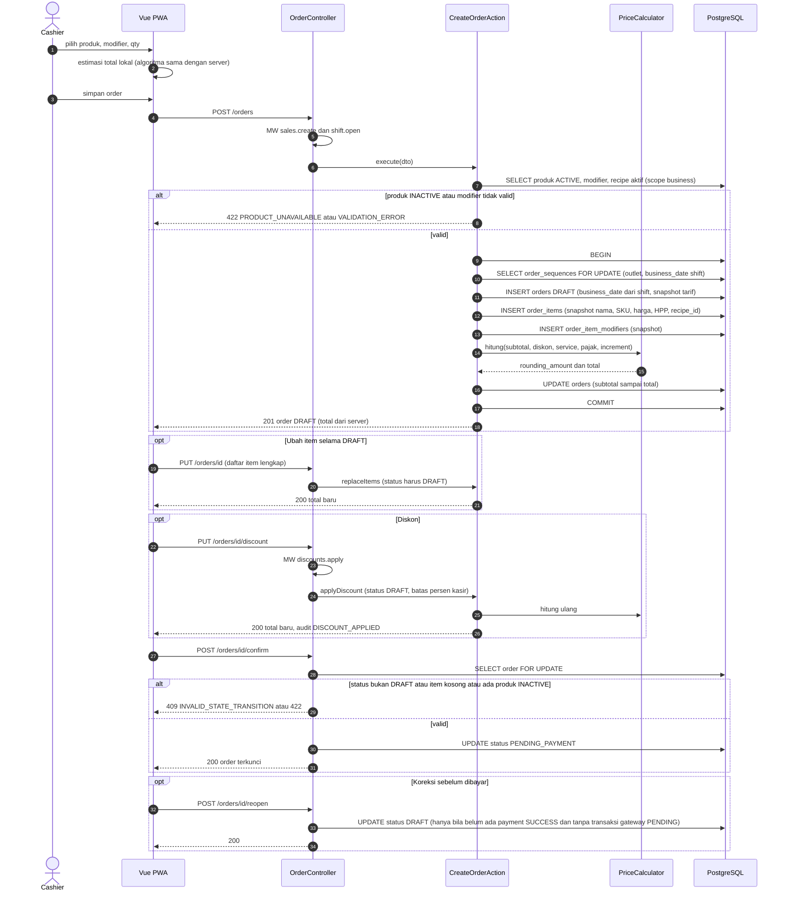
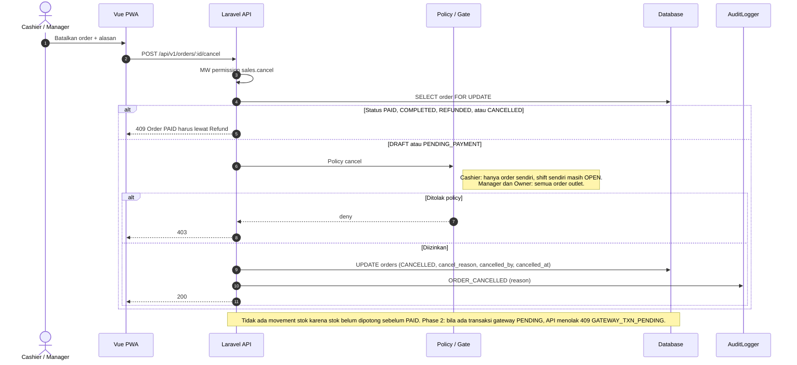
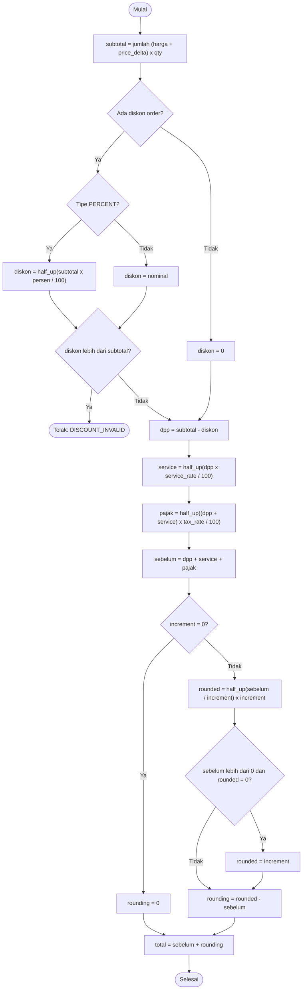
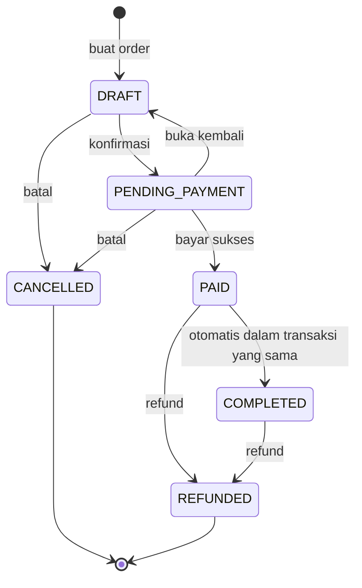

# Modul ORD — Order POS

> Sumber kebenaran tetap `docs/` v3.0; file ini hanya **kumpulan per modul** supaya developer cukup membuka satu folder. Bila ada beda, `docs/` menang.

| | |
|---|---|
| Owner | Ongki (14 tiket) |
| Tiket | 14 core (12.00 hari) + 0 rilis 1.1 (0.00 hari) |

## 1. Ringkasan buat developer

Membuat order (draft), diskon order-level, menghitung total (service, pajak exclusive, pembulatan), konfirmasi, cancel, riwayat. Harga, HPP, dan recipe di-**snapshot** saat order dibuat.

**Hati-hati**
- Total dihitung server (`PriceCalculator`); FE hanya estimator dengan vektor uji yang sama.
- Vektor wajib: 54.000 → 62.400 (rounding +30); diskon 10% → 56.100 (−33).
- Order butuh shift OPEN; status mengikuti STM-ORDER.
- Nomor order aman konkurensi per outlet per business date.

**Dianggap selesai kalau:** Order lifecycle dan kalkulator teruji table-driven; layar POS responsif di HP.

## 2. Kebutuhan Fungsional (dari SRS v3.0)

### Modul ORD — Order

#### FR-ORD-001: Buat & Ubah Draft
**Input:** `order_type` (`DINE_IN`/`TAKEAWAY`), nomor meja (opsional, hanya Dine In, ≤ 20), item (produk, qty integer 1–999 `[ASUMSI]`, modifier terpilih, catatan ≤ 255), catatan order.
**Aturan:** wajib shift OPEN milik kasir (BR-001). Tiap item menyimpan snapshot nama, SKU, harga, HPP, `recipe_id` aktif (BR-014). Modifier menyimpan nama dan `price_delta` saat itu. Total dihitung ulang tiap perubahan (FR-ORD-002). Selama DRAFT, perubahan item dilakukan dengan mengganti seluruh daftar item (`PUT /orders/{id}`); item yang tidak berubah mempertahankan snapshot lama, item baru mengambil snapshot saat ditambahkan.
| Kondisi | Pesan Error |
|---------|-------------|
| Tidak ada shift OPEN | "Buka shift terlebih dahulu." (`409`) |
| Produk INACTIVE / bukan milik tenant | "Produk tidak tersedia." (`422`) |
| Qty di luar 1–999 | "Jumlah harus antara 1 dan 999." |
| Modifier group wajib kosong atau di luar min/max | "Pilih opsi untuk {nama group}." |
| Nomor meja pada order Takeaway | "Nomor meja hanya untuk Dine In." |

#### FR-ORD-002: Kalkulasi Harga
**Aturan (BR-005):**
```
line_total   = (harga + Σ price_delta modifier) × qty
subtotal     = Σ line_total
diskon       = order-level (persen atau nominal), hasil dibulatkan half-up ke rupiah
dpp          = subtotal − diskon
service      = round_half_up(dpp × service_rate / 100)
pajak        = round_half_up((dpp + service) × tax_rate / 100)
sebelum      = dpp + service + pajak
rounding_amount = lihat BR-036 (di bawah)
total        = sebelum + rounding_amount
```
Pajak exclusive saja. Tarif disalin ke order (`tax_rate_snapshot`, `service_rate_snapshot`) saat order dibuat.

**Pembulatan total (BR-036):** langkah terakhir perhitungan, berlaku untuk **semua metode pembayaran**:
```
increment = outlets.rounding_increment   (0 = nonaktif)
rounded   = round_half_up(sebelum / increment) × increment
IF sebelum > 0 AND rounded = 0 THEN rounded = increment
rounding_amount = rounded − sebelum      (boleh negatif)
total     = rounded
```
Contoh (increment 100): sebelum 24.350 → total 24.400 (rounding +50); sebelum 24.340 → total 24.300 (rounding −40). `orders.rounding_amount` menyimpan selisih; `orders.total` adalah angka yang dibayar, di-refund, dan dilaporkan.

#### FR-ORD-003: Diskon Order
**Input:** tipe (`PERCENT`/`AMOUNT`), nilai.
**Aturan:** hanya level order (BR-006). Butuh `discounts.apply`. Persen 0–100; nominal ≤ subtotal. Untuk Cashier, diskon efektif (% dari subtotal) tidak melebihi `cashier_max_discount_percent` outlet; Manager dan Owner tanpa batas. Audit `DISCOUNT_APPLIED`. Hanya pada status DRAFT.
| Kondisi | Pesan Error |
|---------|-------------|
| Persen > 100 atau nominal > subtotal | "Diskon melebihi nilai order." |
| Cashier melebihi batas | "Diskon melebihi batas {x}% untuk kasir." (`403`) |

#### FR-ORD-004: Konfirmasi & Edit Ulang
**Aturan:** `DRAFT → PENDING_PAYMENT` mengunci item dan memvalidasi ulang produk/modifier masih ACTIVE (BR-029). `PENDING_PAYMENT → DRAFT` diizinkan sebelum ada pembayaran sukses (BR-028) dan selama tidak ada transaksi gateway `PENDING` (BR-038). Order kosong tidak bisa dikonfirmasi.
| Kondisi | Pesan Error |
|---------|-------------|
| Order tanpa item | "Tambahkan minimal satu item." |
| Status tidak valid untuk transisi | "Transisi status tidak valid." (`409`) |
| Ada transaksi gateway PENDING [P2] | "Batalkan pembayaran QRIS terlebih dahulu." (`409`) |

#### FR-ORD-005: Cancel Order
**Input:** alasan (wajib).
**Aturan:** hanya DRAFT dan PENDING_PAYMENT (BR-025). Order PAID/COMPLETED hanya lewat refund. Cashier hanya order miliknya di shift yang masih OPEN; Manager/Owner semua order outlet. Tidak ada movement stok (stok belum dipotong). Order dengan transaksi gateway `PENDING` tidak dapat dibatalkan sebelum transaksinya dibatalkan (BR-038). Audit `ORDER_CANCELLED`.
| Kondisi | Pesan Error |
|---------|-------------|
| Order sudah dibayar | "Order yang sudah dibayar harus melalui refund." (`409`) |
| Cashier membatalkan order orang lain | `403` |
| Ada transaksi gateway PENDING [P2] | "Batalkan pembayaran QRIS terlebih dahulu." (`409`) |
| Alasan kosong | "Alasan wajib diisi." |

#### FR-ORD-006: Riwayat & Detail
Cashier hanya melihat order miliknya (`sales.view` = Own); Manager/Owner semua order di outlet yang diakses. Filter: tanggal (business date), status, kasir, nomor order. Paginasi.

#### FR-ORD-007: Penomoran Order
Format `{KODE_OUTLET}-{YYMMDD}-{urut 4 digit}`, `YYMMDD` dari business date, urutan reset per outlet per hari, dijamin unik walau order dibuat bersamaan (BR-019).

---

## 3. Aturan Bisnis terkait

| ID | Aturan | Konsekuensi bila dilanggar |
|----|--------|---------------------------|
| BR-001 | Order hanya dibuat jika kasir punya shift OPEN di outlet | `409` |
| BR-005 | Urutan hitung: subtotal → diskon order → service (dari subtotal setelah diskon) → pajak (dari subtotal setelah diskon + service). Pajak exclusive. Half-up ke rupiah per komponen. Pembulatan total ke kelipatan increment outlet sebagai langkah terakhir (BR-036) | Total salah |
| BR-006 | Diskon hanya level order, persen atau nominal, tidak melebihi subtotal; butuh `discounts.apply`; batas % kasir per outlet | `403`/`422` |
| BR-008 | Endpoint bayar wajib `Idempotency-Key`; key yang sama mengembalikan hasil sebelumnya | Payment ganda |
| BR-014 | Perubahan harga, nama, recipe tidak mengubah order lama (snapshot) | Laporan historis berubah |
| BR-019 | Nomor order `{KODE_OUTLET}-{YYMMDD}-{urut 4 digit}`, reset harian menurut timezone outlet, aman konkurensi | Nomor ganda |
| BR-025 | Cashier hanya membatalkan order miliknya, DRAFT/PENDING_PAYMENT, shift OPEN | `403` |
| BR-028 | `PENDING_PAYMENT → DRAFT` diizinkan sebelum ada pembayaran sukses | Kasir tidak bisa koreksi |
| BR-029 | Produk, modifier, kategori INACTIVE tidak bisa masuk order baru; divalidasi saat tambah item dan saat konfirmasi | Produk nonaktif terjual |
| BR-033 | Antrian dapur tidak menampilkan harga dan data pembayaran | Kebocoran data sensitif |
| BR-036 | Pembulatan total: ke kelipatan `rounding_increment` outlet (0/100/500/1000), half-up, selisih boleh negatif, berlaku semua metode pembayaran; total > 0 tidak boleh menjadi 0; selisih disimpan di `orders.rounding_amount`; total setelah pembulatan yang dibayar, di-refund, dan dilaporkan | Kas dan struk tidak sinkron |
| BR-038 | [P2] Satu transaksi gateway `PENDING` per order. Selama ada, order tidak dapat `reopen` atau cancel; transaksi harus dibatalkan atau berakhir lebih dulu | Order dibayar setelah dibatalkan |

## 4. Use Case

| ID | Nama | Aktor | Prioritas | FR | Proses |
|----|------|-------|-----------|----|--------|
| UC-ORD-01 | Buat Order (draft, konfirmasi, edit ulang) | Cashier | Must | FR-ORD-001, 002, 004, 007 | BP-01 |
| UC-ORD-02 | Terapkan Diskon | Cashier, Manager, Owner | Must | FR-ORD-003 | BP-01 |
| UC-ORD-03 | Batalkan Order | Cashier, Manager, Owner | Must | FR-ORD-005 | BP-01 |
| UC-ORD-04 | Lihat Riwayat & Detail Order | Cashier, Manager, Owner | Must | FR-ORD-006 | |

**Spesifikasi penuh**

##### UC-ORD-01: Buat Order
| Elemen | Isi |
|--------|-----|
| Aktor utama | Cashier |
| Tujuan | Menyusun order yang total-nya benar dan siap dibayar |
| Prakondisi | Login; shift OPEN milik aktor di outlet aktif |
| Pascakondisi sukses | Order `PENDING_PAYMENT`, item terkunci, total terhitung (termasuk pembulatan) |
| Pascakondisi gagal | Order tetap `DRAFT` atau tidak terbentuk |
| FR / BR | FR-ORD-001, 002, 004, 007 / BR-001, 005, 019, 028, 029, 030, 036 |

**Alur utama:** (1) Aktor memilih produk, modifier, qty. (2) Sistem menyimpan snapshot nama, harga, HPP, versi recipe dan menghitung ulang total. (3) Aktor memilih tipe order (dan nomor meja bila Dine In). (4) Aktor (opsional) menerapkan diskon (UC-ORD-02). (5) Aktor mengonfirmasi; sistem memvalidasi produk masih ACTIVE dan mengunci item.

| Kode | Kondisi | Respon |
|------|---------|--------|
| 1a | Produk INACTIVE | "Produk tidak tersedia." |
| 1b | Group modifier wajib belum dipilih | "Pilih opsi untuk {group}." |
| 3a | Nomor meja pada Takeaway | Ditolak |
| 5a | Order kosong | "Tambahkan minimal satu item." |
| 5b | Ada produk jadi INACTIVE sejak ditambahkan | Konfirmasi ditolak, item ditandai |
| 6a | Aktor ingin koreksi setelah konfirmasi | `PENDING_PAYMENT → DRAFT` (BR-028) |
| – | Tidak ada shift OPEN | `409` "Buka shift terlebih dahulu." |

**Spesifikasi ringkas**

| ID | Prakondisi | Alur utama | Pascakondisi sukses | Alternatif / gagal | FR / BR |
|----|-----------|------------|---------------------|--------------------|---------|
| UC-ORD-02 | Order `DRAFT`; punya `discounts.apply` | Pilih persen/nominal, isi nilai | Diskon tersimpan; total dihitung ulang; audit `DISCOUNT_APPLIED` | Melebihi subtotal → `422`; Cashier melebihi batas outlet → `403` | FR-ORD-003 / BR-006 |
| UC-ORD-03 | Order `DRAFT`/`PENDING_PAYMENT` | Isi alasan → batalkan | `CANCELLED`; tanpa movement stok; audit `ORDER_CANCELLED` | Order dibayar → `409` (harus refund); Cashier membatalkan order orang lain → `403` | FR-ORD-005 / BR-025 |
| UC-ORD-04 | Login | Filter tanggal, status, kasir, nomor → buka detail | Daftar dan detail tampil (Cashier: milik sendiri) | Order tenant lain → `404` | FR-ORD-006 |

## 5. Tabel Database (ERD v3.0)

**`orders`**
| Kolom | Tipe | Null | Constraint | Keterangan |
|-------|------|------|-----------|------------|
| outlet_id | BIGINT | NN | FK | |
| shift_id | BIGINT | NN | FK shifts | BR-001 |
| cashier_id | BIGINT | NN | FK users | |
| business_date | DATE | NN | | Salinan dari shift |
| order_number | V(30) | NN | UNIQUE `(outlet_id, order_number)` | `{OUTLET}-{YYMMDD}-{urut}` |
| order_type | V(10) | NN | CHECK `DINE_IN`,`TAKEAWAY` | |
| table_number | V(20) | N | CHECK NOT NULL ⇒ `DINE_IN` | |
| status | V(20) | NN | CHECK `DRAFT`,`PENDING_PAYMENT`,`PAID`,`COMPLETED`,`CANCELLED`,`REFUNDED` | |
| kitchen_status | V(10) | N | CHECK `NEW`,`READY` | NULL sebelum dibayar |
| subtotal | BIGINT | NN | DEFAULT 0 | |
| discount_type | V(10) | N | CHECK `PERCENT`,`AMOUNT` | Order-level |
| discount_value | DEC(10,2) | N | | |
| discount_amount | BIGINT | NN | DEFAULT 0 | |
| service_charge_amount | BIGINT | NN | DEFAULT 0 | |
| tax_amount | BIGINT | NN | DEFAULT 0 | |
| rounding_amount | BIGINT | NN | DEFAULT 0 | Boleh negatif |
| total | BIGINT | NN | DEFAULT 0, CHECK ≥ 0 | Setelah pembulatan |
| paid_amount | BIGINT | NN | DEFAULT 0 | = total saat dibayar |
| tax_rate_snapshot, service_rate_snapshot | DEC(5,2) | NN | | |
| note, cancel_reason | V(255) | N | | |
| cancelled_by | BIGINT | N | FK users | |
| paid_at, completed_at, cancelled_at | TIMESTAMP | N | | `paid_at = completed_at` |

**`order_items`**: `order_id` FK NN · `product_id` FK NN · `recipe_id` FK N (NULL = tanpa recipe) · `product_name_snapshot` V(150) NN · `sku_snapshot` V(50) NN · `unit_price` BIGINT NN · `unit_cost_snapshot` BIGINT NN DEFAULT 0 · `quantity` INT NN CHECK 1–999 · `line_total` BIGINT NN · `note` V(255) N.

**`order_item_modifiers`**: `order_item_id` FK NN · `modifier_option_id` FK NN · `name_snapshot` V(100) NN · `price_delta` BIGINT NN.

**`order_sequences`**: PK `(outlet_id, business_date)` · `business_id` NN · `last_number` INT NN. Dikunci `FOR UPDATE` saat membuat order.

## 6. Behavior (Sequence / State / Activity)

#### 3.2.1 SEQ-ORD-01: Buat, Ubah, Diskon, Konfirmasi Order (UC-ORD-01, 02)

**Catatan:** `shift.open` dicek lewat middleware (BR-001). Penomoran order memakai lock `order_sequences` agar aman konkurensi (BR-019). Server selalu menjadi sumber angka akhir; FE hanya estimasi (selisih pembulatan diperbaiki saat respons tiba). Diskon hanya pada status DRAFT.

#### ACT-ORD-02: Hitung Total Order (dipakai SEQ-ORD-01)

**Catatan:** urutan sesuai BR-005 dan BR-036. Contoh uji (increment 100, service 5%, pajak 10%): subtotal 54.000 → total 62.400 (rounding +30); dengan diskon 10% → total 56.100 (rounding −33). Vektor uji ini dipakai bersama oleh test backend dan frontend.

#### 3.2.11 SEQ-ORD-02: Cancel Order (UC-ORD-03)


#### ACT-ORD-02: Hitung Total Order (dipakai SEQ-ORD-01)

**Catatan:** urutan sesuai BR-005 dan BR-036. Contoh uji (increment 100, service 5%, pajak 10%): subtotal 54.000 → total 62.400 (rounding +30); dengan diskon 10% → total 56.100 (rounding −33). Vektor uji ini dipakai bersama oleh test backend dan frontend.

#### STM-ORDER: Status `orders.status`

| Dari | Ke | Pemicu | Aktor | Guard / Syarat | Efek Samping |
|------|----|--------|-------|----------------|--------------|
| (awal) | DRAFT | `POST /orders` | Cashier | Shift OPEN milik pelaku | Nomor order, snapshot item, total |
| DRAFT | PENDING_PAYMENT | `confirm` | Cashier | ≥ 1 item, semua produk ACTIVE | Item terkunci |
| PENDING_PAYMENT | DRAFT | `reopen` | Cashier, Manager, Owner | Belum ada payment `SUCCESS` **dan** tanpa transaksi gateway `PENDING` (BR-038) | Item dapat diubah |
| DRAFT, PENDING_PAYMENT | CANCELLED | `cancel` | Cashier (Limited), Manager, Owner | Alasan wajib; Cashier hanya order sendiri di shift OPEN; tanpa transaksi gateway `PENDING` (BR-038) | Audit; tanpa movement |
| PENDING_PAYMENT | PAID | `pay` (Cash, QRIS manual) atau settlement Midtrans [P2] | Cashier; Sistem (settlement) | Kasir: nominal valid, key baru, stok cukup atau minus diizinkan. Settlement: terverifikasi, nominal = total, stok tidak pernah menolak (BR-041) | Payment, movement SALE, `kitchen_status = NEW` |
| PAID | COMPLETED | otomatis | Sistem | Dalam transaksi yang sama dengan `pay` | `completed_at = paid_at` |
| PAID, COMPLETED | REFUNDED | `refund` | Manager, Owner | Belum ada refund; tunai butuh shift OPEN pelaku | Refund, kas keluar, RETURN opsional |

Transisi yang tidak tercantum **dilarang** → `409 INVALID_STATE_TRANSITION`. `CANCELLED` dan `REFUNDED` terminal.

**Status dapur** (`orders.kitchen_status`, terpisah dari status order):
| Dari | Ke | Pemicu | Aktor | Guard |
|------|----|--------|-------|-------|
| NULL | NEW | `pay` sukses | Sistem | — |
| NEW | READY | `POST /kitchen/orders/{id}/ready` | Kitchen, Manager, Owner | Order `COMPLETED` |

## 7. Endpoint (SDD v3.0 §4)

| ID | Method | Endpoint | Permission | UC | FR | Deskripsi |
|----|--------|----------|-----------|----|----|-----------|
| API-ORD-01 | POST | `/orders` | `sales.create` | UC-ORD-01 | FR-ORD-001, 002, 007 | Buat draft |
| API-ORD-02 | GET | `/orders` | `sales.view` (Own) | UC-ORD-04 | FR-ORD-006 | Riwayat |
| API-ORD-03 | GET | `/orders/{id}` | `sales.view` (Own) | UC-ORD-04 | FR-ORD-006 | Detail |
| API-ORD-04 | PUT | `/orders/{id}` | `sales.update` | UC-ORD-01 | FR-ORD-001 | Ganti seluruh item (DRAFT) |
| API-ORD-05 | PUT | `/orders/{id}/discount` | `discounts.apply` | UC-ORD-02 | FR-ORD-003 | Diskon order |
| API-ORD-06 | POST | `/orders/{id}/confirm` | `sales.update` | UC-ORD-01 | FR-ORD-004 | → PENDING_PAYMENT |
| API-ORD-07 | POST | `/orders/{id}/reopen` | `sales.update` | UC-ORD-01 | FR-ORD-004 | → DRAFT |
| API-ORD-08 | POST | `/orders/{id}/cancel` | `sales.cancel` (Limited) | UC-ORD-03 | FR-ORD-005 | Batalkan |

**Contoh request/response**

#### API-ORD-01 · POST /orders
**Request:**
```json
{ "order_type": "DINE_IN", "table_number": "A3", "note": null,
  "items": [ { "product_id": 12, "quantity": 2, "modifier_option_ids": [5], "note": "Less ice" } ] }
```
**Response 201 (OrderResource, dipakai juga oleh endpoint order lain):**
```json
{ "success": true, "data": {
  "id": 5012, "order_number": "KP01-261012-0007", "order_type": "DINE_IN", "table_number": "A3",
  "status": "DRAFT", "kitchen_status": null, "business_date": "2026-10-12",
  "items": [ { "id": 9001, "product_id": 12, "name": "Es Kopi Susu", "sku": "KOP-001", "quantity": 2, "unit_price": 22000,
               "modifiers": [ { "modifier_option_id": 5, "name": "Extra Shot", "price_delta": 5000 } ], "line_total": 54000, "note": "Less ice" } ],
  "subtotal": 54000, "discount": { "type": null, "value": null, "amount": 0 },
  "service_charge_amount": 2700, "tax_amount": 5670, "rounding_amount": 30, "total": 62400,
  "rates": { "tax": "10.00", "service": "5.00" }, "created_at": "2026-10-12T03:10:00Z" } }
```
Respons POS **tidak** memuat HPP (NFR-SEC-007).
**Validasi:**
| Field | Rule | Pesan Error |
|-------|------|-------------|
| order_type | required, in:DINE_IN,TAKEAWAY | "Tipe order tidak valid." |
| table_number | nullable, max:20, hanya bila DINE_IN | "Nomor meja hanya untuk Dine In." |
| items | required, array, min:1 | "Tambahkan minimal satu item." |
| items.*.quantity | integer, between:1,999 | "Jumlah harus antara 1 dan 999." |
| items.*.modifier_option_ids | array; sesuai min/max group | "Pilih opsi untuk {nama group}." |

**Error Codes:** 409 `NO_OPEN_SHIFT`, 422 `PRODUCT_UNAVAILABLE` ("Produk tidak tersedia."), 422 `VALIDATION_ERROR` — FR-ORD-001, BR-001, BR-029, BR-030.

#### API-ORD-04 · PUT /orders/{id}
**Request:** sama dengan `items` + `order_type`/`table_number`/`note` pada API-ORD-01 (mengganti seluruh item). Hanya status `DRAFT`.
**Response 200:** OrderResource. **Error:** 409 `INVALID_STATE_TRANSITION` bila bukan DRAFT. Item yang tetap memakai snapshot lama; item baru mengambil snapshot saat ditambahkan.

#### API-ORD-05 · PUT /orders/{id}/discount
**Request:** `{ "type": "PERCENT", "value": 10 }` (hapus diskon: `{ "type": null }`)
**Response 200:** OrderResource dengan `discount: { "type": "PERCENT", "value": "10.00", "amount": 5400 }`, `service_charge_amount: 2430`, `tax_amount: 5103`, `rounding_amount: -33`, `total: 56100`.
**Error Codes:**
| HTTP | Code | Kondisi | Rujukan |
|------|------|---------|---------|
| 403 | FORBIDDEN | Tanpa `discounts.apply` | BR-006 |
| 403 | DISCOUNT_LIMIT_EXCEEDED | "Diskon melebihi batas {x}% untuk kasir." | FR-ORD-003 |
| 422 | DISCOUNT_INVALID | "Diskon melebihi nilai order." | BR-006 |
| 409 | INVALID_STATE_TRANSITION | Bukan DRAFT | |

#### API-ORD-06 · POST /orders/{id}/confirm
**Request:** — **Response 200:** OrderResource `status: "PENDING_PAYMENT"`.
**Error:** 422 `VALIDATION_ERROR` ("Tambahkan minimal satu item."), 422 `PRODUCT_UNAVAILABLE`, 409 `INVALID_STATE_TRANSITION` — FR-ORD-004.

#### API-ORD-08 · POST /orders/{id}/cancel
**Request:** `{ "reason": "Pelanggan batal" }` **Response 200:** OrderResource `status: "CANCELLED"`.
**Error:** 422 `VALIDATION_ERROR` ("Alasan wajib diisi."), 409 `INVALID_STATE_TRANSITION` ("Order yang sudah dibayar harus melalui refund."), 403 `FORBIDDEN` (Cashier membatalkan order orang lain atau shift sudah tertutup) — FR-ORD-005, BR-025.

## 8. Tiket

Detail AC lengkap ada di `tickets/tickets.md` (ID sama).

| ID | Task | Est | Owner | Sprint | Depends on | Test |
|----|------|-----|-------|--------|-----------|------|
| BE-ORD-001 | OrderNumberGenerator aman konkurensi {OUTLET}-{YYMMDD}-{urut} | S | Ongki | S2 | DB-ORD-001 | TC-ORD-005 |
| BE-ORD-002 | PriceCalculator: subtotal, diskon, service, pajak exclusive, pembulatan total | M | Ongki | S2 | SETUP-007, BE-USER-002 | TC-ORD-001, TC-ORD-002 |
| BE-ORD-003 | Create/replace draft: snapshot nama, SKU, harga, HPP, recipe_id, modifier | M | Ongki | S2 | BE-ORD-001, BE-ORD-002, BE-CAT-005, BE-SHF-005, BE-REC-001, BE-REC-002 | TC-ORD-006, TC-ORD-009 |
| BE-ORD-004 | Diskon order-level (persen/nominal), batas Cashier per outlet, audit | S | Ongki | S4 | BE-ORD-003 | TC-ORD-003, TC-ORD-004 |
| BE-ORD-005 | State machine order: confirm, reopen (guard gateway PENDING) | M | Ongki | S2 | BE-ORD-003 | TC-ORD-007, TC-ORD-010 |
| BE-ORD-006 | Cancel order (DRAFT/PENDING, alasan wajib, aturan Cashier limited, audit) | S | Ongki | S4 | BE-ORD-005, BE-AUD-001 | TC-ORD-008 |
| BE-ORD-007 | Riwayat & detail order (Cashier hanya miliknya) | S | Ongki | S3 | BE-ORD-003 | TC-ORD-008 |
| DB-ORD-001 | Migrasi orders, order_items, order_item_modifiers, order_sequences | M | Ongki | S2 | DB-CAT-001, DB-SHF-001, DB-REC-001 | TC-ORD-009 |
| FE-ORD-001 | Layout layar POS responsif (grid kategori/produk + cart) | M | Ongki | S3 | BE-CAT-005, FE-SHF-001 | TC-ORD-001 |
| FE-ORD-002 | Cart store (Pinia), modifier picker, qty | M | Ongki | S3 | FE-ORD-001, BE-ORD-003 | TC-ORD-006 |
| FE-ORD-003 | Panel ringkasan: tipe order, nomor meja, diskon, total (estimator = vektor uji server) | M | Ongki | S4 | FE-ORD-002, BE-ORD-004 | TC-ORD-001, TC-ORD-002, TC-ORD-009 |
| FE-ORD-004 | Halaman riwayat & detail order | M | Ongki | S4 | BE-ORD-007 | TC-ORD-008 |
| TEST-ORD-001 | Unit test PriceCalculator table-driven (diskon, service, pajak, pembulatan) | M | Ongki | S5 | BE-ORD-002 | TC-ORD-001…003 |
| TEST-ORD-002 | Feature test lifecycle order & cancel | M | Ongki | S5 | BE-ORD-006 | TC-ORD-007, TC-ORD-008 |

**Acceptance Criteria ringkas**

- **BE-ORD-001** 
  - [ ] Nomor reset per outlet per business date
  - [ ] 50 order paralel tidak menghasilkan nomor ganda
- **BE-ORD-002** 
  - [ ] Vektor uji: subtotal 54.000 → total 62.400 (rounding +30); diskon 10% → 56.100 (−33)
  - [ ] Total > 0 tidak boleh menjadi 0 setelah pembulatan
- **BE-ORD-003** 
  - [ ] Produk INACTIVE 422 PRODUCT_UNAVAILABLE; qty di luar 1–999 422
  - [ ] Mengubah harga produk setelah order dibuat tidak mengubah order
- **BE-ORD-004** 
  - [ ] Diskon > subtotal 422 DISCOUNT_INVALID; audit `DISCOUNT_APPLIED`
  - [ ] Cashier melebihi batas outlet 403 DISCOUNT_LIMIT_EXCEEDED
- **BE-ORD-005** 
  - [ ] Transisi tidak terdaftar 409 INVALID_STATE_TRANSITION
  - [ ] Reopen ditolak bila ada payment SUCCESS; titik ekstensi guard gateway PENDING tersedia
- **BE-ORD-006** 
  - [ ] Order sudah dibayar 409 "harus melalui refund"; audit `ORDER_CANCELLED`
  - [ ] Cashier membatalkan order orang lain 403
- **BE-ORD-007** 
  - [ ] Filter tanggal (business date), status, kasir, nomor order
  - [ ] Order tenant lain 404
- **DB-ORD-001** 
  - [ ] Kolom snapshot, CHECK table_number ⇒ DINE_IN, rounding_amount boleh negatif
  - [ ] FK recipe_id ke recipes (NULL = tanpa recipe)
- **FE-ORD-001** 
  - [ ] Nyaman di HP ≥ 360 px dengan target sentuh ≥ 44 px
  - [ ] Load awal < 3 detik (4G, cache dingin)
- **FE-ORD-002** 
  - [ ] Group modifier wajib memblokir tombol simpan dengan pesan SRS
  - [ ] Cart bertahan saat berpindah layar dalam sesi
- **FE-ORD-003** 
  - [ ] Estimasi lokal memakai vektor uji yang sama dengan backend; angka server menjadi final
  - [ ] Nomor meja hanya aktif untuk Dine In
- **FE-ORD-004** 
  - [ ] Cashier hanya melihat order miliknya
  - [ ] Tombol cancel/refund tampil sesuai status dan permission
- **TEST-ORD-001** 
  - [ ] Vektor uji ACT-ORD-02 tersimpan sebagai fixture bersama BE dan FE
  - [ ] Kasus increment 0/100/500/1000 dan batas .5 diuji
- **TEST-ORD-002** 
  - [ ] Semua transisi STM-ORDER diuji (sah dan tidak sah)
  - [ ] Cancel Cashier Own/Limited diuji

## 9. Test Case (Test Plan v3.0)

| ID | Skenario | FR / BR | Level | Rilis |
|----|----------|---------|-------|-------|
| TC-ORD-001 | Vektor: subtotal 54.000, service 5%, PB1 10% → total 62.400 (rounding +30) | FR-ORD-002; BR-036 | Unit | Core |
| TC-ORD-002 | Diskon 10% → total 56.100 (rounding −33); batas .5 dan increment 0/100/500/1000 | FR-ORD-002; BR-005 | Unit | Core |
| TC-ORD-003 | Diskon > subtotal 422 DISCOUNT_INVALID | FR-ORD-003 | Feature | Core |
| TC-ORD-004 | Cashier melebihi batas diskon outlet 403 DISCOUNT_LIMIT_EXCEEDED | FR-ORD-003; BR-006 | Feature | Core |
| TC-ORD-005 | 50 order paralel: nomor order unik, reset harian per outlet | FR-ORD-007; BR-019 | Integration | Core |
| TC-ORD-006 | Snapshot: ubah harga/nama produk setelah order tidak mengubah order | FR-ORD-001; BR-008 | Feature | Core |
| TC-ORD-007 | State machine: transisi sah dan tidak sah (409 INVALID_STATE_TRANSITION) | FR-ORD-004; STM-ORDER | Feature | Core |
| TC-ORD-008 | Cancel: alasan wajib; order dibayar 409; Cashier hanya miliknya; riwayat sesuai role | FR-ORD-005; FR-ORD-006; BR-025 | Feature | Core |
| TC-ORD-009 | table_number hanya DINE_IN; qty 1–999; item minimal 1 | FR-ORD-001 | Feature | Core |
| TC-ORD-010 | Produk INACTIVE saat confirm 422 PRODUCT_UNAVAILABLE; reopen ditolak jika ada payment | FR-ORD-004; BR-028 | Feature | Core |
