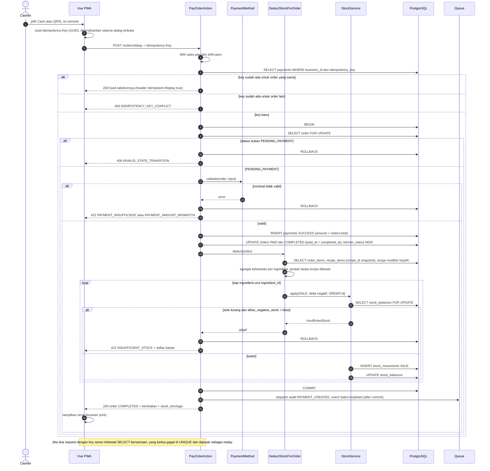
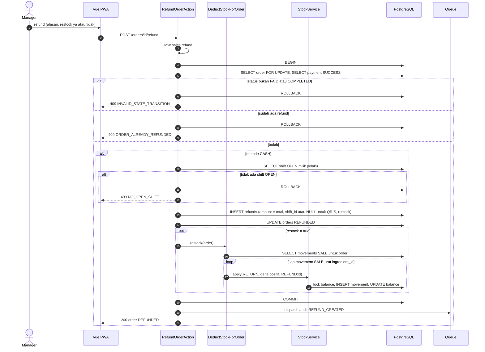

# Modul PAY-RFD — Pembayaran, Struk, Refund

> Sumber kebenaran tetap `docs/` v3.0; file ini hanya **kumpulan per modul** supaya developer cukup membuka satu folder. Bila ada beda, `docs/` menang.

| | |
|---|---|
| Owner | Ongki (11 tiket) |
| Tiket | 11 core (9.00 hari) + 0 rilis 1.1 (0.00 hari) |

## 1. Ringkasan buat developer

Bayar Cash/QRIS manual dengan **Idempotency-Key**, potong stok di transaksi yang sama, cetak struk, dan refund penuh sekali per order.

**Hati-hati**
- Bayar + status + movement + saldo = satu transaksi; gagal = rollback total.
- Key sama untuk order sama = replay (200), untuk order lain = 409.
- Refund tunai masuk shift OPEN milik pelaku; QRIS `shift_id` NULL.
- Kolom gateway nullable sudah disiapkan untuk Phase 2; metode CARD/GATEWAY ditolak.

**Dianggap selesai kalau:** Bayar, struk, refund jalan; TC-PAY hijau; double submit tidak menggandakan apapun.

## 2. Kebutuhan Fungsional (dari SRS v3.0)

### Modul PAY — Pembayaran & Struk

#### FR-PAY-001: Bayar Order
**Input:** metode (`CASH`/`QRIS`), `tendered_amount` (Cash), `reference_no` (QRIS, opsional ≤ 50), header `Idempotency-Key` (wajib, UUID).
**Aturan:**
- Hanya order PENDING_PAYMENT; butuh `sales.pay` dan shift OPEN milik kasir.
- Cash: `tendered ≥ total` (total sudah termasuk pembulatan), `change = tendered − total`. QRIS: nominal = total; kasir mengonfirmasi pembayaran diterima. Tanpa split payment (BR-007).
- Key yang sudah dipakai mengembalikan hasil sebelumnya tanpa memproses ulang (BR-008).
- Dalam **satu transaksi**: kunci order → buat payment → order `PAID` lalu `COMPLETED` (BR-021) → potong stok (FR-ENG-001) → set `kitchen_status = NEW`. Gagal di langkah mana pun → rollback semuanya.
- Audit `PAYMENT_CREATED` setelah commit.
| Kondisi | Pesan Error |
|---------|-------------|
| Order bukan PENDING_PAYMENT | "Order tidak dapat dibayar." (`409`) |
| Cash `tendered` < total | "Uang diterima kurang dari total." (`422`) |
| QRIS dengan nominal ≠ total | "Nominal QRIS harus sama dengan total." (`422`) |
| Metode CARD/GATEWAY | "Metode pembayaran belum tersedia." (`422`) |
| `Idempotency-Key` hilang | "Idempotency-Key wajib." (`422`) |
| `Idempotency-Key` sudah dipakai untuk order lain | "Idempotency-Key sudah dipakai untuk order lain." (`409`) |
| Stok kurang dan `allow_negative_stock` = false | "Stok tidak cukup: {daftar bahan}." (`422`) |
**Output:** `200` order COMPLETED, `change_amount`, `stock_shortage` (daftar bahan yang menjadi minus, jika ada).
**Catatan:** endpoint ini hanya untuk **Cash dan QRIS manual**. Pembayaran lewat Midtrans memakai FR-PAY-003 s.d. FR-PAY-005 [P2]; `CARD` tetap tidak tersedia.

#### FR-PAY-002: Struk
Data struk: header outlet, nomor order, tanggal (timezone outlet), kasir, tipe order (+meja), item + modifier, subtotal, diskon, service, pajak, pembulatan (bila ada), total, metode, tunai/kembalian, footer. Tampil di layar dengan CSS print 58/80 mm (browser print). Dapat dicetak ulang dari riwayat order. Untuk pembayaran gateway, struk menampilkan tipe pembayaran dan 6 karakter terakhir id transaksi Midtrans. Kirim struk ke WhatsApp/email = Phase 2.

#### FR-PAY-003: Mulai Pembayaran Midtrans [P2]
**Input:** `payment_type` (salah satu `enabled_payment_types`; pilot: `qris`).
**Aturan:**
1. Order `PENDING_PAYMENT`; butuh `sales.pay` dan shift OPEN milik kasir; konfigurasi Midtrans aktif untuk outlet (override outlet, jika tidak ada pakai business).
2. Bila `allow_negative_stock = false`, stok dicek lebih dulu (tanpa memotong); kurang → ditolak sebelum QR dibuat (BR-041).
3. Bila order sudah punya transaksi `PENDING` yang belum kedaluwarsa dengan tipe sama, kembalikan transaksi itu (klik ganda aman); tipe berbeda → `409` (BR-038).
4. Buat transaksi `PENDING` (`attempt_no` berikutnya, `provider_order_id = {order_number}-{attempt_no}`, `gross_amount = orders.total`, `expires_at = now + expiry_minutes`), commit, **lalu** panggil Midtrans (timeout 10 detik). Rincian item dikirim sehingga jumlahnya sama dengan `gross_amount` (item, diskon sebagai nilai negatif, service, pajak, pembulatan).
5. Midtrans gagal atau menolak → transaksi `FAILED`, order tetap `PENDING_PAYMENT`.
6. Audit `GATEWAY_PAYMENT_INITIATED`.
| Kondisi | Pesan Error |
|---------|-------------|
| Order bukan PENDING_PAYMENT | "Order tidak dapat dibayar." (`409`) |
| Tidak ada shift OPEN | "Buka shift terlebih dahulu." (`409`) |
| Provider belum dikonfigurasi atau nonaktif | "Pembayaran QRIS Midtrans belum diaktifkan di outlet ini." (`422` `GATEWAY_NOT_CONFIGURED`) |
| Tipe tidak diaktifkan | "Metode pembayaran belum tersedia." (`422`) |
| Stok kurang dan minus dilarang | "Stok tidak cukup: {daftar bahan}." (`422`) |
| Transaksi PENDING dengan tipe lain | "Batalkan pembayaran yang sedang berjalan terlebih dahulu." (`409`) |
| Midtrans tidak merespons atau menolak | "Layanan pembayaran sedang tidak tersedia. Coba lagi atau gunakan tunai." (`502` `GATEWAY_UNAVAILABLE`) |
**Output:** `201` transaksi (`id`, `status`, `qr_string`/`redirect_url`, `expires_at`, `provider_order_id`).

#### FR-PAY-004: Webhook Midtrans [P2]
**Endpoint:** publik (tanpa sesi/CSRF), throttle, hanya HTTPS.
**Aturan:**
1. Hitung signature = `SHA512(order_id + status_code + gross_amount + server_key)` dengan server key milik konfigurasi transaksi terkait; tidak cocok → simpan event `signature_valid = false`, balas `403`, **tidak diproses** (BR-040).
2. Hitung `event_key`; sudah ada → balas `200` tanpa memproses ulang (BR-040).
3. Simpan event (`RECEIVED`), antrekan job, balas `200` (target p95 < 300 ms, NFR-PERF-007).
4. Job: cari transaksi lewat `provider_order_id` (tak dikenal → event `IGNORED`); **verifikasi status ke Midtrans** (Get Status) dan pakai hasilnya, bukan isi webhook saja.
5. `settlement` (atau `capture` dengan `fraud_status = accept`): dalam **satu transaksi DB** kunci order lalu cek (a) order masih `PENDING_PAYMENT`, (b) `gross_amount` = `orders.total`. Lolos → transaksi `SETTLED`, buat `payments` `SUCCESS` (`method` `QRIS`/`GATEWAY`, `provider = MIDTRANS`, `shift_id` = shift order, `created_by` NULL, `idempotency_key = transaction_id`), order `PAID → COMPLETED`, `kitchen_status = NEW`, potong stok **tanpa menolak** bila minus (BR-041). Setelah commit: audit `GATEWAY_PAYMENT_SETTLED` (+ `GATEWAY_STOCK_OVERRIDE` bila ada kekurangan), event `SaleCompleted`.
6. Tidak lolos (a) atau (b): order **tidak berubah**, transaksi tetap tercatat, event `FAILED` dengan alasan `ORDER_NOT_PAYABLE` atau `AMOUNT_MISMATCH`; muncul di FR-RPT-007 (BR-039).
7. `deny`/`failure` → `FAILED`; `cancel` → `CANCELLED`; `expire` → `EXPIRED`; `capture` + `challenge` → `CHALLENGE`; `refund`/`partial_refund`/`chargeback` hanya dicatat. Order tetap `PENDING_PAYMENT`. Audit `GATEWAY_PAYMENT_FAILED`.
8. Kegagalan pemrosesan diulang otomatis (3 kali, backoff); setelah itu event `FAILED` dan tampil di FR-RPT-007.

#### FR-PAY-005: Status, Pembatalan, dan Kedaluwarsa [P2]
**Aturan:**
- `GET` status transaksi (butuh `sales.pay` dan order milik kasir, atau `sales.view` penuh): FE polling tiap 3 detik selama dialog QR terbuka sampai status final atau `expires_at`.
- Batalkan transaksi `PENDING` (kasir pemilik order, Manager, Owner): panggil API cancel Midtrans; sukses → `CANCELLED` dan audit `GATEWAY_PAYMENT_CANCELLED`; gagal → tetap `PENDING`. Order baru dapat dibuka ulang, dibatalkan, atau dibayar tunai setelah transaksi tidak lagi `PENDING` (BR-038).
- Penyapu terjadwal tiap menit: transaksi `PENDING` yang lewat `expires_at` dicek ke Midtrans; `settlement` diproses seperti FR-PAY-004, selain itu `EXPIRED` (BR-044).
| Kondisi | Pesan Error |
|---------|-------------|
| Transaksi sudah final | "Transaksi sudah selesai." (`409`) |
| Cancel ditolak Midtrans karena sudah dibayar | "Pembayaran sudah diterima. Menunggu konfirmasi." (`409`); settlement diproses oleh FR-PAY-004 |

---

### Modul RFD — Refund

#### FR-RFD-001: Refund Penuh
**Input:** alasan (wajib), `restock` (bool, default `false`).
**Aturan (BR-012, BR-035):**
- Order harus PAID atau COMPLETED; satu refund per order; seluruh nilai order (`total`, termasuk pembulatan). Butuh `sales.refund`.
- Metode refund mengikuti metode pembayaran asli.
- **Tunai:** dicatat sebagai kas keluar di shift OPEN milik **pelaku refund**, bukan shift asal order; ditolak jika pelaku tidak punya shift OPEN (`409`).
- **QRIS:** hanya dicatat di sistem; pengembalian dana manual di luar sistem; tidak butuh shift (`refunds.shift_id` nullable).
- `restock = true` → movement `RETURN` (positif) per ingredient dari movement `SALE` order tersebut, dalam transaksi yang sama.
- Order → `REFUNDED`. Audit `REFUND_CREATED`.
| Kondisi | Pesan Error |
|---------|-------------|
| Order bukan PAID/COMPLETED | "Order tidak dapat direfund." (`409`) |
| Sudah pernah direfund | "Order sudah direfund." (`409`) |
| Refund tunai tanpa shift OPEN | "Buka shift terlebih dahulu untuk refund tunai." (`409`) |
| Alasan kosong | "Alasan wajib diisi." |

#### FR-RFD-002: Refund Pembayaran Gateway [P2]
**Input:** sama dengan FR-RFD-001.
**Aturan (BR-043):** berlaku untuk order yang dibayar lewat Midtrans. Sistem membuat `gateway_refund_key` unik, memanggil API refund Midtrans, dan hanya bila diterima: refund tercatat (`gateway_status` `PENDING`/`SUCCESS`), order `REFUNDED`, restock bila dipilih (satu transaksi DB). Refund ditolak atau tipe pembayaran tidak mendukung refund via API (`[ASUMSI]` tergantung tipe; verifikasi ke Midtrans) → `422 GATEWAY_REFUND_FAILED`; Manager/Owner dapat mengulang dengan **refund manual** (`gateway_refund_key` NULL, dana dikembalikan di luar sistem, seperti QRIS manual). `shift_id` NULL (non-tunai). Audit `GATEWAY_REFUND`. Key refund yang sama tidak diproses dua kali.
| Kondisi | Pesan Error |
|---------|-------------|
| Midtrans menolak refund | "Refund ke Midtrans gagal. Anda dapat mencatat refund manual." (`422`) |
| Midtrans tidak merespons | "Layanan pembayaran sedang tidak tersedia." (`502`) |

---

## 3. Aturan Bisnis terkait

| ID | Aturan | Konsekuensi bila dilanggar |
|----|--------|---------------------------|
| BR-004 | Expected Cash = Opening + Cash Sales (bersih kembalian) + Cash In − Cash Out − Cash Refund | Selisih kas salah |
| BR-007 | Cash: `tendered ≥ total`, kembalian dihitung. QRIS manual: kasir konfirmasi, `reference_no` opsional, nominal = total. Tanpa split payment | `422` |
| BR-008 | Endpoint bayar wajib `Idempotency-Key`; key yang sama mengembalikan hasil sebelumnya | Payment ganda |
| BR-011 | `allow_negative_stock = true`: tetap jual, stok boleh minus, ditandai di laporan. `false`: bayar ditolak dengan daftar bahan kurang. Pembayaran gateway: lihat BR-041 | Sesuai setting |
| BR-012 | Refund penuh saja, butuh `sales.refund`, alasan wajib; tunai dicatat di shift OPEN pelaku dan ditolak bila tidak ada; restock dipilih per refund (default tidak) | Selisih kas/stok |
| BR-021 | Pembayaran sukses menjadikan order `PAID` lalu `COMPLETED` dalam transaksi yang sama; status dapur terpisah di `kitchen_status`. Untuk pembayaran gateway pemicunya settlement terverifikasi (BR-039) | State ambigu |
| BR-035 | Satu refund per order | Refund ganda |
| BR-038 | [P2] Satu transaksi gateway `PENDING` per order. Selama ada, order tidak dapat `reopen` atau cancel; transaksi harus dibatalkan atau berakhir lebih dulu | Order dibayar setelah dibatalkan |
| BR-039 | [P2] Settlement mengubah order hanya bila order `PENDING_PAYMENT` dan `gross_amount` = `orders.total`. Selain itu order tidak berubah dan event ditandai untuk tinjauan (FR-RPT-007) | Payment pada order salah status |
| BR-040 | [P2] Webhook wajib signature valid, status diverifikasi ke Midtrans, dan idempoten lewat `event_key` unik; pembuatan `payments` memakai `idempotency_key = transaction_id` | Payment ganda atau data palsu |
| BR-041 | [P2] Pembayaran gateway tidak boleh di-rollback karena stok (dana sudah diterima). Bila `allow_negative_stock = false`, stok dicek saat transaksi dimulai; saat settlement stok tetap dipotong walau menjadi minus, ditandai `GATEWAY_STOCK_OVERRIDE` dan muncul di laporan stok minus 🔶 | Uang diterima tanpa order selesai |
| BR-043 | [P2] Refund gateway lewat API refund Midtrans dengan `gateway_refund_key` unik; ditolak → pilihan refund manual oleh Manager/Owner; tetap satu refund per order (BR-035) | Refund ganda atau dana tidak kembali |
| BR-044 | [P2] Transaksi `PENDING` yang lewat `expires_at` dicek ke Midtrans lalu `EXPIRED` bila tidak settlement; percobaan baru memakai `attempt_no` + 1 dan `provider_order_id` baru | Transaksi menggantung |

## 4. Use Case

| ID | Nama | Aktor | Prioritas | FR | Proses |
|----|------|-------|-----------|----|--------|
| UC-PAY-01 | Bayar Order | Cashier | Must | FR-PAY-001 | BP-01 |
| UC-PAY-02 | Cetak Struk | Cashier, Manager | Must | FR-PAY-002 | BP-01 |
| UC-RFD-01 | Refund Order | Manager, Owner | Must | FR-RFD-001 | BP-02 |

**Spesifikasi penuh**

##### UC-PAY-01: Bayar Order
| Elemen | Isi |
|--------|-----|
| Aktor utama | Cashier |
| Tujuan | Menerima pembayaran dan menyelesaikan order |
| Prakondisi | Order `PENDING_PAYMENT`; shift OPEN milik aktor |
| Pascakondisi sukses | Payment `SUCCESS`; order `COMPLETED` (via `PAID`); stok terpotong (UC-ENG-01); `kitchen_status = NEW`; audit `PAYMENT_CREATED`; struk siap |
| Pascakondisi gagal | **Tidak ada perubahan** (rollback penuh); order tetap `PENDING_PAYMENT` |
| FR / BR | FR-PAY-001 / BR-007, 008, 009, 011, 021 |
| Include | UC-ENG-01 |

**Alur utama:** (1) Aktor memilih Cash atau QRIS dan mengisi nominal/referensi. (2) FE membuat `Idempotency-Key`. (3) Sistem mengunci order, memvalidasi nominal. (4) Sistem membuat payment, menandai order dibayar, memotong stok dalam satu transaksi. (5) Sistem mengembalikan kembalian dan `stock_shortage` bila ada. (6) FE menampilkan struk.

| Kode | Kondisi | Respon |
|------|---------|--------|
| 1a | Metode CARD/GATEWAY | "Metode pembayaran belum tersedia." |
| 3a | Order bukan `PENDING_PAYMENT` | `409` |
| 3b | Cash `tendered` < total | `422` "Uang diterima kurang dari total." |
| 3c | QRIS nominal ≠ total | `422` |
| 3d | Key sudah dipakai (order sama) | `200` hasil sebelumnya |
| 3e | Key dipakai untuk order lain | `409` |
| 4a | Stok kurang dan `allow_negative_stock = false` | `422` + daftar bahan; rollback |
| 4b | Stok kurang dan minus diizinkan | Lanjut; `stock_shortage` di respons |
| 5a | Jaringan putus sebelum respons | Retry dengan key sama; tidak ada payment ganda |

##### UC-RFD-01: Refund Order
| Elemen | Isi |
|--------|-----|
| Aktor utama | Manager, Owner |
| Tujuan | Mengembalikan pembayaran order dengan jejak jelas |
| Prakondisi | Order `PAID`/`COMPLETED`, belum pernah direfund; aktor punya `sales.refund` |
| Pascakondisi sukses | Refund tercatat; order `REFUNDED`; kas keluar di shift OPEN aktor (tunai); `RETURN` bila restock; audit `REFUND_CREATED` |
| Pascakondisi gagal | Tidak ada perubahan |
| FR / BR | FR-RFD-001 / BR-012, 035 |
| Extend | Restock (UC-ENG-01) |

**Alur utama:** (1) Aktor membuka order, mengisi alasan, memilih restock (default tidak). (2) Sistem memvalidasi status dan shift. (3) Sistem membuat refund sebesar `orders.total`, mengubah status, mencatat movement bila restock. (4) Sistem mengonfirmasi.

| Kode | Kondisi | Respon |
|------|---------|--------|
| 2a | Order bukan PAID/COMPLETED | `409` |
| 2b | Sudah direfund | `409` |
| 2c | Tunai dan aktor tanpa shift OPEN | `409` "Buka shift terlebih dahulu…" |
| 2d | Alasan kosong | `422` |
| 3a | Refund QRIS | Hanya dicatat; dana dikembalikan manual |

**Spesifikasi ringkas**

| ID | Prakondisi | Alur utama | Pascakondisi sukses | Alternatif / gagal | FR / BR |
|----|-----------|------------|---------------------|--------------------|---------|
| UC-PAY-02 | Order dibayar | Buka struk → cetak (browser print 58/80 mm), dapat dicetak ulang | Struk tampil/tercetak | — | FR-PAY-002 |
| UC-PAY-03 | Cashier | Order `PENDING_PAYMENT`; shift OPEN; provider aktif | Pilih QRIS Midtrans → sistem buat transaksi + QR → layar polling 3 detik → settlement → order `PAID`→`COMPLETED` | Payment `GATEWAY` tercatat; stok terpotong; struk | Kedaluwarsa, gagal → transaksi `EXPIRED`/`FAILED`, order tetap `PENDING_PAYMENT` | FR-PAY-003 / BR-037…039, 041 |
| UC-PAY-04 | Cashier | Transaksi gateway `PENDING` | Batalkan transaksi atau ganti metode | Transaksi `CANCELLED` (dibatalkan juga di Midtrans) | Settlement sudah masuk → ditolak | FR-PAY-004 / BR-039 |
| UC-PAY-05 | Owner, Manager | Ada transaksi gateway | Buka laporan rekonsiliasi gateway | Selisih/anomali tampil | — | FR-RPT-007 / BR-044 |
| UC-RFD-01 (ekstensi) | Manager, Owner | Order dibayar via gateway | Refund via API Midtrans; bila ditolak → fallback manual | Refund tercatat dengan `gateway_status` | API menolak → jalur manual (B6) | FR-RFD-002 / BR-043 |

## 5. Tabel Database (ERD v3.0)

**`payments`** 🔒 (hanya pembayaran **berhasil**; berubah dari v2.0: + kolom gateway)
| Kolom | Tipe | Null | Constraint | Keterangan |
|-------|------|------|-----------|------------|
| outlet_id | BIGINT | NN | FK | |
| order_id | BIGINT | NN | FK | |
| shift_id | BIGINT | NN | FK shifts | Shift order; gateway = shift asal order |
| method | V(10) | NN | CHECK `CASH`,`QRIS`,`CARD`,`GATEWAY` | QRIS Midtrans = `QRIS`; VA/e-wallet/kartu = `GATEWAY` |
| provider | V(20) | N | CHECK `MIDTRANS` | ➕ NULL = manual (Cash, QRIS manual) |
| gateway_transaction_id | BIGINT | N | FK payment_gateway_transactions | ➕ |
| gateway_payment_type | V(30) | N | | ➕ mis. `qris`, `gopay`, `bank_transfer` |
| status | V(10) | NN | CHECK `SUCCESS`,`FAILED`,`VOID` | Phase 1/2 hanya `SUCCESS` ditulis |
| amount | BIGINT | NN | CHECK ≥ 0 | = `orders.total` |
| tendered_amount, change_amount | BIGINT | N | | Cash saja |
| reference_no | V(50) | N | | QRIS manual |
| idempotency_key | V(64) | NN | UNIQUE `(business_id, idempotency_key)` | Webhook: pakai Midtrans `transaction_id` |
| created_by | BIGINT | N | FK users | NULL bila dibuat oleh webhook |
| paid_at | TIMESTAMP | NN | | Midtrans: `settlement_time` |

UNIQUE parsial `(order_id) WHERE status = 'SUCCESS'`. `created_by` jadi **nullable** (webhook tidak punya user).

**`refunds`** (perluasan v2.0: + kolom gateway)
| Kolom | Tipe | Null | Constraint | Keterangan |
|-------|------|------|-----------|------------|
| outlet_id | BIGINT | NN | FK | |
| order_id | BIGINT | NN | FK, UNIQUE | BR-035 |
| payment_id | BIGINT | NN | FK | |
| shift_id | BIGINT | N | FK shifts | Shift OPEN pelaku; NULL hanya untuk non-tunai. CHECK `CASH` ⇒ NOT NULL |
| amount | BIGINT | NN | | = `orders.total` |
| method | V(10) | NN | | Mengikuti pembayaran asli |
| reason | V(255) | NN | | |
| restock | BOOLEAN | NN | DEFAULT false | |
| gateway_refund_key | V(100) | N | UNIQUE `(business_id, gateway_refund_key)` | ➕ idempotensi refund Midtrans |
| gateway_status | V(20) | N | CHECK `PENDING`,`SUCCESS`,`FAILED` | ➕ NULL = refund manual |
| refunded_by | BIGINT | NN | FK users | |
| refunded_at | TIMESTAMP | NN | | |

## 6. Behavior (Sequence / State / Activity)

#### 3.2.2 SEQ-PAY-01: Bayar Order + Potong Stok (UC-PAY-01, UC-ENG-01)

**Catatan:** seluruh langkah di dalam `BEGIN…COMMIT` atomik (ADR-002). Lock berurutan `ingredient_id` mencegah deadlock. `PAID` hanya state transien di dalam transaksi (BR-021). Jaringan putus: FE retry dengan key yang sama. Endpoint ini hanya untuk Cash dan QRIS manual; pembayaran Midtrans memakai SEQ-GW-01 dan SEQ-GW-02 [P2].

#### 3.2.3 SEQ-RFD-01: Refund Penuh (UC-RFD-01)

**Catatan:** refund tunai masuk ke shift OPEN **pelaku**, bukan shift asal (BR-012). Refund QRIS hanya tercatat (`shift_id` NULL); pengembalian dana manual. Order `REFUNDED` otomatis keluar dari antrian dapur (filter `COMPLETED`).

## 7. Endpoint (SDD v3.0 §4)

| ID | Method | Endpoint | Permission | UC | FR | Deskripsi |
|----|--------|----------|-----------|----|----|-----------|
| API-PAY-01 | POST | `/orders/{id}/pay` | `sales.pay` | UC-PAY-01 | FR-PAY-001 | Bayar + potong stok |
| API-PAY-02 | GET | `/orders/{id}/receipt` | `sales.view` | UC-PAY-02 | FR-PAY-002 | Data struk |
| API-RFD-01 | POST | `/orders/{id}/refund` | `sales.refund` | UC-RFD-01 | FR-RFD-001 | Refund penuh |

**Contoh request/response**

#### API-PAY-01 · POST /orders/{id}/pay
**Headers:** `Idempotency-Key: 6f1d3c0e-3b52-4d0f-9a2b-1c9e4f7a8b10` (wajib)
**Request (Cash):** `{ "method": "CASH", "tendered_amount": 60000 }`
**Request (QRIS):** `{ "method": "QRIS", "reference_no": "QR-8821", "amount": 56100 }`
**Response 200:**
```json
{ "success": true, "data": {
  "order": { "id": 5012, "order_number": "KP01-261012-0007", "status": "COMPLETED", "kitchen_status": "NEW", "total": 56100, "paid_at": "2026-10-12T03:15:00Z" },
  "payment": { "id": 880, "method": "CASH", "amount": 56100, "tendered_amount": 60000, "change_amount": 3900 },
  "stock_shortage": [] }, "message": "Pembayaran berhasil" }
```
Bila stok menjadi minus (diizinkan): `"stock_shortage": [ { "ingredient_id": 3, "name": "Susu", "quantity_after": "-150.0000" } ]`.
**Validasi:**
| Field | Rule | Pesan Error |
|-------|------|-------------|
| Idempotency-Key | required, uuid | "Idempotency-Key wajib." |
| method | required, in:CASH,QRIS | "Metode pembayaran belum tersedia." |
| tendered_amount | required jika CASH, integer, ≥ total | "Uang diterima kurang dari total." |
| amount | required jika QRIS, integer, = total | "Nominal QRIS harus sama dengan total." |
| reference_no | nullable, max:50 | — |

**Error Codes:**
| HTTP | Code | Kondisi | Rujukan |
|------|------|---------|---------|
| 409 | INVALID_STATE_TRANSITION | "Order tidak dapat dibayar." | BR-021 |
| 409 | IDEMPOTENCY_KEY_CONFLICT | Key dipakai untuk order lain | BR-008 |
| 409 | NO_OPEN_SHIFT | Kasir tanpa shift OPEN | BR-001 |
| 422 | PAYMENT_INSUFFICIENT / PAYMENT_AMOUNT_MISMATCH / PAYMENT_METHOD_UNAVAILABLE / IDEMPOTENCY_KEY_REQUIRED | Lihat ERD v3.0 §7.1 | BR-007 |
| 422 | INSUFFICIENT_STOCK | "Stok tidak cukup: {daftar bahan}." (`details.ingredients`) | BR-011 |

Replay (key sama, order sama) mengembalikan `200` dengan body identik dan header `Idempotent-Replay: true`.

#### API-RFD-01 · POST /orders/{id}/refund
**Request:** `{ "reason": "Salah pesanan", "restock": false }`
**Response 200:**
```json
{ "data": { "order": { "id": 5012, "status": "REFUNDED" },
  "refund": { "id": 14, "amount": 56100, "method": "CASH", "restock": false, "shift_id": 32, "refunded_at": "2026-10-12T06:20:00Z" } } }
```
**Error Codes:** 409 `INVALID_STATE_TRANSITION` ("Order tidak dapat direfund."), 409 `ORDER_ALREADY_REFUNDED` ("Order sudah direfund."), 409 `NO_OPEN_SHIFT` ("Buka shift terlebih dahulu untuk refund tunai."), 422 `VALIDATION_ERROR` ("Alasan wajib diisi.") — FR-RFD-001, BR-012, BR-035.

#### API-RFD-01 · tambahan untuk Midtrans [P2]
**Request:** `{ "reason": "Salah pesanan", "restock": false, "refund_mode": "AUTO" }` (`refund_mode`: `AUTO` bawaan, `MANUAL` untuk refund tanpa API). **Response 200:** `refund` memuat `gateway_status` (`PENDING`/`SUCCESS`/`null`).
**Error Codes tambahan:** 422 `GATEWAY_REFUND_FAILED` ("Refund ke Midtrans gagal. Anda dapat mencatat refund manual."), 502 `GATEWAY_UNAVAILABLE`.

## 8. Tiket

Detail AC lengkap ada di `tickets/tickets.md` (ID sama).

| ID | Task | Est | Owner | Sprint | Depends on | Test |
|----|------|-----|-------|--------|-----------|------|
| BE-PAY-001 | Interface PaymentMethod (strategy): Cash, QRIS manual; CARD/GATEWAY stub nonaktif | M | Ongki | S3 | DB-PAY-001 | TC-PAY-001, TC-PAY-002, TC-PAY-003 |
| BE-PAY-002 | POST /orders/{id}/pay: Idempotency-Key, lock order, PAID→COMPLETED atomik | M | Ongki | S3 | BE-PAY-001, BE-ORD-005 | TC-PAY-004, TC-PAY-005, TC-PAY-007 |
| BE-PAY-003 | Panggil DeductStockForOrder dalam transaksi yang sama + event SaleCompleted after-commit | S | Ongki | S3 | BE-PAY-002, BE-ENG-002 | TC-PAY-006, TC-PAY-008 |
| BE-PAY-004 | Builder data struk (pembulatan, metode, kembalian) | S | Ongki | S3 | BE-PAY-002 | TC-PAY-014 |
| BE-PAY-005 | Refund penuh: permission, alasan, kas ke shift OPEN pelaku, restock opsional, audit | M | Ongki | S4 | BE-PAY-002, BE-AUD-001, BE-ENG-004 | TC-PAY-009, TC-PAY-010, TC-PAY-011, TC-PAY-012 |
| DB-PAY-001 | Migrasi payments, refunds (+ kolom gateway nullable, trigger append-only payments) | M | Ongki | S2 | DB-ORD-001 | TC-PAY-004 |
| FE-PAY-001 | Dialog pembayaran (numpad, nominal cepat, kembalian, ref QRIS, Idempotency-Key) | M | Ongki | S5 | BE-PAY-002, FE-ORD-003 | TC-PAY-004, TC-PAY-008 |
| FE-PAY-002 | Tampilan struk + CSS print 58/80 mm | M | Ongki | S4 | BE-PAY-004 | TC-PAY-014 |
| FE-PAY-003 | Dialog refund (alasan, restock) | S | Ongki | S5 | BE-PAY-005, FE-ORD-004 | TC-PAY-009, TC-PAY-010 |
| TEST-PAY-001 | Test pembayaran: double submit, overpay, status invalid, kembalian, rollback | M | Ongki | S5 | BE-PAY-003 | TC-PAY-001…008 |
| TEST-PAY-002 | Test refund (kas, status, permission, restock) | S | Ongki | S5 | BE-PAY-005 | TC-PAY-009…013 |

**Acceptance Criteria ringkas**

- **BE-PAY-001** 
  - [ ] Cash tendered < total 422; QRIS nominal ≠ total 422
  - [ ] CARD/GATEWAY 422 PAYMENT_METHOD_UNAVAILABLE
- **BE-PAY-002** 
  - [ ] Key sama untuk order sama = 200 + Idempotent-Replay; untuk order lain 409
  - [ ] Order bukan PENDING_PAYMENT 409; header kosong 422
- **BE-PAY-003** 
  - [ ] Stok kurang dan minus dilarang: rollback total, payment tidak tersimpan
  - [ ] Double submit paralel menghasilkan 1 payment dan 1 set movement
- **BE-PAY-004** 
  - [ ] Struk memuat baris pembulatan bila ada
  - [ ] Cetak ulang dari riwayat memakai data tersimpan
- **BE-PAY-005** 
  - [ ] Refund tunai tanpa shift OPEN pelaku 409 NO_OPEN_SHIFT; QRIS shift_id NULL
  - [ ] Refund kedua 409 ORDER_ALREADY_REFUNDED
- **DB-PAY-001** 
  - [ ] UNIQUE (business_id, idempotency_key) dan UNIQUE parsial SUCCESS per order
  - [ ] refunds: UNIQUE(order_id), CHECK CASH ⇒ shift_id NOT NULL; created_by payments nullable
- **FE-PAY-001** 
  - [ ] Key dibuat sekali per dialog dan dipakai ulang saat retry
  - [ ] Error stok kurang menampilkan daftar bahan
- **FE-PAY-002** 
  - [ ] Print browser 58 dan 80 mm rapi (uji printer thermal)
  - [ ] Cetak ulang dari riwayat
- **FE-PAY-003** 
  - [ ] Alasan wajib; restock default tidak dicentang
  - [ ] Pesan 409 NO_OPEN_SHIFT jelas
- **TEST-PAY-001** 
  - [ ] 0 payment tanpa potong stok pada test kegagalan
  - [ ] Retry dengan key sama tidak menggandakan payment/movement
- **TEST-PAY-002** 
  - [ ] Efek ke Expected Cash shift pelaku diuji
  - [ ] RETURN movement terbentuk hanya bila restock

## 9. Test Case (Test Plan v3.0)

| ID | Skenario | FR / BR | Level | Rilis |
|----|----------|---------|-------|-------|
| TC-PAY-001 | Tunai: kembalian benar; nominal kurang 422 | FR-PAY-001; BR-007 | Feature | Core |
| TC-PAY-002 | QRIS manual: nominal ≠ total 422; referensi opsional | FR-PAY-001 | Feature | Core |
| TC-PAY-003 | Metode CARD/GATEWAY → 422 PAYMENT_METHOD_UNAVAILABLE | FR-PAY-001 | Feature | Core |
| TC-PAY-004 | Idempotency-Key sama + order sama → replay tanpa payment/movement baru | FR-PAY-001; BR-007 | Feature | Core |
| TC-PAY-005 | Key yang sama untuk order lain → 409; header kosong 422 | FR-PAY-001 | Feature | Core |
| TC-PAY-006 | Double submit paralel → 1 payment, 1 set movement | NFR-DATA-002; NFR-DATA-003 | Integration | Core |
| TC-PAY-007 | Order bukan PENDING_PAYMENT → 409 | FR-PAY-001 | Feature | Core |
| TC-PAY-008 | Stok kurang & minus dilarang → rollback total (0 payment, 0 movement, status tetap) | FR-ENG-002; BR-011 | Integration | Core |
| TC-PAY-009 | Refund tunai masuk shift OPEN pelaku; mengurangi Expected Cash | FR-RFD-001; BR-004 | Feature | Core |
| TC-PAY-010 | Refund tunai tanpa shift OPEN pelaku → 409 NO_OPEN_SHIFT | FR-RFD-001 | Feature | Core |
| TC-PAY-011 | Refund QRIS manual: shift_id NULL | FR-RFD-001 | Feature | Core |
| TC-PAY-012 | Refund kedua 409 ORDER_ALREADY_REFUNDED; hanya Manager/Owner | FR-RFD-001; BR-012 | Feature | Core |
| TC-PAY-013 | Refund restock: movement RETURN per bahan; tanpa restock tanpa movement | FR-RFD-001; BR-012 | Feature | Core |
| TC-PAY-014 | Struk memuat baris pembulatan, metode, kembalian; cetak ulang dari data tersimpan | FR-PAY-002 | Feature | Core |
