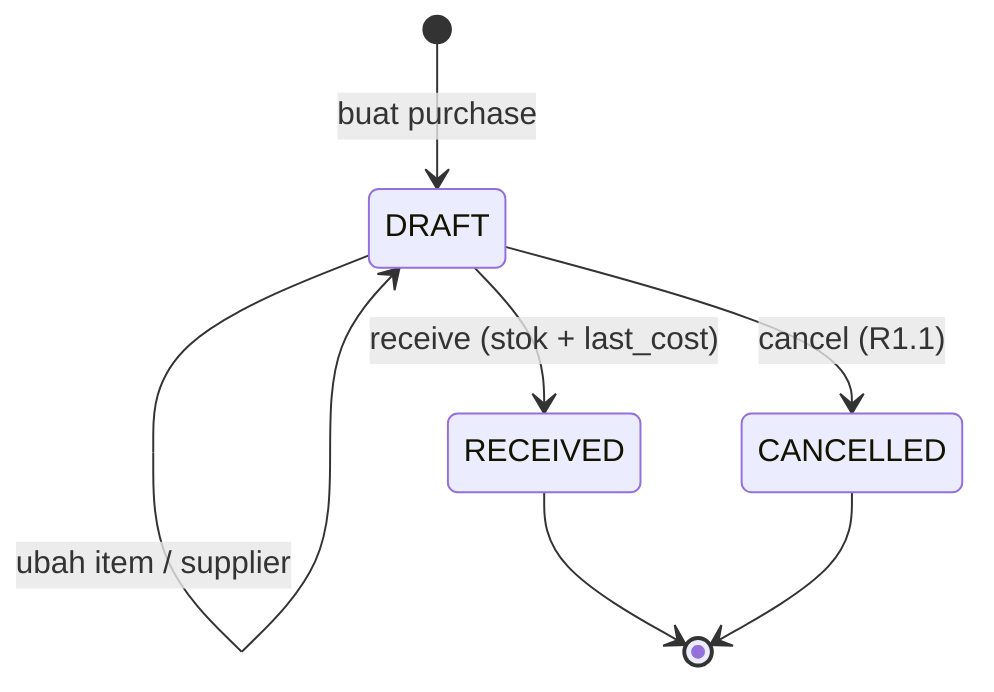

# Modul PUR — Supplier & Purchasing

> Sumber kebenaran tetap `docs/` v3.0; file ini hanya **kumpulan per modul** supaya developer cukup membuka satu folder. Bila ada beda, `docs/` menang.

| | |
|---|---|
| Owner | Naufaldi (10 tiket) |
| Tiket | 9 core (7.50 hari) + 1 rilis 1.1 (1.00 hari) |

## 1. Ringkasan buat developer

Mencatat pembelian bahan dari supplier. Saat purchase **diterima**, stok bertambah dan `last_cost` bahan diperbarui. Satuan beli (kg, L) dikonversi ke satuan dasar (g, ml).

**Hati-hati**
- Receive hanya dari DRAFT, atomik, idempoten; klik ganda tidak menggandakan stok.
- Konversi tetap: kg→g = 1000, L→ml = 1000 (BR-046).
- `last_cost` = harga per satuan beli ÷ faktor, bukan rata-rata (BR-047).
- Nomor PO dari `document_sequences` dengan lock.
- Cancel dan partial receive masuk rilis 1.1.

**Dianggap selesai kalau:** Supplier dan purchase DRAFT→RECEIVED bekerja; TC-PUR hijau; stok dan last_cost cocok.

## 2. Kebutuhan Fungsional (dari SRS v3.0)

### Modul PUR — Supplier & Purchasing (F-20)

#### FR-PUR-001: Supplier
**Input:** nama (wajib, ≤ 150, unik per business tanpa membedakan huruf besar/kecil), kontak (≤ 100), telepon (≤ 30), email, alamat (≤ 255), status.
**Aturan:** permission `suppliers.*` (Owner, Manager, Inventory). Supplier INACTIVE tidak bisa dipilih untuk purchase baru; supplier yang pernah dipakai tidak dihapus permanen (BR-018, BR-048).
| Kondisi | Pesan Error |
|---------|-------------|
| Nama supplier sudah ada | "Nama supplier sudah digunakan." |
| Nama kosong | "Nama supplier wajib diisi." |
| Email tidak valid | "Format email tidak valid." |

#### FR-PUR-002: Buat & Ubah Purchase (DRAFT)
**Input:** supplier (wajib, ACTIVE), nomor invoice supplier (opsional, ≤ 50), catatan, item: bahan (wajib), satuan beli (`g`, `kg`, `ml`, `L`, `pcs`), qty (> 0, maks 4 desimal), harga per satuan beli (rupiah bulat ≥ 0).
**Aturan:** butuh `purchases.create`. Satuan beli harus punya faktor konversi ke base unit bahan (BR-046); sistem menghitung `quantity_base`, `unit_cost_base`, dan `line_total` serta menampilkannya sebelum simpan. Satu bahan hanya sekali per purchase. Nomor `PO-{KODE_OUTLET}-{YYMMDD}-{urut 3 digit}` (BR-049). Hanya status DRAFT yang dapat diubah (BR-048).
| Kondisi | Pesan Error |
|---------|-------------|
| Supplier INACTIVE atau bukan milik tenant | "Supplier tidak tersedia." |
| Item kosong | "Tambahkan minimal satu item." |
| Qty ≤ 0 | "Jumlah harus lebih dari 0." |
| Harga negatif atau bukan bilangan bulat | "Harga harus bilangan bulat ≥ 0." |
| Satuan beli tidak punya konversi untuk bahan | "Satuan tidak dapat dikonversi untuk bahan ini." |
| Bahan ganda | "Bahan {nama} sudah ada di purchase." |
| Purchase bukan DRAFT | "Purchase sudah diterima dan tidak dapat diubah." (`409`) |

#### FR-PUR-003: Terima Purchase
**Input:** — (opsional `note`).
**Aturan (BR-045, BR-047, BR-050):** butuh `purchases.receive`. Dalam **satu transaksi**: kunci purchase → pastikan DRAFT → untuk tiap bahan berurutan `ingredient_id`: `StockService::apply(PURCHASE, +quantity_base, PURCHASE:{id}, unit_cost = unit_cost_base)` → perbarui `ingredients.last_cost = unit_cost_base` → purchase `RECEIVED` (`received_by`, `received_at`). Gagal di langkah mana pun → rollback total. Penerimaan kedua tidak menambah stok. Tidak tunduk pada `allow_negative_stock`. Audit `PURCHASE_RECEIVED` memuat last_cost sebelum/sesudah per bahan.
| Kondisi | Pesan Error |
|---------|-------------|
| Purchase bukan DRAFT | "Purchase tidak dapat diterima." (`409` `INVALID_STATE_TRANSITION`) |
| Outlet tidak aktif | "Outlet tidak aktif." |
| Tanpa permission | `403` |
**Output:** `200` purchase RECEIVED + ringkasan `items[{ingredient_id, quantity_after, last_cost_before, last_cost_after}]`.

#### FR-PUR-004: Daftar & Detail Purchase
Filter status, supplier, tanggal; paginasi. Butuh `purchases.view`. Data tenant lain `404`.

#### FR-PUR-005: Cancel & Partial Receive `[R1.1]`
**Aturan:** cancel hanya DRAFT dengan alasan wajib (`purchases.cancel`), tanpa movement. Partial receive menerima sebagian qty per item lewat `purchase_receipts`; status tetap DRAFT sampai seluruh qty diterima. Detail ditulis menjelang R1.1.

---

## 3. Aturan Bisnis terkait

| ID | Aturan | Konsekuensi bila dilanggar |
|----|--------|---------------------------|
| BR-018 | Entitas yang pernah dipakai transaksi tidak dihapus permanen: INACTIVE atau soft delete | Laporan historis rusak |
| BR-045 | Receive purchase hanya dari DRAFT, satu transaksi: 1 movement `PURCHASE` per bahan, purchase `RECEIVED`, `last_cost` diperbarui; gagal → rollback; receive kedua tidak menambah stok | Stok ganda atau setengah jadi |
| BR-046 | Satuan beli dikonversi ke base unit memakai `ingredient_unit_conversions`: `kg→g` = 1000, `L→ml` = 1000, satuan sama dengan base unit = 1; kombinasi lain ditolak | Salah hitung stok |
| BR-047 | `last_cost` bahan = harga per satuan beli ÷ faktor konversi (`DECIMAL(18,4)`) dari purchase RECEIVED terbaru (Last Cost, bukan rata-rata); tidak mengubah movement/order lama | HPP historis berubah |
| BR-048 | Purchase RECEIVED/CANCELLED tidak dapat diubah; supplier INACTIVE tidak bisa dipilih | `409` / `422` |
| BR-049 | Nomor purchase `PO-{KODE_OUTLET}-{YYMMDD}-{urut 3 digit}` dari `document_sequences`, reset harian menurut timezone outlet, aman konkurensi | Nomor ganda |
| BR-050 | Receive tidak tunduk pada `allow_negative_stock` (delta positif); menerima bahan pada stok minus tetap boleh | Penerimaan terblokir tanpa alasan |

## 4. Use Case

| ID | Nama | Aktor | Prioritas | FR | Proses |
|----|------|-------|-----------|----|--------|
| UC-PUR-01 | Kelola Supplier | Owner, Manager, Inventory | Should | FR-PUR-001 | BP-05 |
| UC-PUR-02 | Buat & Ubah Purchase (DRAFT) | Owner, Manager, Inventory | Should | FR-PUR-002 | BP-05 |
| UC-PUR-03 | Terima Purchase | Owner, Manager, Inventory | Should | FR-PUR-003 | BP-05, BP-04 |
| UC-PUR-04 | Lihat Purchase | Owner, Manager, Inventory | Should | FR-PUR-004 | BP-05 |
| UC-PUR-05 `[R1.1]` | Cancel Purchase & Partial Receive | Owner, Manager, Inventory | Could | FR-PUR-005 | BP-05 |

**Spesifikasi ringkas**

| ID | Prakondisi | Alur utama | Pascakondisi sukses | Alternatif / gagal | FR / BR |
|----|-----------|------------|---------------------|--------------------|---------|
| UC-PUR-01 | Aktor punya `suppliers.*` | Tambah, ubah, nonaktifkan supplier | Supplier tersimpan; INACTIVE tidak muncul di pilihan purchase baru | Nama ganda → `422` | FR-PUR-001 / BR-048 |
| UC-PUR-02 | Aktor punya `purchases.create`; ada supplier ACTIVE dan bahan | Pilih supplier → tambah item (bahan, satuan beli, qty, harga) → sistem tampilkan konversi dan total → simpan | Purchase `DRAFT` dengan nomor PO; total terhitung | Qty ≤ 0, satuan tak dapat dikonversi, bahan ganda → `422`; purchase bukan DRAFT → `409` | FR-PUR-002 / BR-046, 048, 049 |
| UC-PUR-03 | Purchase `DRAFT`; `purchases.receive` | Tekan Terima → sistem menambah stok per bahan, memperbarui `last_cost`, mengubah status | Purchase `RECEIVED`; movement `PURCHASE`; audit `PURCHASE_RECEIVED`; tidak bisa diubah | Bukan DRAFT → `409` (tanpa efek); gagal di tengah → rollback total | FR-PUR-003 / BR-045, 047, 050 |
| UC-PUR-04 | `purchases.view` | Filter status, supplier, tanggal → buka detail | Daftar dan detail tampil | Data tenant lain → `404` | FR-PUR-004 |
| UC-PUR-05 `[R1.1]` | Purchase DRAFT; `purchases.cancel` | Cancel dengan alasan, atau terima sebagian | CANCELLED tanpa movement / stok bertambah sesuai qty diterima | Alasan kosong → `422` | FR-PUR-005 |

## 5. Tabel Database (ERD v3.0)

**`suppliers`**: `name` V(150) NN · `contact` V(100) N · `phone` V(30) N · `email` V(255) N · `address` V(255) N · `status` V(20) NN CHECK `ACTIVE`,`INACTIVE` · `deleted_at` N · UNIQUE parsial `(business_id, lower(name)) WHERE deleted_at IS NULL`.

**`purchases`**: `outlet_id` FK NN · `supplier_id` FK NN · `code` V(30) NN, UNIQUE `(outlet_id, code)` (BR-049) · `supplier_invoice_no` V(50) N · `status` V(15) NN CHECK `DRAFT`,`RECEIVED`,`CANCELLED` · `note` V(255) N · `total` BIGINT NN CHECK ≥ 0 · `created_by` FK users NN · `received_by` FK users N · `received_at` TIMESTAMP N · `cancelled_by`, `cancelled_at`, `cancel_reason` N (dipakai R1.1) · CHECK `(status='RECEIVED') = (received_at IS NOT NULL)`.

**`purchase_items`**: `purchase_id` FK NN · `ingredient_id` FK NN · `unit_id` FK NN (satuan beli) · `quantity` DEC(18,4) NN CHECK > 0 · `conversion_factor` DEC(18,4) NN CHECK > 0 (salinan faktor saat dibuat) · `quantity_base` DEC(18,4) NN (= quantity × factor) · `unit_price` BIGINT NN CHECK ≥ 0 (per satuan beli) · `unit_cost_base` DEC(18,4) NN (= unit_price ÷ factor; menjadi `last_cost`, BR-047) · `line_total` BIGINT NN (= round half-up(quantity × unit_price)) · UNIQUE `(purchase_id, ingredient_id)`.

**`document_sequences`**: PK `(outlet_id, doc_type, seq_date)` · `business_id` NN · `doc_type` V(20) NN CHECK `PURCHASE` (opname dapat ditambahkan di R1.1) · `seq_date` DATE NN (tanggal lokal outlet) · `last_number` INT NN. Dikunci `FOR UPDATE` saat menerbitkan nomor (BR-049).

## 6. Behavior (Sequence / State / Activity)

#### 3.2.6a SEQ-PUR-01: Terima Purchase (UC-PUR-03)
```mermaid
sequenceDiagram
    actor U as Inventory/Manager
    participant FE as Vue PWA
    participant API as Laravel API
    participant PS as ReceivePurchase
    participant SS as StockService
    participant DB as PostgreSQL
    U->>FE: Klik "Terima" (konfirmasi ringkasan)
    FE->>API: POST /purchases/{id}/receive
    API->>API: auth, outlet.context, permission purchases.receive
    API->>PS: handle(purchase_id)
    PS->>DB: BEGIN; SELECT purchase FOR UPDATE
    alt status != DRAFT
        PS-->>API: 409 INVALID_STATE_TRANSITION
        API-->>FE: 409
    else DRAFT
        loop item urut ingredient_id
            PS->>SS: apply(PURCHASE, +quantity_base, ref PURCHASE:id, unit_cost_base)
            SS->>DB: lock balance, insert movement (idempoten), update balance
            PS->>DB: UPDATE ingredients SET last_cost = unit_cost_base
        end
        PS->>DB: UPDATE purchases SET status RECEIVED, received_by, received_at
        PS->>DB: COMMIT
        PS-->>API: purchase + ringkasan stok & last_cost
        API->>API: afterCommit: audit PURCHASE_RECEIVED, event PurchaseReceived
        API-->>FE: 200
    end
```
**Catatan:** gagal di langkah mana pun = rollback total (BR-045). Klik ganda: request kedua melihat status RECEIVED → 409, tidak ada movement baru (UNIQUE idempotensi movement sebagai pengaman kedua).

#### STM-PURCHASE: Status `purchases.status`

| Dari | Ke | Pemicu | Guard | Efek |
|------|----|--------|-------|------|
| DRAFT | RECEIVED | `POST /purchases/{id}/receive` | `purchases.receive`; supplier ACTIVE; item ≥ 1 | movement `PURCHASE`, `last_cost`, audit |
| DRAFT | CANCELLED `[R1.1]` | `POST /purchases/{id}/cancel` | `purchases.cancel`; alasan wajib | Tanpa movement |
| RECEIVED, CANCELLED | — | — | Final | Tidak dapat diubah (BR-048) |

## 7. Endpoint (SDD v3.0 §4)

| ID | Method | Endpoint | Permission | UC | FR | Deskripsi |
|----|--------|----------|-----------|----|----|-----------|
| API-PUR-01 | GET | `/suppliers` | `suppliers.view` | UC-PUR-01 | FR-PUR-001 | Daftar supplier |
| API-PUR-02 | POST | `/suppliers` | `suppliers.create` | UC-PUR-01 | FR-PUR-001 | Tambah supplier |
| API-PUR-03 | PUT | `/suppliers/{id}` | `suppliers.update` | UC-PUR-01 | FR-PUR-001 | Ubah/nonaktifkan |
| API-PUR-04 | DELETE | `/suppliers/{id}` | `suppliers.delete` | UC-PUR-01 | FR-PUR-001 | Hapus (soft) |
| API-PUR-05 | GET | `/purchases` | `purchases.view` | UC-PUR-04 | FR-PUR-004 | Daftar purchase (filter status, supplier, tanggal) |
| API-PUR-06 | POST | `/purchases` | `purchases.create` | UC-PUR-02 | FR-PUR-002 | Buat purchase DRAFT |
| API-PUR-07 | GET | `/purchases/{id}` | `purchases.view` | UC-PUR-04 | FR-PUR-004 | Detail purchase |
| API-PUR-08 | PUT | `/purchases/{id}` | `purchases.create` | UC-PUR-02 | FR-PUR-002 | Ubah DRAFT |
| API-PUR-09 | POST | `/purchases/{id}/receive` | `purchases.receive` | UC-PUR-03 | FR-PUR-003 | Terima purchase |
| API-PUR-10 | POST | `/purchases/{id}/cancel` | `purchases.cancel` | UC-PUR-05 | FR-PUR-005 | Cancel DRAFT `[R1.1]` |

**Contoh request/response**

#### API-PUR-06 · POST /purchases
Header: `X-Outlet-Id`. Permission `purchases.create`.
```json
{
  "supplier_id": 4,
  "supplier_invoice_no": "INV-2210-77",
  "note": "Belanja mingguan",
  "items": [
    {"ingredient_id": 12, "unit": "kg", "quantity": "2.5000", "unit_price": 98000},
    {"ingredient_id": 15, "unit": "L",  "quantity": "6.0000", "unit_price": 18500}
  ]
}
```
`201`:
```json
{"success": true, "data": {
  "id": 31, "code": "PO-KP01-261104-001", "status": "DRAFT", "total": 356000,
  "items": [
    {"ingredient_id": 12, "unit": "kg", "quantity": "2.5000", "conversion_factor": "1000.0000", "quantity_base": "2500.0000", "unit_price": 98000, "unit_cost_base": "98.0000", "line_total": 245000},
    {"ingredient_id": 15, "unit": "L", "quantity": "6.0000", "conversion_factor": "1000.0000", "quantity_base": "6000.0000", "unit_price": 18500, "unit_cost_base": "18.5000", "line_total": 111000}
  ]}}
```
Error: `422 VALIDATION_ERROR` (supplier tidak tersedia, qty ≤ 0, satuan tidak dapat dikonversi, bahan ganda).

#### API-PUR-09 · POST /purchases/{id}/receive
Permission `purchases.receive`. Tanpa body (opsional `note`).
`200`:
```json
{"success": true, "data": {
  "id": 31, "status": "RECEIVED", "received_at": "2026-11-04T07:42:10Z",
  "items": [
    {"ingredient_id": 12, "quantity_after": "3100.0000", "last_cost_before": "95.0000", "last_cost_after": "98.0000"},
    {"ingredient_id": 15, "quantity_after": "8200.0000", "last_cost_before": "18.0000", "last_cost_after": "18.5000"}
  ]}}
```
Error: `409 INVALID_STATE_TRANSITION` (bukan DRAFT / sudah diterima), `403`, `404`.

## 8. Tiket

Detail AC lengkap ada di `tickets/tickets.md` (ID sama).

| ID | Task | Est | Owner | Sprint | Depends on | Test |
|----|------|-----|-------|--------|-----------|------|
| BE-PUR-001 | CRUD supplier (soft delete, INACTIVE tidak bisa dipilih) | S | Naufaldi | S2 | DB-PUR-001, BE-RBAC-001 | TC-PUR-001, TC-PUR-006 |
| BE-PUR-002 | Purchase DRAFT: buat/ubah item (satuan beli + faktor konversi), nomor PO | M | Naufaldi | S3 | BE-PUR-001, BE-ING-001, BE-INV-003 | TC-PUR-002, TC-PUR-005 |
| BE-PUR-003 | Receive purchase: movement PURCHASE, update last_cost, atomik dan idempoten | M | Naufaldi | S3 | BE-PUR-002, BE-INV-002 | TC-PUR-003, TC-PUR-004, TC-PUR-005 |
| BE-PUR-004 | GET daftar & detail purchase (filter status, supplier, tanggal) | S | Naufaldi | S4 | BE-PUR-002 | TC-PUR-006 |
| DB-PUR-001 | Migrasi suppliers, purchases, purchase_items, document_sequences | M | Naufaldi | S2 | DB-ING-001, DB-TEN-002 | TC-PUR-002 |
| FE-PUR-001 | Halaman supplier | S | Naufaldi | S3 | BE-PUR-001, FE-AUTH-003 | TC-PUR-001 |
| FE-PUR-002 | Form & daftar purchase (satuan beli, konversi tampil) | M | Naufaldi | S3 | BE-PUR-002, FE-PUR-001 | TC-PUR-002 |
| FE-PUR-003 | Alur terima barang (konfirmasi, hasil stok baru) | M | Naufaldi | S4 | BE-PUR-003, FE-PUR-002 | TC-PUR-003, TC-PUR-004 |
| TEST-PUR-001 | Test purchasing: konversi, last_cost, idempotensi, permission | M | Naufaldi | S5 | BE-PUR-003 | TC-PUR-001…006 |
| BE-PUR-005 | Cancel purchase DRAFT + partial receive (purchase_receipts) | M | Naufaldi | R1.1 | BE-PUR-003 | TC-PUR-007 |

**Acceptance Criteria ringkas**

- **BE-PUR-001** 
  - [ ] Supplier INACTIVE ditolak saat membuat purchase
  - [ ] Permission suppliers.* sesuai matriks (Owner, Manager, Inventory)
- **BE-PUR-002** 
  - [ ] quantity_base = quantity × faktor (kg→g, L→ml = 1000)
  - [ ] Purchase RECEIVED tidak bisa diubah 409 INVALID_STATE_TRANSITION
- **BE-PUR-003** 
  - [ ] Receive menambah stok base unit dan last_cost = harga per satuan beli ÷ faktor
  - [ ] Receive ganda tidak menggandakan movement (409 atau replay)
- **BE-PUR-004** 
  - [ ] Filter dan paginasi bekerja; data tenant lain 404
  - [ ] Permission purchases.view
- **DB-PUR-001** 
  - [ ] purchases UNIQUE (outlet_id, code); status CHECK DRAFT/RECEIVED/CANCELLED
  - [ ] document_sequences PK (outlet_id, doc_type, seq_date) dengan lock FOR UPDATE
- **FE-PUR-001** 
  - [ ] CRUD supplier dengan state loading/empty/error
  - [ ] Aksi dibatasi v-can suppliers.*
- **FE-PUR-002** 
  - [ ] Konversi ke base unit tampil sebelum simpan
  - [ ] Purchase RECEIVED tampil read-only
- **FE-PUR-003** 
  - [ ] Konfirmasi menampilkan ringkasan stok sebelum dan sesudah
  - [ ] Klik ganda aman
- **TEST-PUR-001** 
  - [ ] Semua BR-045…050 punya test
  - [ ] balance = SUM(movements) tetap benar setelah receive
- **BE-PUR-005** `[R1.1]`
  - [ ] Cancel hanya DRAFT dengan alasan wajib
  - [ ] Partial receive memotong sisa dan status mengikuti jumlah diterima

## 9. Test Case (Test Plan v3.0)

| ID | Skenario | FR / BR | Level | Rilis |
|----|----------|---------|-------|-------|
| TC-PUR-001 | Supplier CRUD; nama unik; INACTIVE tak bisa dipilih | FR-PUR-001; BR-048 | Feature | Core |
| TC-PUR-002 | Purchase DRAFT: konversi kg→g dan L→ml, total, nomor PO unik; bahan ganda 422 | FR-PUR-002; BR-046; BR-049 | Feature | Core |
| TC-PUR-003 | Receive: stok bertambah per bahan, last_cost = harga ÷ faktor, status RECEIVED | FR-PUR-003; BR-045; BR-047 | Feature | Core |
| TC-PUR-004 | Receive ganda/klik ganda: tidak ada movement baru | FR-PUR-003; BR-045 | Integration | Core |
| TC-PUR-005 | Purchase RECEIVED tak bisa diubah/diterima ulang (409) | BR-048 | Feature | Core |
| TC-PUR-006 | Permission suppliers.*/purchases.* sesuai matriks; tenant lain 404 | FR-PUR-004 | Feature | Core |
| TC-PUR-007 | Cancel DRAFT dengan alasan; partial receive | FR-PUR-005 | Feature | R1.1 |
