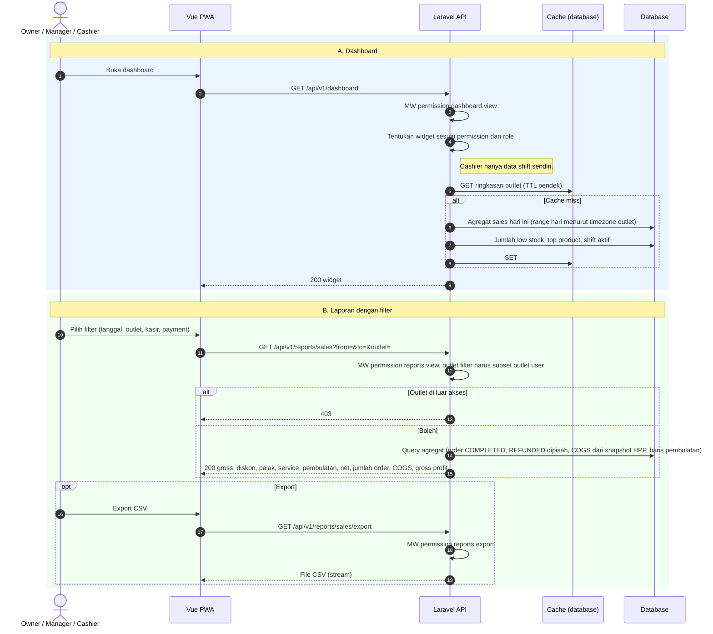

# Modul RPT — Laporan & Dashboard

> Sumber kebenaran tetap `docs/` v3.0; file ini hanya **kumpulan per modul** supaya developer cukup membuka satu folder. Bila ada beda, `docs/` menang.

| | |
|---|---|
| Owner | Naufaldi (9 tiket), Akmal (1 tiket) |
| Tiket | 4 core (3.00 hari) + 6 rilis 1.1 (5.00 hari) |

## 1. Ringkasan buat developer

Laporan penjualan dan pembayaran (core); laporan produk, inventory, waste, dashboard, dan export CSV menyusul di rilis 1.1. Semua laporan hanya membaca data.

**Hati-hati**
- Periode memakai **business date** sesuai timezone outlet.
- Refund dipisah dari net sales; pembulatan punya baris sendiri.
- COGS dari snapshot HPP order, bukan HPP saat ini.
- Cashier hanya melihat ringkasan miliknya.

**Dianggap selesai kalau:** Laporan sales dan payment cocok dengan fixture; isolasi tenant dan outlet teruji.

## 2. Kebutuhan Fungsional (dari SRS v3.0)

### Modul RPT — Laporan & Dashboard

Semua laporan: filter per outlet harus subset outlet user; periode memakai **business date** (BR-027); order `PAID`/`COMPLETED` dihitung penjualan, `REFUNDED` dipisah.

| FR | Isi |
|----|-----|
| **FR-RPT-001** Sales | Filter tanggal/outlet/kasir/metode. Gross sales, diskon, pajak, service, net sales, jumlah order, pembulatan (baris terpisah, di luar net sales), **COGS** (Σ HPP snapshot × qty), **gross profit**, total refund |
| **FR-RPT-002** Product `[R1.1]` | Produk terjual, qty, revenue; daftar "no recipe" (BR-010) |
| **FR-RPT-003** Payment | Total per metode (Cash, QRIS) dan, di Phase 2, per provider dan tipe pembayaran gateway |
| **FR-RPT-004** Inventory & Waste `[R1.1]` | Stok saat ini, ringkasan movement per tipe, low stock, **stok minus**; waste per bahan, qty, alasan, biaya |
| **FR-RPT-005** Dashboard `[R1.1]` | Penjualan hari ini, jumlah order, rata-rata order (net sales ÷ jumlah order), low stock, top product (hari ini by qty), shift saat ini. Widget menyesuaikan permission; Cashier hanya data shift sendiri; cache TTL pendek |
| **FR-RPT-006** Export CSV (F-19) `[R1.1]` | Sales dan stock movement, filter sama dengan layar, butuh `reports.export`, stream |
| **FR-RPT-007** Rekonsiliasi Gateway **[P2]** | Butuh `reports.view` (Owner, Manager). Daftar transaksi Midtrans per status; tiga daftar tindak lanjut: (1) event `FAILED` (`ORDER_NOT_PAYABLE`, `AMOUNT_MISMATCH`, gagal proses) = dana mungkin diterima tanpa payment, (2) `PENDING` lewat `expires_at`, (3) `SETTLED` tanpa payment. Total settlement per hari dibandingkan total `payments` provider |

Cashier pada `reports.view` hanya melihat ringkasan shift dan transaksi miliknya.

---

## 3. Aturan Bisnis terkait

| ID | Aturan | Konsekuensi bila dilanggar |
|----|--------|---------------------------|
| BR-010 | Produk tanpa recipe aktif boleh dijual, tidak memotong stok, ditandai "no recipe" di daftar produk dan (R1.1) laporan "no recipe" | Kasir terblokir |
| BR-027 | Business date = tanggal shift dibuka (timezone outlet); laporan harian memakai business date | Laporan salah hari |

## 4. Use Case

| ID | Nama | Aktor | Prioritas | FR | Proses |
|----|------|-------|-----------|----|--------|
| UC-RPT-01 | Lihat Laporan (core: sales, payment, stok; FR-RPT-002/004 `[R1.1]`) | Owner, Manager, Inventory, Cashier (terbatas) | Must | FR-RPT-001…004 | |
| UC-RPT-02 | Lihat Dashboard `[R1.1]` | Owner, Manager, Cashier, Inventory | Must | FR-RPT-005 | |
| UC-RPT-03 | Export CSV `[R1.1]` | Owner, Manager | Should | FR-RPT-006 | |

**Spesifikasi ringkas**

| ID | Prakondisi | Alur utama | Pascakondisi sukses | Alternatif / gagal | FR / BR |
|----|-----------|------------|---------------------|--------------------|---------|
| UC-RPT-01 | `reports.view` | Pilih laporan dan filter | Laporan sesuai business date; Cashier hanya miliknya | Outlet di luar akses → `403` | FR-RPT-001…004 / BR-027 |
| UC-RPT-02 | `dashboard.view` | Buka dashboard | Widget sesuai permission | — | FR-RPT-005 |
| UC-RPT-03 | `reports.export` | Pilih laporan → Export CSV | File CSV, filter sama dengan layar | Tanpa permission → `403` | FR-RPT-006 / BR-022 |

## 5. Tabel Database (ERD v3.0)

Modul ini hanya membaca tabel modul lain.

## 6. Behavior (Sequence / State / Activity)

#### 3.2.13 SEQ-RPT-01: Dashboard & Laporan (UC-RPT-01, 02)


## 7. Endpoint (SDD v3.0 §4)

| ID | Method | Endpoint | Permission | UC | FR | Deskripsi |
|----|--------|----------|-----------|----|----|-----------|
| API-RPT-01 | GET | `/reports/sales` | `reports.view` | UC-RPT-01 | FR-RPT-001 | Laporan penjualan |
| API-RPT-02 | GET | `/reports/products` | `reports.view` | UC-RPT-01 | FR-RPT-002 | Laporan produk + "no recipe" `[R1.1]` |
| API-RPT-03 | GET | `/reports/payments` | `reports.view` | UC-RPT-01 | FR-RPT-003 | Laporan pembayaran |
| API-RPT-04 | GET | `/reports/inventory` | `reports.view` | UC-RPT-01 | FR-RPT-004 | Stok, movement, low stock, minus `[R1.1]` |
| API-RPT-05 | GET | `/reports/waste` | `reports.view` | UC-RPT-01 | FR-RPT-004 | Waste + biaya `[R1.1]` |
| API-RPT-06 | GET | `/dashboard` | `dashboard.view` | UC-RPT-02 | FR-RPT-005 | Widget sesuai permission `[R1.1]` |
| API-RPT-07 | GET | `/reports/sales/export` | `reports.export` | UC-RPT-03 | FR-RPT-006 | CSV sales `[R1.1]` |
| API-RPT-08 | GET | `/reports/movements/export` | `reports.export` | UC-RPT-03 | FR-RPT-006 | CSV movement `[R1.1]` |
| API-RPT-09 | GET | `/reports/gateway-reconciliation` | `reports.view` | UC-PAY-05 | FR-RPT-007 | Rekonsiliasi transaksi gateway |

**Contoh request/response**

#### API-RPT-01 · GET /reports/sales
**Query:** `from=2026-10-01&to=2026-10-12&outlet_ids[]=1&cashier_id=7&method=CASH` (tanggal = `business_date`).
**Response 200:**
```json
{ "data": { "summary": { "gross_sales": 4800000, "discount": 120000, "service_charge": 234000, "tax": 468000, "rounding": -1200, "net_sales": 4680000, "order_count": 128,
  "cogs": 1620000, "gross_profit": 3060000, "refunded_total": 56100, "refunded_count": 1 },
  "daily": [ { "business_date": "2026-10-12", "net_sales": 560000, "order_count": 18 } ] } }
```
**Error:** 403 `FORBIDDEN` bila `outlet_ids` di luar akses. Cashier hanya menerima ringkasan miliknya.

*(Endpoint lain mengikuti konvensi §4.1–4.3 dan aturan validasi di SRS §2; contoh lengkap per endpoint ditulis saat implementasi di dokumentasi OpenAPI `DOC-001`.)*

## 8. Tiket

Detail AC lengkap ada di `tickets/tickets.md` (ID sama).

| ID | Task | Est | Owner | Sprint | Depends on | Test |
|----|------|-----|-------|--------|-----------|------|
| BE-RPT-001 | Laporan sales (gross, diskon, service, pajak, pembulatan, net, COGS, gross profit, refund) | M | Naufaldi | S3 | BE-PAY-002, BE-ORD-007 | TC-RPT-001, TC-RPT-002, TC-RPT-003, TC-RPT-004, TC-RPT-005 |
| BE-RPT-003 | Laporan payment per metode | S | Naufaldi | S4 | BE-RPT-001 | TC-RPT-001 |
| FE-RPT-001 | Halaman laporan sales & payment | M | Naufaldi | S5 | BE-RPT-003, FE-AUTH-003 | TC-RPT-001 |
| TEST-RPT-001 | Test laporan sales & payment: angka vs fixture, isolasi tenant, timezone | S | Akmal | S5 | BE-RPT-003 | TC-RPT-001…005 |
| BE-RPT-002 | Laporan produk + daftar no recipe | S | Naufaldi | R1.1 | BE-RPT-001 | TC-RPT-006 |
| BE-RPT-004 | Laporan inventory (stok, movement per tipe, low stock, minus) + waste + pembelian | M | Naufaldi | R1.1 | BE-INV-006, BE-INV-005, BE-PUR-003 | TC-RPT-008 |
| BE-RPT-005 | Dashboard permission-aware (timezone outlet, cache TTL pendek) | M | Naufaldi | R1.1 | BE-RPT-001, BE-INV-006, BE-SHF-005 | TC-RPT-007 |
| BE-RPT-006 | Export CSV sales dan stock movement (stream, reports.export) | S | Naufaldi | R1.1 | BE-RPT-001, BE-INV-006 | TC-RPT-009 |
| FE-RPT-002 | Halaman laporan produk, inventory, waste | M | Naufaldi | R1.1 | BE-RPT-004, BE-RPT-002 | TC-RPT-006, TC-RPT-008 |
| FE-RPT-003 | Dashboard | M | Naufaldi | R1.1 | BE-RPT-005 | TC-RPT-007 |

**Acceptance Criteria ringkas**

- **BE-RPT-001** 
  - [ ] Angka cocok dengan fixture; REFUNDED dipisah; pembulatan baris terpisah
  - [ ] Periode memakai business_date; outlet di luar akses 403
- **BE-RPT-003** 
  - [ ] Total Cash dan QRIS cocok dengan payments
  - [ ] Cashier hanya ringkasan miliknya
- **FE-RPT-001** 
  - [ ] Filter tanggal/outlet/kasir/metode
  - [ ] State empty dan loading ada
- **TEST-RPT-001** 
  - [ ] Business date lintas tengah malam benar
  - [ ] Isolasi tenant pada semua endpoint laporan
- **BE-RPT-002** `[R1.1]`
  - [ ] Produk tanpa recipe aktif tampil di daftar
  - [ ] Revenue dan qty cocok dengan fixture
- **BE-RPT-004** `[R1.1]`
  - [ ] Stok minus muncul pada laporan
  - [ ] Waste menampilkan biaya (Kitchen tanpa nilai)
- **BE-RPT-005** `[R1.1]`
  - [ ] Widget sesuai permission; Cashier hanya data shift sendiri
  - [ ] Rata-rata order = net sales ÷ jumlah order
- **BE-RPT-006** `[R1.1]`
  - [ ] Filter sama dengan layar; hanya business/outlet user
  - [ ] Tanpa permission 403
- **FE-RPT-002** `[R1.1]`
  - [ ] Daftar no recipe dan stok minus menonjol
  - [ ] Nilai biaya disembunyikan sesuai role
- **FE-RPT-003** `[R1.1]`
  - [ ] Widget mengikuti respons permission
  - [ ] Polling/refresh tidak membebani (cache TTL)

## 9. Test Case (Test Plan v3.0)

| ID | Skenario | FR / BR | Level | Rilis |
|----|----------|---------|-------|-------|
| TC-RPT-001 | Laporan sales cocok dengan fixture; payment per metode | FR-RPT-001; FR-RPT-003 | Feature | Core |
| TC-RPT-002 | COGS dan gross profit dari snapshot HPP | FR-RPT-001 | Feature | Core |
| TC-RPT-003 | REFUNDED dipisah dari net sales; pembulatan baris terpisah | FR-RPT-001 | Feature | Core |
| TC-RPT-004 | Business date menurut timezone outlet (lintas tengah malam) | FR-RPT-001; BR-027 | Feature | Core |
| TC-RPT-005 | Outlet di luar akses → 403; Cashier hanya ringkasan miliknya | FR-RPT-001 | Feature | Core |
| TC-RPT-006 | Laporan produk + daftar no recipe | FR-RPT-002 | Feature | R1.1 |
| TC-RPT-007 | Dashboard sesuai permission, timezone, cache | FR-RPT-005 | Feature | R1.1 |
| TC-RPT-008 | Laporan inventory (minus) dan waste (biaya disembunyikan untuk Kitchen) | FR-RPT-004 | Feature | R1.1 |
| TC-RPT-009 | Export CSV: filter sama dengan layar; tanpa izin 403 | FR-RPT-006 | Feature | R1.1 |
