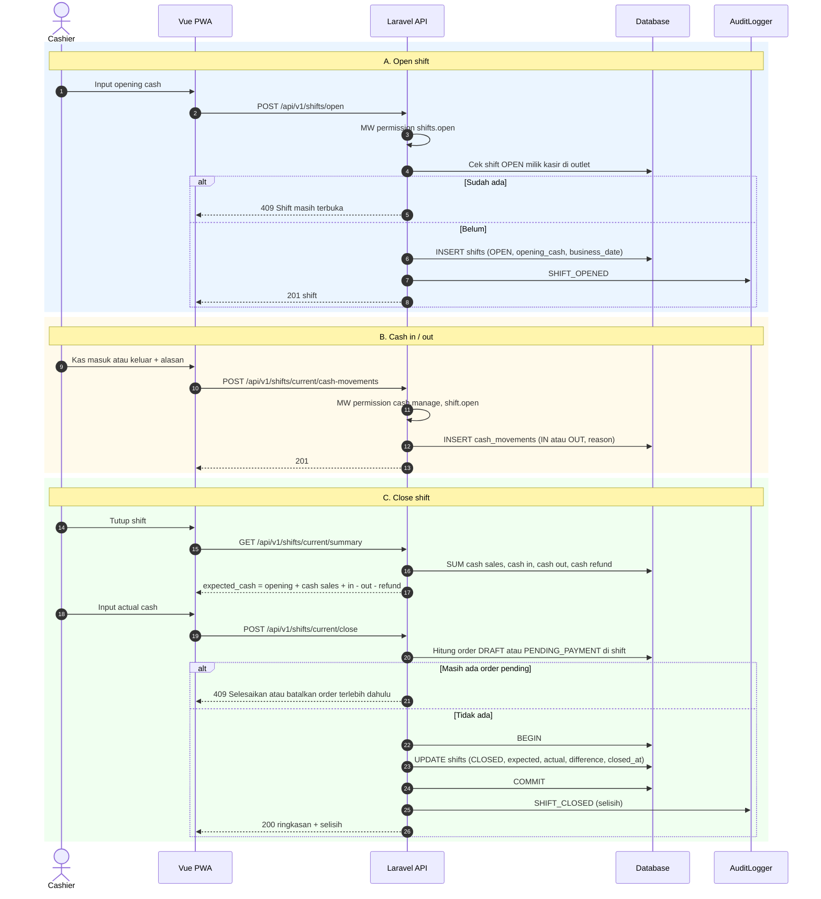
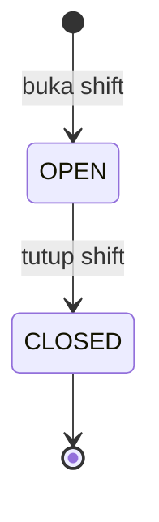

# Modul SHF — Shift & Kas

> Sumber kebenaran tetap `docs/` v3.0; file ini hanya **kumpulan per modul** supaya developer cukup membuka satu folder. Bila ada beda, `docs/` menang.

| | |
|---|---|
| Owner | Naufaldi (10 tiket) |
| Tiket | 10 core (7.50 hari) + 0 rilis 1.1 (0.00 hari) |

## 1. Ringkasan buat developer

Kasir wajib membuka shift sebelum jualan. Sistem menghitung **Expected Cash** supaya uang di laci bisa dicocokkan saat tutup shift.

**Hati-hati**
- Expected = kas awal + penjualan tunai (bersih kembalian) + kas masuk − kas keluar − refund tunai.
- Pembayaran non-tunai tidak masuk Expected Cash tapi tampil di ringkasan.
- Tutup shift ditolak bila ada order DRAFT/PENDING.
- Tabel `cash_movements` append-only (trigger).

**Dianggap selesai kalau:** Open, cash in/out, summary, close bekerja; test TC-SHF hijau termasuk efek refund.

## 2. Kebutuhan Fungsional (dari SRS v3.0)

### Modul SHF — Shift & Kas

#### FR-SHF-001: Open Shift
**Input:** opening cash (bilangan bulat ≥ 0).
**Aturan:** satu kasir hanya boleh satu shift OPEN per outlet (BR-002), dijamin constraint DB. `business_date` = tanggal saat dibuka menurut timezone outlet (BR-027). Beberapa kasir boleh punya shift OPEN paralel di outlet yang sama. Audit `SHIFT_OPENED`.
| Kondisi | Pesan Error |
|---------|-------------|
| Sudah ada shift OPEN | "Anda masih memiliki shift yang terbuka." (`409`) |
| Opening cash negatif | "Kas awal tidak boleh negatif." |

#### FR-SHF-002: Cash In / Cash Out
**Input:** tipe (`IN`/`OUT`), nominal (> 0), alasan (wajib).
**Aturan:** butuh `cash.manage` dan shift OPEN milik user. `cash_movements` append-only. Audit.
| Kondisi | Pesan Error |
|---------|-------------|
| Alasan kosong | "Alasan wajib diisi." |
| Tidak ada shift OPEN | "Buka shift terlebih dahulu." (`409`) |

#### FR-SHF-003: Ringkasan & Close Shift
**Input:** actual cash (≥ 0).
**Aturan:** Expected Cash = opening + cash sales (bersih kembalian) + cash in − cash out − cash refund; selisih = actual − expected (BR-004). Ditolak jika masih ada order DRAFT/PENDING_PAYMENT di shift itu (BR-003). Setelah CLOSED tidak ada transaksi baru ke shift tersebut. Pembayaran gateway (non-tunai) tidak masuk Expected Cash dan ditampilkan di `non_cash` per metode (BR-042). Audit `SHIFT_CLOSED` memuat selisih.
| Kondisi | Pesan Error |
|---------|-------------|
| Ada order DRAFT/PENDING_PAYMENT | "Selesaikan atau batalkan {n} order sebelum menutup shift." (`409`) |
| Shift sudah CLOSED | "Shift sudah ditutup." (`409`) |

#### FR-SHF-004: Shift Saat Ini & Peringatan
`GET /shifts/current` mengembalikan shift OPEN user + `open_hours_exceeded` (true jika terbuka > 24 jam, BR-026). Sistem tidak menutup shift otomatis. Pembuatan order memakai guard `shift.open` (BR-001). Pengguna dengan `shifts.view_all` dapat melihat semua shift outlet.

---

## 3. Aturan Bisnis terkait

| ID | Aturan | Konsekuensi bila dilanggar |
|----|--------|---------------------------|
| BR-001 | Order hanya dibuat jika kasir punya shift OPEN di outlet | `409` |
| BR-002 | Satu kasir maksimal 1 shift OPEN per outlet; outlet boleh punya beberapa shift OPEN paralel | `409`; dijamin partial unique index |
| BR-003 | Close shift ditolak jika masih ada order DRAFT/PENDING_PAYMENT di shift itu | `409` |
| BR-004 | Expected Cash = Opening + Cash Sales (bersih kembalian) + Cash In − Cash Out − Cash Refund | Selisih kas salah |
| BR-026 | Shift terbuka > 24 jam menampilkan peringatan; tidak ditutup otomatis | Shift terlupa |
| BR-027 | Business date = tanggal shift dibuka (timezone outlet); laporan harian memakai business date | Laporan salah hari |
| BR-042 | [P2] Pembayaran gateway non-tunai: tidak masuk Expected Cash; `payments.shift_id` = shift order; masuk laporan payment per provider | Selisih kas salah |

## 4. Use Case

| ID | Nama | Aktor | Prioritas | FR | Proses |
|----|------|-------|-----------|----|--------|
| UC-SHF-01 | Buka Shift | Cashier | Must | FR-SHF-001, 004 | BP-03 |
| UC-SHF-02 | Kas Masuk / Keluar | Cashier | Must | FR-SHF-002 | BP-03 |
| UC-SHF-03 | Tutup Shift | Cashier | Must | FR-SHF-003 | BP-03 |

**Spesifikasi penuh**

##### UC-SHF-03: Tutup Shift
| Elemen | Isi |
|--------|-----|
| Aktor utama | Cashier |
| Tujuan | Menutup shift dan mengetahui selisih kas |
| Prakondisi | Shift OPEN milik aktor |
| Pascakondisi sukses | Shift `CLOSED`; `expected_cash`, `actual_cash`, `difference` tersimpan; audit `SHIFT_CLOSED` |
| Pascakondisi gagal | Shift tetap OPEN |
| FR / BR | FR-SHF-003 / BR-003, BR-004 |

**Alur utama:** (1) Aktor menekan Tutup Shift. (2) Sistem memeriksa tidak ada order DRAFT/PENDING_PAYMENT. (3) Sistem menampilkan Expected Cash. (4) Aktor memasukkan uang fisik. (5) Sistem menghitung selisih dan menutup shift. (6) Ringkasan dapat dicetak.

| Kode | Kondisi | Respon |
|------|---------|--------|
| 2a | Ada order DRAFT/PENDING | `409` "Selesaikan atau batalkan {n} order…" |
| 5a | Shift sudah CLOSED (tab ganda) | `409` |
| 5b | Selisih ≠ 0 | Tetap boleh tutup; selisih dicatat |

**Spesifikasi ringkas**

| ID | Prakondisi | Alur utama | Pascakondisi sukses | Alternatif / gagal | FR / BR |
|----|-----------|------------|---------------------|--------------------|---------|
| UC-SHF-01 | Cashier; tidak ada shift OPEN | Isi kas awal → buka | Shift `OPEN`, `business_date` terisi; audit | Shift sudah OPEN → `409`; kas awal negatif → `422` | FR-SHF-001, 004 / BR-002, 026, 027 |
| UC-SHF-02 | Shift OPEN | Pilih masuk/keluar, nominal, alasan | Tercatat di shift | Alasan kosong → `422`; tanpa shift OPEN → `409` | FR-SHF-002 |

## 5. Tabel Database (ERD v3.0)

**`shifts`**
| Kolom | Tipe | Null | Constraint | Keterangan |
|-------|------|------|-----------|------------|
| outlet_id | BIGINT | NN | FK | |
| cashier_id | BIGINT | NN | FK users | |
| status | V(10) | NN | CHECK `OPEN`,`CLOSED` | |
| business_date | DATE | NN | | Tanggal buka (timezone outlet) |
| opening_cash | BIGINT | NN | CHECK ≥ 0 | |
| expected_cash, actual_cash, difference | BIGINT | N | | Diisi saat close |
| closed_by | BIGINT | N | FK users | |
| opened_at | TIMESTAMP | NN | | |
| closed_at | TIMESTAMP | N | | |
| note | V(255) | N | | |

UNIQUE parsial `(outlet_id, cashier_id) WHERE status = 'OPEN'` (BR-002).

**`cash_movements`** 🔒: `shift_id` FK NN · `type` V(3) NN CHECK `IN`,`OUT` · `amount` BIGINT NN CHECK > 0 · `reason` V(255) NN · `user_id` FK NN · `created_at`.

## 6. Behavior (Sequence / State / Activity)

#### 3.2.10 SEQ-SHF-01: Open Shift, Cash In/Out, Close Shift (UC-SHF-01…03)

**Catatan:** Expected Cash memakai `payments.amount` tunai (sudah termasuk pembulatan, bersih kembalian) ditambah kas masuk, dikurangi kas keluar dan refund tunai (BR-004). `GET /shifts/current` juga mengembalikan `open_hours_exceeded` (BR-026). Pembayaran gateway (non-tunai) tidak masuk Expected Cash dan tampil di `non_cash` per metode (BR-042).

#### STM-SHIFT: Status `shifts.status`

| Dari | Ke | Pemicu | Aktor | Guard / Syarat | Efek Samping |
|------|----|--------|-------|----------------|--------------|
| (awal) | OPEN | `open` | Cashier | Tidak ada shift OPEN milik pelaku di outlet (UNIQUE parsial) | `business_date` terisi |
| OPEN | CLOSED | `close` | Cashier | Tidak ada order DRAFT/PENDING_PAYMENT di shift | `expected_cash`, `actual_cash`, `difference`, audit |

## 7. Endpoint (SDD v3.0 §4)

| ID | Method | Endpoint | Permission | UC | FR | Deskripsi |
|----|--------|----------|-----------|----|----|-----------|
| API-SHF-01 | POST | `/shifts/open` | `shifts.open` | UC-SHF-01 | FR-SHF-001 | Buka shift |
| API-SHF-02 | GET | `/shifts/current` | `shifts.open` | UC-SHF-01 | FR-SHF-004 | Shift OPEN + `open_hours_exceeded` |
| API-SHF-03 | GET | `/shifts/current/summary` | `shifts.close` | UC-SHF-03 | FR-SHF-003 | Ringkasan + Expected Cash |
| API-SHF-04 | POST | `/shifts/current/cash-movements` | `cash.manage` | UC-SHF-02 | FR-SHF-002 | Kas masuk/keluar |
| API-SHF-05 | POST | `/shifts/current/close` | `shifts.close` | UC-SHF-03 | FR-SHF-003 | Tutup shift |
| API-SHF-06 | GET | `/shifts` | `shifts.view_all` | UC-SHF-03 | FR-SHF-004 | Daftar shift outlet |
| API-SHF-07 | GET | `/shifts/{id}` | `shifts.view_all` | UC-SHF-03 | FR-SHF-004 | Detail + ringkasan |

**Contoh request/response**

#### API-SHF-01 · POST /shifts/open
**Request:** `{ "opening_cash": 200000 }`
**Response 201:** `{ "data": { "id": 31, "status": "OPEN", "business_date": "2026-10-12", "opening_cash": 200000, "opened_at": "2026-10-12T01:02:00Z" } }`
**Validasi:** `opening_cash` required, integer, min:0 → "Kas awal tidak boleh negatif."
**Error Codes:** 409 `SHIFT_ALREADY_OPEN` ("Anda masih memiliki shift yang terbuka.") — BR-002.

#### API-SHF-03 · GET /shifts/current/summary · API-SHF-05 · POST /shifts/current/close
**Summary 200:**
```json
{ "data": { "shift_id": 31, "opening_cash": 200000, "cash_sales": 560000, "cash_in": 50000, "cash_out": 20000, "cash_refund": 56100, "expected_cash": 733900,
  "non_cash": { "QRIS": 310000 }, "order_count": 18, "pending_orders": 0 } }
```
**Close request:** `{ "actual_cash": 730000, "note": "Selisih receh" }`
**Close 200:** `{ "data": { "id": 31, "status": "CLOSED", "expected_cash": 733900, "actual_cash": 730000, "difference": -3900, "closed_at": "2026-10-12T10:05:00Z" } }`
**Error Codes:** 409 `SHIFT_HAS_PENDING_ORDERS` ("Selesaikan atau batalkan {n} order sebelum menutup shift."), 409 `INVALID_STATE_TRANSITION` ("Shift sudah ditutup.") — BR-003, BR-004.

## 8. Tiket

Detail AC lengkap ada di `tickets/tickets.md` (ID sama).

| ID | Task | Est | Owner | Sprint | Depends on | Test |
|----|------|-----|-------|--------|-----------|------|
| BE-SHF-001 | Open shift (opening cash, business_date menurut timezone outlet) | M | Naufaldi | S2 | DB-SHF-001, BE-RBAC-001 | TC-SHF-001 |
| BE-SHF-002 | Cash in / cash out (alasan wajib, cash.manage) | S | Naufaldi | S4 | BE-SHF-001 | TC-SHF-002 |
| BE-SHF-003 | ShiftSummaryService: Expected Cash + non_cash per metode | M | Naufaldi | S3 | BE-SHF-001, DB-PAY-001 | TC-SHF-003, TC-SHF-007 |
| BE-SHF-004 | Close shift: tolak bila ada order DRAFT/PENDING, hitung selisih, audit | M | Naufaldi | S3 | BE-SHF-003, BE-ORD-005 | TC-SHF-004, TC-SHF-005 |
| BE-SHF-005 | GET /shifts/current + open_hours_exceeded + middleware shift.open | S | Naufaldi | S2 | BE-SHF-001 | TC-SHF-006 |
| DB-SHF-001 | Migrasi shifts, cash_movements (+ UNIQUE parsial 1 OPEN per kasir per outlet) | S | Naufaldi | S1 | DB-TEN-002 | TC-SHF-001 |
| FE-SHF-001 | Dialog open shift (+ banner > 24 jam) | S | Naufaldi | S3 | BE-SHF-005, FE-AUTH-003 | TC-SHF-006 |
| FE-SHF-002 | Dialog cash in / cash out | S | Naufaldi | S5 | BE-SHF-002 | TC-SHF-002 |
| FE-SHF-003 | Wizard close shift + ringkasan (cetak) | M | Naufaldi | S4 | BE-SHF-004 | TC-SHF-004, TC-SHF-005 |
| TEST-SHF-001 | Test shift: open ganda, selisih kas, close dengan order pending, efek refund | M | Naufaldi | S4 | BE-SHF-004, BE-PAY-005 | TC-SHF-001…007 |

**Acceptance Criteria ringkas**

- **BE-SHF-001** 
  - [ ] Sudah ada shift OPEN 409 SHIFT_ALREADY_OPEN
  - [ ] Opening cash negatif 422; audit SHIFT_OPENED
- **BE-SHF-002** 
  - [ ] Alasan kosong 422; tanpa shift OPEN 409
  - [ ] Tercatat append-only dan masuk audit
- **BE-SHF-003** 
  - [ ] Expected = opening + cash sales (bersih kembalian) + in − out − cash refund
  - [ ] Pembayaran non-tunai tampil di non_cash dan tidak masuk Expected Cash
- **BE-SHF-004** 
  - [ ] Ada order pending 409 SHIFT_HAS_PENDING_ORDERS dengan jumlah order
  - [ ] Sukses menyimpan expected, actual, difference; shift CLOSED tidak menerima transaksi
- **BE-SHF-005** 
  - [ ] open_hours_exceeded true bila terbuka > 24 jam
  - [ ] Order tanpa shift OPEN ditolak 409 NO_OPEN_SHIFT
- **DB-SHF-001** 
  - [ ] Shift OPEN kedua milik kasir yang sama di outlet sama ditolak DB
  - [ ] cash_movements append-only (trigger)
- **FE-SHF-001** 
  - [ ] Banner peringatan tampil saat open_hours_exceeded
  - [ ] Tidak bisa masuk layar POS tanpa shift OPEN
- **FE-SHF-002** 
  - [ ] Alasan wajib divalidasi
  - [ ] Saldo ringkasan ter-refresh setelah simpan
- **FE-SHF-003** 
  - [ ] Expected Cash tampil sebelum input uang fisik
  - [ ] Pesan error order pending menampilkan jumlah
- **TEST-SHF-001** 
  - [ ] Formula Expected Cash diuji dengan data campuran (cash, QRIS, refund)
  - [ ] Konkurensi open shift ganda lulus

## 9. Test Case (Test Plan v3.0)

| ID | Skenario | FR / BR | Level | Rilis |
|----|----------|---------|-------|-------|
| TC-SHF-001 | Open shift ganda 409 SHIFT_ALREADY_OPEN; kas awal negatif 422 | FR-SHF-001; BR-002 | Feature | Core |
| TC-SHF-002 | Cash in/out: alasan wajib; tanpa shift OPEN 409 | FR-SHF-002 | Feature | Core |
| TC-SHF-003 | Expected Cash = opening + cash sales − kembalian + in − out − cash refund | FR-SHF-003; BR-004 | Unit | Core |
| TC-SHF-004 | Close shift ditolak bila ada order DRAFT/PENDING (409 + jumlah) | FR-SHF-003; BR-003 | Feature | Core |
| TC-SHF-005 | Close sukses: expected, actual, difference tersimpan; shift CLOSED tak menerima transaksi | FR-SHF-003 | Feature | Core |
| TC-SHF-006 | open_hours_exceeded > 24 jam; order tanpa shift OPEN 409 NO_OPEN_SHIFT | FR-SHF-004; BR-026 | Feature | Core |
| TC-SHF-007 | Pembayaran non-tunai tidak masuk Expected Cash; tampil di non_cash | BR-042 | Feature | Core |
